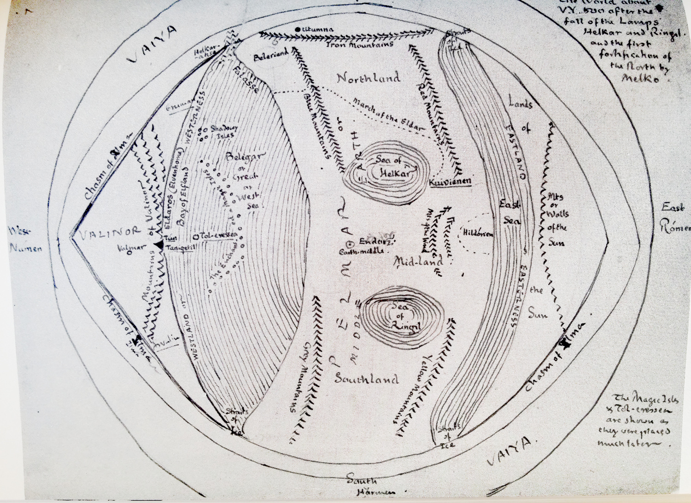
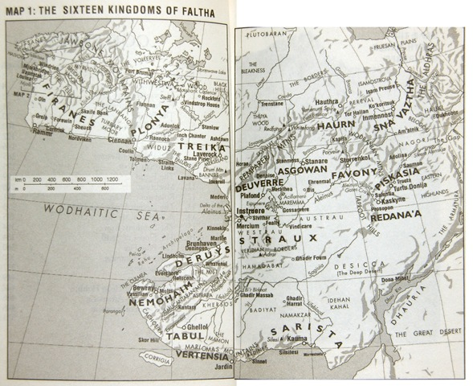

At one time, maps were considered a standard part of the furniture in an epic fantasy novel. The absence of a map was very much the exception rather than the rule, and could result in readers writing to the author to grumble. In fact, when presenting a book with invented lands, it has been standard to include a map of them for a very, very long time. Jonathan Swift’s _Gulliver’s Travels_ (1726) features maps of Lilliput, Brobdingnag, Laputa and the other fictional islands discovered by Gulliver. Likewise, Frank L. Baum included maps of Oz with _The Wonderful Wizard of Oz_ (1900) and Robert E. Howard created a map of the Hyborian Age for his **Conan the Barbarian** series of short stories in _Weird Tales_ magazine (1932-36). But the populariser of the map in epic fantasy was of course J.R.R. Tolkien. He included a map of Wilderland in _The Hobbit_ (1937) and a much larger map of north-western Middle-earth in _The Lord of the Rings_ (1954-55), accompanied by more detailed maps of the Shire and Gondor.

One of the earliest maps of J.R.R. Tolkien’s world of Arda. The central continent is Middle-earth, with Beleriand (the setting for _The Silmarillion_) in its top-left corner.

In [a 1964 interview with the BBC](http://tolkiengateway.net/wiki/1964_BBC_Interview), Tolkien made clear his reasons for including a map:

> I had maps of course. If you’re going to have a complicated story you must work to a map, otherwise you can never make a map of it afterwards.

As _The Shaping of Middle-earth_ (the fourth volume of Christopher Tolkien’s non-fiction **History of Middle-earth** series) made clear, Tolkien had in fact been drawing huge, elaborate maps of Middle-earth since the early 1920s and making the geography work had been a preoccupation of his for some time.

Some authors have decried maps as being a bit geeky or nerdy, or unnecessary as the author should be able to explain geography and locations in the text itself. However, literary authors such as Ursula K. Le Guin (in her 1968 novel, _A Wizard of Earthsea_), Michael Moorcock (in his **Elric** novels and short stories starting in 1961) and China Mieville (in _Perdido Street Station_, 2000) seem to have had no problems including maps in their novels and it’s hard to argue with the very simple fact that having a map saves potentially pages and pages of detailed geographic description that could instead be spent on the story and characters.

Other fantasy authors have taken a slightly odd approach to mapping. Steven Erikson and Ian Esslemont had together created a fantasy world starting in 1981, initially for roleplaying but later as the setting for novels. The world of the **Malazan Book of the Fallen** first saw print in _Gardens of the Moon_ (1999) and Erikson included a map of the continent of Genabackis and the city of Darujhistan, where the bulk of the action takes place. However, he doesn’t include a map of Quon Tali, the imperial homeland, where a lot of the opening chapters take place. This doesn’t appear until _House of Chains_ (2002), the fourth volume in the series, but this novel features no action taking place on Quon Tali at all. It also doesn’t feature a map of Seven Cities, the continent where most of the novel takes place. Later books in the series are set off the edge of any map featured in the series. It’s all a bit odd, but we will look at the maps of the **Malazan** series in a future, separate entry.

On a different note, Joe Abercrombie did not include maps in his **First Law Trilogy** (2006-08) (and explained why [here](http://www.joeabercrombie.com/2007/10/02/maps-craps-2/)) but did include them in his subsequent books. His upcoming _Sharp Ends_ short story collection – published ten years almost to the month after _The Blade Itself_ – in fact features the first canonical maps of the territory covered in the original trilogy, so better late than never.

When the fantasy map has longitude and latitude lines as well as a scale in miles _and_ kilometers, you know the author means business.

The quality of maps in fantasy have also enormously varied. Some maps are quick, rough and probably not to scale. Other series, such as Russell Kirkpatrick’s **Fire of Heaven** trilogy, are written by professional cartographers and the maps are of jaw-dropping quality (to the point where you begin to wonder if the maps had more time spent on them than the prose).

So maps are considered pretty standard for a fantasy novel and for George R.R. Martin, a traditional fantasy fan if there ever was one, this meant he was going to have to have maps in his fantasy series.
