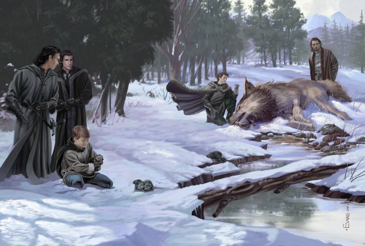
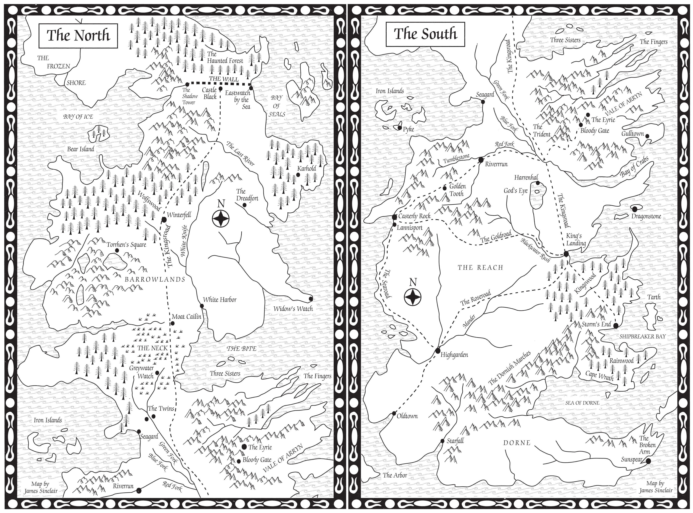

George R.R. Martin began writing fiction in the late 1960s and published his first short story in 1971. He released his first novel, _Dying of the Light_, in 1977. A string of novels, short stories and awards later, he started working in Hollywood. At the invitation of Harlan Ellison he became a writer on **The Twilight Zone** in 1985 and then, when that show’s future appeared in doubt, he accepted an invitation to work on Ron Koslow’s new urban fantasy TV series, **Beauty and the Beast**, which ran from 1987 to 1990. After that show’s cancellation (after the brutal and highly unpopular killing off of the lead character), Martin lingered in LA working on some other projects but by the summer of 1991 he was back home in Santa Fe, New Mexico, working on a science fiction novel called _Avalon_. It was part of his long-gestating **Thousand Worlds** universe and the writing was going pretty well.

The Starks find the direwolf pups at the start of _A Game of Thrones_ – Art by Mark Evans for Fantasy Flight Games.

Suddenly, as has been oft-reported, Martin was struck by the image of a young boy watching a deserter being beheaded. He didn’t know if this was a short story, a novel or a book series, but he felt inspired and kept writing. By the end of the summer, when he returned to Hollywood to work on a TV pilot for ABC, he had written 100 manuscript pages…and drawn a map. When he resumed working on the novel in 1993, he had decided that this new story was going to be a full-on epic fantasy trilogy called **A Song of Ice and Fire**, consisting of the novels _A Game of Thrones_, _A Dance with Dragons_ and _The Winds of Winter_. In the event, this plan did not long survive contact with the enemy and the series expanded to a (currently) planned seven volumes. With the publication of each volume, the existing maps were updated and new maps were added.

[Martin’s argument](https://youtu.be/Vcy-EhkHXnE?t=1h12m9s) for including a map in the story was pretty straightforward.

> Maps are necessary for fantasy, I think. I know that some critics have occasionally mocked them, but if you’re creating a secondary world you really need them…If I’m writing straight historical fiction and my character in Ireland says, “I must go to France,” you don’t need a map. We kind of know where France is. But in my world if a character from Winterfell says “I must go to Dorne,” you don’t know if Dorne is the next village or halfway around the world. So you’d better have a map so these things that the characters are saying make some sense. So I created a map and it was basically pretty simple but as the story continued I started adding more and more places to it and it’s ongoing.

The original maps for _A Game of Thrones_ were drawn by Martin, as we know now starting in 1991, and were given to Bantam Books to have professionally drawn up. They contracted an artist named James Sinclair, who created some fairly primitive but effective maps apparently using CAD.

The original maps for _A Game of Thrones_, created by James Sinclair based on George R.R. Martin’s original, hand-drawn map.

These maps appeared in both the UK and US editions of _A Game of Thrones_, and really were that sparse on detail. This is the famous map that made me think the seat of House Tully was actually spelled “Riverrrun” for quite some time.

These were also the _only_ maps in the book. So when Daenerys Targaryen’s first chapter cropped up and told us she was somewhere called Pentos, this created immediate confusion for the reader left trying to find the city on the maps before realising it wasn’t on there, and the Narrow Sea was the body of water to the east of Westeros. There was also the lack of a scale bar which left many readers confused as to the size of Westeros. Given the inspiration from the Wars of the Roses, more than one reader was left thinking that Westeros was a landmass not much bigger than Great Britain. Only those paying attention when the length of the Wall (300 miles, or 100 leagues) was mentioned realised that Westeros was fairly massive, a substantial continent in its own right.

Later paperback editions of the novel added some of the maps from later volumes, updated the map of Westeros (and sadly removing “Riverrrun” in favour of the correct spelling) and generally started looking more like the maps we are familiar with now. But back in 1996 when the novel was published, this was what people had to go with. And, astonishingly, it would be _fifteen years_ before Pentos finally appeared on a map.
