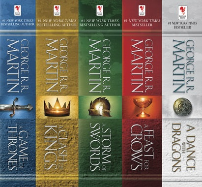

Welcome to the Atlas of Ice and Fire, a blog that will look at the geography and cartography of George R.R. Martin’s novel series **A Song of Ice and Fire** and its TV adaptation, **Game of Thrones**. In this blog I’ll also be mainly investigating issues of maps and geography but I’ll also discuss other issues related to the books and TV show where necessary, and maybe venture into discussions of maps and geography for other fantasy series.

Who am I? My name is Adam Whitehead and I have run the successful general science fiction and fantasy review blog [**The Wertzone**](http://thewertzone.blogspot.co.uk/) for the past decade. I have also been a moderator on the popular **ASoIaF** forum [westeros.org](http://asoiaf.westeros.org/) since 2005. I have met and interviewed George R.R. Martin on several occasions, and George has been kind enough to mention and recommend my blog from time to time. The upcoming novel _The Winds of Winter_ also contains a blink-and-you’ll-miss-it reference to House Whitehead of the Stormlands. In addition to my **ASoIaF**\-related activities I am also currently writing _A History of Epic Fantasy_, a look at the development and history of the fantasy genre (particularly epic fantasy, the genre to which **A Song of Ice and Fire** belongs).

I am not a cartographer or artist myself, so the quality of the maps we feature on the blogs is going to be variable 🙂 I hope to bring on board some other, more talented **ASoIaF**\-related artist and cartographers to discuss topics and bring better-quality images to the blog.

In terms of useful resources, I recommend _The Lands of Ice and Fire_ by Jonathan Roberts, the best (so far) collection of canonical maps based on the books; _The World of Ice and Fire_, by George R.R. Martin, Elio Garcia, Jr. and Linda Antonsson, which has plenty of background material on the wider world and some new maps; and of course the novels themselves and their accompanying maps. There are also many, many fine fan maps out there created over a very long period of time which are of value, although their reliability may vary depending on when they were created.

Without further delay, we’ll start with a look at the history of mapping the lands of Westeros and Essos, going back to when George R.R. Martin started writing the series back in 1991.
