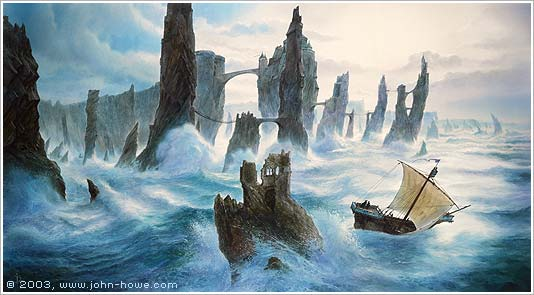
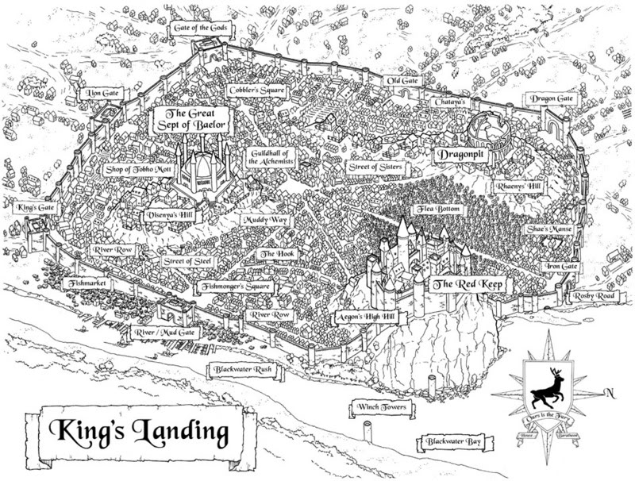
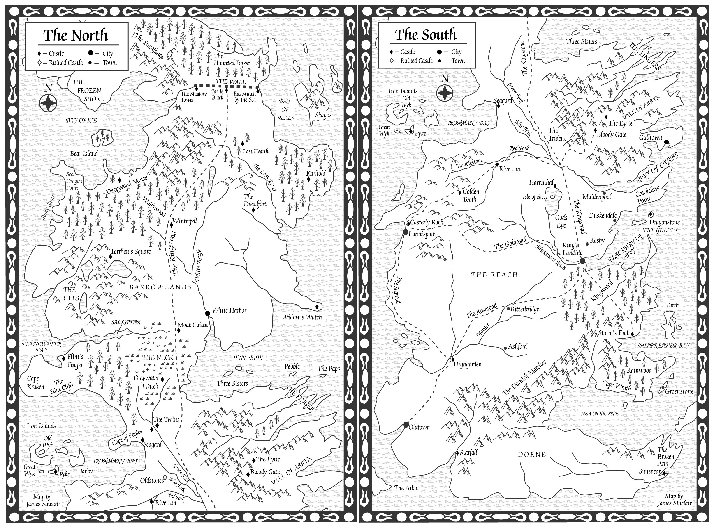
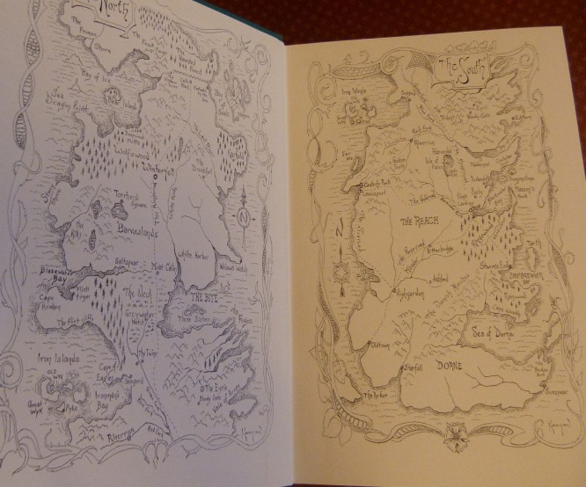
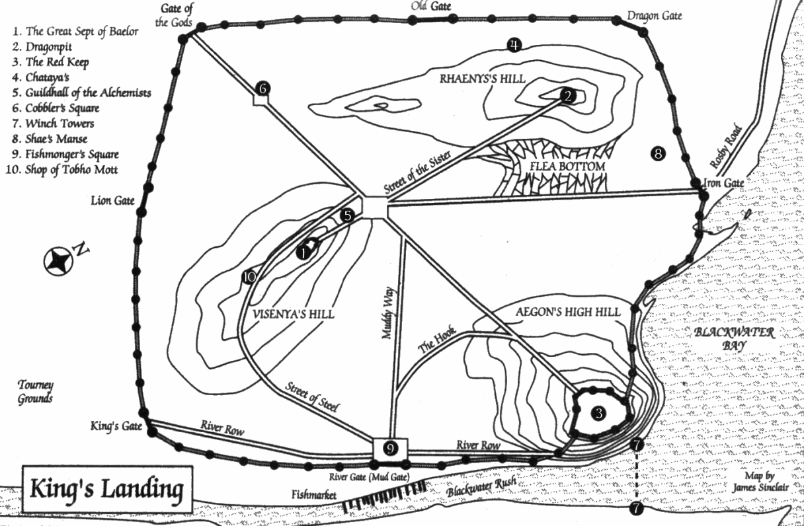
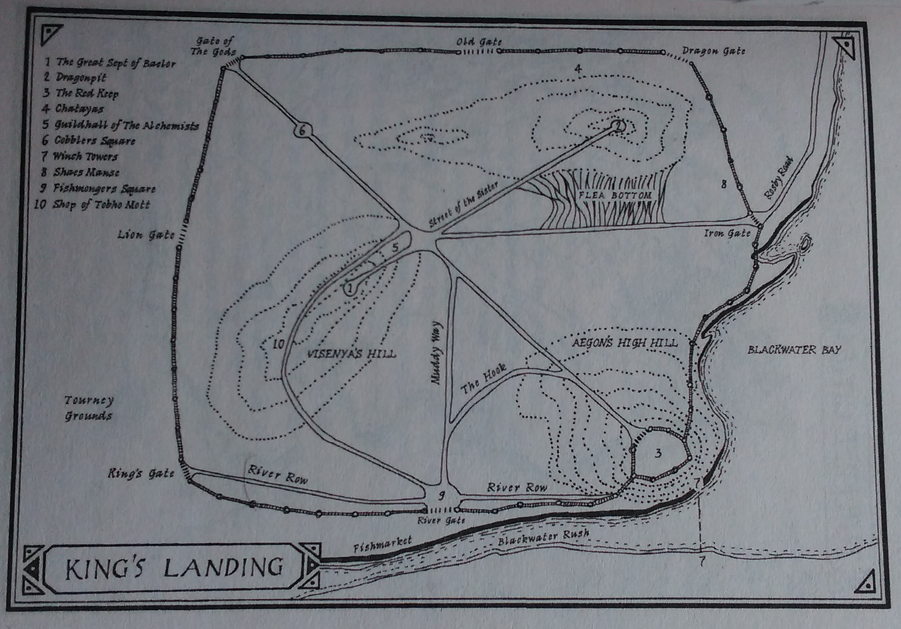

Originally, **A Song of Ice and Fire** was supposed to be a trilogy consisting of three novels: _A Game of Thrones_ (focusing on Eddard Stark and the War of the Five Kings), _A Dance with Dragons_ (focusing on Daenerys Targaryen and her invasion of Westeros) and _The Winds of Winter_ (focusing on the Others and events at the Wall), each novel consisting of about 700 manuscript pages.

John Howe’s cover art for the Meisha Merlin limited edition of _A Clash of Kings_, depicting Pyke and the Iron Islands.

Martin was forced to revise this plan when he found himself north of 1,400 manuscript pages and still less than halfway through his planned first volume. He broke off 1,088 manuscript pages which became _A Game of Thrones_, and moved the rest back into a new second volume, _A Clash of Kings_. By mid-1998 this novel had also become far too large to publish in one volume, so again he broke off the narrative at a suitable concluding part and pushed the rest of the material he’d written back into a new third volume, _A Storm of Swords_. He also revamped his original plans for the series and acknowledged now that it would be six volumes in length.

Graig Kreindler’s spectacular map of King’s Landing from the Meisha Merlin limited edition of _A Clash of Kings_. Despite many additional, handsome maps of the city, this version may remain definitive.

_A Clash of Kings_ was published in the UK by HarperCollins in October 1998, although, due to the vagaries of international publishing, Bantam Spectra did not bring out the American edition until February 1999. After lukewarm early sales for _A Game of Thrones_ (fortunately it had a long tail and sold excellently in paperback), _Kings_ was the first novel in the series to hit the bestseller lists, albeit the lower reaches. It also expanded the scale and scope of the story of **A Song of Ice and Fire**. New viewpoint characters were added, such as Theon Greyjoy and Davos Seaworth, and it also featured new maps.

James Sinclair’s original maps of Westeros in _A Clash of Kings_. This is the same map as in _A Game of Thrones_ modified with additional names, such as Duskendale and Rosby.

Mapmaking duties once again fell to James Sinclair and his trusty CAD programme. The existing map of Westeros had new locations added to it and a whole new map was added of the city of King’s Landing, capital of the Seven Kingdoms. These new maps were subsequently put in paperback reprints of _A Game of Thrones_, replacing the original, sparser maps (and sadly eliminating the infamous “Riverrrun” spelling error). Still no map of the east, with fans having to guesstimate where the heck the Red Waste and Qarth were.

Charles Keegan’s rarely-seen hand-drawn map of Westeros, as it appeared in the Meisha Merlin limited editions of _A Game of Thrones_ and _A Clash of Kings_.

The map of King’s Landing proved useful (although it’d have been also useful in _A Game of Thrones_, retroactively) for readers interested in the make-up of the city, and was especially useful to track the epic Battle of the Blackwater that marked the novel’s climax. we’ll look more at maps of King’s Landing in a separate entry, as there’s been quite a few over the years of varying degrees of quality.

James Sinclair’s map of King’s Landing in _A Clash of Kings_, the first of many, many maps depicting the city.

The Sinclair maps appeared in both the UK and US editions of _A Clash of Kings_. However, later editions did change things up somewhat. The Meisha Merlin limited edition of _A Clash of Kings_ (with splendid artwork from Tolkien artist John Howe) provided a highly impressive new map of King’s Landing by Graig Kreindler whilst Charles Keegan provided an excellent new map of Westeros as a whole.

Richard Geiger’s map of King’s Landing, which appears in the current UK paperback editions of the novels.

The most recent UK paperback editions have also seen the Sinclair maps swapped out for ones by Richard Geiger, who has provided the maps for the UK books since _A Storm of Swords_. This is a pretty simple and undetailed reprint of the Sinclair map, and feels a bit of a missed opportunity given the quality of some of the other maps out there.

_A Clash of Kings_ established the precedent of adding new maps to each volume in the series, something each volume (so far) would continue to do.
