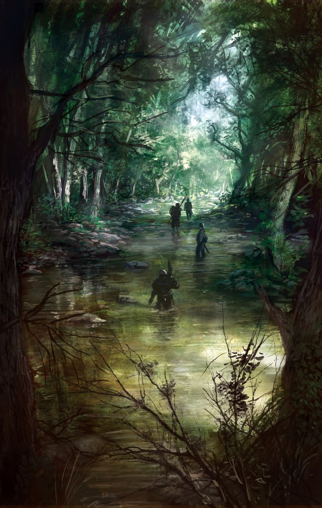
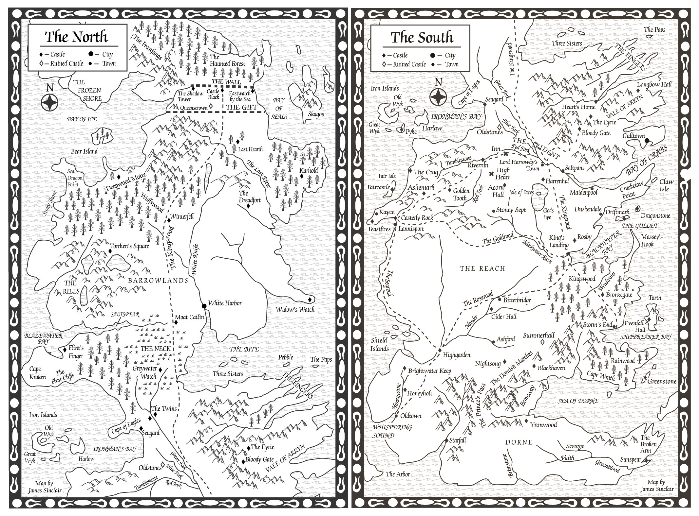
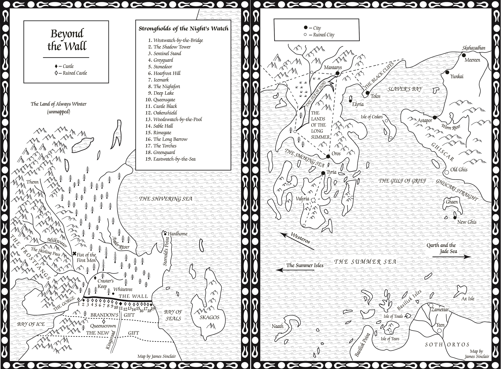
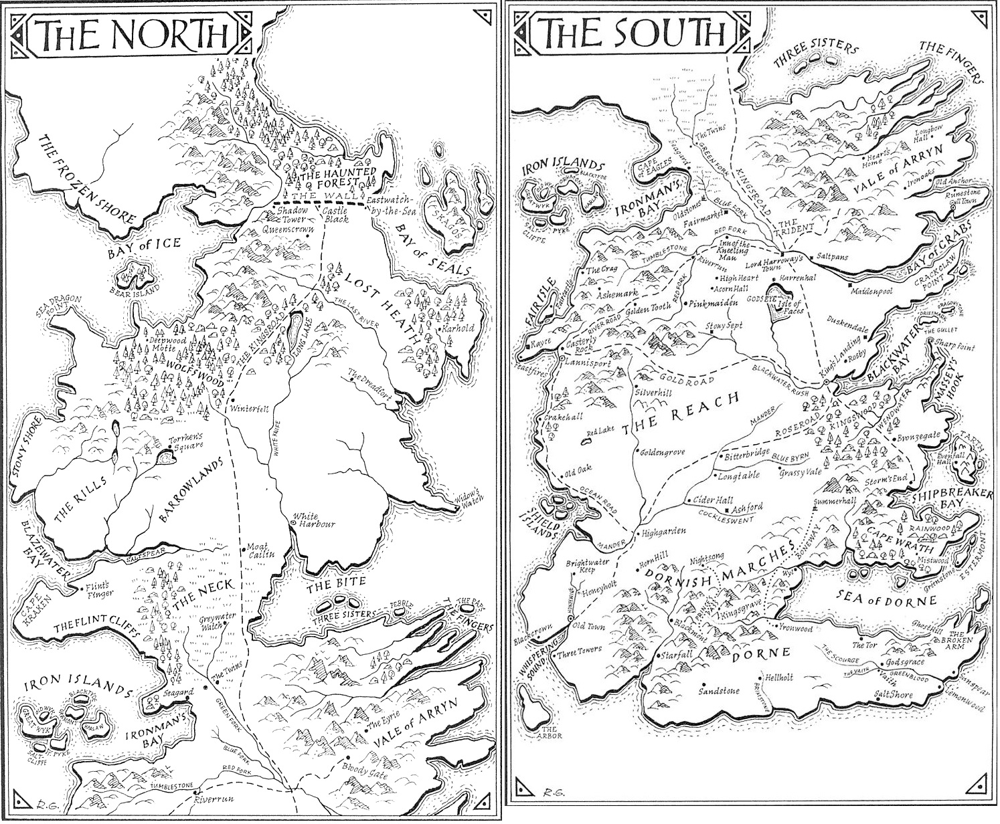
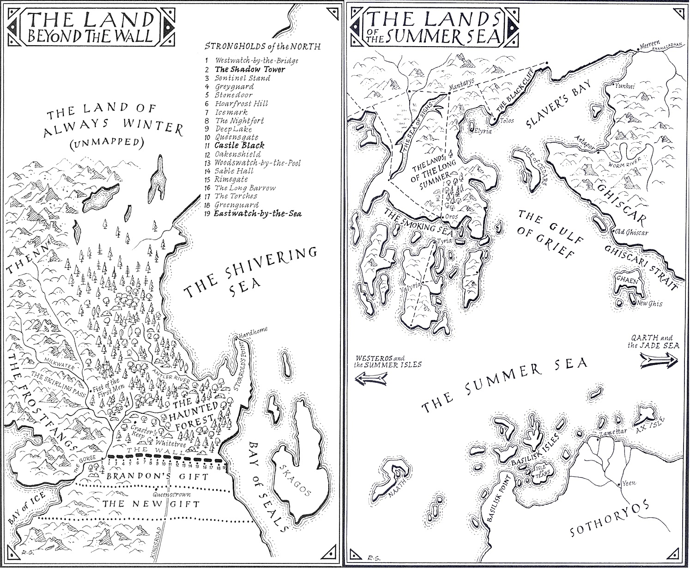

As related previously, by the time _A Clash of Kings_ was published in 1998, George R.R. Martin had firmly abandoned his plan to have **A Song of Ice and Fire** last for three volumes. He now postulated six in total: _A Game of Thrones_, _A Clash of Kings_, _A Storm of Swords_, _A Dance with Dragons_, _The Winds of Winter_ and _A Time for Wolves_ (although he admitted hating this title, and later changed it to _A Dream of Spring_). In 1998 he also published _The Hedge Knight_, the first in a series of prequel novellas to the series about Ser Duncan the Tall and his unusual squire, Egg.

The cover of the French edition of _A Storm of Swords_, art by the mighty [Marc Simonetti](http://marcsimonetti.artworkfolio.com/).

As he began work on the third volume, Martin was suddenly struck by an idea. When he started writing the series he had a large number of very young characters, ranging from 3-year-old Rickon Stark to 14-year-old Jon Snow. Subsequently he realised that he’d made these characters too young. His original plan had been for years to pass in each volume so the characters would grow up, but by the end of _A Storm of Swords_ only around 18-24 months had passed since the start of the series. More drastic action was required. Martin realised that it should be possible to “plateau” the story at the end of the third book and then pick up the action five years later. Everyone would be older and some lengthy “training montages” for characters like Bran, Jon, Daenerys and Arya could be elegantly sidestepped. However, this would require every storyline put in motion at the start of _A Game of Thrones_ to either climax, end or reach a natural end point before the end of the third volume.

James Sinclair’s maps of Westeros from the American edition of _A Storm of Swords_. Again, the base map is the same as the original _A Game of Thrones_ map, but yet more places have been added (including the Gift, Yronwood and Summerhall). Note that Last Hearth is correctly placed and spelt on this map.

The result was that Martin couldn’t simply break off the novel when it got too long. Instead he had to keep writing until he had achieved all those objectives, no matter the length. This resulted in a book over 1,500 manuscript pages and 420,000 words in length, half again the length of _A Game of Thrones_ (and only just a bit shorter than _The Lord of the Rings_ in its entirety). In total, this translated into about 950 pages in hardcover and 1,200 pages in paperback. _A Storm of Swords_, first published in July 2000 in the UK (less than two months after being submitted) and in October that year in the USA, was thus a massive, brick-thick monster of a novel. Fortunately it was also the most successful on release so far, hitting #11 on _The New York Times_ bestseller list and gaining massive critical acclaim.

The maps of Beyond the Wall and the Lands of the Summer Sea from the American edition of _A Storm of Swords_.

As well as its length, the book was notable for its maps. Martin had drawn two new maps for the book, one of the lands Beyond the Wall and one of the lands around Slaver’s Bay, giving us our first look at the eastern continent (still unnamed at this stage) and even the hitherto unknown southern continent of Sothoryos. As usual, James Sinclair pulled map duty in the United States by contributing new, CAD-driven maps. However, the UK publishers decided they wanted to go in a more artistic, hand-drawn direction and called on artist Richard Geiger to provide new, more organic-looking maps. These were immediately very popular and became the go-to maps for many fans, even those reading in the United States. Part of the reason for this was that the UK map was more detailed, adding many more castles in places like Dorne that did not appear in the American version.

Richard Geiger’s iconic maps from the UK edition of _A Storm of Swords_, featuring significantly more place names than the American renditions of Westeros to this time. Note the “Lost Heath” mis-labelling.

Unfortunately some things got lost in translation. For example, Geiger’s maps placed Meereen on the north bank of the Skahazadhan River whilst it’s a fairly important plot point that the city is on the south bank. Geiger also misread “Last Hearth”, the castle of House Umber located north of the Last River, as “Lost Heath” and assumed it referred to an area of wilderness. The latter mistake was corrected in later editions but the former remains on the maps in the current UK paperbacks.

Richard Geiger’s maps for Beyond the Wall and the Lands of the Summer Sea from the UK edition of _A Storm of Swords_. Note the incorrect placement of Meereen. However, Geiger did also make an attempt to reconcile the mismatch (from Martin’s own maps) in the coast west of Storrold’s Point from the Beyond the Wall and North maps.

_A Storm of Swords_ was so large that it was published in two paperback editions in the UK: _Steel and Snow_ (Part 1) and _Blood and Gold_ (Part 2). Some overseas editions were even split in more volumes due to the sheer size of the book.

With _A Storm of Swords_ completed and published, winning plaudits and awards (although, alas, not the 2001 Hugo which instead went to _Harry Potter and the Goblet of Fire_), Martin could now start work on _A Dance with Dragons_, the fourth volume of **A Song of Ice and Fire** which would pick up five years after the events of _A Storm of Swords_. This did not entirely go to plan.
