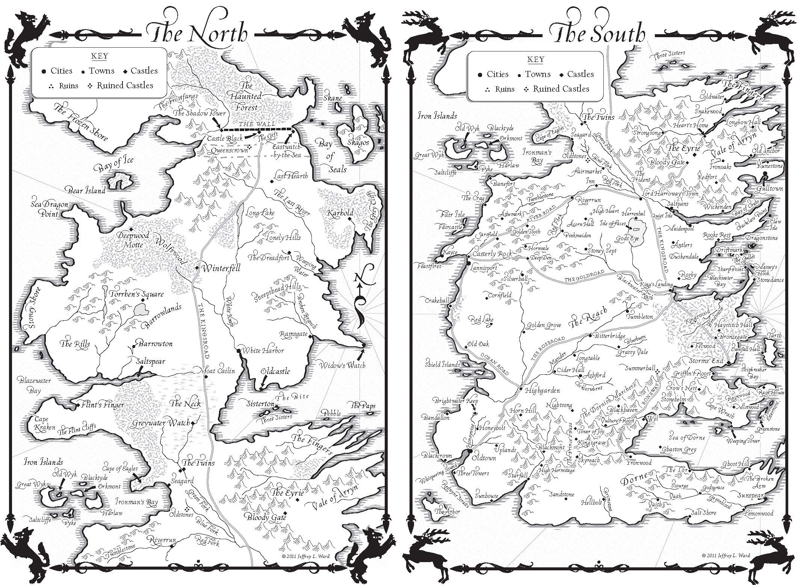
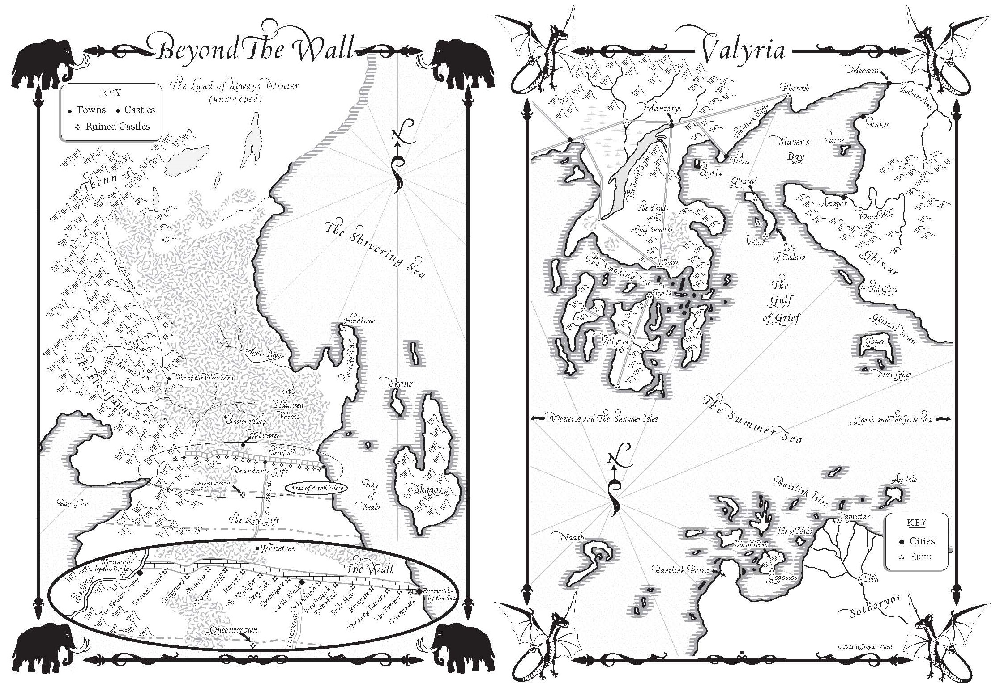
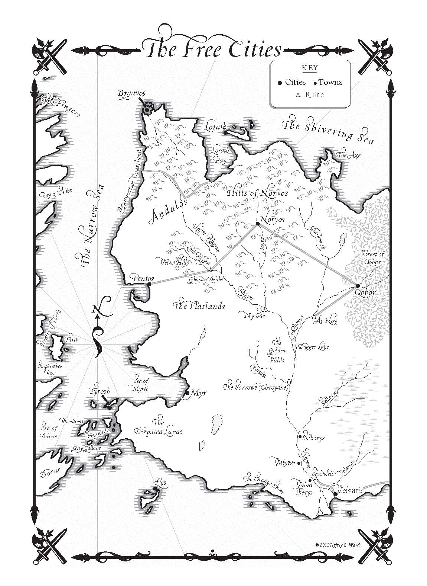

In 2005 George R.R. Martin completed work on _A Feast for Crows_. The book had grown too large to fit into one volume, so he split the narrative by character location. Those in the south of Westeros, as well as in the Free City of Braavos, Dorne and the Iron Islands, were put in _Crows_. The remaining characters, mostly in the North, Slaver’s Bay and the Free City of Volantis, were pushed into _A Dance with Dragons_. With 500 manuscript pages already completed, Martin anticipated it would be possible to complete the novel within about a year.

Daenerys and Drogon in Daznak’s Pit, by [Marc Simonetti](http://marcsimonetti.artworkfolio.com/).

This proved unduly optimistic. Repeated narrative dead ends, a tricky timeline issue known as the “Meereenese Knot” and complications caused by _Dragons_ being longer and covering more time than _Crows_, necessitating the re-addition of _Crows_ characters in the latter part of the novel, all proved problematic. In the event the novel was not published until July 2011, five years and nine months after the previous book.

Jeffrey L. Ward’s maps of Westeros from _A Dance with Dragons_.

The novel again hit the #1 spot on the _New York Times_ bestseller list, helped by the then-recent launch of the HBO TV series **Game of Thrones**, based on the books. The novel was again gigantic, coming in only marginally shorter than _A Storm of Swords_. Again, the book was so large that for the UK paperback edition it was released in two volumes: _Dreams and Dust_ (Part 1) and _After the Feast_ (Part 2).

Jeffrey L. Ward’s maps of Beyond the Wall and Slaver’s Bay from _A Dance with Dragons_.

The book again came with new maps. Bantam Spectra had decided to part ways with James Sinclair and instead arranged for new maps from Jeffrey L. Ward. These included new maps of the North and South, Slaver’s Bay and Beyond the Wall. However, the real treat for long-term fans was a map of the Free Cities. HBO had released an earlier version of this map on their website a couple of months earlier, but this was the first canonical map of the region to appear. Mentioned and appearing in the text since _A Game of Thrones_, the area had been the subject of much speculation and fan-made maps of varying degrees of accuracy.

Jeffrey L. Ward’s map of the Free Cities from _A Dance with Dragons_.

For the UK hardcover edition, HarperCollins Voyager made a mistake with the printing. In the American edition, the maps of Westeros formed the inside covers. For the UK edition Voyager covered these up, but forgot to move them into the book itself. So the UK edition of the novel didn’t actually feature maps of the North or South of Westeros, just Slaver’s Bay, Beyond the Wall and the Free Cities. The initial UK hardcover also used the Ward maps but the later paperback editions reverted to using Richard Geiger, who was drafted in to provide a new map of the Free Cities almost identical to Ward’s. Although the Geiger maps had been definitive for the preceding decade, Ward’s are clearer and more up-to-date so it is unclear why Voyager chose to continue with the older style.

With _A Dance with Dragons_ published, Martin was able to start work on _The Winds of Winter_. What new maps, if any, will accompany the book is unknown but Martin has indicated that the book will take us further north than ever before and we may see locations such as Highgarden and Casterly Rock for the first time, so there is plenty of scope for new locations to be mapped.
