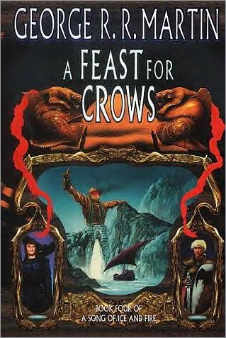
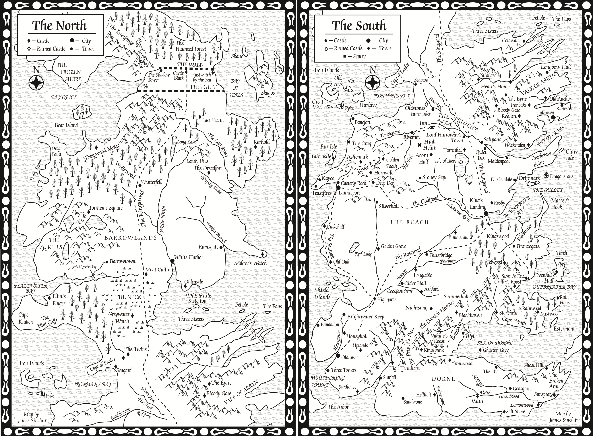
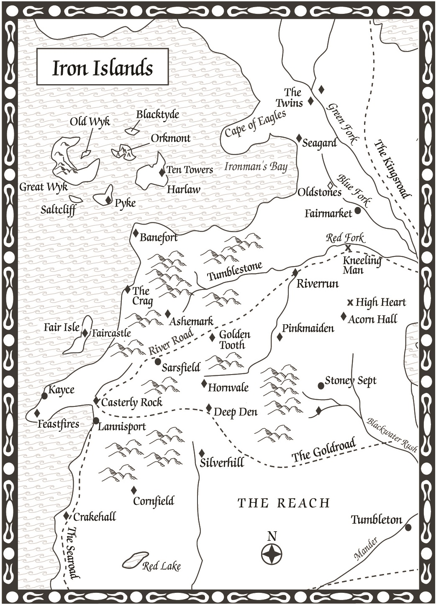

In late 2000 George R.R. Martin started work on _A Dance with Dragons_, then intended to be the fourth volume in **A Song of Ice and Fire**. His plan was to pick up five years after the events of the previous three books in the series with the younger characters all grown up and ready to confront the challenges waiting for them as the saga climaxed. As it turned out, this did not proceed well. For some characters, such as Bran (in training with the Three-Eyed Crow beyond the Wall) or Arya (in training with the Faceless Men of Braavos) the gap worked really well. For other characters, it was problematic. Martin had spent three books setting up the threat of the Others and suddenly they were on vacation for half a decade. He also found it hard to credit that Cersei ruling King’s Landing would go well for five years, or that Brienne of Tarth would spend five years searching for Arya and Sansa without either finding them or giving up.

The original and unused UK cover art by Jim Burns for _A Feast for Crows_ before it was split (hence Jon Snow’s appearance).

With the book being filled up by lengthy flashbacks, Martin finally gave up on the plan. In September 2001 he announced that he had scrapped several hundred manuscript pages and begun again from scratch with a new book picking up immediately after the end of _Swords_. This new book was called _A Feast for Crows_. Three and a half years later, in May 2005, the book hit another problem. Martin had produced over 1,600 manuscript pages but there were quite a few characters and storylines that he’d barely started. His friend and fellow fantasy writer Daniel Abraham (author of the excellent **Long Price Quartet** and **Dagger and the Coin** series, as well as half of the writing team behind **The Expanse** SF series) suggested splitting the book by geographical location. With most of the characters in King’s Landing, Braavos, Oldtown, Dorne and the Riverlands already having completed story arcs this made sense and allowed Martin to get the novel on the shelves in October of that year.

James Sinclair’s map of Westeros for _A Feast for Crows_, with a huge number of new place names and locations.

As usual, _A Feast for Crows_ featured new maps. Once again James Sinclair produced updated maps of Westeros with lots of new locations, as well as providing a new map of the Iron Islands (although it took in a lot of the Westerlands and Riverlands as well). For the UK hardcover edition HarperCollins Voyager decided to switch back to the Sinclair maps, but through an administrative error the original maps from _A Game of Thrones_ were used, lacking any of the later locations (and, confusingly, very few of the locations from _A Feast for Crows_). This was corrected for the paperback, which brought back the Richard Geiger maps from _A Storm of Swords_ as well as the map of the Iron Islands redrawn by Geiger but was completely identical to Sinclair’s.

The – slightly redundant – map of the Iron Islands and surrounding area from _A Feast for Crows_.

Whilst writing the novel, Martin worked on an elaborate and detailed map of Braavos. However, the map became quite confused and messy as he kept changing the details of the city around so it wasn’t in a fit state to be used for _A Feast for Crows_. Instead, he later cleaned it up and it saw the light in Jonathan Roberts’s excellent map collection, _The Lands of Ice and Fire_, published in 2012.

_A Feast for Crows_ was the first novel in the series to debut at #1 on _The New York Times_ bestseller list. Martin, with a 500 manuscript-page jump-start on _A Dance with Dragons_, confidently predicted that the book should be along in a year or so (“I devoutly hope”). It turned out that this estimate was a little bit off-target.
