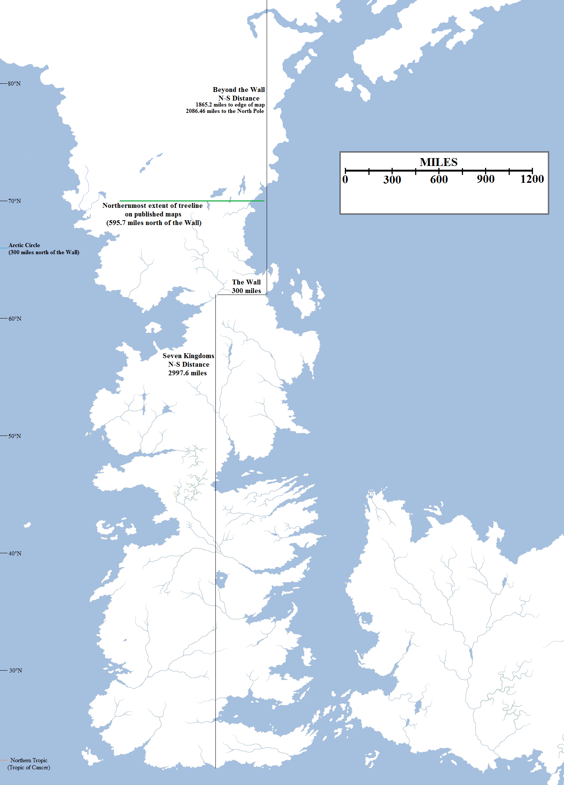
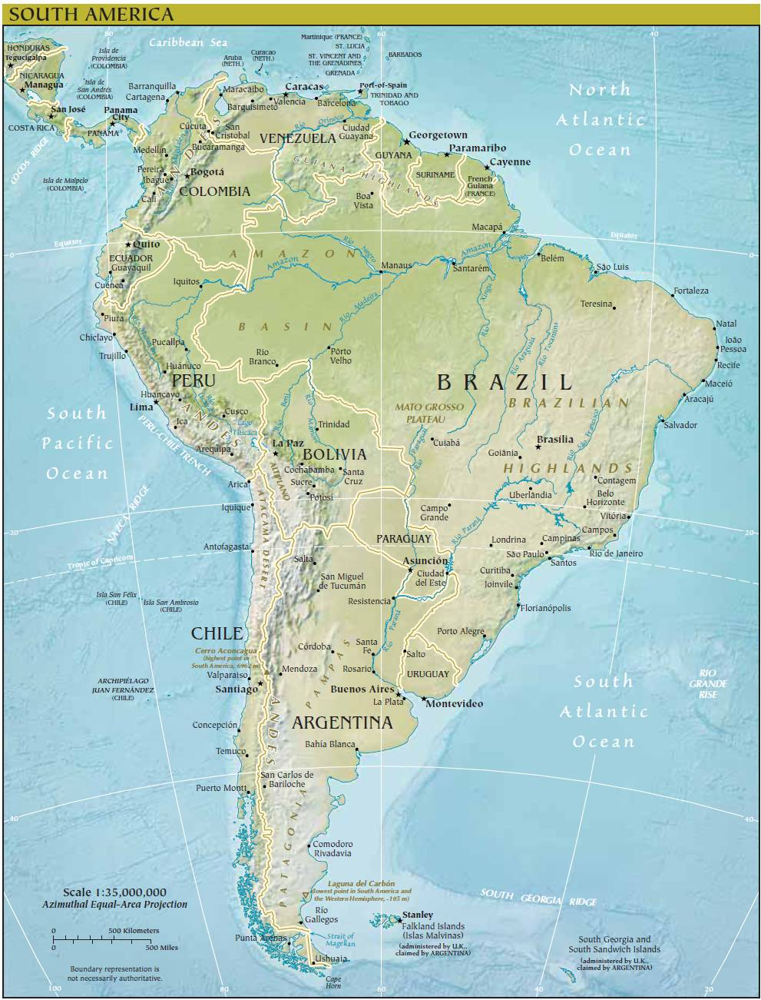
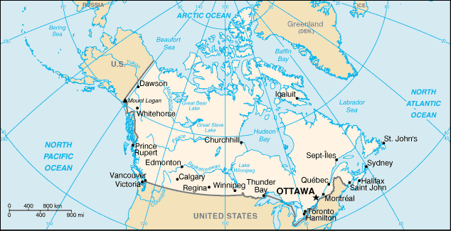
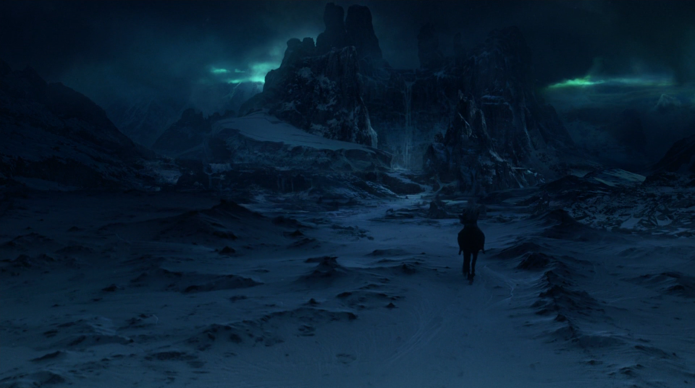

Having determined a (working rough) basis for [the size of the planet](https://atlasoficeandfireblog.wordpress.com/2016/02/28/so-how-big-is-the-world-anyway/), we need next to determine the size of Westeros itself, the continent on which most of the action in **A Song of Ice and Fire** takes place, and determine its location on the globe. We know it is in the northern hemisphere, but not how far it extends.

Click to embiggen. This map features the estimated length of Westeros, the size of the Lands Beyond the Wall and approximate lines of latitude, including the Arctic Circle and Northern Tropic.

The original maps for _A Game of Thrones_ did not include a scale bar, and many readers assumed that Westeros was somewhat small, maybe not much larger than Great Britain. This was backed up by the comparisons with English medieval history, particularly the Wars of the Roses. However, more attentive readers noted that the Wall was said to be 300 miles long and extrapolated from this that Westeros was considerably larger, a full-sized continent rather than an island or peninsula. This was backed up by the extensive travel times for King Robert’s party from King’s Landing to Winterfell and back again. Very rough calculations using the Wall as a scale bar suggested that Westeros measured in fact about 3,000 miles from the Wall to the south coast of Dorne.

Martin was wary of absolutely pinning down the size of Westeros and travel times, fearing that sharp-eyed readers would pick up on unintended mistakes and errors in the text and complain about them. He decided to be vague, stating that the map of Westeros was not to scale and the Wall could not be used as a scale bar. He also said that his intention had been for Westeros to be about “the size of South America” and the continent to the east to be even larger, around the size of “Eurasia”.

South America, which Martin compares in size to Westeros, measures 4,443 miles from north to south, is 2,705 miles wide at its widest point and is 6,890,000 square miles in area.

As the years passed, Martin relaxed on the former point. Size calculations done for Westeros and Essos using the Wall as a scale bar by multiple fans (but most notably Elio Garcia and Linda Antonsson of westeros.org) did not turn up any major discrepancies in travel time and eventually Martin agreed that you could in fact use the Wall as a scale bar.

Original estimates also showed that, Westeros couldn’t be the _area_ of South America (it is a very narrow landmass, whilst South America bulges out to quite a large size) but it could certainly be the length. Depending on where you place the measurements, South America measures out to about 4,400-4,500 miles in length from its north coast to the southern tip. If we take Westeros to be 3,000 miles from the Wall to the south coast of Dorne, then that leaves roughly 1,500 miles of additional land north of the Wall to at least match the length of Westeros. The mapped portion of the continent (in the books and _Lands of Ice and Fire_) extends up to around 750 miles north of the Wall, which works quite well. The _World of Ice and Fire_ map more than doubles this up to around 1,865 miles north of the Wall.

Canada, which Martin has suggested equals the size of the Lands Beyond the Wall. Canada is 3.8 million square miles in area, over 3,400 miles wide and 2,400 miles north to south (including the islands).

One curious new piece of information was [unveiled by George R.R. Martin in 2013](https://www.youtube.com/watch?v=VyG1rk1XgT4): he envisages the lands north of the Wall being roughly “the size of Canada”. Canada is 3.8 million square miles in area, measuring over 3,400 miles from east to west and 2,400 miles north to south including the Canadian Arctic Archipelago (but only 1,500 miles on the mainland). Exactly what Martin is referring to here is unclear, especially since the actual continental lands of Westeros presumably merge with his world’s equivalent of the Arctic ice cap. An editor on Wikipedia, however, rationalises Martin’s claim by suggesting that the lands to the north of Wall are indeed the size of Canada and in fact when combined with the size of Westeros actually give us the full “area of South America” (6.89 million square miles) mentioned previously by Martin. Previous area estimates for the Seven Kingdoms indicate that they may be around 3 million square miles in area, so this actually tracks.

Pixel-tracking on the maps (that, is breaking down the size of the Wall by pixel to come up with a distance-per-pixel which is reasonably precise) gives us the following sizes:

*   **North-South Distance of the Seven Kingdoms: 2,997.6 miles**
*   **North-South Distance of the Lands Beyond the Wall (to the edge of the WoIaF map): 1,865.2 miles**
*   **Combined North-South Distance of Mapped Westeros: 4,862.8 miles**

This seems to work quite well, assuming then that the bulk of the Lands Beyond the Wall “wrap around” the north polar icecap of the planet and can extend out of it on all sides (imagine Westeros attached to a northern polar equivalent of Antarctica sitting on top of the world).

Now that we’ve established that this is possible, the next question is where exactly Westeros sits in the northern hemisphere. One way of doing this is by working out where the treeline stops. In the real world, the treeline is where it gets too cold for trees to grow. You can see this on mountains where trees grow up the slopes and then stop – sometimes quite dramatically – and the snow takes over. This is also true on a global perspective. On Earth, the northern-most extent of the treeline is at 70°N in Norway and 72°N on the Central Siberian Plateau. These are both north of the Arctic Circle, which is located at 66°N. Both are noted as being unusual, the result of favourable climate and local regional fluctuations. However, this is helped by the northern-most trees on the map of Westeros, located in the valley of Thenn in the northern Frostfangs, also being the result of highly favourable, local climactic conditions. For the sake of argument, we can place Thenn and the northern limit of the treeline at 70°N. This then gives us the lines of latitude extending north and south from that point. On Earth there is 69 miles between each degree of latitude, but we did previously establish that the planet of Westeros and Essos is located on is 8.0771% larger than Earth, so the lines of latitude would be slightly further apart at 74.573 miles. This is important as we need to make sure we don’t run out of planet north of the Wall, or end up with the deserts of Dorne in what should be a temperate zone.

Working out the lines of latitude with Thenn at 70°N works quite well. The Northern Tropic (the Tropic of Cancer on Earth) runs through Dorne and the Red Waste, the equator runs through the southern Summer Isles, Sothoryos and Ulthos just south of Asshai, and the Arctic Circle is located exactly 300 miles north of the Wall.

What actually lies right up there past the Wall, in the Lands of Always Winter? According to Bran’s dreams, a place known as Winter’s Heart.

This also allows us to estimate the distance from the Wall to the North Pole (20° north of Thenn and the treeline, or 1,491.46 miles). This works out at 2,086.46 miles. This gives us only 200 miles between the very top of the _World of Ice and Fire_ map and the north pole, which isn’t a lot to have the continent spread out to the size of Canada. However, that’s not necessarily an issue as the landmass can continue and extend further into the opposite hemisphere. In addition, it may be that the WoIaF map is showing solely the geological landmass, whilst Martin was including the year-round pack ice in his size count (his planet presumably not undergoing the same degree as warming as our own, which is rapidly diminishing the amount of the Arctic which is frozen year-round). Presumably to the Others and their minions the distinction between continental bedrock and permanently frozen ice is academic.

These calculations allow us to draw the following conclusions:

*   **Total length of Westeros from the North Pole to the coast of Dorne: 5084.06 miles**
*   **Distance from the Wall to the North Pole: 2,086.46 miles**
*   **Distance from the Wall to the treeline in Thenn: 595.7 miles**
*   **Distance from the Wall to the Arctic Circle: 300 miles**

Potential issues: I know a lot of people like put the Wall on the Arctic Circle itself because it’s symbolic, but this is problematic as it pushes the treeline a lot further north than it should be and brings the North Pole too far south (onto the _World of Ice and Fire_ map) so that doesn’t really seem to track. Another possibility is to push the entire continent further south to allow more space in the north for the Lands Beyond the Wall. Whilst possible, this also starts pushing Westeros too far south towards the equator, and the entire continent should get a lot warmer and reduce the impact of the long winters on the North. The conclusions I’ve reached here, I think, are a good compromise between the climate we see of the various regions in the books and cartographic/scientific accuracy.
