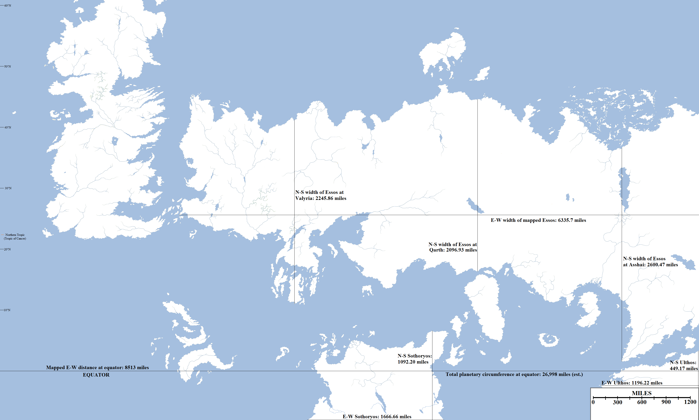

Now that we have determined the size of the world and the size of Westeros, it is a lot easier to determine the size (or at least the mapped size) of the other three continents of the explored world: Essos, Sothoryos and Ulthos. This has been simply done by extrapolation from our earlier figures, although some caution is advised.

Size estimates for the mapped portions of Essos, Sothoryos and Ulthos.

One problem we have not dealt with so far is the issue of longitudal scaling on a globed planet, mainly because, as far as can be told, George R.R. Martin has ignored it. This is something that most fantasy authors do, or the lands covered by their story are so small that the differences is negligible. The issue is caused by extrapolating a globed surface onto a flat, rectangular map. On such a map preserving distance (so that north is always at the top) means distorting the relative shapes and sizes of areas, as the scale moves from covering the entire circumference of the equator in the middle of the map to effectively the entire top and bottom of the map representing single points (the poles). This can be seen on flat wall maps which radically inflate the size of Greenland so it looks almost as large as South America, when in reality it is less than an eighth of the size. What this means on a such a map (using what is known as Mercator projection) is that the scale is only valid for the equator and alters radically further north and south.

The problem with this is that on all the maps of Westeros, the scaling is constant. So the 300 mile-length of the Wall precisely matches the distances given elsewhere (such as the 1,200 mile-width of Westeros at Dorne given in _A Feast for Crows_) regardless of longitude. This means that if we projected Westeros onto a sphere, the North would actually balloon out to the east and west and cover more lines of longitude than the South. It is tempting to ignore this issue and not even attempt to accurately convey what the world would look like on a sphere, but the scope of this project means that at some point it would be interesting to try.

Regardless, using the scaling we’ve worked out, some interesting distances for Essos, Sothoryos and Ulthos emerge:

*   **East-west width of Essos from the Narrow Sea to Mossovy: 6,335.7 miles**
*   **North-south width of Essos at Valyria: 2,245.86 miles**
*   **North-south width of Essos at Qarth: 2,096.93 miles**
*   **North-south width of Essos at Asshai: 2,600.47 miles**
*   **North-south width of mapped Sothoryos: 1,092.20 miles**
*   **Earth-west width of mapped Sothoryos: 1,666.66 miles**
*   **North-south width of mapped Ulthos: 449.17 miles**
*   **East-west width of mapped Ulthos: 1,196.22 miles**
*   **Total east-west width of the known world map (at equator): 8,513 miles**

“To go north, you must journey south, to reach the west you must go east. To go forward you must go back and to touch the light you must pass beneath the shadow.”

**Going East to Go West**

One idea frequently floated by fans of **A Song of Ice and Fire** is that Daenerys could travel east and thus invade Westeros from the west, via say Oldtown or Lannisport, taking the defenders by surprise. This idea is grossly impractical, but has picked up traction due to a mysterious prophecy uttered by Quaithe of the Shadow suggesting that this indeed could happen.

From Meereen, it is 2,976.36 miles to King’s Landing. This is as the crow flies, so the sea route around Valyria and up through the Stepstones will of course add to that. However, it is a straightforward, if still long, trip. To travel the opposite direction by ship requires a much longer journey. Daenerys would have to sail from Meereen to Asshai, which is located 3,056.74 miles to the south-east (curiously, Meereen is located almost exactly halfway between King’s Landing and Asshai, which are separated by 5,992.9 miles). From Asshai to the eastern limit of the Saffron Straits mapped so far it is 938.5 miles. At this point she passes beyond the map of the known world.

However, at this point she is just north of the equator, and we know (okay, guesstimate) that the equatorial circumference of the planet is 26,998 miles. So, from the eastern end of the Saffron Strait back to the western edge of the known world map is **18,485 miles**. So the total distance Daenerys would have to travel to invade Westeros from the west by going east is over **22,480 miles**. That’s more than seven times the length of the route going west. Not to mention that we do not know if the Saffron Straits are even navigable by ships all the way out into the (presumed) ocean east of Essos, and assuming that it is possible to survive the crossing of the far eastern ocean and that there isn’t an American-equivalent continent blocking the way (based on the Farwynd reports in _A Feast for Crows_, there may well be). Based on how easily the Iron Fleet was scattered by storms in the Summer Sea crossing a much smaller distance, not to mention the absence of any known friendly ports for almost the entire length of the voyage, the chances of such a journey being successful are almost non-existent.

To this end Quaithe’s prophecy is much more likely to refer to Dany’s journey as a whole – travelling east from Pentos to Vaes Dothrak to Qarth before heading west again – or be much less literal than this interpretation.
