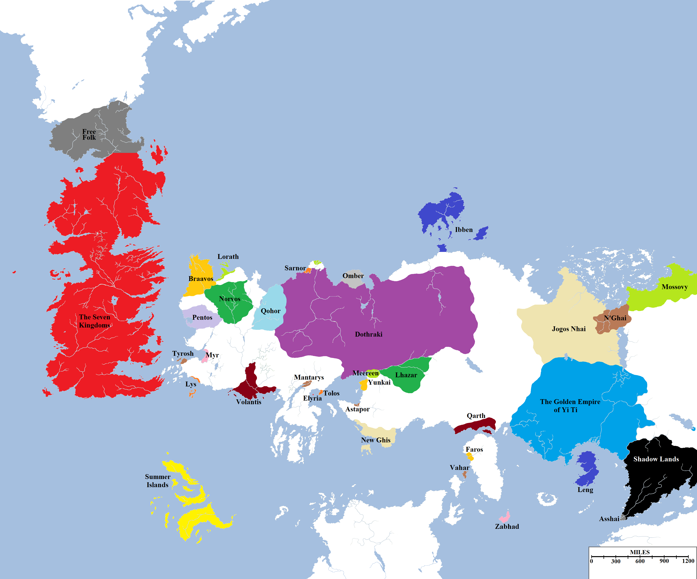
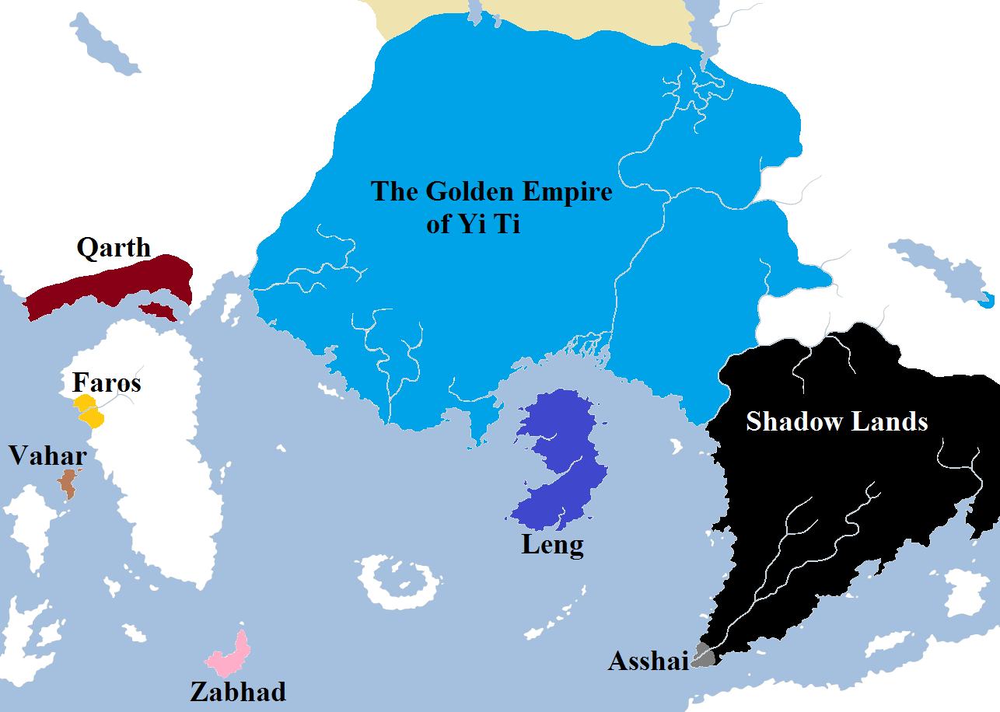

Leaving aside distances and sizes for the time being, an interesting facet of Martin’s world to explore is the notion of borders. Where does the influence of one nation end and another begin? The following map attempts to plot these borders as of the beginning of _A Game of Thrones._

A political map of the known world.

The external borders of the Seven Kingdoms are pretty much fixed: the Wall marks the northern end of the nation and the sea defines the rest. The internal borders are a little bit more debatable, but these will be the subject of a future post. To the north, the Free Folk (or “wildlings”) control a stretch of territory extending for approximately six hundred miles, petering out in the northern-most foothills of the Frostfangs, the remote valley of Thenn and the northern limit of the treeline before giving way to the endless wastes of the Lands of Always Winter.

The Free Cities are more than just the nine city-states alone. Each city controls a wide swathe of land around them, and in many respects they are a collection of small countries. We know that Volantis has several smaller cities subject to it – Volon Therys, Selhorys and Valysar – and it is likely that the others also have lesser, vassal towns sworn to them. Mostly, the borders of the cities do not directly adjoin upon one another and there appears to be no issue with future expansion or colonisation. The exception, of course, are the Disputed Lands in the Heel of Essos, where the cities of Myr and Lys have warred continuously (frequently also involving Tyrosh and occasionally Volantis) for dominance. The coastal areas of this region are likely directly controlled by those cities (Tyrosh and Lys, located on islands, need staging areas on the mainland anyway) but the heart of the area remains heavily contested between the cities.

A detailed look at the approximate borders of the major powers of western Essos.

East of the Free Cities region, the Dothraki _khalasars_ hold sway over a vast stretch of territory, extending some two thousand miles eastwards to the Bone Mountains. The main exceptions to their rule are found along the north coast. The broken remnants of the ancient kingdom of Sarnor can be found in the port city of Saath, located on the mouth of the mighty River Sarne. Further north can be found Morosh, a colony of the Free City of Lorath devoted to trade and mining. These cities have presumably survived the interest of the Dothraki through tribute and also terrain, with the many mouths of the Sarne (second only to the Rhoyne as the mightiest river of western Essos) providing some measure of defence against the horselords. The pastoral kingdom of Omber located along the Bay of Tusks survives by paying the Dothraki a yearly tribute of gems and grain (along with slaves) to remain unmolested. The size of Omber is unclear, but the lettering on the world map suggests it covers most of the headlands between the Bay of Tusks and the gulf to the west.

To the south, determining borders is again trickier. Tolos, Elyria and ill-omened Mantarys are small cities of limited power and influence, so likely do not control vast swathes of territory around them. The three great cities of Slaver’s Bay – Meereen, Yunkai and Astapor – are mostly concerned with the slave trade than territory, although Meereen is said to at least nominally control the lands east to Lhazar. Lhazar’s borders are relatively easy to determine, with the kingdom squeezed between the old Ghiscari slave cities to the west, the Dothraki Sea to the north and the Red Waste to the east.  More questionable is the spreading power of New Ghis to the south, which certainly is interested in territory as it seeks to rebuild the great Ghiscari Empire of old.

The territory of Qarth is more easy to define, hemmed in by the Red Waste to the north and the foothills of the lower Bones to the east, but extending along the coast west to Qarkash and Port Yhos and east to the island of Qal.

A detailed look at the approximate borders of the lands adjoining the Jade Sea.

In the heart of the Bones, athwart the three great passes, lie the cities of Kayakayanaya, Samyriana and Bayasabhad. These are remnants of the once-great empire of Hyrkoon, but each city now stands alone and not part of a greater nation, so their borders have not been marked. The approximate borders of the ranging lands of the nomadic Jogos Nhai have been marked, as have those of the kingdom of N’Ghai and the approximate edges of Mossovy, although the degree to which Mossovy is a unified nation or even a state at all is questionable.

The borders of the great empire of Yi Ti are marked, extending from the Jade Sea to the Bleeding Sea and the Mountains of the Morn. There is also a (possibly temporary) extension of the YiTish borders around the city of Carcosa on the Hidden Sea, as one of several claimants to the Imperial Throne of Yi Ti has taken refuge there and is rumoured to be building an army to help his claim.

South-east of Yi Ti lies the Shadow Lands. To what degree there is governance or control over the Shadow Lands is unknown, save that there are people who live there with shared cultural traits (like always going masked in public). At the tip of the peninsula lies the city of Asshai, who may be related to the people of the Shadow but are distinct from them.

Of the islands of the Jade Sea, it is known that Leng is an independent nation-state, as is the Isle of Elephants (ruled from Zabhad by a leader known as the _shan_). Vahar appears to be a trading port, as is storied Faros. However, no nation or organised governance can be found on the continent of Sothoryos or the islands off its shore (which are instead claimed by feuding pirates and corsairs).

Of what powers may exist in remoter corners of the globe, nothing is of course known. This may suggest that there is no civilisation anywhere else on the world, with only savages and wastelands to be found elsewhere. This is something we will examine in closer detail shortly.
