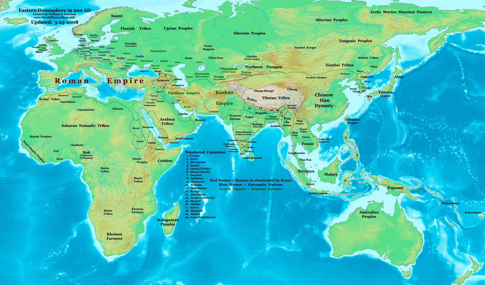

As established previously, the “known world” in **A Song of Ice and Fire** stretches for seven and a half thousand miles from the Lonely Light in the Sunset Sea to the Saffron Straits beyond Asshai. This vast stretch of territory incorporates the continent of Westeros, a vast chunk of Essos and the northern-most reaches of Sothoryos and Ulthos, along with numerous islands. However, it’s only a small chunk of the world (rather less than a quarter, at most). The question that naturally arises is, what else is out there beyond the edges of the maps?

A highly speculative look at the world beyond the maps. The red line marks the limits of canon knowledge (the edges of the known world maps). What lies beyond is total guesswork, but indicates how much of the world remains unknown (and Essos and Sothoryos could, of course, be much, much larger than shown here).

The answer is probably “not a lot”, at least in terms of powerful empires, kingdoms or other nation states. And there are some clues and indications from real history as to why this is so.

In European history, reasonably accurate maps of the continent, particularly the eastern Mediterranean basin, were created as early as the 7th Century BC. These maps also showed the north coast of Africa. It would take over 2,100 years until European explorers accurately mapped the far southern tip of Africa and created the first complete maps of the continent (and reasonably accurate maps of the entire continent would have to wait until well into the 19th Century). According to Herodotus, a Phoenician expedition circumnavigated Africa as early as 600 BC. This claim has been doubted, but the record of the voyage accurately reports the changing direction of the sun in the southern hemisphere, which some have claimed gave it credence. Real or not, the Phoenician report indicated that the southern extremities of Africa were lacking in riches or civilisation and providing no incentive to travel there. Overland travel, of course, was discouraged by the extreme hostility of the vast Sahara Desert.

So in real history, there was no incentive to explore the far southern reaches of Africa as there was no-one down there to trade with, and it was easier (and safer) to travel overland through Egypt to get from the Mediterranean to the Red Sea, if necessary. On the other hand, the existence of China was known to Europeans in antiquity, and a huge amount of indirect trade was carried out between the Roman and Han Empires via the intermediary nations in the first couple of centuries AD. There was a significant push to find viable sea and land routes to China and the East Indies to make trade more profitable and eventually – almost out of desperation – drove Columbus into his journey across the Atlantic in 1492 and Vasco da Gama in his 1497-98 trip right around the coast of Africa and up to Calicut in India.

Or to put it another way, almost no-one said, “Let’s see what’s out there!” and hurled themselves completely into the unknown. One of the few groups that did was the Norse Vikings, who ended up colonising Iceland, Greenland and Vinland (in north-eastern Canada) by around 1009 AD. But they were lucky because the distances from north-western Europe to Iceland, Iceland to Greenland and Greenland to the North American mainland were not large.

How this relates to **A Song of Ice and Fire** is clear: Columbus was driven by the need to _travel to a known destination_ (the East Indies, China and other Asian markets), as was da Gama (India), and the economic benefits of opening a trade route to a known and previously-reached (overland or by ships travelling across the Indian Ocean) destination. The impetus for their voyages of exploration was to get to a place that was already known to exist.

In the context of Essos, no such destination is known to exist. East of Asshai, the Shadow Lands, and the Thousand Islands knowledge peters out into pure fantasy or complete befuddlement. No-one knows what’s out there and the people who’ve tried have either never returned or, as in the case of Corlys Velaryon, the Sea Snake (53-132 AC), had to turn back due to lack of supplies or a lowering of morale.

The Roman and Chinese Han Empires in 200 AD. Although direct contact was extremely limited (unless you believe the Jackie Chan movie _Dragon Blade_), intermediary nations carried trade and information between the two superpowers.

What is particularly interesting is the fact that there is no indication of shared or passed-on knowledge. In the Roman period there was only very limited and sketchy contact between Rome and China, but intermediary nations stretching between the two (Parthia, Kushan, Tibet) could act as a conduit for trade and information, even if much of it was sketchy or inaccurate. In the case of Essos, it’s almost like a wall slams down beyond the Mountains of the Morn and the forests of Mossovy. It appears that no-one from Yi Ti, Asshai, or Ibben knows what the heck is out there either. If there were any further cities or nations, presumably they would have explored westwards and encountered the Mossovites, or the empire of Yi Ti, and some news of it would have made its way to Westeros.

This allows for a very simple conclusion: there is pretty much nothing out there past the Grey Waste and Mossovy. Essos may stretch on for a (relatively) short distance or for many thousands more miles, but either way there is no civilisation to be found or, if there is, it’s separated from the known world by such a vast gulf of wilderness that it’s not worth the exorbitant costs and dangers of making such a journey.

There may also be geographic hindrances. We know that the Saffron Straits link the Jade Sea to unknown bodies of water to the east, beyond the island-continent of Ulthos, but no-one has apparently explored the straits and returned. It may be that the far eastern end of the straits closes up to the point where they are not navigable by large ships, preventing further exploration that way. If equatorial Ulthos is even half as inhospitable as Sothoryos, then overland exploration will also likely be impossible. We know that there is no reported civilisation at all on Sothoryos (Jaenara Belaerys of Valyria spent three years exploring the continent on her dragon, Terrax, and reported that she still hadn’t seen all of it and she suspected it was as large as Essos, “a land without end”), which would discourage exploration down the coast of that landmass or whatever presumed straits or seas separate it from Ulthos. This effectively bars eastward exploration to the south of Essos.

To the north, civilisation to all intents and purposes ends at the island of Ibben, three thousand miles to the east of Westeros. Beyond Ibben, there is a grand total of _one_ (relatively) safe port on the Shivering Sea: Nefer, the capital of N’Ghai, and that is a city of dubious repute which can only be reached via the forbidding Thousand Islands. Nefer is approximately two thousand miles from the Port of Ibben and one thousand miles from the furthermost-edge of the known world map. Even a sailor as hardy as the Sea Snake didn’t like the risk of a voyage east into unknown seas and lands with no known safe harbourage, and chose to return to Westeros (where, years and decades later, he would play a major role in the Dance of Dragons). It also appears that no ships have ever come west to these lands from whatever may be at the far eastern end of Essos.

Is it possible that the far east coast of Essos can be reached by sailing west across the Sunset Sea? Certainly, assuming there isn’t another landmass blocking the way. It might be that Essos wraps around most of the globe and its eastern shores lie just a few thousand miles across the Sunset Sea. However, George R.R. Martin [has said](http://www.westeros.org/Citadel/SSM/Entry/Geography) that Essos is about the size as Eurasia (21 million square miles, or almost exactly three times the area of South America/Westeros). Whilst this would make Essos huge, it wouldn’t be so huge it would extend an additional 10,000 miles further eastwards, and wouldn’t be vastly bigger than what we see already on the maps.

According to Martin, we’re never going to get an official, full world map or a globe showing where everything is. But from the text, my conclusion is that if there are other pockets of civilisation in the world, they are incredibly distant and remote from the settled parts of Westeros and Essos, and will play no role in the rest of the story.
