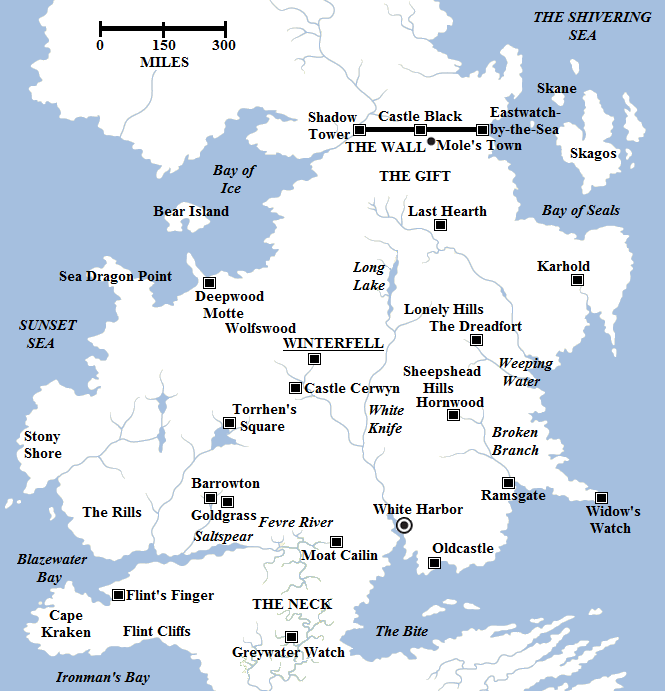

After five seasons something rather peculiar has become apparent on HBO’s **Game of Thrones**. For unknown reasons, the continent of Westeros appears to be significantly smaller in the TV show than in the books.

A map of the North, the largest but also most sparsely-populated of the Seven Kingdoms.

This may not be immediately apparent, but three separate data points now confirm it. These are as follows:

**It takes one month to get from King’s Landing to Winterfell.**

In the first episode of the TV show Cersei says that it has taken one month to travel from King’s Landing to Winterfell. Although the royal party is mounted, the party has travelled using carriages which will slow them down. The ridiculously massive land-cruiser wagon from the novels is fortunately not present, but it’d still be slower going with carriages. The novels suggest that actually several months may have passed on the road. Using the book maps, the distance from King’s Landing to Winterfell by road can be calculated at approximately 1,500 miles. Even making 30 miles a day on good roads (as we can assume the Kingsroad is), it’d take 50 days (more than one-and-a-half months) for the party to travel from King’s Landing to Winterfell.

**The distance from Torrhen’s Square to Winterfell.**

In the Season 2 episode _The Ghost of Harrenhal_, it is stated that the castle of Torrhen’s Square is 40 leagues (120 miles) from Winterfell. However, the maps make it 76-80 leagues (230-240 miles). This distance is notable because it is quite specific, suggesting that the TV version of Westeros may only be half the size of the book version!

**The size of the North.**

In the Season 4 episode _The Mountain and the Viper_ Roose Bolton legitimises his bastard son Ramsay just outside the recently-surrendered castle of Moat Cailin. They then discuss the size of the North. [Roose states](https://www.youtube.com/watch?v=CCECeic9XK0) that the North measures, from Moat Cailin, more than 700 miles by 400 miles by 300 miles. This is at odds with the book maps, which suggest the territory is much larger. From Moat Cailin to the Wall, for example, is approximately 970 miles. Given that Roose is trying to impress Ramsay, this is indicative that the TV version of the North is again smaller than the book version. The other measurements are somewhat nonsensical: given Moat Cailin’s location it’s actually quite close to the sea in either direction (220 miles to the west, 140 miles to the east) and it’s unclear where Roose is pointing when he gives these directions.

The correct size of the North from the books is approximately 1,175 miles from north to south and over 1,400 miles from the western-most tip of Cape Kraken to the eastern-most island off Skagos (the actual widest point on the mainland is still about 1,190 miles). According to the calculations by Elio of Westeros.org, the North measures about one million square miles, or one-third the total size of the Seven Kingdoms (and about one-sixth the total size of the Westeros continent, including the lands beyond the Wall and offshore islands). The TV version of the North simply seems to fall short of that size.

I’d normally be inclined to dismiss such things as the TV writers not paying attention to details, but the very specific sizes given for the distance from Winterfell to Torrhen’s Square and for the size of the North suggest that a calculated decision has been made to make Westeros and Essos smaller on TV than in the books. This does also help explain Littlefinger’s ability to move extremely rapidly around the continent and the relative quickness of Tyrion and Varys’s journey from Pentos to Volantis to Valyria to Meereen, compared to the epic, lengthy grind in the books. It also appears that there has been no set scale for the size different: clearly the entire continent isn’t half the size as this wouldn’t make sense for the climate and would also make the journey from King’s Landing to Winterfell too long rather than too short.

Of course, just to make things awkward it has also been mentioned on TV (in the final episode of Season 3) that the Wall is still 300 miles long, just as in the books. Actually at one point it was said to be _500_ miles long, although this appears to have been a script error.

It’ll be interesting to see if Season 6 gives us more clues as to what the TV producers have in mind for their version of Westeros and Essos.
