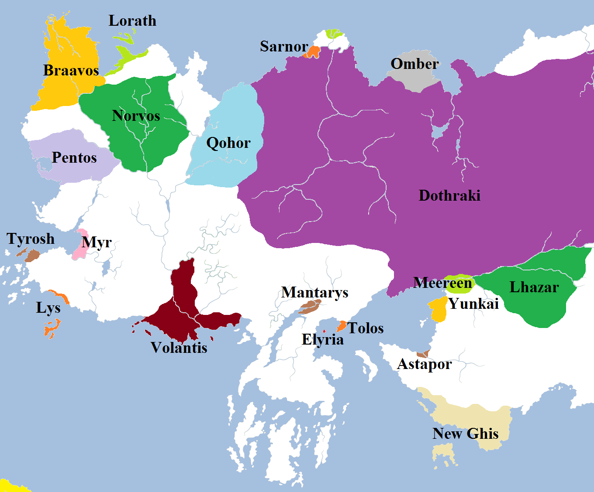

Working out the population of Westeros ([estimated at 40 million](https://atlasoficeandfireblog.wordpress.com/2016/03/06/the-population-of-the-seven-kingdoms/)) is possible thanks to the information and data given to us in the text of the **Song of Ice and Fire** novels. Unfortunately, Martin is much sketchier on the figures and populations of the lands of Essos. The military activity around Slaver’s Bay in _A Dance with Dragons_ does give us a little bit of an idea for a population of that region (to be covered in a future entry), but for other areas we are in the dark.

This means that working out the population of the Free Cities means delving into speculation and historical parallels even more than we did with Westeros. As a result, these figures should be taken with a much greater pinch of salt than the figures for the Seven Kingdoms.

**Relative Sizes and Influence of the Free Cities**

We do know a few things about the nine Free Cities of Essos that can help guide us towards an idea of their populations. We are told that Volantis is the oldest (at least two thousand years old, possibly longer), the physically largest and the most populous of the nine cities, so large that all of the islands of Braavos could fit in its harbour. It also appears to be the most corrupt and the most heavily dependent on slaves. Braavos is the youngest city but also the richest and most powerful. Lorath is the smallest, poorest and most remote of the nine cities. The others fall between those in relative size and population. So I would suggest we could order the cities as follows:

**1) Volantis: 1.2 million (city), 5 million (surrounds)**

Located at the mouth of the mighty River Rhoyne, Volantis sprawls for many miles along the coast of the Summer Sea. The city is bustling and crowded, with the older and richer districts located in the eastern half within the massive Black Walls (one-third the height of the Wall of Westeros but considerably wider). Slaves, outlanders and freedmen most dwell in the newer, poorer districts to the west of the Rhoyne. The colossal Long Bridge links the two halves of the city together. Although the city is massively populated, it is in decline with several areas abandoned and run-down compared to the city’s height under the Valyrians.

There are a few clues we have to the population of the city. In _A Dance with Dragons_ Victarion Greyjoy estimates the strength of the Volantene fleet as being between 300 and 500 war-dromonds, each teeming with slave soldiers. The size of these ships is unclear – Byzantine dromonds could reportedly sport up to 300 crew (230 rowers and 70 marines) – but typically a dromond from the medieval or pre-medieval period would be sporting 100-200 crewmen. Of course, there could be additional ships accompanying the Volantene fleet bearing yet more soldiers.

More directly, Volantis is simply described as being huge in a way no other cities in the books are: it stretches for a massive distance, just travelling through the city takes hours and it is certainly presented as being several times (I would say at least three times) the size of King’s Landing. This is backed up by the fact that Volantis has three major supporting cities located upriver from it – Volon Therys, Valysar and Selhorys – _each_ of which is allegedly bigger than King’s Landing whilst still being subservient to Volantis and far smaller than it. I would there submit that Volantis has a population of approximately 1-1.2 million, with about 1.2-1.5 million people living in the three river towns (combined) and yet more in the surrounding countryside. This is probably conservative: to support such a large urban population a much more colossal number of farmers and slave-workers really should exist just to keep the cities fed. One thing that is startling is that this very large population is divided between 20% freemen and nobles against 80% slaves, a striking and possibly highly unwise imbalance.

Is this size plausible? Well, Volantis certainly has enough supporting infrastructure (or enough space for the presumed existence of a theoretical supporting framework) to reach such a size. It controls all of the Rhoyne southwards from Chroyane, not to mention the Orange Coast to the west and a wide swathe of countryside extending westwards into the Disputed Lands. In the real-life medieval period, however, the city would be grotesquely massive. Hangzhou in China is generally regarded as the largest city in the world in 1300 AD, with a population of approximately 800,000 (1.5 million is occasionally cited, but the evidence is disputed). Cities in Europe were much smaller: 350,000 for Constantinople, 200,000 for Paris and 80,000 for London. However, with a population of 400,000 for King’s Landing and the general sizes of everything in Westeros and Essos being bigger (apart from general population, which is curiously much lower), 1.2 million for Volantis does not seem too unreasonable. It does beg the question of how much bigger the population was in its heyday under the Valyrians: possibly 2 million in the city and immediate surrounding area, which in turn suggests that Valyria itself was even bigger.

**2) Braavos: 800,000 (city), 2-3 million (surrounds)**

Braavos is the youngest of the Free Cities, founded just 800 years ago by escaped slaves from the Valyrian Freehold. The city sprawls across dozens of islands in a lagoon located at the very north-western tip of the Essosi continent, linked by bridges and barges. The city is entirely located on the islands, with the nearby mainland being too rugged, too mountainous and too far from the islands to allow for easy settlement. However, Braavos also controls a huge chunk of the surrounding territory, extending east to the shores of Lorath Bay (Braavos holds the entire western coast of the bay) and south through the mountains and hills to the borders of Pentos and Norvos. In particular, Braavos claims all the coast of the Narrow Sea southwards for about 450 miles. This gives the city an extensive hinterland which it could have colonised with mines, fishing villages and towns.

Estimating a population is difficult. Braavos is clearly inspired by both Venice and Amsterdam, but direct comparisons with the inspirations for them isn’t very helpful in this case: the city of Venice is geographically quite small (far smaller than Braavos) and its population was just 50,000 in the 14th Century. The city’s population reached a high of 200,000, but not until the late 16th Century. The city’s population today is only 260,000. There simply isn’t a lot of room there to live. Amsterdam is a relatively new city, only founded in the 13th Century. Martin seems to have taken influence from Amsterdam’s much more recent (17th Century) position as the centre of the world’s mercantile trading, but even then the city’s population was only 250,000, reaching 300,000 only during the mid-19th Century.

Braavos, on the other hand, is physically much larger than either Venice or Amsterdam in the medieval period. It directly controls a much vaster amount of surrounding territory and it is described as both being immensely wealthy and having formidable direct military power. Venice commanded formidable naval power and it did control colonial territories (through the Venetian Republic, which at one point dominated the shores of the Adriatic), but it was never described as being as massively dominant as Braavos is over the other Free Cities.

On this basis, giving Braavos a population of around twice that of King’s Landing (800,000) with 2-3 million more people spread through its territory seems reasonable.

**3) Norvos: 600,000 (city), 1-2 million (surrounds)**

For the title of third-most populous city, Norvos seems a reasonable conclusion. It is located safely inland and has very few border clashes with its neighbours (Pentos, Qohor and Braavos). It also has a significant number of small towns and villages subservient to it, with mines located in the surrounding hills and in the Axe giving it significant natural resources, easily transported down the Rhoyne or by Valyrian road to the coast. I put it over Pentos or Qohor due to the explicitly-mentioned (in _A Game of Thrones_) other settlements that are controlled by it.

**4) Pentos: 500,000 (city), 1-2 million (surrounds)**

Pentos sits on an enclosed bay of the same name, almost directly opposite King’s Landing on the eastern shores of the Narrow Sea. Pentos appears to be a reasonably-sized city but not massively huge. It is fed by immense farmsteads on the Flatlands, but it curiously appears to control no other cities or towns. From the sound of it, it may be that any other settlements that did exist were destroyed by Dothraki raids. This limits Pentos’s size and influence from what it could be. However, it’s position as an important port and effectively the gateway between Westeros and Essos for direct trade should make it a significant city.

**5) Qohor: 500,000 (city), 1-2 million (surrounds)**

Qohor appears to be somewhat less notable than Norvos: it has no named or noted towns or villages subservient to it, and it does not appear to control significant resources such as mines. Its main resources seem to be the Rhoyne, which it controls as far south as Dagger Lake, and of course the vast Forest of Qohor that surrounds the city and provides excellent logging resources. Qohor should probably be smaller than it is, but it does sit athwart the main trade routes from the Narrow Sea to Vaes Dothrak, significantly enriching it. Qohor also appears to have at least a modicum of safety from the Dothraki due to its Unsullied garrison defeating Khal Temmo’s _khalasar_ three-odd centuries ago. The Dothraki haven’t attacked it since, especially since the Qohoriks have no problem with the Dothraki simply riding past it. However, I wouldn’t be surprised if Qohor was less powerful and populous than it once was, with the destruction of the Valyrian colony of Essaria and the mighty Kingdom of Sarnor at the hands of the Dothraki ridding it of several valuable trading partners.

**6-8) Tyrosh, Myr & Lys: 400,000 each (cities), 1 million each (surrounds)**

The Quarrelsome Daughters of Valyria are located around the Heel of Essos and are noted for being individually rich, powerful and also almost constantly at one another’s throats over control of the Disputed Lands that lie between them. The cities seem very well-matched in terms of numbers, influence and military power, since none has gained the upper hand over the others. The cities also have to be significantly weaker than Volantis, which conquered two of them during the Bleeding Years but then overreached when it tried to take the third. Fear of Volantis compelled the three cities to form the Kingdom of the Triarchy to resist it, suggesting they have to be individually much weaker than Volantis but a match for it when united.

Tyrosh and Lys are both located on islands, limiting their size, but both cities almost certainly have settlements on the mainland to serve as staging grounds for sorties into the Disputed Lands. Myr is located on the mainland and I suspect may have a more populous hinterland as a result, although this may be limited due to Dothraki incursions into its territory.

**9) Lorath: 250,000 (city), 800,000 (surrounds)**

Lorath is the smallest and poorest of the Free Cities. Located on an island in the Shivering Sea, east of Braavos, it is also the most remote. If it wasn’t for its position on the main shipping lane from Westeros and the Free Cities to distant Ib, it’s doubtful if the city could prosper at all.

Still, although not a patch on the other eight cities, Lorath isn’t totally worthless. It has a colony port at Morosh at the mouth of the Sarne, from where it trades with the Dothraki, the Omberi and the remnants of Sarnor, and it also holds the eastern shores of Lorath Bay (the west being lost to Braavos some time ago). The city’s bizarre mazes, built by a long-forgotten civilisation for purposes unknown, are also a curiosity that attracts the occasional scholar and adventurer.

The figures in this article are _highly_ speculative, and I’ve probably grossly underestimated the populations needed to support each city. However, this may give at least an idea of how large and populous these cities might be.
