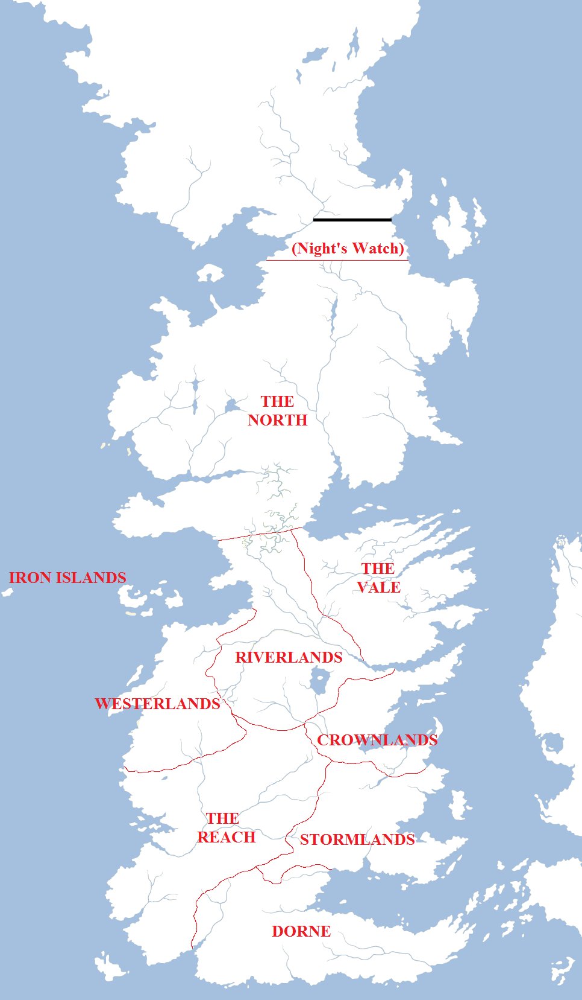

Borders delineate boundaries between nations, regions and cultures. They are sometimes obvious things – a towering mountain range or a huge river – but at other times they are simply arbitary lines drawn on a map that bear little reality to the situation on the ground. This was especially true in the medieval period, when the maps themselves were not tremendously accurate so working out where the borders were between one region and the next could be a difficult process. When this led to border violations and conflicts, this could have massive ramifications.

In the case of the Seven Kingdoms of Westeros, the external borders are very easy to identify: the Sunset Sea to the west, the Summer Sea to the south, the Narrow Sea to the east and the Shivering Sea to the north-east. The Wall marks the northern border of the kingdoms. But more complex – until recently – was the task of working out the internal borders between the nine constituent regions of the realm.

The regions of the realm (as of the start of _A Game of Thrones_) are as follows:

*   **The Crownlands**, ruled from King’s Landing by the King on the Iron Throne.
*   **The North**, ruled from Winterfell by House Stark.
*   **The Riverlands**, ruled from Riverrun by House Tully.
*   **The Vale**, ruled from the Eyrie by House Arryn.
*   **The Iron Islands**, ruled from Pyke by House Greyjoy.
*   **The Westerlands**, ruled from Casterly Rock by House Lannister.
*   **The Reach**, ruled from Highgarden by House Tyrell.
*   **The Stormlands**, ruled from Storm’s End by House Baratheon.
*   **Dorne**, ruled from Sunspear by House Martell.

The precise borders between the regions have been a matter of conjecture for some time, but _The World of Ice and Fire_ finally revealed (bar a couple of continuity errors) the “canonical” borders between the Seven Kingdoms. For the most part these adhered to the borders worked out by fans years earlier, but a couple of surprises were included. Most notable was the addition of a large “salient” of territory along the southern shore of Ironman’s Bay. Previously assumed to be part of the Riverlands, this was instead given to the Westerlands for reasons that remain unexplained. The book also moved the borders of the Stormlands slightly further westwards into the Reach, perhaps to make the extension of the Dornish Marches in the south look somewhat less tenuous. However, this does also slightly contradict the previous suggestion that the Stormlands were very small and an unpleasant place to live.

The borders between the regions were established by King Aegon I Targaryen following the Conquest and seem to have remained pretty fixed for the 300 years since then. Even the chaos of the War of the Five Kings does not seem to changed the main regional borders, although the interior divisions (such as the Boltons seizing more land from the Hornwoods) have seen some changes.

We’ll take a closer look at the borders when we come to examine each region of Westeros in detail.
