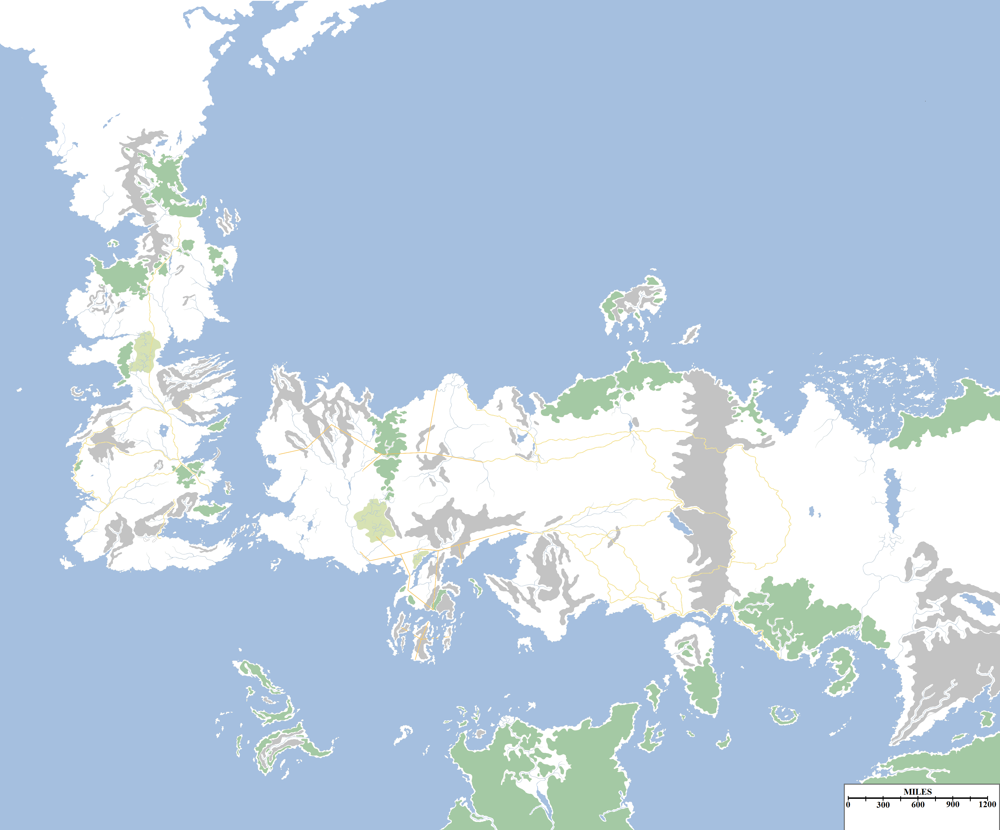

I recently updated the master map of Westeros and Essos (from which my others are derived) with mountain ranges. As mentioned in my first post, I am not a cartographer or digital map-maker, so fancy, shaded mountain ranges and individually-crafted peaks were not really a realistic option. Instead I settled for grey blobs.

The thicker grey blobs are the big mountain ranges and the thinner ones are hill chains. Forests and roads are also shown, but not (so far) the deserts, canyons or different terrain types.

The original underlying map [was created](http://www.cartographersguild.com/showthread.php?t=21768) by forum-member Galanix on the Cartographer’s Guild website some years ago (by overlaying it from the _Lands of Ice and Fire_ map, I believe). I’ve extended it with the information from the WoIaF world map. Most of my additions and changes have been in MS Paint (oh yes) and GIMP2. I may start using the latter more for the layering functions, which will be easier than keeping multiple versions of each map for lettering, terrain, political factions etc.

This will help with the next phase of the atlas, which will be historical maps of the different periods of history in Westeros and Essos.
