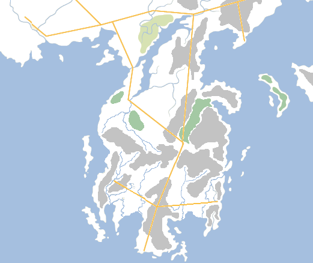

In the backstory of **A Song of Ice and Fire**, no nation plays  more crucial a role than that of Valyria. Ancient and powerful, the Valyrian Freehold was the supreme power in the known world for nigh on five thousand years, until it was laid low in a single day and night of fire, ash and blood. Every attempt made to reclaim Valyria or rebuild the empire was defeated, either by hubris or rival kingdoms or by the land itself. The last hope of reforging the Freehold was lost when Aegon the Conqueror, his sisters and the last three dragons in the world set their sights on the Sunset Lands instead.

The city of Valyria before the Doom, with at least one of the Fourteen Flames in the background. Artwork by Ted Nasmith, from _The World of Ice and Fire_.

From a cartographic point of view, all of the canon maps showing Valyria show the land in ruins, utterly destroyed as the result of the Doom. The Doom was a volcanic supercataclysm, a series of eruptions of not just a single volcano but no less than fourteen peaks. Imagine Krakatoa, Vesuvius, Mount St. Helens, Etna, and Mauna Loa all erupting at the same time within a few dozen miles of one another and then throw in another nine volcanoes on top of that. Worse still, not only did the volcanoes erupt but the very hills and land split asunder for (according to legend) five hundred miles in all directions. Even allowing for artistic licence, this still indicates a catastrophe not like anything seen in the real world in recorded history.

The result of this was the neck of the Valyrian Peninsula, formerly a single landmass, collapsing into the sea, sending vast megatsunamis racing across the soon-to-be-well-named Gulf of Grief and Summer Sea. The destruction wrought by the Doom not just on Valyria but the surrounding lands for thousands of miles in all directions cannot be underestimated. The cities of Slaver’s Bay may have been shielded from the worst by the Isle of Cedars, which took the brunt of the tidal waves heading north-east, but it’s likely tremendous destruction was wrought on the shores of Sothoryos, the Basilisk Isles, Naath, Ghaen and potentially as far away as the Summer Isles. The 2005 Indonesian tsunami reached as far afield as the east coast of Africa, over 3,000 miles away, and the Doom would have been far worse with millions of tons of rock displaced into the Summer Sea. The ash thrown up into the atmosphere would have resulted in reduced sunlight and even more devastating-than-normal winters across south-western Essos for years, possibly decades. There would also have been some seriously spectacular sunsets and sunrises for a long time afterwards.

Potentially what Valyria looked like before the Doom.

Rebuilding the Valyrian Peninsula (see map above) requires that the shattered islands be linked back together, remembering that some of the surrounding islands were likely still separate landmasses before the Doom anyway. The three big islands were part of the mainland (Valyria itself certainly was) and the neck of the peninsula, where the Smoking Sea now lies, is likely where most of the chain of the Fourteen Flames was located. In addition, the weakened parts of the peninsula, where the sea came rushing in, were most likely to be along rivers and fault lines. Although hard data is hard to come by – the book maps are hardly finely-detailed – this gave a working idea for what Valyria may have looked like before the Doom. And yes, there is a special feature on the **Game of Thrones** Season 1 Blu-Ray set which does hint at a pre-Doom map of Valyria, but it is 1) poor and 2) only applies to the TV canon, not the books.

We can also glean some clues from Tad Nasmith’s drawing of Valyria’s capital city from _The World of Ice and Fire_. This shows the city sitting on rivers of lava channelled from the Fourteen Flames nearby, but still in a hilly/upland area. This accords with the maps, which show mountains and hills surrounding Valyria itself. This also hints at the location of the Fourteen Flames, with a spur of mountains reaching up from Valyria to the main chain across the neck of the peninsula. This neatly answers why Valyria was near-instantly destroyed despite lying about 180 miles south of the main chain. This supposition – that the Fourteen Flames contained solitary peaks as well as the central range – also helps explain how some of the volcanoes apparently survived the Doom and are still active, belching out the fires that Tyrion sees reflected off the clouds over Valyria in _A Dance with Dragons_.

> So those are the fires of the Fourteen Flames we’re seeing, reflected on the clouds?”
> 
> “Fourteen or fourteen thousand. What man dares count them? It is not wise for mortals to look too deeply into those fires, my friend. Those are the fires of god’s own wrath, and no human flame can match them. We are small creatures, men.

We can therefore assume that the majority of the peaks were destroyed in the Doom (although possibly growing again under the Smoking Sea, as Krakatoa has done over the past 133 years), but several survived on the mainland and on the newly-formed islands. Indeed, with Valyria itself reportedly still intact and salvageable, it’s probable that the mountain shown in the illustration is still there as well.

The Valyrian Peninsula just before the Doom.

Looking at the extant maps and geography, we can put together a good idea of what Valyria looked like before the Doom. The cities of Tyria and Oros now appear to be located at either end of the biggest pass through the Fourteen Flames, with a Valyrian straight road linking them together with Valyria itself to the south and Mantarys far to the north. The lands between the volcanoes and the Sea of Sighs are known as the Lands of the Long Summer, known for their balmy, warm days mixed with occasional rainfall. This resulted in what was formerly (but not now, as the landscape remains volcanically active) the most fertile landscape in the known world, with richer soil even than that of the Reach in the Seven Kingdoms. This area was therefore the breadbasket of the Valyrian Freehold, feeding the lands to the south and north alike. Valyrian roads linked this region to the Free City of Volantis to the north-west and the cities of Slaver’s Bay to the north-east.

The peninsula is dominated by the Fourteen Flames, fourteen massive, active volcanoes. According to legend, these volcanoes were the lairs for the Valyrian dragons and home to dangerous firewyrms. They were also a rich source of gold, silver, iron and other valuable ores. The Valyrians built great mines under the volcanoes, using magic (some say) to keep the terrible heat at bay so slaves could retrieve the precious metals. Indeed, the most common explanation for the Doom is that the Valyrian mages neglected their duties and let the safety spells lapse, causing the volcanoes to erupt. The alternate theory that a sect of slaves, exposed to the magic of the flames over generations, learned how to change their faces and used this skill to assassinate the mages, thus deliberately triggering the Doom as an act of volition, is interesting but unsubstantiated.

The next set of maps will start delving into the ancient prehistory of Westeros and Essos.
