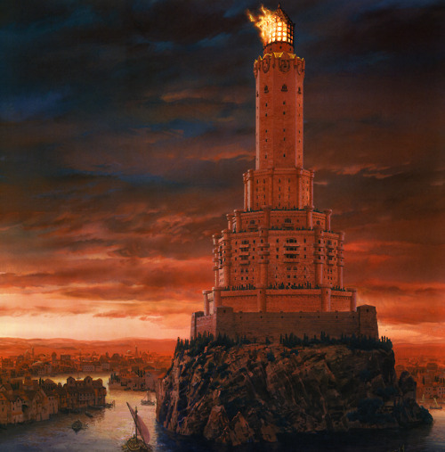

Moving away from cartography, this feels like a good moment to talk about the histories and timelines in **A Song of Ice and Fire**. Westeros and Essos have a grand history stretching back for well over 12,000 years…or so we are told. This is a colossal period of time, almost three times the age of the Egyptian pyramids, and some readers have difficulty in giving such vast spans of time credence. However, _A Dance with Dragons_ and _The World of Ice and Fire_ pour cold water over the idea that the “traditional” dates we are given in the earlier books are in any way reliable, and the margins of error in the calculation of dates may be enormous.

Oldtown is the most ancient city in Westeros, founded in the Age of Heroes. It has been the seat of the Citadel and the home of the order of maesters for thousands of years. It is the greatest bastion of learning in the Seven Kingdoms (artwork by Ted Nasmith).

From _A Game of Thrones_ the traditional dates given for the major events in the history of Westeros and Essos can be summed up as follows:

*   12,000 years ago: Invasion of the First Men, War of the First Men and Children, signing of the Pact.
*   8,000 years ago: The Long Night, the invasion of the Others, defeat of the Others, adventures of the First Hero and Azhor Azhai, building of the Wall, founding of the Night’s Watch and Winterfell by Brandon Stark, the (maybe) First King in the North.
*   6,000 years ago: Invasion of the Andals begins, apparently displaced by a fear of Valyria. However, Valyria’s eye turns eastwards to Ghiscar.
*   5,000 years ago: The Andals conquer the Iron Islands, completing the conquest of southern Westeros. The North remains free. In Essos, Valyria defeats Ghiscar and begins expanding in earnest.
*   2,000 years ago: A meteor falls in western Dorne, from which the Daynes forge the sword Dawn.
*   1,000 years ago: The Valyrians destroy the Rhoynar. The survivors flee to Dorne in a thousand ships, led by Queen Nymeria. House Martell allies with the Rhoynar and conquers Dorne. According to George R.R. Martin, most dates after this point are more reliable and solid than what came before.
*   800 years ago: Braavos is founded.
*   500 years ago: The Targaryens leave Valyria and settle on Dragonstone.
*   400 years ago: The Doom of Valyria.
*   300 years ago: The Targaryen Conquest of Westeros.

These dates seem pretty solid through, at least, the two books that follow. It is only in _A Feast for Crows_ we get our first indications that the dates are unreliable when we learn that the maesters at the Citadel can’t seem to agree on anything and the dates given so far seem to come from only one interpretation of history. This is developed in _A Dance with Dragons_ when Hoster Blackwood tells Jaime that the current theory is that the Andals invaded Westeros between anything from 2,000 to 4,000 years ago, ignoring the fact that the previously-accepted date was in fact 6,000 years ago. _The World of Ice and Fire_ expands on this, mentioning that the invasion of the Others and the Long Night is supposed to have taken place 8,000 years ago, but some sources suggest 6,000, or even less.

The reasons for this unreliability are clear: the First Men left behind only runes on rocks, so any dates or histories given for their activities are second-hand, passed down through oral tradition and some of these rune-records to the Andals, who wrote the first proper histories. Other civilisations may have had more exact records, but unfortunately the annals of Ghiscar appear to have been lost when the Valyrians laid waste to the empire. The records of Valyria itself were destroyed (or rendered inaccessible) in the Doom. Some of Valyria’s client states such as Volantis may hold tomes of Valyrian origin, but those colony states themselves seem to be much younger than the Freehold (Volantis itself may not be much more than 2,000 years old) and of course the most valuable histories would have remained in the capital itself, to be buried along with it under several tons of ash.

The Citadel holds the most complete histories and texts in Westeros, but itself is ancient (dating back to the Andal invasion, according to some histories) and likely some records would have been lost or destroyed over the years. The Citadel’s independence is also suspect, given their apparent willingness to push their own agenda over a more neutral assessment of the facts (most notably the supremacy of science and reason over stories of magic or superstition).

Other powers such as Yi Ti and Asshai may also hold more ancient and reliable records, but these nations are distant from Westeros and their histories likely say very little about the Sunset Lands.

In addition this, the irregular length of the seasons also makes the count of years more problematic, and the harshness of a long winter can have a devastating effect on record-keeping in Westeros as people switched their priorities from writing chronicles of events to scrambling for food and firewood.

To what degree the unreliability of history in the setting has been George R.R. Martin’s intent all along, and how much was a later realisation that the dates and periods of time in the early books seemed unnecessarily long and he needed to course-correct, is unknown. But events in _A Dance with Dragons_ provides Bran Stark with an opportunity to view historical events firsthand, and maybe glean some more reliable dates about when certain events took place.

The unreliability in date keeping therefore makes it hard to assemble a reliable history. The traditional dates given above in fact could be exaggerated by a factor of 100%; slashing them in half (prior to the Rhoynar invasion, anyway) certainly gives much more believable dates: 6,000 years for the First Men invading Westeros, 4,000 years for the Long Night, 3,000 years for the Andal invasion etc. But the true degree to which the dates are incorrect is difficult to pinpoint for certain.

This does address one of the key criticisms levelled at the series, one of technological stasis. In reality, the books do show a (slowly) changing evolution of technology and development. When the First Men invaded Westeros they brought bronze and fire. The Andals followed with iron and horseback riding. Knighthood, heavy armour and horse armour developed later, and castle technology also improved. Older castles, such as Raventree Hall and Winterfell, are shown with square towers whilst newer ones have rounded towers which help better deflect fire from siege weapons. In real life, the Bronze Age began circa 3200 BC and lasted to around 600 BC; the Iron Age overlapped with it, running from approximately 1200 BC to 400 AD. Halving the timespans given in **A Song of Ice and Fire** gives us a pace of technological development only twice as slow as in the real world, not unreasonable given that the harsh seasons substantially interfere with technological development and the transmission of information around the known world.

I explore this subject in substantially greater detail in _An Unreliable World_, my essay in the book _Beyond the Wall_ ([UK](http://www.amazon.co.uk/Beyond-Wall-Lowder-James/dp/1936661748/ref=sr_1_1?s=books&ie=UTF8&qid=1459716279&sr=1-1&keywords=beyond+the+wall), [USA](http://www.amazon.com/Beyond-Wall-Exploring-Martins-Thrones/dp/1936661748/ref=sr_1_5?s=books&ie=UTF8&qid=1459716289&sr=1-5&keywords=beyond+the+wall)). But in the meantime it’s worth bearing in mind the uncertainty regarding the history of Westeros and Essos when we begin looking at historical maps of the Dawn of Days, the Age of Heroes and the Long Night.
