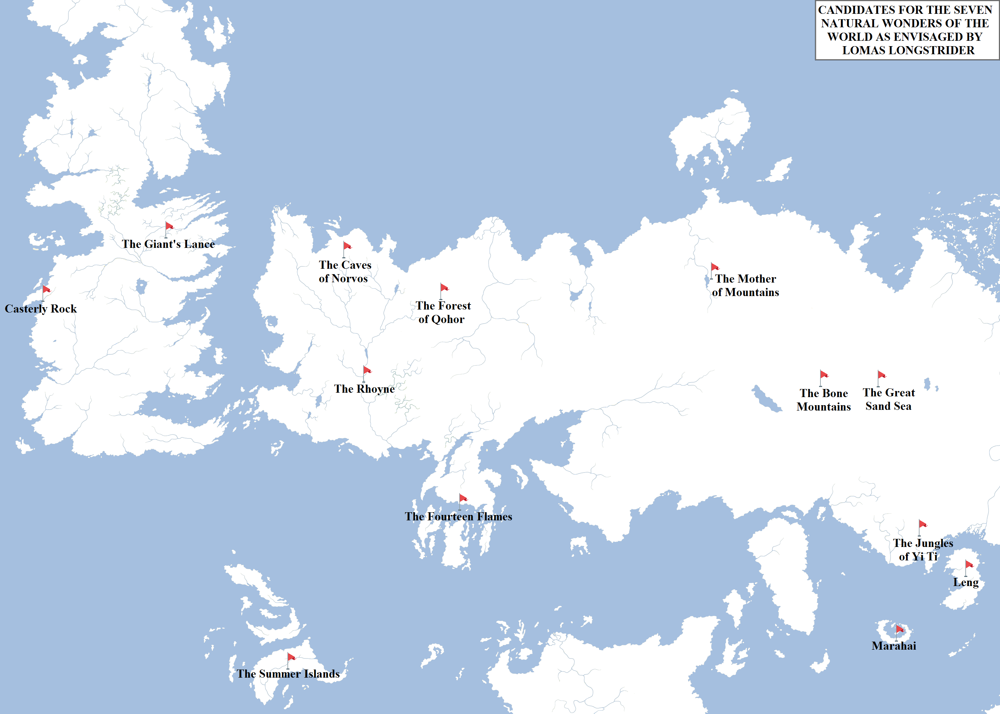
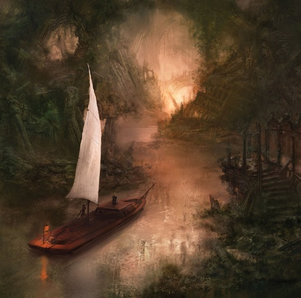

In [our previous post](https://atlasoficeandfireblog.wordpress.com/2016/04/08/wonders-made-by-man/), I looked at the _Wonders Made by Man_, the nine greatest artificial structures of the world as chronicled by Lomas Longstrider. Lomas also wrote an additional book about which we know much less, simply entitled _Wonders_. This book explored seven natural wonders of the world. As of _A Dance with Dragons_ and _The World of Ice and Fire_, we know only of one of the natural wonders: the immense underground cave system in the hills and mountains north of Norvos. The others remain unknown.

Map showing the potential candidates for the Seven Natural Wonders of the Known World, as envisaged by Lomas Longstrider in his book _Wonders_. Only one, the Caves of Norvos, is known to be part of the list.

We can, however, made good, educated guesses on what at least some of the others might be. We know that Longstrider never visited Asshai or the Shadow Lands, otherwise the forbidding shadowed valleys would likely feature heavily. It’s also unlikely he visited Ulthos or the Saffron Straits. We also know he didn’t travel east of Ib in the Shivering Sea, so the Thousand Islands, N’Ghai and Mossovy are likely also not included on his list. From the discussions of his visit to the Summer Islands, it also sounds like he avoided travelling to Sothoryos after hearing of its extremely lethal jungles.

Other possibilities are as follows, arranged in order of likelihood.

**The Highly Probable List**

*   **Casterly Rock**: one of the greatest natural wonders of the world, its fame known even in Asshai. Casterly Rock has been measured at between 2,100 feet and 2,400 feet in height, three times the height of the Wall or the High Tower of Oldtown. It is six miles long from east to west. To put this in context, the Rock of Gibraltar (on which the Rock is loosely based) is only 1,398 feet and measures about two miles in length. If this _isn’t_ one of the natural wonders of the world, I’d like to know what Lomas thought was better.
*   **The Fourteen Flames**: although few sailors dare sail within sight of the Valyrian coastline or the ash-bleeding mountains known as the Fourteen Flames today, at one time the situation was different. An immense chain of hills, mountains and volcanoes stretched across the neck of the Valyrian Peninsula and down to the great city of Valyria, with its towering dragon abodes divided by rivers of lava. The Fourteen Flames were immense mountains riven by volcanic vents, spewing lava and clouds into the sky. Whilst a question remains if Lomas would have been allowed to visit Valyria itself, it’s much more likely he could have seen the Fourteen Flames. They were immense, visible from both the sea and the land. And when the Doom came, the simultaneous eruption of the peaks caused the greatest cataclysm the world has ever seen. It’s pretty likely these made the list.
*   **The Rhoyne**: there are many great rivers in the world, but none quite like the Rhoyne. Starting as streams and tributary streams forming in the highlands, hills and mountains between Norvos and Braavos, these soon combine into one colossal waterway. Already hundreds of feet wide even before it winds its way out of the Flatlands, the river still has a thousand miles and more to run until it empties into the sea through four immense deltas. The river mouth at Volantis alone is five times the width of the Blackwater Rush at King’s Landing, and that’s only one of them. The Rhoyne is in fact so wide in places you can barely see the other side, making it more than a match for some of its inspirations, namely the Amazon, the Nile and (of course) the Mississippi, the waterway George R.R. Martin previously studied in depth for his classic horror novel _Fevre Dream_.
*   **The Bone Mountains**: several hundred miles to the east of Vaes Dothrak and the Womb of the World stand the Bones, a colossal series of mountain ranges which start off being big and then get even bigger, each range giving way to an even more massive one beyond it. The Bones stretch for over 2,100 miles from north to south and are almost 300 miles across at their widest point. Compare this to the Himalayas, which extend in an arc for only approximately 1,500 miles and are about 200 miles wide at their widest point. It is possibly, on this basis and given the greater size of the planet, that the tallest peaks of the Bones are even taller than Everest. The Bones are so dangerous to cross that even the Dothraki have rarely dared to attempt the passage, and the few _khalasars_ that survived were destroyed against the walls of Samyriana, Kayakayanaya and Bayasabhad. Lomas Longstrider was so dismayed by seeing the Bones that he lost heart and almost gave up on his journey (he either steeled himself to resume his trip, or took ship instead for Yi Ti and Leng). I think we can safely say that these make the list.
*   **The Great Sand Sea**: just beyond the Bones and along the far north-western border of Yi Ti lies a series of cliffs that drop sharply into the largest canyon system in the known world. The Great Sand Sea was possibly once an inland sea that dried up thousands of years ago, maybe the result of the same process that is affecting the Shrinking Sea a few hundred miles to the east. The Great Sand Sea is full of spectacular vistas as the ground drops away hundreds or even thousands of feet at a time. This seems a reasonably likely entry for Lomas’s list.

Beyond these obvious entries, things get a bit more speculative.

The Rhoyne as it passes through the ruins of the festival city of Chroyane. This stretch of the river is known as “The Sorrows”. Art by Marc Simonetti.

**The Speculative List**

*   **The Forest of Qohor**: located just east of the Free City of Qohor, the great forest of the same name sprawls for hundreds of miles. It divides the entire Free City region of Essos from the Dothraki Sea beyond, and provides an immense source of lumber for western Essos. The forest is vast, rich in wildlife and, although somewhat dangerous due to the animal life and the proximity of the Dothraki Sea, somewhat easy to reach given the Valyrian roads that pass straight as an arrow through it. Larger forests exist, but it is unclear if – apart from the jungles of Yi Ti – Longstrider ever visited them.
*   **The Giant’s Lance**: this is the tallest mountain in the Mountains of the Moon, on a shoulder of which sits the castle known as the Eyrie, seat of House Arryn. The Giant’s Lance is certainly an imposing mountain, 17,000 feet high and possibly the tallest mountain on the continent of Westeros. However, I suspect that the sight of the Bones – which may be as much as twice the height of the Giant’s Lance – may have displaced this from the list. Lomas may have been tempted to keep it on the list, however, due to the Eyrie itself, making the Lance likely the highest habited point in the known world. The tremendous sight of the partially-frozen waterfall of Alyssa’s Tears may also have helped keep it on the list.
*   **The Summer Isles**: we know that Lomas visited the Summer Isles, possibly on his shipborne trip to the Jade Sea and back, so that makes this a more likely candidate. The Summer Isles are islands of balmy beaches, a friendly (but determined and hardy) native culture and beautiful scenery. If there was such a thing as tourist industry in Westeros, the Summer Isles would probably be the most popular holiday destination. Whether the islands just being pretty would be enough to make the list is debatable, however.
*   **Marahai**: Located in the Jade Sea on the way to Yi Ti and Leng, this is a possible candidate for the list. The island of Marahai is apparently peaceful and tranquil, but there are two volcanic isles located in the great bay of Marahai with occasionally become active and spew fire into the sky. Apparently it’s an impressive sight from the mainland. But as nice as it is, the volcanoes are dwarfed by the Fourteen Fires and the scenery is likely outstripped by the Summer Isles. So this is less likely.
*   **The** **Moth****er-of-Mountains**: this towering peak isn’t actually all that high, especially not given the colossal peaks of the Bones just a few hundred miles away. However, the mountain may make the grade for the fact that it’s a single peak, totally alone, sitting on the endless green plains of the Dothraki Sea, with the great lake known as the Womb of the World wrapped around its flanks. It’s certainly an impressive sight, and the reason that the Dothraki assembled their only city (Vaes Dothrak) around it.
*   **The Jungles of Yi Ti**: the vast and powerful nation of Yi Ti is divided into mountainous regions in the east, vast plains in the north (giving way to the Plains of the Jogos Nhai) and, along the coast, immense, thick jungles. Despite the foliage and humidity, the bulk of Yi Ti’s immense population can be found living in these jungles, in cities and towns linked by road network, tradeways and shipping routes along the Jade Sea. Lomas Longstrider was much taken with Yi Ti, noting that even its ruined cities were more impressive than the extant cities of western Essos and Westeros. Whether the jungles themselves were impressive enough to make his list of wonders is unknown.
*   **Leng**: the island of Leng lies in the Jade Sea off the south coast of Yi Ti, and is the last major stop for merchants and travellers before forbidding Asshai-by-the-Shadow. Even Lomas’s courage failed him at the thought of pressing on, and Leng marks the eastern-most stop on his journey around the Jade Sea. Leng itself is covered by impressive jungles and forests, not to mention immense cavern systems dropping deep into the earth beneath the island. However, the government of Leng has sealed most of these off for safety. Lomas was most impressed by Leng’s wildlife, calling it the land of a thousand tigers and ten million monkeys.

As with the list of manmade wonders, we’ll have to wait and see if George R.R. Martin will expand on this list in future books. In the meantime, we are free to speculate.
