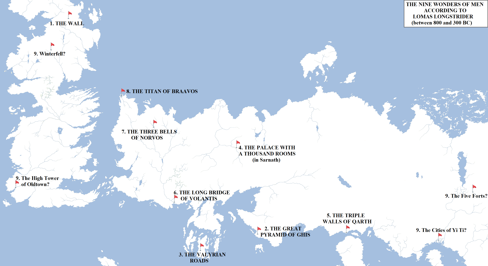
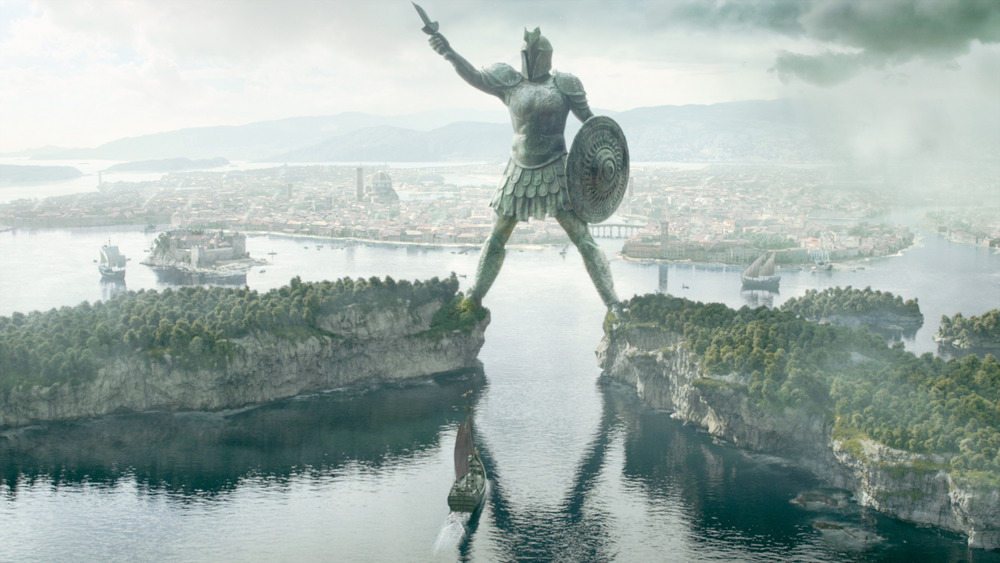

In the world of **A Song of Ice and Fire**, two of the most famous books were written by a long-dead adventurer named Lomas Longstrider. A possible homage to Robert Jordan’s Jain Farstrider (from **The Wheel of Time** books), Lomas roamed the world investigating foreign cultures and writing accounts of his travels that proved hugely popular back in the Seven Kingdoms. His two major works were _Wonders_, which detailed nine natural wonders of Westeros and Essos, and _Wonders Made By Men_, which detailed nine amazing structures built by men. Thanks to _A Dance with Dragons_ and _The World of Ice and Fire_, we know of eight of the nine Wonders Made By Men but the identity of the final one remains elusive.

Maps showing the eight known Wonders Made By Men, and speculation over the ninth.

To identify the final structure, we need to know when Lomas lived. There aren’t too many clues here, except that both Tyrion and Barristan Selmy, when he was younger, had read the two books. This puts Lomas’s life and death at least a few decades before the events of _A Game of Thrones_. He also lists the Palace With a Thousand Rooms in Sarnath (capital of Sarnor) as one of the Nine Wonders. Considering that Sarnath was levelled by the Dothraki shortly after the Doom, between 300 and 400 years before the events of _A Game of Thrones_, that puts Lomas’s life at least that far back. If this is so, this rules out any construction newer than that from being eligible. So, Harrenhal, the Red Keep of King’s Landing, the Great Sept of Baelor or any newer structure is likely not amongst the number. Lomas lists the Titan of Braavos on his list, which was built, at maximum, 800 years ago but probably a century or two under that. This gives a likely window for Lomas Longstrider’s life and times being between 400 and 800 years ago (which also means, unlike Jain Farstrider, he isn’t likely to show up in future **ASoIaF** novels).

Let us look at the existing list, arranged by age of the structure:

1.  **The Wall**: built by men (and possibly giants and children of the forest) 8,000 years ago, the Wall is 300 miles long and 700 feet high. It is the largest artificial structure in the world, and clearly a shoe-in for the list.
2.  **The Great Pyramid of Ghis**: built by the Ghiscari Empire in their capital city well over 5,000 years ago, the Great Pyramid was 800 feet tall and divided into 33 levels. The Great Pyramid of Meereen is a copy of it. The Great Pyramid of Ghis was destroyed by the Valyrians when they defeated Ghis for the fifth and final time. Lomas visited the ruins of the Great Pyramid and was able to declared it a great wonder (possibly by comparing it with its copy, the still-extant Meereenese Great Pyramid).
3.  **The Valyrian Roads**: a network of impossible, straight-as-an-arrow roads were built by the Valyrians shortly after the Freehold began rising to power. This network consists of several extremely long roads of fused stone, with no chink or break in them, running all the way from Pentos in the north-west to Bhorash and Sarnath in the east. The sheer length of this network (running to many thousands of miles) and its incredible hardiness, with some of these roads being over 5,000 years in age, impressed Lomas into including it in his book.
4.  **The Palace With a Thousand Rooms**: located in Sarnath, the capital of Sarnor. This palace was so huge, lush and ornate that Lomas felt that he had to include it in his book. Sarnor was a mighty power of Essos for over 2,000 years prior to its destruction, powerful enough that even the Valyrians chose peaceful coexistence (though the nearby trading post of Essaria). The Palace With a Thousand Rooms is probably dated to the early to mid period of Sarnori dominance.
5.  **The Triple Walls of Qarth**: the Qaathi people were a rival to the Sarnori, struggling for control of the Essosi Grasslands (later called the Dothraki Sea). The Qaathi lost those struggles, gradually being displaced south and east of the Skahazadhan. They established some towns and cities here, but the land grew desolate and dead, starving the cities into ruins. The Red Waste, as it became known, consumed the towns of the Qaathi until only the ports were left. Qarth, on the Jade Gates, was by far the largest and greatest of these. Qarth endures today as one of the greatest cities in the world. Although the Red Waste is a formidable barrier to anyone seeking to attack the city from the land, its greatest defence are its triple walls. The walls are 30, 40 and 50 feet tall and emblazoned with images of tremendous artistic skill.
6.  **The Long Bridge of Volantis**: Volantis was founded by the Valyrians over 2,000 years ago on one of the four major mouths of the Rhoyne, the greatest river of western Essos. The city, originally located to the east of the river mouth, actually existed for some considerable time without a bridge over the river until Triarch Vhalaso decreed it built to ease ferry traffic and allow swifter expansion of the newer, western districts. This puts the age of the bridge at probably less than two thousand years. The bridge was included in Lomas’s book due to the engineering achievement of building such a long structure. Although a firm length is not given in the books, it is five times the width of the mouth of the Blackwater Rush at King’s Landing, and the Blackwater is probably close to a mile wide (as multiple galleys battle one another across the mouth simultaneously in _A Clash of Kings_).
7.  **The Three Bells of Norvos**: the date of Norvos’s founding is not known, save that it is likely older than 2,000 years (Lorath, the youngest of the Free Cities, was founded 1,736 years ago). The city is divided into two distinct districts, a high one on the hills overlooking the River Noyne and the low city with its port along the river. Lomas was impressed by the three great bells of the city, Noom, Narrah and Nyel. These bells ring out at different times and in different combinations, informing the Norvosi of times to start and end the work day, have meals and attend religious worship. The size of the bells and the efficiency of their reverberations (they can be heard anywhere in the city, high or low) impressed Lomas into including them in his book.
8.  **The Titan of Braavos**: the youngest of the Nine Wonders. Braavos was founded 800 years ago as a secret redoubt by religious refugees fleeing persecution at the hands of the Valyrians. Some theorise that the Titan was built to serve as a defensive fortification against dragons. The height of the Titan has not been officially given, but rough estimates based on illustrations suggest possibly over 400 feet (the Statue of Liberty is 305 feet, for comparison, but that’s including the pedestal and the torch), given the statue has to be large enough for galleons to comfortably pass between its legs. Arya also notes that it could easily step over the 100-foot-tall walls of Winterfell.

The Titan of Braavos as depicted in Season 5 of HBO’s **Game of Thrones**.

So then, what is the ninth structure? I think we can rule out Harrenhal, the Red Keep or anything else built after the Doom of Valyria. Lomas also never visited Asshai or the Shadow Lands, so the dark and disturbing “wonders” of Asshai and Stygai would not be included. The likely candidates are as follows:

*   **The Towers of Valyria**: in the heart of the Valyrian Freehold, long before the Doom, lay immense cities where incredibly tall towers existed, separated by rivers of lava. The Lords Freeholder flew on dragonback from one tower to the other, never deigning to touch the ground. It’s likely Lomas would have counted these as a wonder if he’d seen them. However, whether an outlander would have been permitted to see such a sight is unknown.
*   **The High Tower of Oldtown**: built over a period of many thousands of years and topping out at well over north of 800 feet, the High Tower is the tallest artificial structure in Westeros and probably the world. Easily visible from the city of Oldtown, this has to be a front runner for the position, especially since it’s clearly inspired by the Lighthouse at Alexandria, one of the real Seven Wonders of the World.
*   **The Five Forts**: these are five massive fortifications located between the Bleeding Sea and the Mountains of the Morn, on the far north-eastern border of Yi Ti. The forts consist of walls of fused black slabs, each one being almost a thousand feet high. The forts and associated defences (which may be inspired by the Great Wall of China, although for once Martin’s version is rather smaller and less elaborate overall) defend Yi Ti from the wastelands beyond, and may form an eastern equivalent of the Wall (the Forts and their defences stretch for over 300 miles, so are similar in extent). We know Lomas visited Yi Ti, Leng and the cities of the Bone Mountains, but we don’t know if he came this far east, or if the reports of the size of the Five Forts are accurate or exaggerated.
*   **Winterfell**: the oldest castle in the Seven Kingdoms, sprawling across a huge amount of space which is defended by two massive walls, the inner one being 100 feet high and the outer being 80 feet high. Prior to the construction of Harrenhal, it may have been the largest castle complex on the continent, with numerous ruins speaking to its tremendous age. If the smaller walls of Qarth counted as a wonder, then perhaps Winterfell did as well. However, Lomas’s count may have been affected by Qarth’s much greater size (so the walls, being shorter, are far larger overall) and by the works of art adorning the surface.
*   **The Cities of Yi Ti:** we know that Lomas visited both Yi Ti and Leng, and was amazed by the vastness of their cities and the richness of their culture. Yi Ti is (probably) the most populated nation in the known world and also makes credible claims to the oldest. It is likely that there are many amazing structures, wonders and buildings in Yi Ti, and the final Wonder Built By Man may rank amongst their number.

It seems likely that Martin will reveal the location of the ninth wonder at some point, but until then we can speculate on which Westerosi or Essos megastructure fits the bill.
