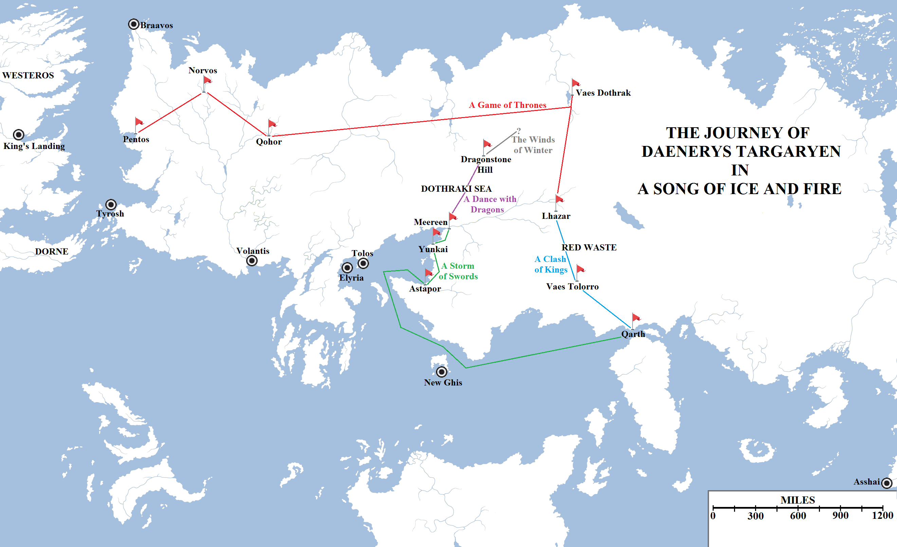
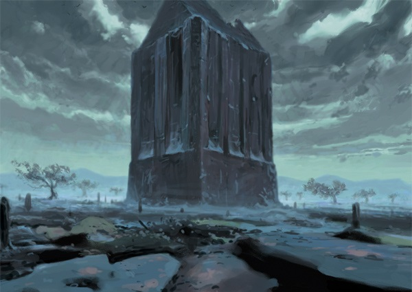

Of the main cast of characters in **A Song of Ice and Fire**, none has covered more ground than Daenerys Targaryen. In her opening chapter in the first novel in the series, _A Game of Thrones_, she is living in the manse of Magister Illyrio Mopatis just outside the Free City of Pentos. By the end of that novel alone she has crossed the Forest of Qohor and the Dothraki Sea, visited Vaes Dothrak and journeyed to the borderlands of the Lhazareen. The following books take her even further afield before she turns west and eventually arrives in Slaver’s Bay.

A map showing Daenerys’s journey and other areas of interest. Please click to see a larger version.

The above map divides Daenerys’s journey between the five published novels in the series so far:

# _**A Game of Thrones**_

After a year living in the abode of Illyrio Mopatis in Pentos, Daenerys marries Khal Drogo outside the city. Drogo’s _khalasar_ departs Pentos using the Valyrian straight roads. This allows it to travel from Pentos to Qohor, via Norvos, relatively quickly. From Qohor the _khalasar_ follows the Valyrian road eastwards through the vast Forest of Qohor (taking a fortnight, which seems a bit long considering how relatively narrow it is, but okay) to the edge of the Dothraki Sea. The Valyrian road terminates at the ruins of Essaria, Valyria’s old trading post with the kingdom of Sarnor to the north and east before both Sarnor and Essaria were destroyed by the Dothraki during the Century of Blood.

After this point the Dothraki cross almost the entirety of the Dothraki Sea. There are the remains of the old Sarnori trade routes but, not infused with alleged sorcery like the Valyrian roads, these have almost disappeared after the passage of four centuries. Back on their home ground, the Dothraki are much more comfortable moving through the open grasslands anyway. Some time later, after Daenerys learns she is pregnant, the _khalasar_ reaches Vaes Dothrak, the Dothraki city on the shore of the Womb of the World, in the shadow of the Mother of Mountains. There they stay for a time, until an attempt is made on Daenerys’s life and thwarted by Ser Jorah Mormont. Khal Drogo learns that the assassin was sent on the order of King Robert Baratheon. Furious, Drogo swears to conquer the Seven Kingdoms and put his son on the Iron Throne. The _khalasar_ strikes south, Drogo planning to take a horde of slaves in Lhazar and herd them down the Skahazadhan to Meereen to sell in return for the ships and supplies the Dothraki will need to invade Westeros.

Of course, this plan goes awry. Drogo takes a wound in battle which festers. Daenerys employs the Lhazareen _maegi_ Mirri Maz Duur to heal Drogo, but instead she renders him insensible at the cost of Daenerys’s child. Drogo’s _khalasar_ splits to the winds. Daenerys burns Mirri Maz Duur and Drogo alive on a pyre along with her dragon eggs, a gift from Illyrio who claims they came from the Shadow Lands beyond Asshai. However, the description of the eggs matches some of the eggs left behind in Westeros after the Dance of Dragons. The true origin of the eggs remains unknown. It is known that, thanks to a fusion of heat, blood and maybe magic, the eggs hatched and three dragons come into the world.

Daenerys therefore crosses the following distances in _A Game of Thrones_ alone:

*   Pentos to Norvos: just under 600 miles.
*   Norvos to Qohor: approximately 550 miles.
*   Qohor to Vaes Dothrak: approximately 2,200 miles.
*   Vaes Dothrak to Lhazar: approximately 800 miles.
*   Total: approximately 4,150 miles.

The hatching of the dragons, by Michael Komarck.

# _**A Clash of Kings**_

After the hatching of the dragons, aware the neither the Lhazareen nor the Dothraki will give her succour, Daenerys and her small band of followers head south and east into the forbidding Red Waste, the former homeland of the Qaathi people before it was destroyed by the encroaching desert. The _khalasar_, battered by disease and starvation, eventually finds some relief in the ruins of Vaes Tolorro, the City of Bones, where they find a clean well and some hardy fruit-growing trees. Daenerys’s bloodriders go searching for help and eventually locate the great city of Qarth to the south-east.

Daenerys makes her way to Qarth and allies herself with Xaro Xhoan Daxos, a merchant prince. Ultimately, Xaro proves an unreliable friend and Daenerys is betrayed by the Undying, an order of mages. The House of the Undying is destroyed by Drogon, the largest and fiercest of Daenerys’s dragons. Daenerys and her followers vacate the city quickly by sea, thanks to three ships sent by Magister Illyrio to find her.

*   Lhazar to Vaes Tolorro: approximately 525 miles
*   Vaes Tolorro to Qarth: approximately 525 miles
*   Total: approximately 1,050 miles

The House of the Undying in Qarth, art by Bjarne Hansen for Fantasy Flight Games.

# _**A Storm of Swords**_

Daenerys’s small fleet is heading west from Qarth to Pentos when Daenerys decides to take it north into Slaver’s Bay. Jorah’s suggestion is that Daenerys hires an army of the Unsullied, the greatest soldiers in Essos. Daenerys does indeed acquire an army of Unsullied in Astapor, the southern-most of the slaver cities, but is so disgusted by the slavers that she uses her new soldiers and her dragons to seize control of the city. The army then marches north to Yunkai. Daenerys fails to take the city but she does convince the Yunkai’i to surrender their slaves to her. Then she marches to Meereen and, thanks to the bravery of Ser Jorah Mormont and Ser Barristan Selmy, takes that city as well. Her advisors urge her to march on Westeros with her newly-acquired forces but Daenerys decides to remain and learn how to rule in Meereen first, fearing that the city will descend into bloodshed, chaos and slavery once more if she leaves.

*   Qarth to Astapor (by sea): approximately 2,325 miles
*   Astapor to Yunkai: approximately 375 miles
*   Yunkai to Meereen: 163 miles
*   Total: approximately 2,863 miles

Meereen, as depicted in the Telltale adventure game.

# _**A Dance with Dragons**_

Daenerys’s attempts to bring peace to Meereen founder on cultural differences, economical problems and the resentment of the ruling class. Daenerys attempts to overcome some of these by marrying a local noble, Hizdahr zo Loraq and winning the allegiance of the religious leader, the Green Grace, but ultimately these moves only result in a reprieve whilst those opposed to Daenerys’s liberation of the slave cities attack and destroy Astapor and then besiege Meereen. Daenerys is eventually carried off from the city by her dragon, Drogon, who flies north and east far into the Dothraki Sea and leaves her on a hill she names Dragonstone, in memory of the ancestral Targaryen island fastness in the Narrow Sea. She and Drogon are then surrounded by Dothraki, the _khalasar_ of Khal Jhaqo, one of Drogo’s bloodriders who splintered off after Drogo’s death and formed his own khalasar.

*   Meereen to Dragonstone Hill: very approximately 550 miles
*   Total distance travelled from Pentos in _A Game of Thrones_: **approx.** **8,613 miles**

Drogon and Daenerys Targaryen in Daznak’s Pit in Meereen.

# _**The Winds of Winter**_

Daenerys’s fate in _The Winds of Winter_ is unknown, of course, although some things seem likely. It is probable that Daenerys will return to Vaes Dothrak to the north-east and use Drogon to impress the Dothraki into following her. With a vast Dothraki horde at her back, she can then do what she long ago vowed to do: returning to Westeros to claim her rights by fire and blood. How this will be achieved, and whether it will be in time to address the threat of the onrushing winter and the rising dead that come with it, is something that for now only George R.R. Martin knows for sure.

**Hey, will Daenerys be travelling east to reach Westeros via Asshai?**

**[This again? No.](https://atlasoficeandfireblog.wordpress.com/2016/02/29/the-size-and-extent-of-essos-sothoryos-and-ulthos/)** To do so, Daenerys would have to travel approximately **22,480** miles right around the planet, almost completely circumnavigating it. This is instead of travelling west just 3,000 miles to get back to Westeros. Given the limitations of sailing technology (and, without known islands for the dragons to fly and hop across whatever ocean lies east of Essos, she would have to sail), this will take several years and likely remove Daenerys from the story until long after the ultimate victory of the Others.

The reference of going east to go west is likely referring to what we’ve seen already: Daenerys going back to Vaes Dothrak to complete what she started before, and travelling in a huge circle around Slaver’s Bay and the Dothraki Sea before she can finally strike for home.
