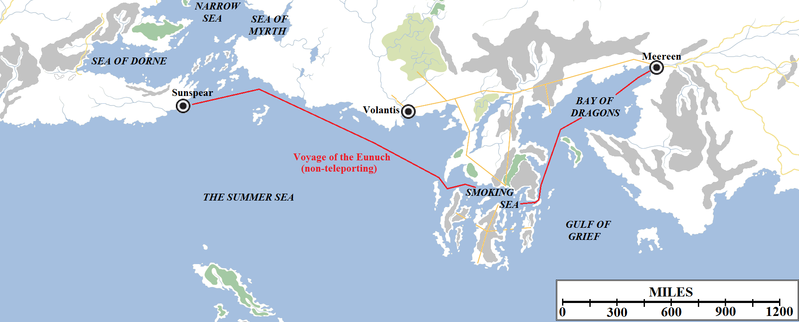

The latest season of **Game of Thrones** has played a little fast and loose with the realism of medieval travel times, chronology and geography, it is fair to say. The TV series has always done this, of course, but in Season 6 there were moments when it felt a little bit over-the-top, especially Littlefinger flashing back and forth between Winterfell, Moat Cailin (700 miles to the south) and the Vale of Arryn, 500-ish miles further away. The most jolting moment came in the series finale when Varys apparently travelled from Meereen to Sunspear in Dorne and back to Meereen again in what felt like a very short span of time.

The Voyage of Varys in Season 6 of **Game of Thrones**. A round-trip journey of 5,130 miles could be accomplished in around ten weeks, assuming he stays in Dorne for a fortnight and there are favourable winds.

The simple answer is that a lot more time elapsed than it first appeared. This has been the case in the show all along which has eaten up much time than the novels. More than a month elapses in the very first episode of the series, _Winter is Coming_, by itself. By the end of Season 5 Myrcella Baratheon says that she had spent “years” living in Dorne, where she was sent towards the end of Season 2. Very clearly, Arya, Sansa and Bran have all grown considerably and even Jon and Daenerys are notably older than when the story began. Estimates vary but it appears that at least three and maybe closer to five years have elapsed in the show to date, compared to two to just under two-and-a-half years in the novels (which begin in 298 AC and conclude, so far, in the middle or latter half of 300 AC). There are some problems with this, most notably that Gilly’s baby (born just a few episodes after Myrcella’s departure for Dorne) only appears to be a year or so old when he should really be over two and maybe closer to three, but it’s a necessity of the production schedule of the TV show and the inconvenient insistence of the actors on aging a year between each season.

For the purposes of cartography, working out how much time elapsed on Varys’s journey is interesting. Meereen and Sunspear are 2,565 miles apart in a straight line. However, the shattered volcanic peninsula of Valyria lies inconveniently in the way. In the books, sailing around Valyria is described as a “fearsome” journey which the faint-hearted do not attempt. Sailors believe that to sail within sight of the cursed Valyrian coastline is to risk death, but ships are not designed to sign for vast periods of time far away from the sight of land. Storms are common on the Summer Sea, particularly if the surviving Fourteen Flames of Valyria are active, and losses at sea are common.

In the TV show, the same dangers are not in place. In fact, in Season 5 Jorah Mormont and Tyrion Lannister cut across the neck of the Valyrian Peninsula via the Smoking Sea and it’s even said that the route is reasonably safe – plummeting Stone Men aside – as the dangers are greatly exaggerated to dissuade treasure-hunters and pirates. Assuming that Varys travelled with a bold captain in a swift vessel, how fast could the journey be?

_Medieval Trade in the Mediterranean World_ (Lopez/Raymond) features a surviving chartering contract for a ship sailing from Genoa, Italy to Acre, Israel in 1250 AD. This is a distance of just under 2,079 miles (1,807 nautical miles). The crew anticipated spending a minimum of 22 days at sea on the voyage out and 25 back, although of course this could be dramatically extended by unfavourable weather, becalmings, storms etc or dramatically shortened by favourable winds on the right quarter. That’s an average of 94.5 miles per day under ideal circumstances.

Travelling in the Mediterranean may be analogous to crossing Slaver’s Bay (now aka the Bay of Dragons) and maybe even the Smoking Sea, but braving the open ocean of the Summer Sea is a different matter, even if Varys’s ship is cleaving to the shore (as all medieval ships generally did; ships capable of sailing out of the sight of land with a reasonable expectation of survival did not really emerge until the 15th Century). Still, let us assume winds were favourable in both directions. Assuming the 94.5 mpd average holds true, it would take 27 days to sail from Meereen to Sunspear. Let’s call it an even month. Let’s assume that Varys spent a fortnight in Sunspear. Logically it should be more if he showed up and only after making his offer of an alliance with the Sand Snakes did they send for Olenna Tyrell, but maybe he organised something by messenger whilst _en route_ and they set it up so Olenna was already on her way or something. Anyway, that gives us a time elapsed from the start of episode 608 (when Varys departs Meereen) to the end of episode 610 (when he joins Daenerys’s fleet) to something like two-and-a-half months, with a time-jump within the episode itself as about a month to six weeks. Not quite as outrageous as first appears. In addition, although viewers have been assuming that Daenerys’s fleet was just departing Meereen there is no on-screen evidence of that. Dany’s fleet could in fact be in the Summer Sea already and Varys and the Tyrell and Martell ships he brought with him could have joined them _en route_.

So, no teleportation required, although the writers could have maybe done a little more to flag the fact that much longer stretches of time had passed than maybe it first appeared.
