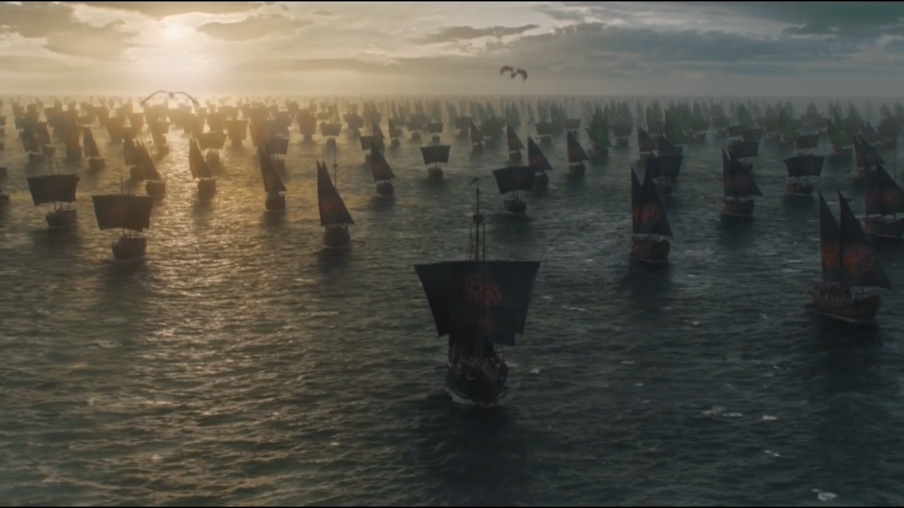
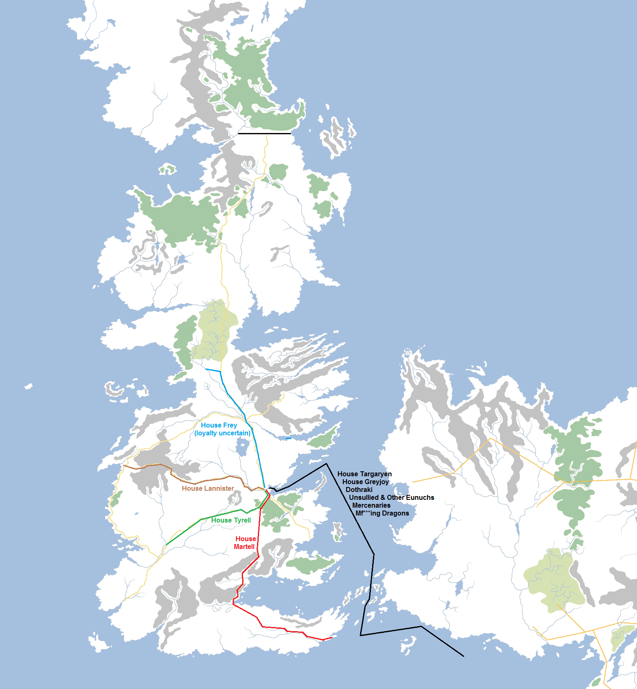
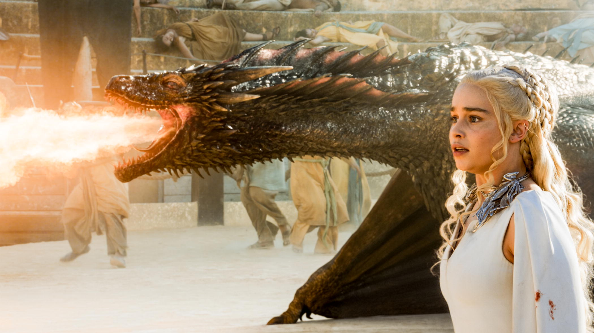

Since the opening chapters of _A Game of Thrones_, readers have anticipated one event in **A Song of Ice and Fire** more than almost any other: the return of Daenerys Targaryen to Westeros and her claiming the Iron Throne with the appropriate amounts of fire and blood. Despite its unimpeachable excellence, _A Storm of Swords_ disappointed a lot of readers when it ended with Daenerys choosing to stay and rule the city of Meereen in Slaver’s Bay rather than pressing on for home. Dany’s departure for Westeros in the books is now not anticipated until _The Winds of Winter_, at least, and it will be a murky, conflicted invasion involving not just Daenerys and her forces but various factions working at cross-purposes. Prominent amongst these complications is her alleged nephew, Aegon VI Targaryen, and his mercenary army, the Golden Company. Aegon and the Golden Company are already in-theatre and may be able to claim the Iron Throne whilst she is still MIA in the Dothraki Sea.

The Targaryen fleet heading for Westeros.

HBO, however, have accelerated this particular storyline. The sixth season of **Game of Thrones** ended with Daenerys setting out with a “coalition of the willing” to finally invade the Seven Kingdoms and claim the Iron Throne. So, how might this be achieved?

For starters, we might look at the forces involved:

**House Targaryen**

*   Three dragons.
*   Dothraki bloodriders (100,000+ men).
*   House Tyrell (several dozen ships, 100,000+ men).
*   House Martell (several dozen ships, 30,000+ men).
*   Rebel Greyjoy forces (100 ships, several thousand troops).
*   The Unsullied (8,000 elite troops, minus a few dozen killed by the Harpy).
*   Captured ships from Volantis, Astapor and Yunkai (hundreds).
*   Support from forces loyal to R’hllor, Lord of Light.
*   Superior numbers.
*   Air superiority.
*   Naval superiority.
*   Dwarf superiority.
*   Eunuch superiority.

**House Lannister**

*   House Lannister (60,000 men minus several tens of thousands of casualties from the War of the Five Kings).
*   House Frey (unreliable, 4,000+ men)
*   Various houses in the Crownlands, Riverlands and Stormlands, maybe totalling 40-50,000 men but of highly uncertain loyalty.
*   One raging psychopathic undead giant zombie thing.

**House Stark**

*   Forces directly loyal to House Stark (probably over 10,000 men, maybe more).
*   House Arryn (40,000+ men)
*   Wildlings (2,000+ men)

**Uncommitted**

*   The Brotherhood Without Banners (several hundred forces)
*   House Greyjoy (1,000 ships and probably 10,000+ men)
*   The Night’s Watch (less than 1,000 men, but unable to leave the Wall)
*   Mercenary forces of Essos (tens of thousands of men)
*   The Iron Bank of Braavos (previously allied to Stannis but current deposition unknown)
*   The hill tribes of the Vale of Arryn (several thousand men, previously allied to Tyrion Lannister)

Dany’s forces in the battle for the Iron Throne will include the armies of House Martell and Tyrell, a large part of the strength of House Greyjoy, tens (and maybe hundreds) of thousands of Dothraki bloodriders, elite Unsullied forces and three dragons. The Lannisters have only their own forces and the redoubtable House Frey to oppose them, and will be severely outnumbered, outmatched and outflanked.

That’s…not great for the forces of House Lannister. In fact, they are so seriously outmatched and outnumbered that I’m not even sure it’s worth them turning up to fight. For there to be any tension in the conflict I suspect the producers of the show will have to field some curveballs.

First up, I think there will be an alliance between Euron’s ironborn and Cersei. Given the lengthy lead-time required to build more ships and then sail to Slaver’s Bay, Euron probably realises that Yara and Theon reached Daenerys months ahead of him and have already secured an alliance. If he wants to rule the Seven Kingdoms, allying with the person who’s already in charge – Cersei – would make a certain amount of sense. Although this would make a naval assault more problematic for Dany’s forces, the certain advantages they have – like three airborne boat-burning dragons – would still ensure victory in Blackwater Bay. The forces the Lannisters and Greyjoys would have available to defend King’s Landing would be quite strong, potentially a quarter of Daenerys’s forces but with the defensive multiplier gained from holding the walls that could be enough to hold them off. However, again, Dany’s dragons would eliminate that advantage and Varys is well aware of the tunnels under the city, such as the one Arya stumbled across in Season 1, that would allow strike forces to slip inside and attack the Red Keep whilst the bulk of the defenders are on the walls.

Daenerys’s dragons confer an immense tactical advantage that Cersei would not seem able to match.

One potential force-equaliser would be if Euron has, as in the books, a Valyrian horn of dragon control. If he does, this could upset things at a delicate moment in the attack. Seizing control of all of the dragons and turning them against Dany’s army and fleet could be disastrous, or getting the dragons to fight and kill one another, or even just distracting them to prevent their use in the battle.

Another possibility is the use of additional stocks of wildfire. Having blown up part of Stannis’s fleet on the Blackwater and then destroyed the Great Sept of Baelor with it, it might be a little too much to rely on it to turn the tide in a third major engagement, but at least this time the attackers should be forewarned by Tyrion and Varys. There’s always been a strong theory that Cersei would rather burn King’s Landing to the ground then surrender and it might be that she would rather die and try to take as many of her enemies with her as possible than give up meekly. This would track with Daenerys’s TV vision from the House of the Undying where the Red Keep is in ruins and snow is falling on the Iron Throne.

Another complicating factor is the position of House Stark. At the end of Season 6 the Starks have a problem. They know about the threat of the White Walkers but they also need to neutralise Cersei and prevent any further threat from the south, as well as attempting to secure more support in the struggle to come. They may decide to march once they learn of Cersei’s difficulties, especially with House Frey in chaos from Lord Walder’s assassination. However, it may be that Daenerys and Jon Snow’s forces come into opposition with one another, potentially over competing claims to the Iron Throne. This would also maximise the level of chaos at a time when Littlefinger is trying to manoeuvre himself into a position where he can take the throne himself (the Knights of the Vale may tip the balance in any struggle, as they did in the battle for Winterfell). And of course this level of chaos would benefit the White Walkers, since they could potentially strike at the Wall at any time.

We know from George R.R. Martin’s original outline that **A Song of Ice and Fire**, when originally mooted as a trilogy, was meant to conclude with an epic battle between the living and the undead, possibly in the North and maybe at Winterfell. The TV producers are not bound to that, of course, and Martin may have changed his mind since then. But with less than 15 episodes of the TV series left and apparently only seven episodes in Season 7, it looks like we are moving decisively towards the end of the TV version of the story and that would indicate that Daenerys’s invasion of Westeros will need to be wrapped up by the end of the next season. It’s going to be a short, sharp and brutal campaign, whoever ends up winning.
