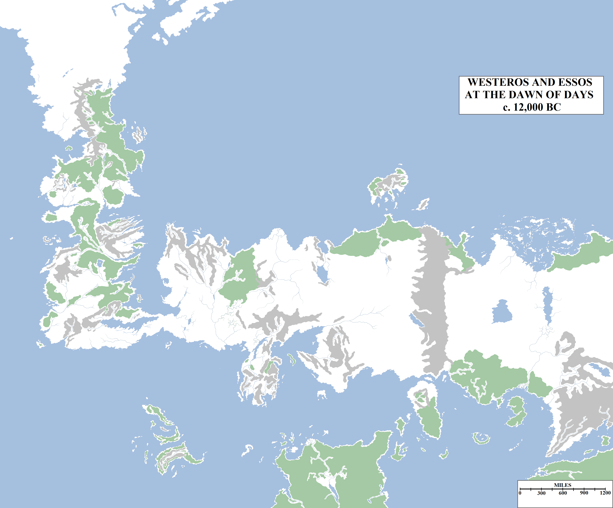
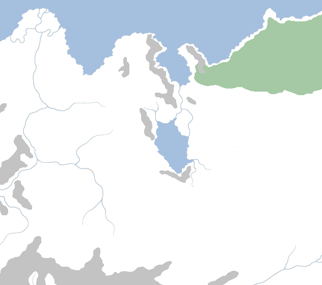
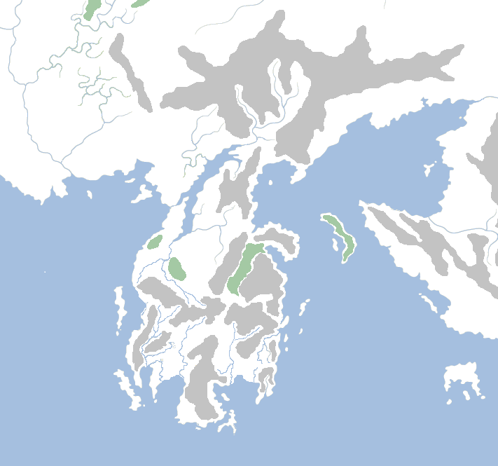
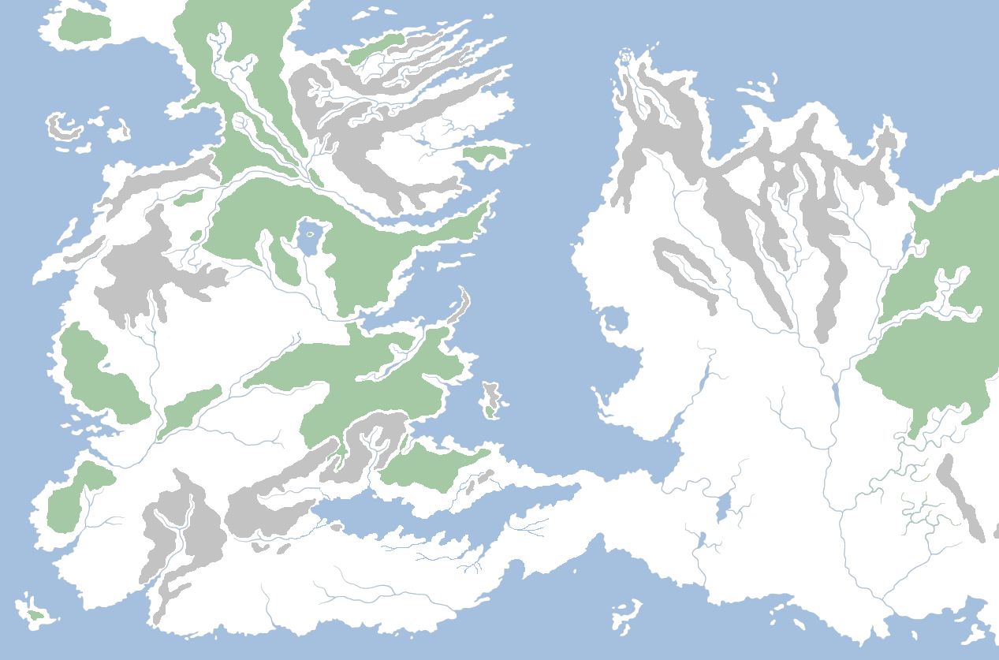

In the Dawn of Days, the period of history that came to an end (according to tradition) some twelve thousand years ago, humanity did not exist save as small bands of roving tribesmen. From whence they came, no-one could say for certain, not even the elder races.

The Known World at the Dawn of Days, at the end of the Dawn Age more than twelve thousand years ago (according to tradition). At this time Westeros and Essos were joined by an isthmus known as the Arm of Dorne and much of Westeros was covered by thick forests. Westeros was home to the Children of the Forest and the gians, Essos to primitive, fur-clad tribes of men.

At that time the world was the domain of two races: the Children of the Forest and the giants. The giants lived in the great northern mountains of Westeros and were strong, fierce and formidable, but lacking in numbers. The Children lived in and under the vast forests that covered most of the Westerosi continent (and, according to some legends, the forests of Essos as well) at that time, sprawling across much of the North, the Riverlands, the Reach and the Stormlands. Neither race recorded history nor wrote books, so it is unknown how long the two races dwelt – sometimes with hostility – alongside one another. According to the Children, their memory stretches back tens and maybe hundreds of thousands of years into a past so remote it is scarcely credible to believe. Some maesters hold that the world is five hundred thousand years old. If so, it may well be that the Children simply ruled the known world for all of that time until men arrived to displace them. The Children lived in harmony with nature, carving faces into the great weirwood trees that could in those days be found in every forest from the Red Mountains to the Frostfangs and enjoying a simple and peaceful existence, only occasionally affected by conflict with the giants.

The Silver Sea was a large body of water in central-western Essos, north of the Painted Mountains, located in the north of the Grasslands (now called the Dothraki Sea). Around its shores the great kingdom of Sarnor later took shape. Today the Silver Sea has dried up, forming three lesser lakes.

There are suggestions of some other, ancient forces dominating the world, however. Black stones, made of an unusual, oily substance, have been found scattered across the world from Pyke to Asshai. Mysterious vast mazes, possibly of non-human origin, can be found on the islands of Lorath. Colossal fortifications, potentially too colossal to be of human construction, stretch across the north-eastern borders of Yi Ti. The true origin of these ruins and items remains unknown, but suggest that the real history of the world is far more complex and bizarre than the neat, orderly chronologies that the maesters strive for.

At this time the Valyrian Peninsula was still intact, extending south from Essos into the Summer Sea. At this time Valyria’s most striking feature was the volcanic mountain range known as the Fourteen Flames.

We know that in those remote times, the world looked differently to how it does now. Westeros and Essos were joined by an immense isthmus that separated the Narrow Sea from the Summer Sea, stretching from what is now Dorne into the Disputed Lands in the Heel of Essos. The Sea of Dorne was in those days a large, brackish lake, likely fed by many streams originating in the Red Mountains and the  mountainous hills stretching along the coast (which later became the Stepstones). The world was wetter, with the Silver Sea covering what is now a series of broken-up lakes in the western Dothraki Sea, and a vast body of water lying inland in Essos, now a salt desert and a lake collectively called the Shrinking Sea\*. The Neck in Westeros was also not covered in swamps, instead consisting of pleasant woodland. There were no cities and very few people of any kind, so no logging, no cities and nature was allowed to dominate.

Westeros and Essos joined by the Arm of Dorne. This isthmus wrapped around the inland Sea of Dorne (a large, salty lake surrounded by marshes and fed by streams and rivers originating in the eastern Red Mountains) and connected what is now Dorne and Cape Wrath to the Disputed Lands in the fertile Heel of Essos. Both the Stepstones and Estermont were likely part of the mainland, although Tarth was too far north and Lys too far south, so were likely still islands.

From where the first tribes of men came is unknown, save that they originated from the east, from Essos where they lived in tribal groupings. Whether they did somehow spring up out of the ground there, or perhaps came from the south, from Sothoryos or from lands as yet unknown in the most distant east, is unknown. They rarely, if ever, came west into Westeros and were not deemed a threat by the Children or the giants.

Large blocks of fused black stone, often feeling oily to the touch, have been found right across the Known World. They predate any known human civilisation. These blocks have been found on Pyke in the Iron Islands, on Battle Island in Oldtown Harbour, on several of the islands of Lorath, on the Isle of Toads in the Basilisk Isles, in the ruined city of Yeen on Sothoryos, in the oldest cities of Yi Ti, in the construction of the Five Forts on the edge of the Grey Waste, and in the great, shrouded city of Asshai, where it is apparently commonplace. Some maesters have spent their whole lives studying this substance and have not been able to discern its origin, purpose or makers.

What changed is that these tribes started settling, raising families and larger social groups. They started farming the land and then started created weapons, first of stone and later of bronze. The creation of bronze spurred a new age of warfare and rivalry between the tribes. Eventually, groups were displaced westwards across the Arm of Dorne in vast numbers, forming both an invasion and a migration. According to traditional histories the First Men began the great crossing to the Sunset Lands over twelve thousand years ago.

\* Based on the original cover blurb for _A Game of Thrones_ and hints in _The World of Ice and Fire_, it is possible to highly probable that the world enjoyed “normal” climatic conditions in these days, seasons of regular length like our own. If this is the case, it is likely that Westeros and Essos would both be much more fertile with smaller deserts (if any), due to the more regular alteration in temperature.
