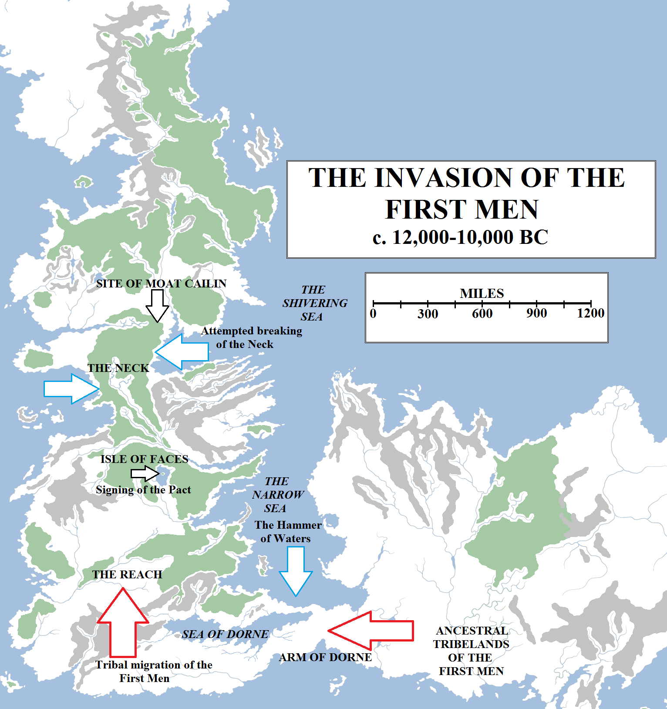
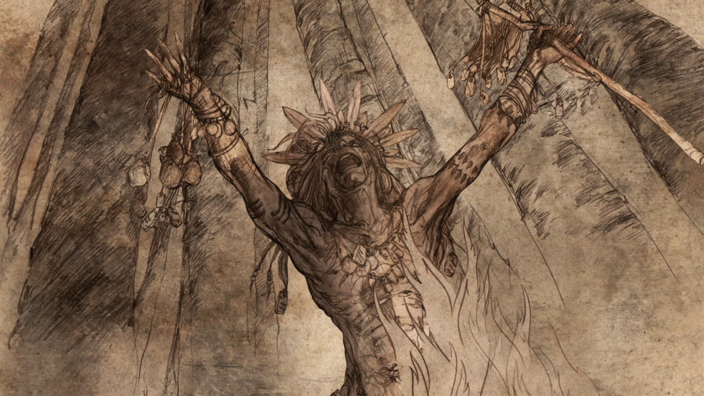
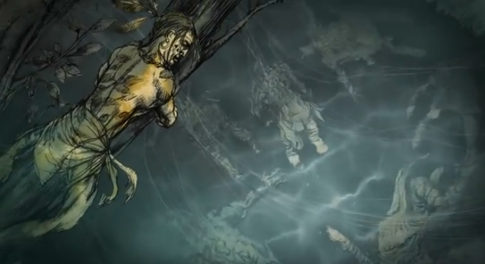
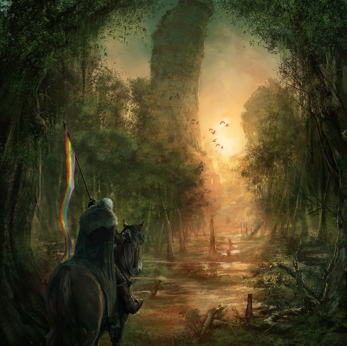

[As discussed previously](https://atlasoficeandfireblog.wordpress.com/2016/09/20/historical-map-1-the-dawn-of-days/), the First Men originated in Essos, the vast continent to the east of Westeros, beyond the Narrow Sea. In those days the Broken Arm was not broken, with instead a substantial isthmus linking the two continents and separating the Narrow Sea from the Summer Sea. It appears that this route linking the two landmasses was not widely travelled, for the lands of Dorne were arid and dry (if, most likely, not as desertified as they are now) and the route north around the then-inland Sea of Dorne was impassable due to vast salt marshes.

According to traditional histories, the First Men invaded Westeros 12,000 years ago and, in a conflict lasting anything from a generation to 2,000 years, conquered the South before forging the Pact with the Children of the Forest, ending a long period of conflict.

However, tribes from the east began to migrate across the Arm of Dorne. The cause is unknown, but the maesters of the Citadel speculate that it may have been simple population pressure. Farming became more widespread, especially in the fertile Heel of Essos, and the population would have boomed. Combined with the increase in the use of bronze, particularly in war, there would have been conflict. Searching for more land, the tribes of the First Men slowly moved west, across the Arm of Dorne, through the arid lowlands and then up through the Red Mountains. They came on foot but they also came on horses, for the First Men had tamed the beasts to be used for both burden and battle.

Beyond the dry Red Mountains they found a veritable bounty and a land so rich and fertile it may have seemed like a divine promised land after the harshness of Dorne: the Reach. A vast swathe of rolling plains and hills, fed by the immense River Mander and its tributaries, the Reach would have been settled strongly by the early-arriving First Men. Perhaps word of this largesse returned via the Arm to Essos, and a trickle of migrants then became a flood. Over the course of generations and centuries, the Reach was settled and farmed and more and more people arrived: family groupings and entire tribes after them. Eventually they would have moved east into the heavily-forested Stormlands and north towards the Riverlands. Although they had started mastering the art of building with stone, it was far easier and cheaper for most to build dwellings out of wood, and the vast forests of Westeros provided a convenient source of lumber.

To what extent southern Westeros was forested is unclear, although legends speak of much vaster canopies of trees existing than the likes of the Rainwood, Kingswood and the woods around Crakehall, which survive today. These forests, like all of the woodlands of Westeros, were the domain of Those Who Sing the Songs of the Earth, whom men remember as the Children of the Forest.

A greenseer singing the Song of the Earth. Artwork by HBO for the **Game of Thrones** home media release.

The Children held all the lands under the forest roof to be theirs, the sacred lands of the ancient and nameless gods. There they carved faces into the weirwood trees, so their greenseers could see whatever they could see, and there they lived long lives. Minstrels like to say these were lives of peace and plenty, but the Children maintained a martial tradition with their wood dancer hunters, and it may be that the Children faced conflicts with the giants, with one another, or with earlier, less numerous migratory tribes of men…or even the rumoured creatures of the sea.

The Children were skilled at sorcery and at war, but one thing they were not was numerous. A Child of the Forest could live for several human lifetimes, but they paid for this longevity with a low birthrate. It is likely that the Children were already grossly outnumbered when the First Men began taking their axes to the great forests and began seizing the Children’s lands from them, and this disadvantage soon proved disastrous.

It is possible that the Children initially ignored the arrival of the First Men, and may have treated with them, for the lands most attractive to the human settlers – the wide open plains of the Reach – were not of much use to the Children. But when the First Men began cutting down the trees and would not stop, the Children were forced to resort to conflict.

Maesters argue long and hard about when the First Men invaded Westeros. According to tradition, the First Men crossed the Arm of Dorne twelve thousand years ago…but was that date of the first mass migration or the adventures of the earliest, probing pioneers? How long elapsed between the first migration and the outbreak of war? Did the Children and First Men coexist for centuries before hostilities erupted, or was there a much faster outbreak of violence? It is simply impossible to tell.

What we do know is that the war that followed last many human generations. The Children knew the forests intimately and had the use of sorcery, but the First Men had far vaster numbers, better weapons and soon proved surprisingly adaptable, devising new strategies and tactics to drive back the Children. The Children also had an unachievable strategic goal: with their inferior numbers it was impossible to hold and defend the vast forests against invaders, especially those who had no issue with burning vast stretches of greenland to take more later on. Over the course of years and decades, the Children lost control of much of southern Westeros.

One problem they faced was that the migration of the First Men was continuing: new tribes and families were crossing the Arm of Dorne even as the First Men already in Westeros bred faster than the Children could match. To halt this threat, the Children decided to embark on the most arduous and greatest feat of magic the world has ever seen: the Hammer of the Waters.

According to myth, the greatest greenseers gathered – possibly on the Isle of Faces in the great lake known as Gods Eye – and sacrificed ten thousand captives to the old gods. The scale of this sacrifice allowed the Children to raise a great wave of water which roared down the Narrow Sea and smashed into the Arm of Dorne with tremendous force. The wave weakened the fault-lines through the isthmus and broke it apart, sending vast columns of rock crashing into the sea. It is said that hundreds of thousands died in Westeros and Essos, and on the arm itself, as the great flood shattered the Arm and left behind a broken jumble of islands and sea-stacks: the Stepstones.

A wood dancer surveying the aftermath of the Hammer of Waters. Artwork by HBO for the **Game of Thrones** home media release.

According to Archmaester Cassander in his noted work, _Song of the Sea: How the Lands Were Severed_, the true story may be less epic and impressive. Cassander notes a discrepancy in the apparent abilities of the Children: their sorcery is mostly noted as being used to see things happening far away, to spy over across vast distances, and possibly to use birds for communications in a manner we don’t fully understand. But to jump from that to the ability to shatter continents at will seems extreme and unlikely. Cassander instead studied the melting of glaciers and the properties of floodwaters and suggested that unusually long and warm summers may have resulted in the vast northern ice cap beyond the Shivering Sea melting, at least in part, sending floodwaters south along the Narrow Sea. This would not have been a single hammerblow, but instead a gradual but continuous rising of the sea levels over the course of decades or even centuries, perhaps even unnoticed for a long time. At some point the isthmus was overwhelmed and collapsed, or in fact it is still there under the waves, and the Stepstones are merely the highest hills of the land bridge to have survived the inundation.

Others have suggested a combination of the two: the Children manipulated natural processes already at work to accelerate the flooding in a much more concentrated period of time, say a few years or a couple of decades, and thus were able to present themselves as having achieved a much more magnificent feat of magic than that which they were normally capable of.

Whatever the truth, this display of magic cowed the First Men, and certainly the story of it has been passed down ever since in awe and terror, but it did not stop them. To the utter dismay of the Children, the First Men soon learned how to build small boats and hopped from island to island to reach the coasts of Westeros. But if it stemmed the tide, it could not stop the many thousands upon thousands of First Men already living on the continent.

The Children retreated. According to some accounts they fell back to the forests which covered the Riverlands, stretching north from the many-streamed Trident and the lands around Gods Eye all the way into the cool lands of the North. In the midst of that forest, at a strategic choke-point between the Bite, the Saltspear and the Fever River, the Children came together again to work their sorcery. This time they planned to break the Neck, the narrowest part of the continent of Westeros, and abandon the entire southern half of the continent to the First Men. But this time their magic did not work as planned: the water rushed onto the land, but did not sink or shatter it. Instead, it left behind festering boglands and marshes. If the First Men were dismayed at their failure, they also had to acknowledge that it was very nearly as effective: the reduction of the Neck to a vast swamp stretching for hundreds of miles made it virtually impassable for any army to pass. And certainly the display of magic would have again made the First Men pause.

That said, the legends hint that the war may have been petering out anyway. The First Men were numerous and bred quickly, but the south of Westeros was vast. They had more land than they could fill for centuries and potentially millennia to come. The shattering of the Arm had reduced the tide of migrants from Essos to a trickle (which soon died away, at least for the next few millennia), ending the population pressures from that quarter. It also appears that some of the First Men had begun to make alliance with the Children of the Forest. The crannogmen, the diminutive dwellers of the Neck, sought the Children’s protection and advice to colonise the swamplands. Worship of the nameless gods of the Children had already begun among some of the First Men tribes. Eventually the benefits of peace and coexistence became more compelling than further violence, and the leaders of both races agreed to a meeting.

On the Isle of Faces, the First Men and the Children of the Forest forged the Pact, a treaty of friendship and alliance. The Children agreed to cede the open plains and even some of the forest lands to the First Men, but in return the First Men had to agree to never destroy the great weirwoods. The First Men agreed.

The forging of the Pact ended the Dawn Age and ushered in the Age of Heroes, which according to tradition lasted for the next four thousand years.

“Theon Greyjoy rides to Moat Cailin”, by Marc Simonetti.

**A Note on Moat Cailin**

One of the more puzzling aspects of Westerosi history – and discrepancies, oddities and conflicts of information in the history of the continent are legion – relates to the age and origin to Moat Cailin, the ruined fortress located where the Kingsroad crosses the Neck. According to tradition, Moat Cailin is the oldest fortress still extant in Westeros, being at least ten thousand years old. It was raised either very late in the Dawn Age or very early in the Age of Heroes. According to some stories it was raised by the First Men and captured by the Children of the Forest; in a few, highly implausible, others it was raised by the Children of the Forest, having observed the working of stone by the First Men; and in yet others it was raised by the crannogmen, First Men who were working alongside the Children as allies.

In several legends, it was from Moat Cailin that the Children of the Forest summoned the waves that drowned the Neck, specifically from the Children’s Tower. However, these legends are contradictary. Most notably, Moat Cailin’s location is due to it being the most formidable natural chokepoint through the marshes. Unless the Children had prescient knowledge of the exact extent of the flooding and what areas would be affected and what wouldn’t, it would not be possible to build the castle _before_ the flood. It is perhaps more likely that the Children used the approximate location of the later fortress to work their magics, and this tale was conflated with the likely later (probably considerably later) founding of Moat Cailin as we know it.

It is of course improbable in the extreme that any of the surviving remnants of Moat Cailin are ten thousand years old, especially given the environment. Most likely, a strategically-minded First Man king raised a keep on the modern site of Moat Cailing some centuries after the Pact and succeeding fortresses have been built on the same spot, in the same manner as Winterfell and other great keeps of Westeros.
