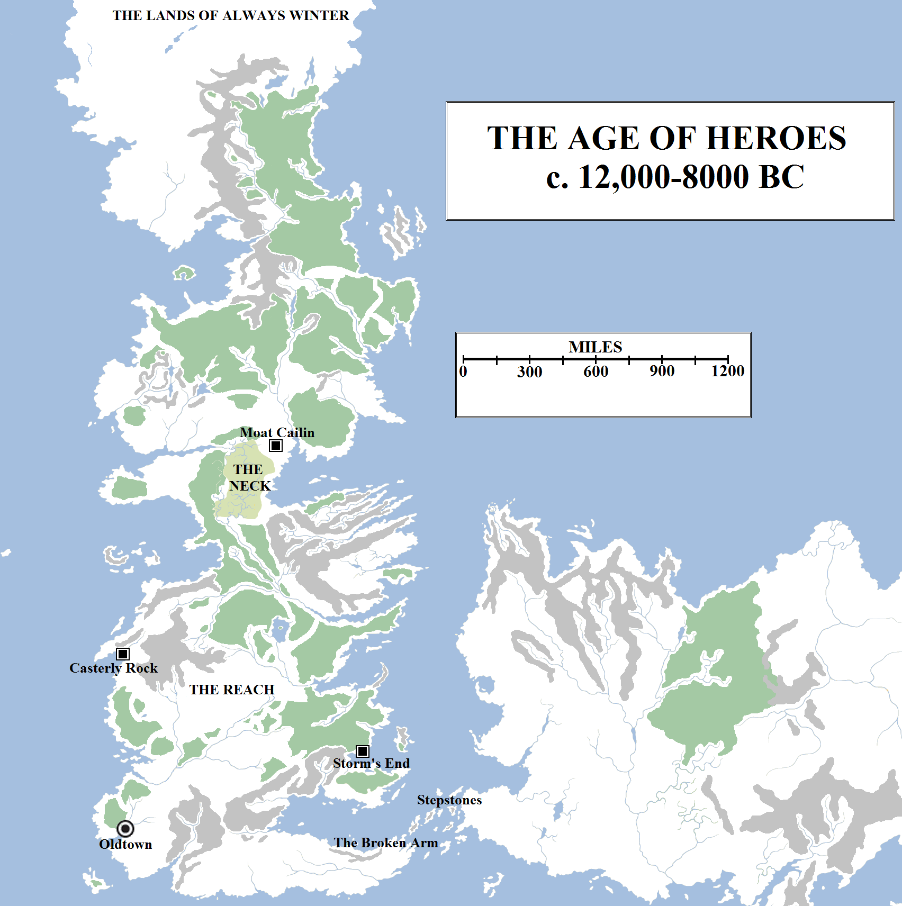
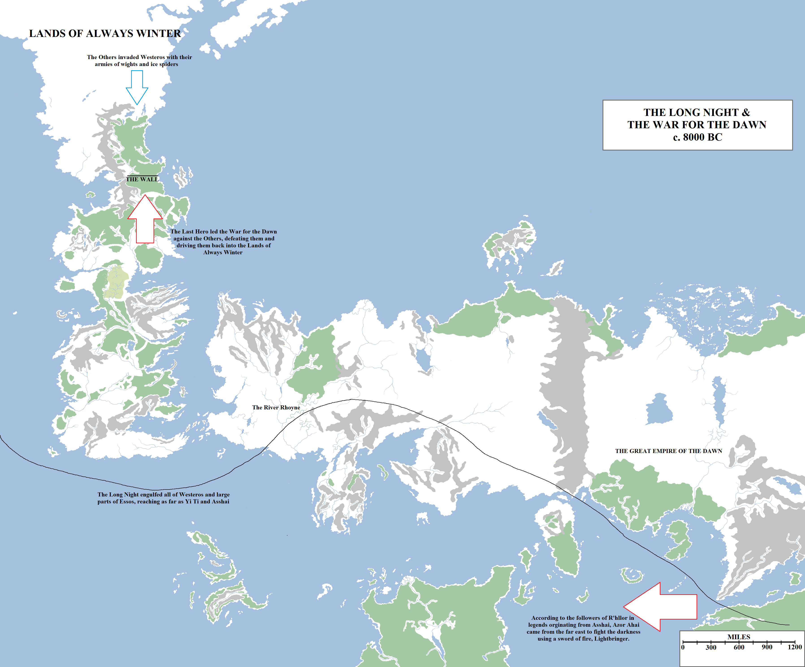
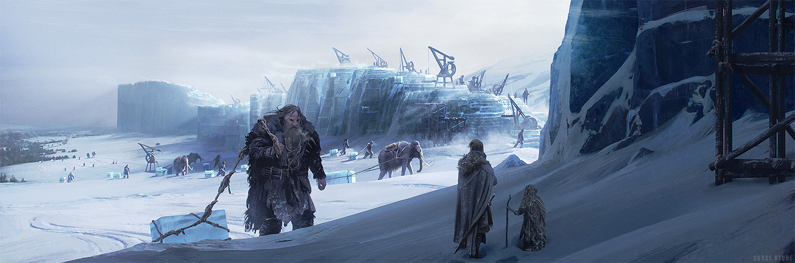
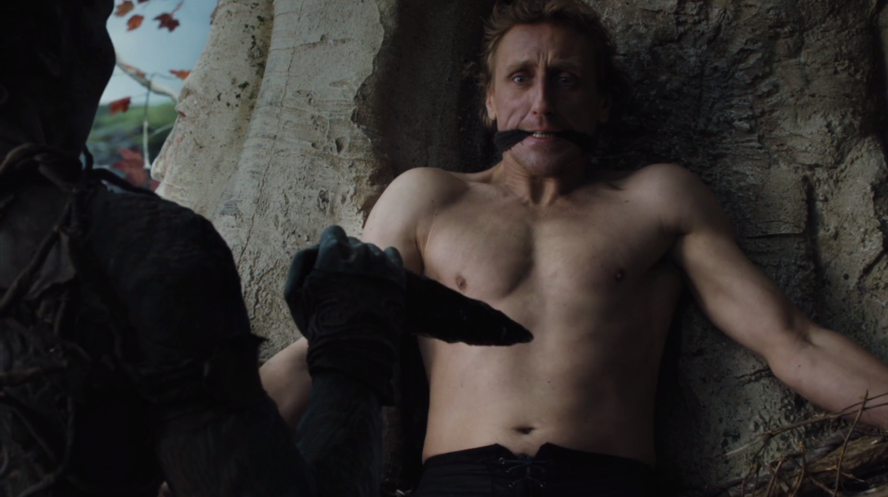

The signing of the Pact began an age of kings, warriors and heroes in Westeros. Kingdoms were founded, splintered apart and reforged, dozens of them spanning the south and, increasingly, the north of the continent. The First Men abided by the Pact, sparing the weirwood and logging the trees but lightly where necessary. But as the centuries and then millennia passed the Children of the Forest were seen but rarely, and they raised no objection when many of the great forests were torn down altogether. Yet still the weirwoods were spared, and sometimes integrated into the design of the earliest holdfasts and ringforts that the First Men built. The respect the First Men held for the weirwoods as a symbol of the Pact saw them slowly take up the religion of the old gods of the forest, as many had already done even during the war, and after a few centuries this religion had become dominant amongst the culture of the First Men.

Westeros in the Age of Heroes. The great forests of the Dawn Age had been partially destroyed in the war against the Children of the Forest, but the land was still heavily wooded. The Arm of Dorne had been destroyed, becoming the Stepstones, and the Neck was flooded as a desolate swamp. At some point in the Age of Heroes, it is said that Oldtown was founded, Moat Cailin raised, Casterly Rock inhabited and Storm’s End built.

Legends speak of the Hundred Kingdoms, of a land divided into a patchwork quilt of ever-shifting petty-fiefdoms where every man who could raise a tower on a hill would call himself king. But in truth we do not know how many kingdoms rose and fell in the earliest days, only that many kings ruled where later only seven did, and then only one.

In all of Westeros in that time, only one city is known to have risen. The original name of the small town that took shape on the banks of the Honeywine is unknown, save that it was old when the Andals invaded. Hence, its name of Oldtown. We know that Battle Island, which stands in the harbour of Oldtown, was inhabited in even more ancient days, for mysterious fused blocks of black stone can be found there, which in later years became the foundations of the High Tower. But when exactly Oldtown was founded, we cannot say.

Reliable records of this time are scant, almost non-existent. The First Men did not use paper or write books. They chiselled runes into stone and occasionally tablets. Few of these records have survived, and their reliability and age are in question. Some of the maesters believe that this entire span of time, the Age of Heroes, is far more recent than tradition claims, and lasted a far shorter span of time. The truth, as always, remains unknown.

In the annals, the great heroes of this age included Lann the Clever, who tricked the Casterlys into abandoning Casterly Rock, the vast stone edifice on the west coast of Westeros, and took it as his own. There was also Garth Greenhand, a great warrior-king who united part of the Reach under his rule, established a great kingdom along the Mander and founded House Gardener. Durran Godsgrief took Elenei, daughter of the gods of the sea and the wind, to wife and was punished by having her and his family slain. In his rage he defied them to build what is Storm’s End. Great warriors such as Symeon Star-Eyes and Serwyn of the Mirror Shield are held to have fought great battles and done great deeds, from slaying dragons to rescuing princesses. But the truth of this, of all of this, is doubtful.

What is known is that the Age of Heroes climaxed in darkness, and cold, and death.

The known world during the Long Night. The great darkness and cold consumed all of Westeros and reached as far south and east as Asshai at its height.

The Long Night fell across the entire world, apparently with little warning. One year, winter came and did not leave. In some parts of the world the sun dipped below the horizon and did not return. This time lasted for more than a generation, where children were born and rose to adulthood never knowing anything other than cold, privation and darkness.

Out of that darkness rode the Others. Pale beings of ice and cold, wielding weapons which shattered bronze of contact, the Others rode dead horses and giant ice-spiders, commanding the bodies of those they had slain to rise again and fight alongside them. They came from the uttermost north, out of the Lands of Always Winter beyond the northern-most valleys and peaks of the Frostfang mountains, spreading south through the Haunted Forest and into the lands that are now called the North. Every king of men who stood against them fell, his forces slaughtered and the bodies raised again to serve their new masters.

This darkness fell across Essos as well. The mighty River Rhoyne froze over. In the lands of the Great Empire of the Dawn, which is now Yi Ti, it is recorded that the sun hid its face from the earth for a lifetime. In Asshai it is said that a great hero, Azor Ahai, slew his beloved to forge the greatest sword in the history of creation, Lightbringer, and used this blade to drive the darkness from the earth and the Others from civilised lands. The religion of R’hllor, the Lord of Light, claims that he will return at the end of days to drive back the darkness a second time.

That Azor Ahai is of Essos is interesting, for the legends of the Others, whom some call the white walkers, claim that their stroke fell on Westeros alone. The rest of the world felt the darkness they had unleashed (or which had summoned them; the cause and effect remains a mystery) but their direct fury fell first on Westeros. Essos is separated from the northern polar icecap by the Shivering Sea, suggesting that the Others had no way of crossing unfrozen water, limiting their initial invasion to the western continent. Whether this means that Azor Ahai came to Westeros to fight the Others, or fought a separate enemy in Essos, is also a mystery.

The legends and annals of Westeros record that the continent was shrouded in darkness and ice. The kingdoms of the First Men fell before them and hope dwindled until a great warrior, the Last Hero (who may or may not be the same as Azor Ahai), rode forth to seek the aid of the Children of the Forest. In the forests of the far north he found them at last, and with their aid he was able to restore light to the world. He founded an army known as the Night’s Watch and took the fight to the enemy. The Others were defeated, driven back in a renewed conflict known as the War for the Dawn. The Children equipped the armies of men with swords and daggers of obsidian – dragonglass, or frozen fire – which shattered the Others on contact. The Others were unable to stand before this threat, and the fire the First Men unleashed on the battlefield, and fled. And as they fled the Long Night lifted, and so the world was saved.

But the Others were defeated, not destroyed. They fled north beyond the Frostfangs, into lands so cold that men could not follow and survive. It was held that they would return, so a great barrier was erected to stand against them. Brandon Stark, a great mason of the northern kingdoms, was called upon to design a defence. He proposed a wall, a single great fortification stretching almost from coast to coast, spanning the narrowest part of Westeros north of the Neck. This required a construction project spanning three hundred miles, the largest in history. But he did not labour alone. Men came in their tens of thousands, and maybe hundreds of thousands, from across Westeros to lend their aid. Giants, who had suffered the depredations of the Others as well, descended from their mountain homes to lend their aid, cutting vast blocks of stone and ice. And the Children of the Forest lent their aid as well, imbuing the blocks and foundation stones with magical properties. How tall Brandon planned to build his wall is unknown, except that it was far lower than what we see today. Some hold that originally the Wall was only dozens of feet tall, rather than hundreds, but as time passed snow and rain fell on the Wall and turned to ice, and that ice then never melted, but grew and became compacted and the Wall grew taller, and taller. By every law of nature and science, the Wall should have toppled and fell, its colossal weight growing far beyond the ability of any foundation stone to support it, but the sorcery of the Children held true, and the Wall grew straight and tall. Thousands of years later, the Wall now tops seven hundred feet, making it the largest and most awe-inspiring sight in all the known world.

The Wall under construction, with men, Children of the Forest and giants allying together. Art by Chase Stone for _The World of Ice and Fire_.

According to myth, Brandon the Builder was acclaimed as a great warrior and administrator as well as a mason and architect, and after building the Wall he laid the foundation stones of Winterfell and ruled as the First King in the North, the founder of House Stark.

Of course, in these more enlightened days, no true maester believes a word of it.

Or, to be more precise, that some great climactic catastrophe took place several thousand years in the past is certainly likely, especially as cultures otherwise remote and disconnected from one another all record a similar age of ice falling on them within roughly the same period of time, and it later lifting. The Others also existing is possible, but it is more likely that they were a tribe of First Men who dwelt the lands of the furthest north. They were displaced south by the Long Night and mounted a migratory invasion to save themselves, but were defeated and thrown back. Their descendants, lacking their numbers and vigour, scattered into the feuding tribes known today as the Free Folk, or wildlings.

This scepticism is checked by the Wall. It still stands in the North of Westeros, spanning the continent for a hundred leagues from the Gorge to the Shivering Sea, topped out at over seven hundred feet, defying reason and logic. It is too regular to be a natural phenomenon, too large to conceivably be the work of man. The Wall is an anomaly that some of the maesters of the Citadel have been trying to explain through science for thousands of years, and others have simply ignored as an inconvenient reminder that they do not know everything.

The Age of Heroes is said by some to have ended in the Long Night and the War for the Dawn. Others believe it only properly concluded when the Andals invaded Westeros millennia later, ushering in an age of iron and conquest.

In **Game of Thrones**, it is said that the Children of the Forest created the original White Walkers using weapons of obsidian, blood magic and mystical runestones. However, this may be a different origin to what George R.R. Martin will reveal in **A Song of Ice and Fire**.

**A Note on the Seasons & Revelations from Game of Thrones**

It is entirely possible that the Long Night is what threw the seasons out of balance and before this event they were normal in duration. This is hinted at in both _The World of Ice and Fire_ and in the original cover blurb for _A Game of Thrones_. Since the Long Night it may be that the seasons instead reflect the power and supremacy of the Great Other, with the weather growing colder as his power waxes and warmer as it wanes. If the Others are defeated forver, it may be that normal seasons will be restored to the world.

The sixth season of **Game of Thrones** featues a sequence in which we see the Children of the Forest created the White Walkers/Others from captured men. That the Children created the Others is a long-standing fan theory. It is possible that they did so to create the ultimate weapon against the First Men, but then the Pact was forged and there was no need to unleash this magic. Four thousand years later, the Others were released by accident, or by Children who foresaw their extinction and were driven to desperation.

It is possible that this is an invention of the TV series alone and the true origin of the Others is yet to be revealed.
