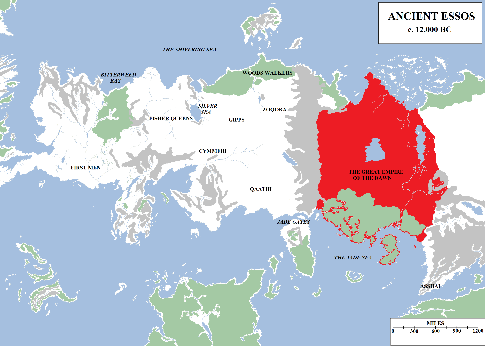
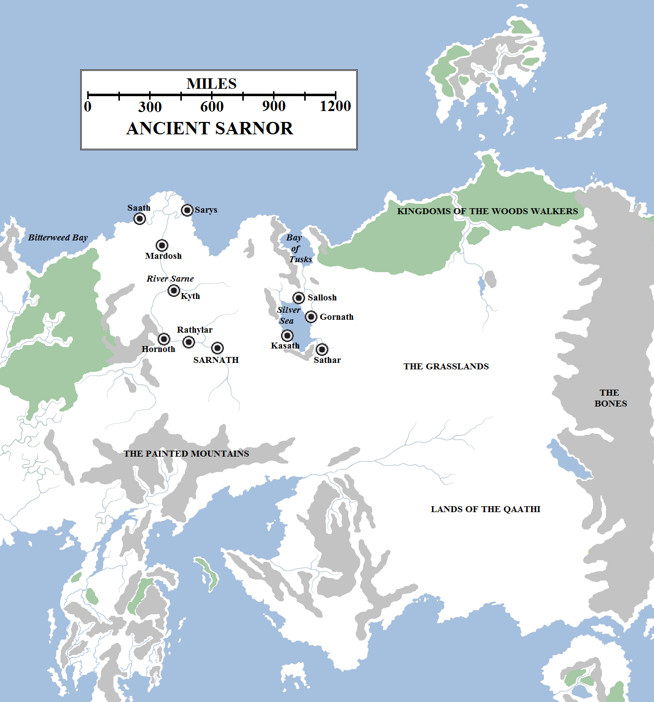
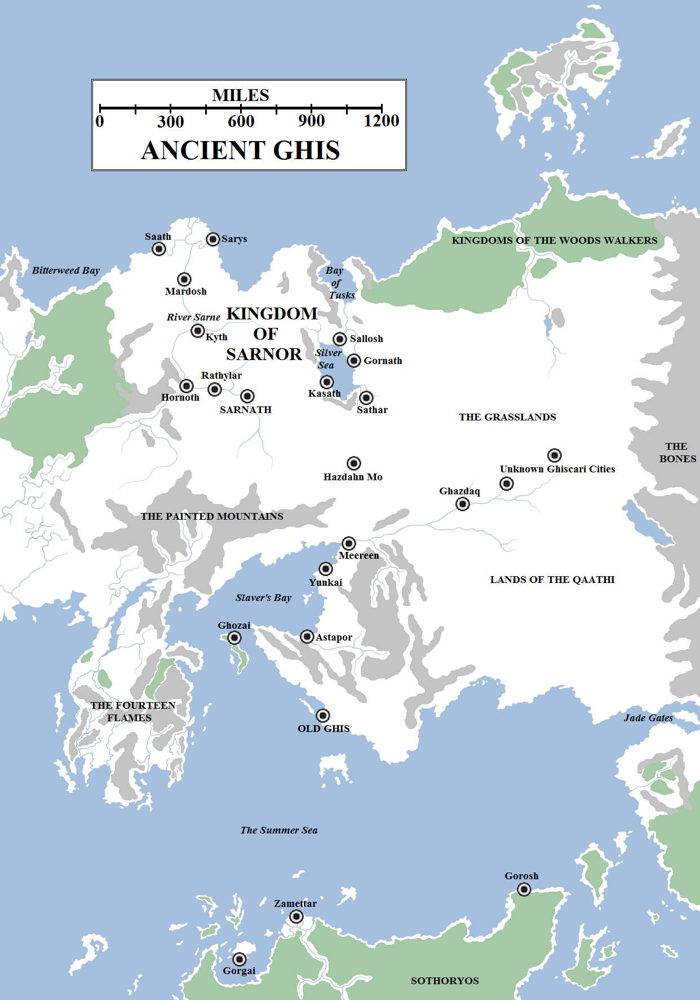

Essos is the cradle of civilisation. The most ancient kingdoms of men arose there when Westeros was still covered by forests and it was there that horses were tamed, weapons of bronze and iron first forged and dragons tamed.

Ancient Essos at the time the First Men departed for Westeros. According to legend, the first nation of men was the Great Empire of the Dawn, the forebear to what is now Yi Ti. Other great ancient powers include the Fisher Queens, Qaathi, the enigmatic woods walkers of the northern forests and the city of Asshai.

The earliest history of the continent is shrouded in fable and doubt. According to myth, the Great Empire of the Dawn was the first nation of men, founded in what is now the jungles of Yi Ti and spanning much of the shores of the Jade Sea thousands of years before the tribes of the First Men departed for Westeros. The Great Empire dominated Essos beyond the Bones, linking the Shivering and Jade Seas and building the colossal Five Forts along its north-eastern frontier, some say on ruins left behind by some older, pre-human civilisation. The truth of this is not known, but it is clear that ancient nations and kingdoms did arise in this region many thousands of years ago. According to legend, the throne of the Great Empire of the Dawn was usurped by the Bloodstone Emperor, whose cruelty and lack of piety brought about the Long Night.

The Long Night destroyed the Great Empire of the Dawn. After the War for the Dawn had been won and the night ended, the Great Empire lay in ruins and it took many centuries before the Golden Empire of Yi Ti rose to replace it, and even then Yi Ti never achieved the greatness of its forebear, ruling only roughly half the territory of the Great Empire at its height.

At roughly the same time that the Great Empire rose to power, the city of Asshai was founded by a people – maybe even a race – unknown to us. Built of a mysterious black stone, oily to the touch, Asshai was and remains colossal, dwarfing every other city in the world. Today only a tiny fraction of the city is inhabited, the rest left abandoned and shrouded in darkness. The Asshai’i claim that their city is the most ancient on earth, but the truth, as with so much, remains unclear.

Sarnor was the first great kingdom of western Essos. It dominated the western half of what is now the Dothraki Sea.

The YiTish claim to supremacy is disputed by the Sarnori. According to their legends, the Fisher Queens of the Silver Sea founded the first kingdom of men along the River Sarne in the most ancient days of Essos. The Fisher Queens ruled a great nation from a floating palace that circled endlessly around the shores of the Silver Sea. Their contemporaries included the Cymmeri hill-folk (who reportedly mastered the art of forging iron long before any others), the Gipps, the chariot-riding Zoqora and the Qaathi, whose domains extended south and east, beyond the Skahazadhan. There were also the woods walkers, a diminutive race living in the vast forest adjoining the Shivering Sea in the north, whom some maesters have linked to the Children of the Forest of Westeros.

Eventually the Fisher Queens were overthrown in a revolution, their subjects freeing themselves to found Sarnor, the Realm of the Tall Men. Sarnor was a large and powerful kingdom, stretching from Bitterweed Bay to the Silver Sea and then eastwards into the Grasslands for at least fifty leagues. It extended from the Shivering Sea in the north almost to the Painted Mountains. Its capital was storied Sarnath, but other great cities were founded, including Saath and Sarys at the mouths of the Sarne; Mardosh, Kyth, Hornoth and Rylathar upriver; and Sallosh, Gornath, Sathar and Kasath on the shores of the Silver Sea.

Huzhor Amai is reported to be the first High King of Sarnor. He was the son of the last of the Fisher Queens and took three wives, one each from the Gipps, the Cymmeri and the Zoqora, binding them into one people. His descendants widened the domains of Sarnor, defeating the Qaathi in several wars and forcing them far to the south and east, almost to the Jade Gates.

Sarnor appears to have been a kingdom of middling power for many millennia, but reached the zenith of its power in its last two thousand years. It was during this time that the Palace of a Thousand Rooms was built in Sarnath and the kingdom became a dominant force of Essos, with even the Valyrians preferring peaceful trade to military confrontation. But Sarnor’s later history is a tale for another time.

Old Ghis began its rise to power just after the Long Night ended (c. 8000 BC according to tradition). It dominated south-central Essos for between two and three thousand years before being overthrown by the Freehold of Valyria. It also founded the first cities on the continent of Sothoryos.

The last of the ancient kingdoms of Essos to arise, just after the Long Night, was Old Ghis. Located on the Summer Sea to the west of the Jade Gates, Ghis was a city founded on slavery and oppression. Grazdan also established the city’s famous lockstep legions, forming a formidable military force which, in its day, was unparalleled for its discipline and tenacity. On the back of these legions and the slave trade, the great Ghiscari Empire came to dominate the shores of the Summer Sea, extending west from the Qaathi lands to the shores of Slaver’s Bay. Ghiscari power extended north into the Grasslands and east along the Skahazadhan, and even south to the continent of Sothoryos. The Ghiscari Empire established the colony of Zamettar on the north coast of that forbidding continent, as well as Gorgai on the Isle of Tears and the penal colony of Gorosh on Wyvern Point to the east.

The greatest of the Ghiscari cities after the capital were the three slave-trading ports of Slaver’s Bay: Astapor, Yunkai and, larger than both combined, Meereen. Under the harpy banner, Old Ghis’s power grew tremendously. But it was clever enough not to wage wars that would interfere with its economic might. Rather than fight against Sarnor to the north, Ghis instead established a trading city at Hazdahn Mo, which soon thrived. Ghis also established the city of Ghozai on the Isle of Cedars. From here, exploratory trips on the huge peninsula to the west were mounted, but the lands seemed worthless: the ground rumbled and fourteen immense mountains belched smoke and occasionally fire into the sky. With the native people a minor race of “sheep-lovers”, the Ghiscari had little interest in these lands.

This ignorance proved the undoing of the ancient Ghiscari Empire, for one day the people of that land found dragons lairing in the volcanic mountains and set the history of the world onto a completely different path.
