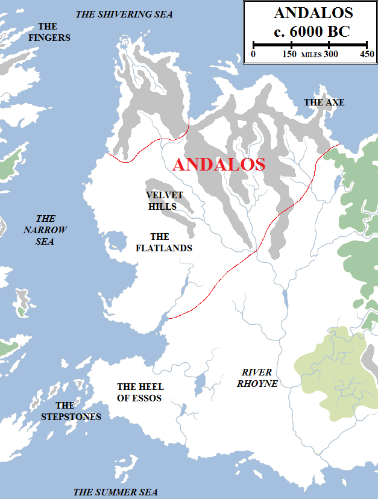
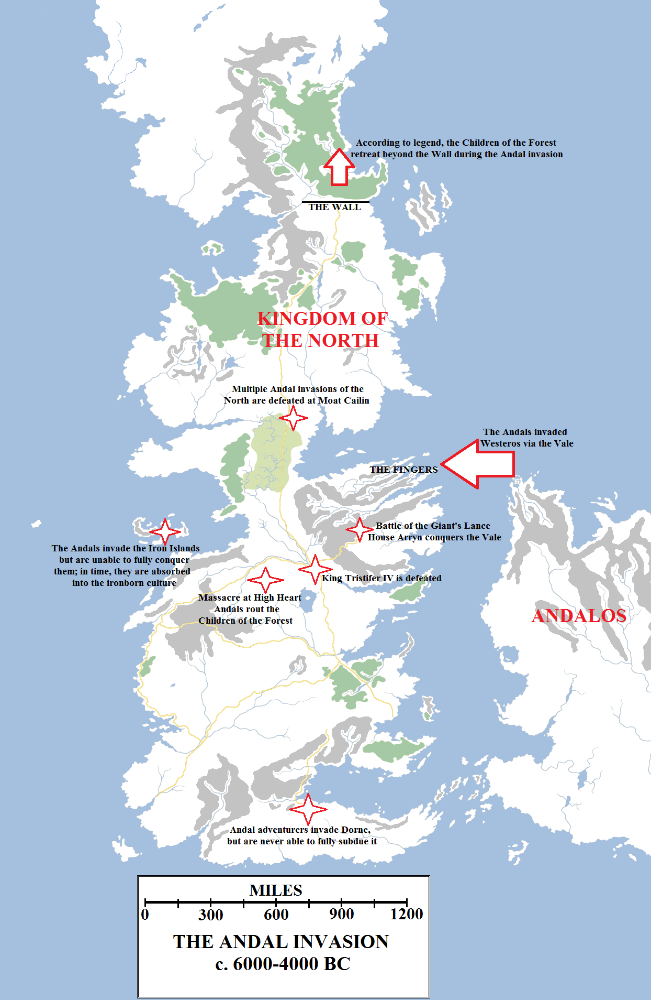

The origin of the people known as the Andals is, like so much else, a matter of debate and controversy among maesters. According to some, the Andals were descended from the same stock as the First Men, but from those tribes that remained in Essos rather than crossing the Arm of Dorne into Westeros. According to others, the Andals were a race of the Grasslands displaced westwards by the growing might of Sarnor.

Andalos was the ancient, ancestral homeland of the Andals. At its height it stretched from the Narrow Sea to the Axe. However, the Andals were a migratory people consisting of many different clans and tribes, and aside from Hugor of the Hill acknowledged no single leader.

However, there is some actual evidence for the wanderings of the Andals, for they left behind carved stones on rocks and, later, writings to describe their histories.

The earliest reliable account of the Andals has them as a migratory people living on the Axe, a mountainous peninsula of Essos extending north and east into the Shivering Sea, west of Bitterweed Bay. From homelands on the Axe, their migrations took them south and west across the hills and mountains to the relatively flat and fertile lands adjoining the Narrow Sea. This region, the northern part of what we now call the Free Cities, became known as Andalos.

Andalos was extensive but relatively little-populated: the Andals were not initially a numerous people and they had few enemies. A vast forest separated them from Sarnor and the only other people native to the region were river-folk dwelling on and alone the Rhoyne, the Rhoynar, who preferred peaceful trade and alliance with the Andals. According to some, it was these early Rhoynar who taught the Andals how to first smelt iron, but Andal histories dispute this, claiming the knowledge came as a gift from the Smith, one of their seven gods.

Andalos flourished for centuries, possibly one or two millennia, before the Andals abruptly left. According to _The Seven-Pointed Star_, the Seven took human form and walked among the people. They crowned Hugor of the Hill as the first (and maybe only, at that time) King of the Andals and promised him and his followers a more secure and fertile home in the great continent across the water to the west. Thus the Andals left their homes and took ship for Westeros.

This tale is stirring, but unlikely. According to some histories, the Andals chose to leave Essos ahead of the advancing tide of the Freehold of Valyria, which had already destroyed Old Ghis, made peaceful alliance with Sarnor and the Rhoynar and founded a great colony-port at the mouth of the Rhoyne, which eventually grew into Volantis. From here, Valyrian armies had unimpeded access to the west coast of Essos, and Andalos lay squarely in their path. Early attempts to thwart Valyrian expansion were destroyed by dragonfire, so the remaining Andals fled.

This story is more likely, but the chronology is confusing. According to tradition, the Andal migration to Westeros began six thousand years ago, but the Valyrians did not throw down Old Ghis until a thousand years later. The founding of Volantis is debatable, but it seems unlikely that Volantis is no older than three thousand years at the outside. It is implausible that the Valyrians would pause for thousands upon thousands of years after reaching the western coastal regions before embarking on their war against the Rhoynar, suggesting their settling of the Free Cities region began some time later (and we know that Lorath was only founded 1,700 years ago).

Various solutions have been proposed, including the controversial claim that all of the ancient dates are too fanciful and that the Andal invasion of Westeros actually took place no more than four thousand years ago, and maybe only two. Some maesters find this arrangement more pleasing and plausible, but it is hard to swallow that so many other histories and religious sources could have been so wrong for so long.

Whatever the truth of the matter, the Andals began building ships and crossing the Narrow Sea. The first major invasion was mounted into the Fingers, which were sparsely-populated and consisted of six major peninsulas and several rivers, giving the Andal ships a huge amount of territory to land on. The native First Men tribes lacked the numbers to resist them. The Andals carved the Seven-Pointed Star of the Faith onto stones and rocks on the beaches to mark their arrival. They seized the Fingers and created good harbourages for the ships that would come after them, first a few hundred and then thousands of vessels bearing the Andal people from Andalos in vast migratory waves.

According to legend, Ser Artys Arryn rode a falcon to slay the Griffon King upon the Giant’s Lance, the tallest mountain in Westeros, located just south-west of the Fingers at the head of the great Vale. In reality, the most powerful of the Vale families was House Royce, which fought until defeat and then surrendered with honour, swearing loyalty to the Arryns. The Arryns spared the Royces and in time allowed them to become a great and powerful family once again. Other First Men families which surrendered, such as House Redfort, were also allowed to retain their lands.

According to tradition, the Andals invaded Westeros 6,000 years ago. These dates are disputed by some maesters, who put the invasion between 2,000 and 4,000 years ago. It is known that the Andals invaded via the Fingers and the Vale of Arryn, later landing more ships along the Crownlands and Stormlands, before sweeping westward, conquering the Riverlands, Reach and Westerlands before finally subduing the Iron Islands 1,000 years into their invasion. According to some, the Andals smashed themselves senseless against Moat Cailin for a millennia before suing for peace with the North.

This was the concept of _chivalry_, of applying rules of honour and respect to warfare and the battlefield. Although it was often broken in the blood rage of combat, the code was vital to the Andals’ victory. Had they pursued a path of genocide and slaughter, the far more numerous First Men could have banded together and destroyed the invaders, despite the superiority of their iron weapons. Instead, by sparing defeated foes and allowing them to retain power and prestige, the Andals did not give the First Men a reason to fight on past the point of defeat. Indeed, the Andals became adept at turning rival First Men kings and tribes against one another to make their own conquests easier.

From the Vale of Arryn (as it was now called), the Andals spilled out of the pass defended by the Bloody Gate and invaded the lands of the Trident – the Riverlands – in full force. Tristifer IV, King of the Rivers and Hills, won ninety-nine battles but was finally defeated when seven Andal rulers brought their armies against him. During this war, the Andal warlord known as Erreg the Kinslayer slaughtered a large number of the Children of the Forest on the hill known as High Heart and destroyed thirty-one massive weirwoods. According to myth, the hill remains cursed to this very day.

The Children of the Forest had grown less numerous and skilful at war and magic than during the Long Night. Few remained below the Neck and as the Andal invasion accelerated, so the remaining Children left. Some say they took refuge on the Isle of Faces, others that they removed themselves north beyond the Wall, and others still that they simply died out.

The Andals were victorious everywhere. They subdued the Reach and the Stormlands, they conquered the Westerlands with fire and iron before forcing the capitulation of Casterly Rock (although whether the Lannisters were First Men who absorbed the invaders or an Andal family taking the name of the trickster hero Lann the Clever remains debatable) and they even managed to conquer the desert lands of the Broken Arm, although the lands were poor and dry.

A thousand years after the first Andals landed on the shores of the Fingers, their descendants invaded the Iron Islands, an archipelago of islands off the west coast of Westeros. The Iron Islands had been home to a proud warrior-race of the First Men, the ironborn, who worshipped the Drowned God. The Andals conquered the islands and installed their own rulers, but curiously the Faith of the Seven never took hold. Within a few centuries the Drowned God was once again worshipped openly and the reavers and pirates had once again begun raiding the other kingdoms of Westeros. The ironborn had not been conquered by the Andals, but had instead simply absorbed them.

The Andals then mounted a series of attacks against the North, but to no end. Unlike the hundreds of fractious kingdoms making up the rest of Westeros, the North had, at least in name, been ruled by House Stark from Winterfell for millennia. The Kings of Winter had fought numerous conflicts to secure their rule of the North and it was a fragile, oft-broken thing, but when the Andals invaded the First Men of the North banded together. They fortified Moat Cailin, destroying every Andal army that attempted to come up the causeway through the Neck. The crannogmen harried the flanks of the Andals and disease did for the invaders as much as the arrows and swords of the defenders. Several times the Andals tried to outflank the North by sea, but each time they were defeated by the horrendous winter storms that either sunk invading ships or disrupted the resupply of the few armies that managed to make landfall. The Kings of Winter also had their own ships, which sailed forth to drive the invaders back.

Eventually the Andals stopped trying, and peaceful trade with the North was opened instead. The old gods remained dominant in the North and among a few houses of the south, but for the most people the people of Westeros took up the worship of the Seven.

In a thousand years of fire and battle, the Andals had conquered the entire continent of Westeros. The First Men had been conquered, or allied to the invaders, and the Children of the Forest had vanished. But peace did not come. The Andals fought amongst each other almost incessantly for the next several millennia, gradually whittling away their rivals and enemies. Scores of kings ruled in Westeros in the immediate aftermath of the invasion, but eventually this fell to maybe a dozen, ruling all of the lands from the Red Mountains to the Frostfangs. South of the Red Mountains, in fractious and sparse Dorne, bandit-kings and warlords continue to fight one another, each seeking supremacy to no avail.

But to the east, in the lands the Andals left behind, a new and mighty power was rising.
