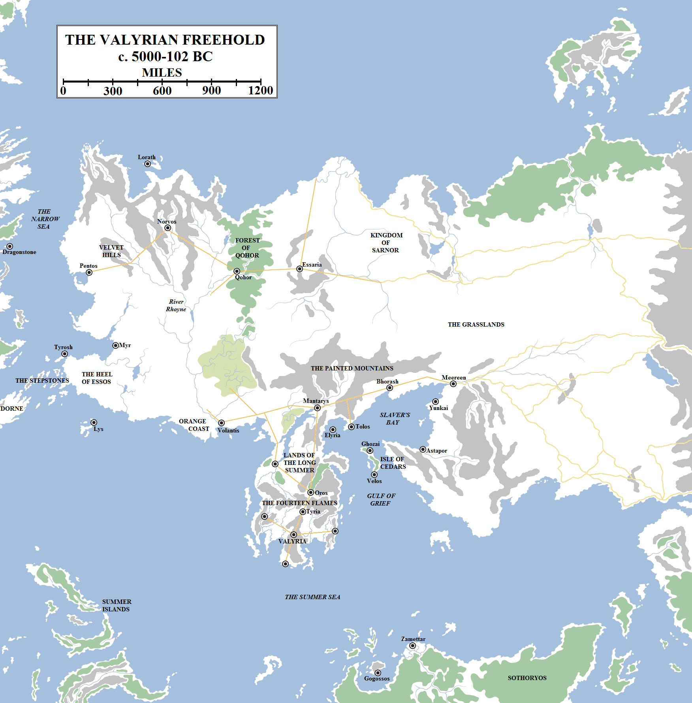
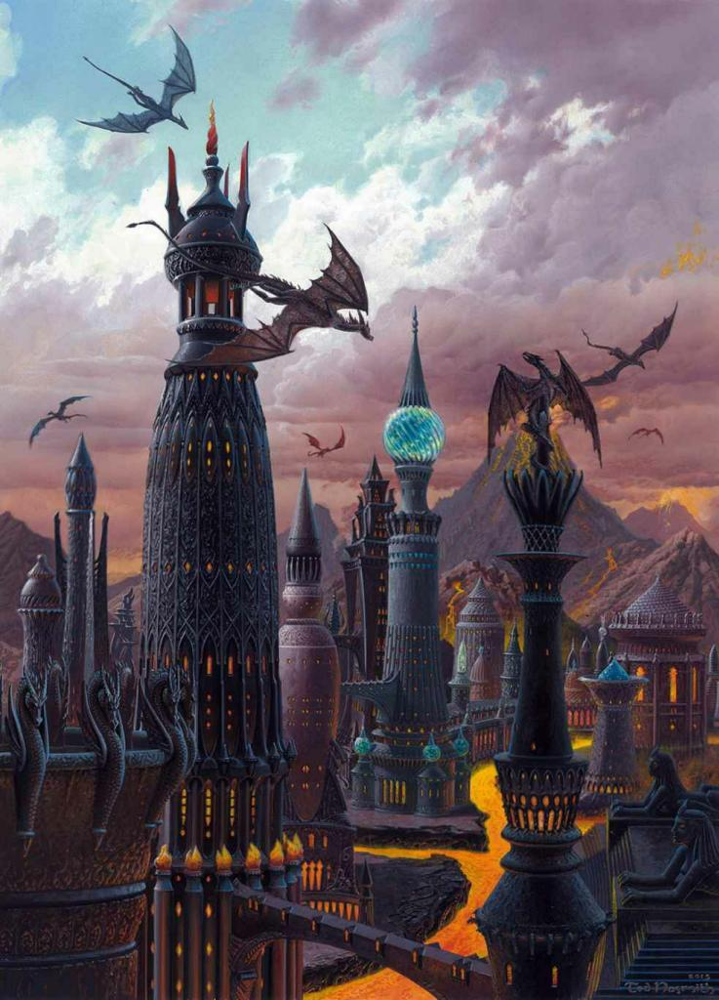
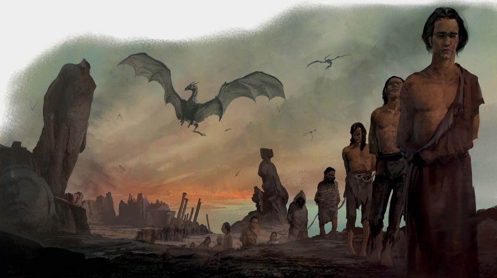
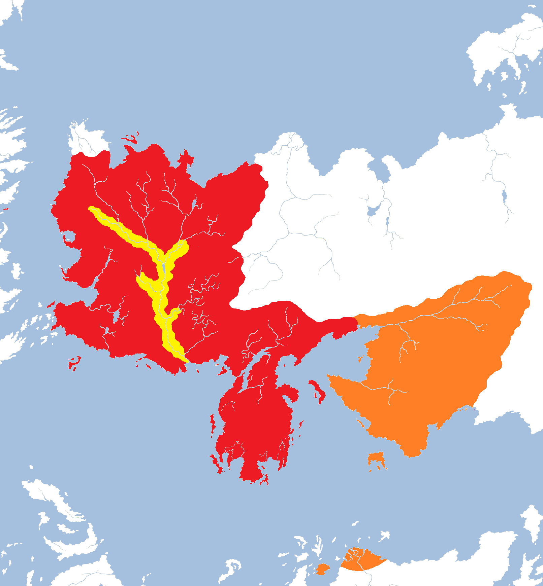
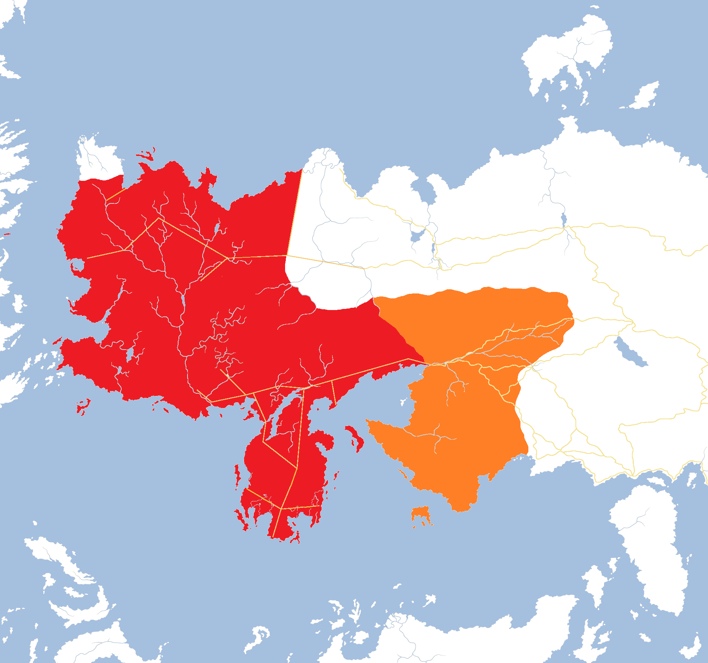

East of the mouth of the great River Rhoyne, the coastline of Essos swings southwards for nine hundred miles, forming a peninsula almost five hundred miles wide. Or rather, it used to. Today the entire lower half of the peninsula lies in ruins, a jumble of islands and rocks and mountains, some of them still blazing with molten fire. Few sailors willingly sail within sight of that coastline. On cloudy nights the sky turns red as the fires of the mountains reflect of the clouds and can be seen for hundreds of miles.

The Valyrian Freehold. Only cities founded by the Valyrians or formally annexed by them are shown. The Valyrian Freehold began its rise to power some centuries before 5000 BC, when dragons were found lairing in the Fourteen Flames. It was destroyed in 102 BC during the Doom of Valyria.

More than five thousand years ago – according to traditional histories – the story was very different. Then the great Valyrian Peninsula was a navigational hazard and a place for explorers and traders to put in on their way from places like Yi Ti and Old Ghis to the Rhoynar cities or the burgeoning Andal kingdoms of Westeros. In those days Valyria was a land of mountains and volcanoes, but also of verdant green grass and fertile fields. These were particularly common north of the mountains, in the Lands of the Long Summer, a patchwork of fields and wheat and fruit which became the breadbasket of Valyria.

Old Ghis turned its attention to the peninsular but were not immediately minded to invade. The landmass was extremely large and the geography favoured the defender. It was also largely worthless, or so it seemed. The volcanic activity made mining hazardous and after a time it was concluded that there was nothing in Valyria but sheep, shepherds and farmers. Maybe the Ghiscari would have invaded anyway, but they had their hands full with controlling their own sprawling empire and dealing with other powers, such as Sarnor to the north and the Qaathi to the east.

What actually happened to trigger the rise of the greatest empire in human history is disputed. According to tradition, bold Valyrian adventurers found dragons lairing amongst the peaks of the main volcano chain, the Fourteen Flames. Using a mixture of bravery, cunning and magic, they forced the dragons into their service.

The origin of dragons is unclear, although their ancient bones have been found in remote parts of Westeros, Essos and Sothoryos, suggesting at one time they may have been commonplace. Some maesters theorise that the world used to be much warmer and hotter, and dragons laired everywhere. As the world cooled, so dragons retreated until they were left only in the warmest and hottest lands. Valyrian histories confirm that dragons are happiest in warm climes (and the lack of such in Westeros may have contributed to their decline in the Seven Kingdoms) so this theory is plausible. Less likely is the Qartheen fable that the world used to have a second moon, which one day wandered too close to the sun and broke apart, spilling a million dragons onto the surface of the earth.

The great city of Valyria, the capital of the Freehold built in the shadow of several of the Fourteen Flames. Artwork by Ted Nasmith, from _The World of Ice and Fire_.

More debatable is the suggestion the dragons originate in the furthest east, in the Shadow Lands and mountains beyond Asshai. Some Asshai’i histories suggest that dragons were first tamed in the Shadow and brought to Valyria by sorcerers who gifted them to the Valyrians. But this seems unlikely, as if true then one would assume that dragons would continue to exist in the Shadow and they would have spread back into the world, or an Asshai’i warlord would have tamed them and embarked on a new war of conquest.

Whatever the truth, it is known that the Valyrians soon seized control of the dragons of the Fourteen Flames. They bonded with them and learned how to ride them in battle. Valyrian sorcery seemed to grow in leaps and bounds with their knowledge of dragons, as they learned how to tap the volcanoes for precious metals and build great, topless towers divided by rivers of fire. So the great city of Valyria, lying in the central-southern region of the peninsular, was founded. Others soon followed, including Oros and Tyria at opposite ends of the great pass through the Fourteen Flames.

Noble families ruled Valyria, but interestingly they had no king or emperor. Instead, a council of Lords Freeholder set policy and determined the future direction of their civilisation. A senior ruler – a spokesman or chair – was elected, the Archon, but there was no hereditary system of rule. This was unusual in history, and remains so.

The rise of Valyria took place over several decades, perhaps a century or two, and did not go unnoticed by the other powers of the world. Old Ghis launched an invasion of Valyria by land and sea, determined to seize the dragons for its own glory, but the Valyrians deployed their dragons as weapons of war. The armies of the Old Empire were destroyed in fire and their ships burned and sent to the bottom of the Gulf of Grief. Four more times did Old Ghis strive against the Freehold, sending its lockstep legions into dragonfire again and again. Eventually the Valyrians tired of the Ghiscari temerity. Approximately five thousand years ago (c. 4700 BC), Valyria sent its dragons, its armies and its ships into the Ghiscari Empire. In a campaign of blood, fire and terror, the Valyrians utterly destroyed Old Ghis. The great city itself was burned to the ground, the fields sowed with salt and the entire population slaughtered or taken into slavery. The Great Pyramid of Ghis was razed, but its colossal stone blocks made it difficult to destroy completely. Its ruins still stand in mute witness to the carnage that the Valyrians unleashed on the city.

The Fall of Old Ghis. Artwork by Marc Simonetti for _The World of Ice and Fire_.

The rest of the Ghiscari Empire collapsed. Astapor, Meereen and Yunkai first broke away, but then became vassals of Valyria. All the lands east of Slaver’s Bay swore homage to Valyria and many of the old Ghiscari cities on the Skahazadhan and north into the Grasslands followed suit. Valyria had also seized the colonies in Sothoryos: Gorgai had been captured in the Third Ghiscari War and renamed Gogossos; Zamettar was seized in the Fourth.

After the final collapse of Old Ghis, Valyria become mainly concerned with consolidation, trade and internal politics. One of the more perplexing questions of history is that if Valyria could overthrow and destroy the greatest empire in Essos in a matter of generations, and if just three dragons could conquer almost the entire continent of Westeros in under three years, why did the Valyrians not simply conquer the entire known world? The vast armies of Yi Ti would have had no defence against a flight of dragons numbering in the hundreds, if not thousands, and the Bone Mountains and even the mist-shrouded peaks of the Shadow Lands around Asshai would have been no defence.

The answer is that the Valyrians simply did not want to conquer the world. Indeed, some maesters have pointed to the phenomenon of the “elephants” and “tigers” of Volantis, politicians who favour peace, trade and plenty versus those who favour aggression and war. Such a similar debate may have held sway, on a much larger scale, in Valyria itself. Valyria grew fat and rich on the back of slaves and on its peaceful trade with Sarnor to the north, the Rhoynar to the west, the Qaathi to the east and the cities around the Jade Sea beyond them. What reason was there to risk the lives of men and dragons when they already were the greatest power in the world?

For the next three and a half thousand years this situation endured. During this time the Valyrians established peaceful relations with many of the other powers of the world. A Valyrian noblewoman married one of the Emperors of Yi Ti, and for a time a dragon lived in the YiTish imperial palace. Explorers on dragonback flew far east beyond the Shadow. Others flew south, over Sothoryos, finding a likewise vast continent but one that was even more dangerous due to its fetid, disease-strewn jungles and savage inhabitants, some of whom were reportedly not even human.

The territories of the Valyrian Freehold just before the Doom, incorporating the home peninsula, the Free Cities and the territory annexed from the Rhoynar (in yellow) and the Ghiscari (in orange). By the time of the Doom the Valyrians had largely abandoned the holdings in Sothoroys to the far south, aside from Gogossos on the Isle of Tears.

Dragons even flew over the sprawling kingdoms of Westeros, as wily Valyrian trader-princes sought new markets and new sources of ore and gold. These traders brought back news of the land beyond the Summer Sea, the land they called the Sunset Kingdoms or the Land of the Andals. Oddly, the Valyrians were not moved to invade or conquer Westeros, not even when they heard of the vast riches of Casterly Rock or the fertile fields of the Reach. It is likely that they simply did not need them: the Lands of the Long Summer were more fertile than the Reach and the great slave-mines extending for dozens, maybe hundreds, of miles under the Fourteen Flames gave them access to gold and precious metals that left Casterly Rock looking poor by comparison.

The Valyrian civilisation grew more populous, more powerful and stronger. Its sorcery allowed the building of fused roadways that soon criss-crossed much of Essos, linking Slaver’s Bay to the Valyrian Peninsula to the western coastal regions to the Grasslands. Valyria’s armies, disciplined and formidable, patrolled the Freehold and ensured safe travel and trade for all. Its fleet kept the waterways safe of pirates. When danger threatened, a flight of dragons could be called to destroy the menace at its source.

The expansion of Valyria’s population saw it found a dozen new cities across the homeland and north into the Lands of the Long Summer. Mantarys was founded at the northern end of the peninsular and Elyria on an island off the far north-eastern coast. Tolos was founded on the mainland north-east of Elyria, and Bhorash as a waystop on the Black Cliffs between Tolos and Meereen. Velos was established on the Isle of Cedars to the east of Valyria proper.

But it was in the lands to the north and west of Valyria that the Freehold saw the best prospects for colonisation. The Rhoynar lived on and along the Rhoyne and its numerous tributaries, but they did not travel or settle far from the river’s shores. With the permission of the Rhoynar, the Valyrians founded a great port at the mouth of the Rhoyne. The date for the founding of Volantis, as it became known, is unknown, save it was more than two thousand and maybe closer to three thousand years ago. Volantis was a trading city and did tremendously successful business with the Rhoynar. Wealth flowed between the two civilisations for well over a thousand years (and possibly more than two), enriching both.

The trading city of Lys was founded on an island in the Summer Sea, far to the south-west of Volantis. From Lys Valyrian traders turned south for the Summer Isles or north and west for Westeros. The prospects of trade with the Andal kingdoms were compelling, but the southern-most part of Westeros, the part closest to Lys, was a poor desert land embroiled in near-constant warfare: Dorne. Better trading prospects were to be found north along the Narrow Sea, so Tyrosh was founded in the Stepstones and Myr on the coast to the north-east. According to some histories, Pentos had already been founded (possibly by descendants of the Andals who had remained in Essos) and was soon convinced to become a vassal of Valyria. Religious schisms led to the founding of the cities of Norvos and Qohor to the east of Pentos. As well as trade with Westeros, these cities were able to mine the great north-western mountains of Essos and lumber the vast and forbidding Forest of Qohor.

The great Valyrian highway system in the centuries preceding the Doom. The Valyrian roads spanned the Freehold itself as well as linking to the road networks of the kingdom of Sarnor to the north and the Ghiscari conquests to the east (in orange), as well as the Qaathi roads even further east.

The Valyrians linked these cities with their famous roads, and even built one extending east from Qohor into the Grasslands. Here they linked with the Sarnori road network and built the great trading hub of Essaria where they met.

The final colony-city to be established was Lorath. Located on an island off the north coast of Essos, not far from Norvos, the islands of Lorath had been settled for centuries already, some say by colonists from Ib although this is debatable. The Ibbenese do not seem to entirely be of human origin and their distinctive features are not to be found amongst the Lorathi. In addition, the islands of Lorath were home to ancient mazes of unknown origin, built centuries or millennia earlier by peoples unknown. Whatever the truth, it is known that the Valyrian city of Lorath was founded by 1436 BC by followers of the Valyrian Blind God Boash. The cult died out around 700 BC.

The colonisation of the western coastal regions of Essos was mostly peaceful, and unfolded gradually over centuries (indeed, two thousand years or more may have separated the founding of Volantis and the colonisation of Lorath). But by the time Lorath had been established, the other powers of the world had grown uneasy. The Andal kingdoms of Westeros, particularly those along the Narrow Sea, now found themselves confronted by a large, unified civilisation just a hundred leagues across the water. The Sarnori now had borders with the Freehold to both the south and the west. And the Rhoynar found themselves completely outflanked, hemmed in by Volantis to the south, Myr and Pentos to the west and Norvos and Qohor to the north, on branches of Mother Rhoyne itself.

Although the situation endured for several centuries, it could not last forever, and in time the Valyrians and the Rhoynar went to war…and the Valyrians encountered a force of sorcery that, for a time, checked their dragons.
