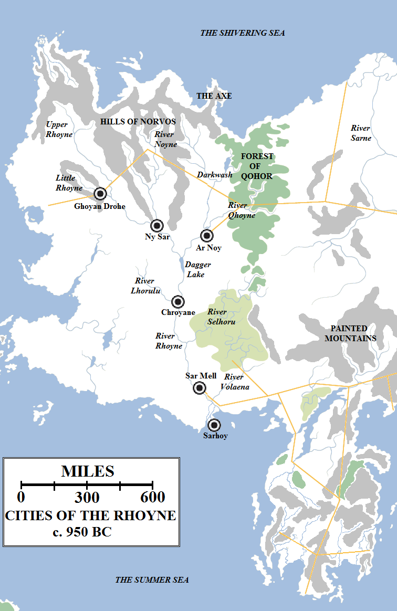
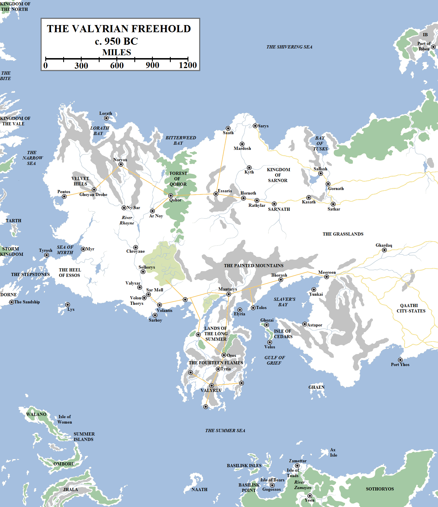
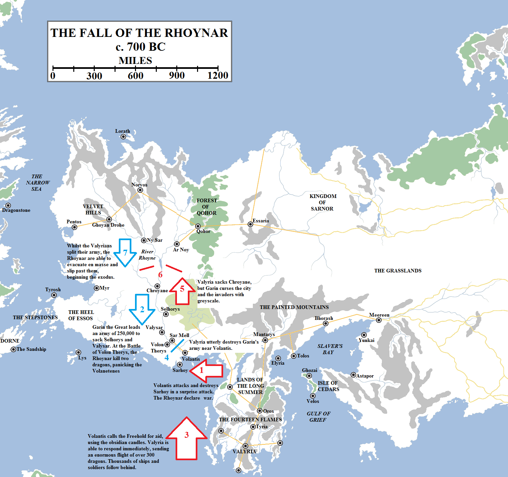
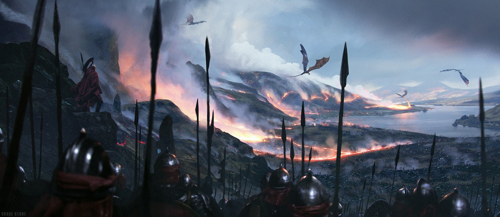
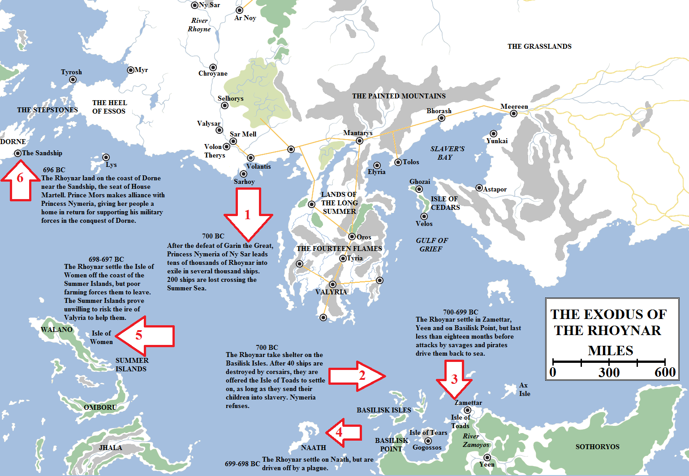
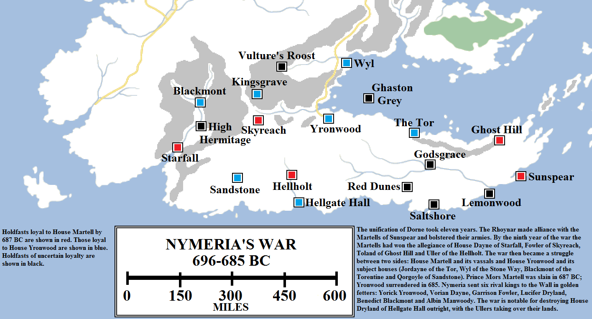
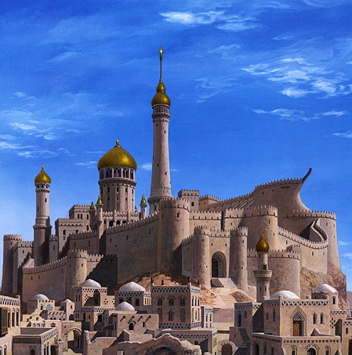

There are many great rivers in Essos. The mighty Sarne waters the grasses of the northern Dothraki sea and was once the lifeblood of the Sarnori people. The Skahazadhan provides transport along the borders of Lhazar and Meereen before emptying into Slaver’s Bay. A hundred rivers cross mighty Yi Ti, watering fields and helping feed a teeming population of millions. But none are as storied and impressive as the Rhoyne.

The River Rhoyne, its major tributaries and the location of the Rhoynar cities in 950 BC, on the eve of the great Rhoynish Wars. Only Rhoynar cities are show on this map for clarity.

Mother Rhoyne is born in the northern mountains of Essos, draining from numerous valleys and glaciers before tumbling down onto the plains. But the river is formed not from one source but many: the Upper Rhoyne starts in the mountains south of Braavos; the Noyne comes down out of the Hills of Norvos and the Darkwash has its source in the lands near the Axe. The Little Rhoyne flows out of the Velvet Hills, moving south and east before joining the main river, whilst the Darkwash merges with the Qhoyne before meeting the Rhoyne at Dagger Lake. South of the lake the Rhoyne is joined by the Lhorulu, then the Selhoru and finally the Volaena just north of the mouth of the river.

The Rhoyne is so wide that in places you can’t even see the other side. Its delta is likewise colossal, sprawling for tens of miles as it empties into the Summer Sea through four major and numerous smaller mouths. The Rhoyne is a river on a huge scale, utterly dwarfing the Blackwater or even the Mander of Westeros.

People first settled along the banks of the Rhoyne many thousands of years ago. The First Men may have fished from its banks, and certainly the Andals made use of the river as their kingdom of Andalos sprawled across its many northern courses. But only one culture claim the river as their own: the Rhoynar. Their origins are unknown, but according to myth they had already established themselves along the river when Andalos rose to power (over six thousand years ago, according to some histories), and they traded with both the Andals and later the Valyrians as they began to expand their influence westwards.

The Rhoynar loved the river and worshipped it, treating it as the their goddess and its major tributaries as her quarrelsome daughters. But the Rhoynar were not a primitive or superstitious folk. They learned to work metal and, according to their histories, taught the Andals how to smelt iron, a point furiously denied by religious scholars who maintain that the first Andals learned this in visions sent by the Smith. The Rhoynar also learned how to work wood and stone, transporting large blocks of stone from the northern mountains to build great cities along the banks of the river.

Among these cities were Ny Sar, located at the junction of the Rhoyne and Noyne. North-west, on the Little Rhoyne, was Ghoyan Drohe, a great trading port where the Rhoynar treated with the Andals. To the east, on the Qhoyne, sat Ar Noy, which was likely involved in the logging of the Forest of Qohor. To the south, below Dagger Lake at the confluence of the Rhoyne and Lhorulu, sat Chroyane, the great Festival City. Sar Mell was built well downriver, near the meeting with the Volaena, whilst the Rhoynar established the port of Sarhoy on the second mouth of the river on the Summer Sea. The Rhoynar were not a unified kingdom, as each city had its own prince or princess (the Rhoynar did not believe in any division of the sexes and Rhoynar women could rule or fight as any man could), unified by faith and culture but politically independent.

The Rhoynar civilisation endured for at least four thousand years, starting as a contemporary of the Andals. After the Andal exodus to Westeros, the Rhoynar were content to remain living along the river. Although it is possible some of their number colonised other lands, the true Rhoynar remained along the Mother Rhoyne, living and feasting and loving and dying as they had done for millennia.

Western Essos in 950 BC, showing the Valyrian Freehold and its neighbours. By this time the Silver Sea was well on its way to drying up and the desertification of the Qaathi lands had begun, although they would remain inhabitable for centuries to come.

The Rhoynar developed a strong relationship with the Valyrian Freehold as it slowly advanced westwards. The Rhoynar took no part in the Valyrian wars, but welcomed Valyrian traders and explorers. They even gave them permission for the Valyrians to establish a colony on the fourth mouth of the Rhoyne, which soon became the great Freehold city of Volantis.

Volantis and Sarhoy traded with one another and much wealth passed upstream to the Rhoynar city-states. The arrangement was beneficial and enriching, but the Rhoynar soon saw the power of Valyria expand around them. Myr, Tyrosh and Lys were founded to the west, whilst Pentos and Lorath were annexed. The city of Norvos was established to the north and Qohor to the east. The Rhoynar found themselves surrounded. There was no immediate panic and the Rhoynar likely benefited from the opening of the trade route through the Forest of Qohor to Sarnor and points beyond, but maps now showed the Rhoynar as an enclave within the territory of the Valyrian Freehold.

Tensions began to spill over when Valyria began colonising the lower river. Starting circa 950 BC, the Valyrians began establishing new towns and cities on the lower Rhoyne to make trade and travel more efficient, safer and more enriching. The first of these was Volon Therys, built fifty leagues upriver from Volantis itself, directly opposite Sar Mell. The intent was clear, to take trade away from Sar Mell and prove a Valyrian waystop and port that would benefit from the river trade at Sar Mell’s expense.

Perhaps this rivalry could have been borne, but the Valyrians then netted and killed one of the great river turtles, which the Rhoynar held to be sacred. The First Turtle War resulted, lasting less than a month. Although the war was brief, both sides unleashed terrible destruction. Sar Mell was burned but Rhoynar water wizards raised a great wave that destroyed Volon Therys and flooded the ruins. This demonstration of Rhoynar power came as a shock to the Valyrians, who had long enjoyed the supremacy of their own magic and their dragons. But the fractious nature of the Rhoynar proved their undoing. The Valyrians, unified in purpose, rebuilt Volon Therys. Sar Mell was also rebuilt as best the citizens could manage, but without outside help it was soon eclipsed by the Valyrian city.

The Valyrians soon slowly advanced up the river, establishing Valysar to the north and then Selhorys at the mouth of the Selhoru. The entire lower Rhoyne for three hundred miles from the Selhoru to Volantis was now controlled by the Valyrian Freehold, to the growing alarm of the Rhoynar.

Over a period of two hundred and fifty years, the Rhoynar and the Valyrians clashed several times in the War of the Three Princes, the Second Turtle War, the Fisherman’s War, the Salt War, the Third Turtle War, the War on Dagger Lake and the First Spice War, along with far too many skirmishes and minor clashes to recount. Tens of thousands on both sides were killed, many more were enslaved and, although peace was made each time, it was unruly and soon fell apart.

The last of the great Rhoynar Wars began as a minor skirmish, the Second Spice War. It rapidly escalated when the Volantenes called on three Valyrian dragonriders to destroy Sarhoy. The resulting Rhoynar counter-attack saw over 140,000 Volantene soldiers and two dragons slaughtered and three cities destroyed. The panicking Volantenes called for aid, resulting in the deployment of the largest Valyrian army in four thousand years. Three hundred dragons obliterated the Rhoynar army and spearheaded a counter-attack that saw the other Rhoynar cities all destroyed in under a year.

The final blow began when the rivalry between Sarhoy and Volantis spilled over into outright warfare. In approximately 700 BC the armies of the two cities clashed and, after hard fighting, the Volantenes deployed three dragons. Sarhoy was razed and burned down to the ground. Every citizen was slaughtered or sold into slavery and the ground sowed with salt to prevent the city ever being refounded.

This news shocked and dismayed the Rhoynar. Prince Garin of Chroyane called the Rhoynar princes to a great council and declared that Valyria meant to consume and conquer the Rhoynar as they had already done to dozens of other cultures. He called for a great assemblage of arms and for the Rhoynar to make war on the Valyrians in their full strength. Princess Nymeria of Ny Sar was dubious, counselling a more cautious approach for the Rhoynar could not hope to match the power of the Freehold fully roused, but Garin’s words carried the day.

Two hundred and fifty thousand Rhoynar warriors gathered, reportedly the largest army ever assembled in one place (that we know of for sure; some reports from Yi Ti suggest even larger armies have fought there in the past). This army travelled in three hosts, one on either bank and another travelling by water inbetween. The Rhoynar feared the Valyrian dragons, but their water-wizards promised to protect them.

The Rhoynar faced their first major opposition at Selhorys, a Valyrian army thirty thousand strong. The Rhoynar were victorious, capturing Selhorys and Valysar in short order. At Volon Therys they faced one hundred thousand enemy troops and three dragons. The Valyrians unleashed their might, certain that three dragons could cow a much vaster army if necessary.

They were wrong. Although the Rhoynar suffered grievous losses, they were able lure the dragons into a trap. Great waterspouts raised by the water-wizards staved off their fire and in a terrible storm of arrows two of the dragons were killed and the third wounded. Volon Therys was destroyed a second time and the Rhoynar marched on Volantis, now just one hundred and fifty miles away.

The Volantenes panicked. Their largest army had been routed and their dragons defeated. They pulled their remaining troops back behind the Black Walls of the city and furiously begged Valyria for aid. If they had had to wait whilst ships sailed and birds flew it is unlikely that any aid could have come in time. But instead the Valyrians had the use of sorcery, obsidian candles which could transmit a person’s words and thoughts hundreds of leagues in an instant. The Lords Freeholder were alerted to the peril of their northern city instantly.

The Valyrians destroy Garin’s army along the shores of the Rhoyne. Artwork by Chase Stone for _The World of Ice and Fire_.

The rulers of the Freehold responded and came in force. They did not send just three dragons, but over three hundred, blackening the skies over the Rhoyne with their wings. They unleashed fire and destruction on a scale not seen since the fall of Old Ghis. The Rhoyne itself boiled in the fury of dragonflame as men burned to death in their tens of thousands. Garin’s entire host was destroyed, the survivors seized and put to death _en masse_, their blood turning the harbour of Volantis red.

Garin himself was captured and placed in a cage. He was forced to watch as the Valyrians destroyed the Rhoynar cities one by one, starting with Sar Mell. Chroyane was captured without offering battle, as it was a city built for beauty rather than war. This did not stop the Valyrians from enslaving the entire population, tens of thousands of women and children. They planned to sell them to the highest bidder. Horrified, Garin called down a curse on the Valyrians. According to legend, the Rhoyne flooded out of season and a foul fog fell on the city. The Valyrians began to die of greyscale in their hundreds. The remainder of the army hurriedly retreated, but the city could not be saved. It became a haunted ruin, known as the Sorrows, home only to the Stone Men afflicted with the disease.

Upriver in Ny Sar, Princess Nymeria foresaw the destruction of her own people. She sent word to every free town and city on the river that the Rhoynar had only one chance: to flee downriver whilst they still could and seek a new home elsewhere. Some refused, choosing to fight and die rather than abandon Mother Rhoyne, but others came in their thousands. Ships flooded down the Rhoyne in a vast tide.

The Flight of the Rhoynar is one of the greatest feats of sailing in the history of the world. Tens of thousands of Rhoynar successfully crossed the Summer Sea three times, visiting three continents and several islands. Four years and over 4,000 miles after the exodus from the Rhoyne began, it ended when Princess Nymeria led her exhausted people to safety on the shores of Dorne, where they were welcomed by Prince Mors of House Martell.

The Valyrians had retreated from the river after the debacle at Chroyane, choosing to swing far inland and come upon the remaining Rhoynar cities from their landward sides. Thus the Rhoynar exodus was able to slip by and flee down the river. At the top of the delta they turned west and passed Sarhoy to enter the Summer Sea, giving Volantis a wide berth.

According to myth, ten thousand ships assembled off Sarhoy under Nymeria’s command. Other histories suggest that perhaps only a thousand ships made the trip. Others still suggest that ten thousand was indeed the figure, but the overwhelming majority of these ships were skiffs, barges and riverboats unsuited to the open sea, and these were either lashed together to make larger vessels or abandoned in favour of the larger ships. But it was still a vast fleet that made its way out into the Summer Sea and southwards, away from Valyrian waters.

Two hundred ships were lost in the crossing of the Summer Sea. The Rhoynar made their way to the Basilisk Isles off the northern coast of Sothoryos to resupply, but were set upon by three corsair kings. Forty ships were destroyed and the Rhoynar forced to flee (rejecting an offer to become a source of slaves to the corsairs). They made their way to the mouth of the great River Zamoyos in Sothoryos and resettled Zamettar, a former Ghiscari colony claimed by the Valyrians but abandoned a thousand years earlier.

For a few months it appeared that the Rhoynar might survive. Sothoryos was home to strange creatures and diseases, but the Zamoyos was a mighty river not dissimilar to the Rhoyne and the Rhoynar a hardy and motivated people. Some of their braver number sailed southwards to the ancient city of Yeen, a mysterious ruin predating human civilisation, and established a new settlement there. But soon the misery of the jungles overwhelmed the Rhoynar: the strange brindled men of the south constantly raided them and pirate attacks from the Basilisk Isles were a constant danger. Just over a year after their arrival, the Rhoynar departed. The final straw had been the destruction of the Yeen settlement by forces unknown, with every man, woman and child there disappearing overnight without a trace.

The Rhoynar sailed the Summer Sea for three years searching for a new home. They made landfall on Naath, the Isle of Butterflies, but a strange plague struck down many of their number. The Rhoynar fled to the Summer Isles, landing on an uninhabited rock east of Walano, which is now called the Isle of Women, but the land was too small and rocky to sustain them. The Summer Islanders refused to give them shelter on the larger islands, fearing either that their numbers would prove too much for the islands to sustain or that they would draw the wrath of Valyria down upon their heads.

Instead the Rhoynar took ship again, and for the last time. Their ships were rickety and increasingly unseaworthy, damaged by every passing wave. The remaining ships headed north crossing more than seven hundred miles to reach the nearest shore. Many ships didn’t make it, or were turned eastwards by storms to face capture near Lys or to be smashed like kindling on the Stepstones.

But many more ships did survive the crossing to reach the country known as Dorne, southern-most of the lands of Westeros. They landed on a barren coast at the mouth of a modest river, the Greenblood. This was a dry, humid land with little food and few sources of water, but it did have people.

To the north of the landing point, Nymeria found a curious sight: a great castle shaped like a vessel. The Sandship was the seat of Prince Mors Martell, a ruler of intelligence, integrity and compassion. He gave shelter to the Rhoynar, although his own resources were scant, and proposed an alliance with them. Nymeria was wary, knowing that the Martells sought to use her people for an advantage, but she also saw in them an opportunity to create a new homeland. She agreed, forging an alliance between the Rhoynar and the Martells, sealed with a promise of marriage between herself and Prince Mors. But she also attached her own condition: that women in Dorne would have equal rights to men.

Nymeria’s War saw Dorne, which had been a fractious, quarrelsome country divided between bitterly opposed lords for several thousand years, unified under the banner of House Martell in just under eleven.

The Rhoynar had knowledge of metalworking far in advance of the Dornish, and soon equipped the Martell army with swords and armour far beyond that any local smiths could forge. The surviving Rhoynar water-wizards were also able to make the deserts around the Sandship bloom, allowing more food to be grown and harvested. Bolstered by the Rhoynar warriors, the Martell army grew in size tenfold. To ensure that all knew of their commitment to their new home, Nymeria burned their ships on the shores of Dorne, ensuring there could be no flight or escape.

The Martell army marched against its neighbours. The other houses of southern and eastern Dorne surrendered or made alliance with the growing might of the Martells, but the houses of the north and west chose to stand against them, led by Yorick Yronwood, the Bloodroyal, King of Redmarch and the Greenbelt and Warden of the Stone Way. The Yronwoods had been traditionally the most powerful house of Dorne for millennia, if not strong enough to conquer the rest of the land, and did not take the sudden rise to power of the Martells lightly.

The Sandship, the original fortress of House Martell, can be seen on the right of this image. Over the next thousand years the stronghold would be expanded many times into Sunspear, the great fortress-stronghold of Dorne and a legacy to the valour and skill of Prince Mors Martell and Princess Nymeria of Ny Sar, the last great ruler of the Rhoynar. Artwork by Ted Nasmith for _The World of Ice and Fire_.

Nine years after Nymeria arrived in Dorne, her husband Prince Mors died in the Third Battle of the Boneway. Nymeria took up his standard and led a counterattack. Two years later Yronwood was finally outflanked and forced to surrender. He bent the knee to Nymeria and accepted exile to the Wall, along with five of his fellow kings.

A decade of battle had seen most of Dorne united under the Martell banner. The Sandship, bolstered by the new Rhoynar settlers, had expanded into a far larger and more impressive castle and city: Sunspear. Some of the Rhoynar who disliked their new homeland had taken to the Greenblood in a pale echo of their lives on the Rhoyne, becoming known as the Children of the Greenblood, and they had built a new port, the Planky Town, near its mouth. Nymeria also took possession of an island just off the north coast of Dorne and there built the fortress and watchtower of Ghaston Grey, which in later years would serve as a prison.

The unification of Dorne was not greeted with joy in the rest of Westeros. Both King Durran III of Storm’s End and King Greydon Gardener of Highgarden launched separate invasions of Dorne in the following years, but both were defeated. Princess Nymeria took two more husbands, Lord Uller of Hellholt and Ser Davos Dayne of Starfall, the Sword of the Morning, but she remained the unquestioned ruler of Dorne. She died in 658 BC, having see her homeland burn, travelled half of the known world, led her people to safety and conquered a nation.
