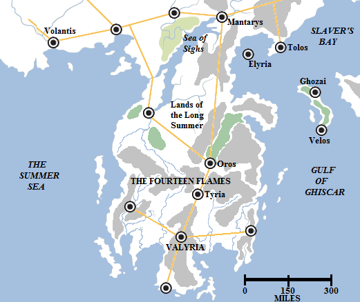
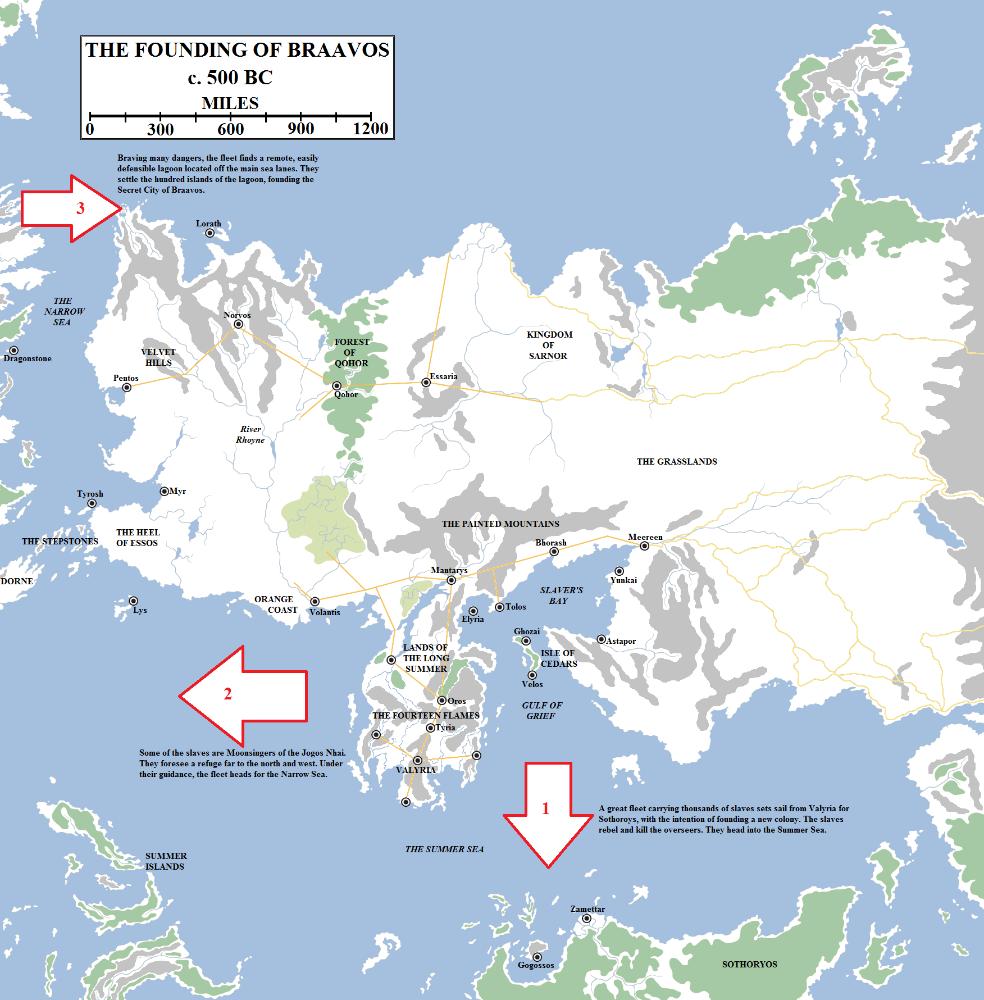
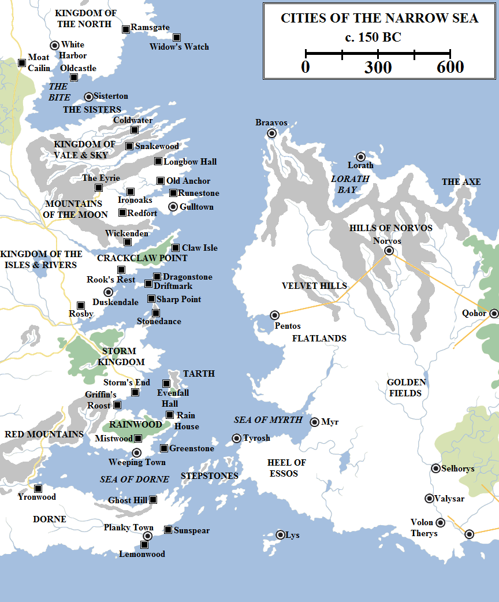
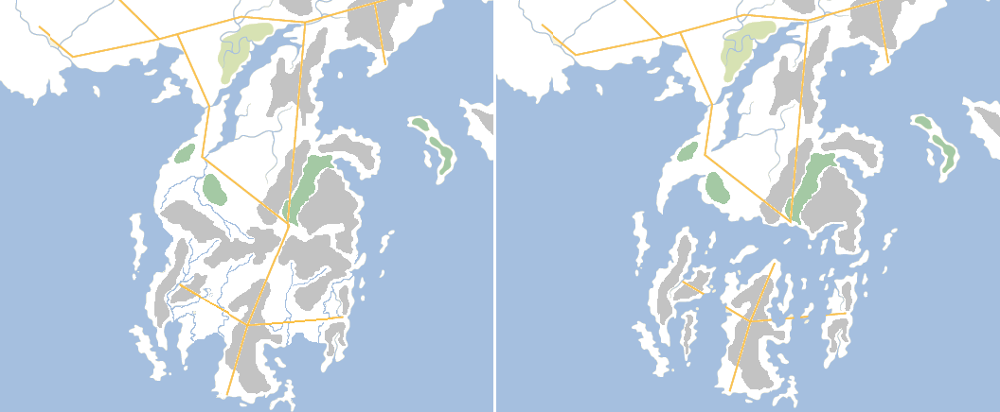
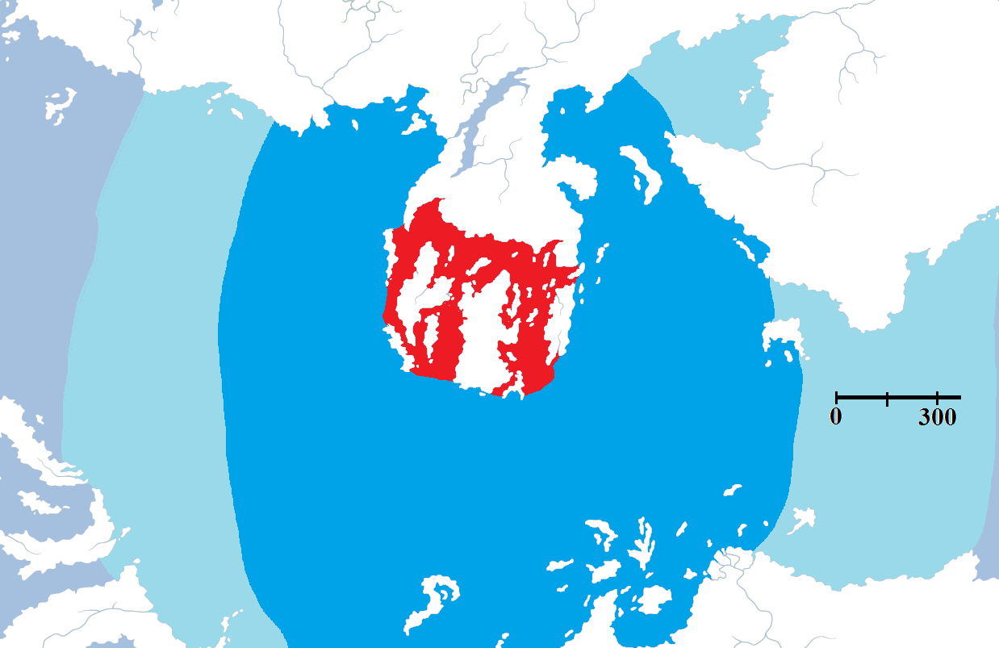
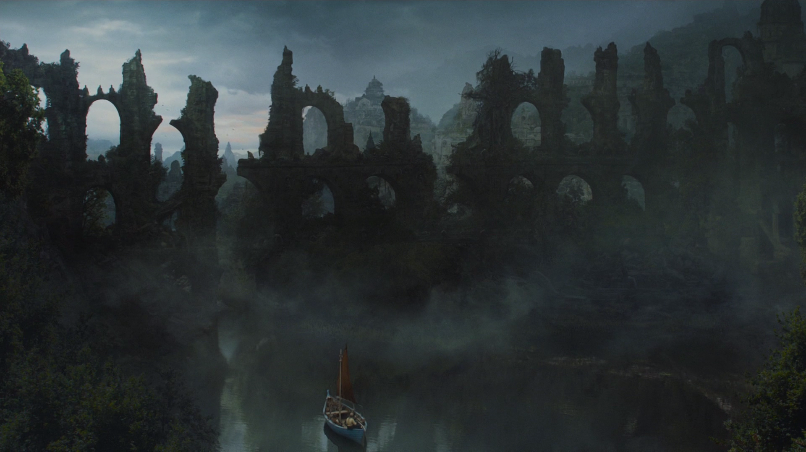
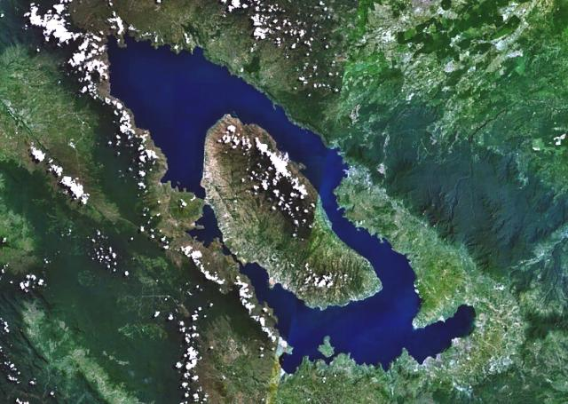

For over five thousand years, Valyria and its Freehold were the greatest power in Essos and the known world. Valyria’s dragons patrolled the skies, its armies kept the peace and its engineers linked far-flung corners of the world through its road network. Valyrian gold and jewels poured out of the Freehold, the product of the mine and forges built under the Fourteen Flames and tended by slaves in their tens of thousands.

The Valyrian Peninsula on the eve of the Doom.

Valyria’s power was such that it did not need to conquer other lands. It was already the mightiest and richest nation on earth and it could do whatever it wanted with little fear of reprisal. For the majority of its existence Valyria was non-expansionist and did not pursue war as a means to its ends, but instead simply waited as the rest of the world brought its riches to them in exchange for its gold, its dragons and its steel.

The war against the Rhoynar seems to have changed this. In a stunning, swift and overwhelming display of power, Valyria laid low a civilisation at least as old as itself in under a year. The other nations of the world were shocked, and treaded ever more carefully in their dealings with the Freehold.

Valyria’s hunger for wealth and for slaves grew. Slaves were seized from lands further and further away, on any excuse. Valyria began to acquire a reputation for cruelty and arrogance.

Valyria’s power was challenged a few times. Around 500 BC, a slave fleet making its way from Valyria to Sothoryos to establish a new colony rebelled. The oarsmen rose up and killed their overseers and freed their captives. The fleet turned west, but the slaves had no idea of where to go. A group of captured women, priestesses from the lands of the Jogos Nhai beyond the Bones, foresaw a place of safety and refuge, a land of mists and clouds where even dragons could not find them. Following the direction of these priestesses, the moonsingers, the fleet fled north along the Narrow Sea, eventually threading through a difficult-to-navigate channel and making landfall in a brackish lagoon. This lagoon was located at the far north-western corner of Essos, where the Narrow Sea and Shivering Sea met. Frequent fog made the access channel impassable and hid the lagoon from the air.

Braavos was founded by escaped slaves and prisoners from Valyria. It was established about 400 years before the Doom, or approximately eight centuries ago. Dragonstone was founded a century later.

Here the slaves founded their refuge: the Secret City of Braavos. Slavery was outlawed and the Secret City became a place of refuge for those fleeing persecution across Essos. It became a religiously tolerant city where all faiths were welcome, and a city of great engineering feats. A hundred isles dotted the lagoon and the Braavosi built cunning bridges and arches to link them together. Bringing fresh water from the mainland was a daunting task, so a great aqueduct was built. Known as the sweetwater river, it was miles long and immensely tall, a formidable feat of engineering.

Braavos remained a city in hiding, surviving on trade with the Seven Kingdoms and Ib alone, until circa 389 BC. On the 111th anniversary of the founding of the city, the Unmasking of Uthero took place. Sealord Uthero Zalyne revealed the existence of the city and immediately established trade ties with Valyria. However, slavery remained outlawed in the city. Valyria had little concern about the descendants of some escaped slaves from a century prior and soon found the existence of an independent port close to both Westeros and their own colony-cities of Pentos and Lorath quite useful. The Braavosi Iron Bank also provided an independent and discrete place where funds could be placed outside of the watchful eye of the Freehold’s own financial institutions.

Once the Unmasking was complete, Braavos built a great monument to celebrate its existence. A vast statue was built over the only navigable channel into the city: the Titan of Braavos. The Titan would go on to serve as monument, lighthouse and fortress.

The Narrow Sea, circa 150 years BC. The largest cities on the Narrow Sea at this time were Braavos, Pentos, Myr and Tyrosh. The only Westerosi cities on the sea were the modest seaports of Gulltown and Duskendale, and the even smaller ports of Weeping Town and Sisterton. The Valyrian Freehold had established outposts on Dragonstone, Driftmark and Claw Isle circa 300 BC to better facilitate trade with the Seven Kingdoms.

With the establishing of Braavos, Valyrian interest in the lands of the Narrow Sea began to grow. Circa 302 BC the Valyrians established an outpost on a rocky island in the Narrow Sea. The island was very close to the shores of Westeros, and in fact was located at the very mouth of Blackwater Bay, just east of the larger island of Driftmark. The surrounding lands belonged to none of the Seven Kingdoms of Westeros (as they were now styled), instead forming an unofficial buffer between the Kingdom of Vale and Sky to the north, the Storm Kingdom to the south and the Kingdom of the Isles and Rivers to the north and east. Even if anyone had objected, it is unlikely they would have risked provoking the wrath of the dragonlords by trying to remove them.

The Valyrians dubbed the island Dragonstone, for the semi-dormant volcano located on the island – the Dragonmont – made a fine lairing place for their dragons. In time the Valyrians also claimed the surrounding islands, with the Velaryon family taking control of Driftmark and the Celtigars being given stewardship of Claw Isle.

If the kings and lords of Westeros had any suspicion about a new sea of Valyrian power being established just off their coast, their lust for Valyrian gold and jewels eclipsed their caution. But greater still was the Westerosi hunger for Valyrian steel. The Valyrians had ways of folding metal many times and working magic into the blade to ensure it never needed to be sharpened. These weapons – mostly swords but quite a few daggers and at least one axe are reported to have been created – were extravagantly expensive, but the lords of Westeros gladly paid. By the time of the Doom there were over two hundred Valyrian steel weapons extant in Westeros, as well as the famed Dawn, the sword of House Dayne of Starfall which was not Valyrian in origin but shared many of its properties (according to the Daynes, the sword was forged from a meteorite that fell from the sky at least two thousand years before the Conquest).

The first inkling that something was wrong came a century before the Doom. At this time over forty senior noble families schemed for dominance and influence on the council of Lords Freeholder, the ruling body of the Valyrian Freehold. Valyria was home to many hundreds of noble families, but only dragonlords – families possessing dragons and dragonriders – could sit on the commanding council. One of the less-powerful of these families – although it had still been a house of dragonlords for two and a half thousand years – was House Targaryen.

The Targaryens were fairly typical for a Valyrian house. They married brother to sister in the traditional way, kept to the Valyrian gods (if less devoutly than some) and honoured their children. Particularly blessed was Daenys the Dreamer, the maiden daughter of Lord Aenar Targaryen. Daenys had the gift of foresight and could see things before they happened in her dreams. Sometimes things happened later or earlier than she expected, or in a different manner to what was envisaged, but her powers of prophecy were reliable and absolutely trusted by her family.

In 114 BC Daenys dreamed of the utter destruction and ruin of her family in fire and blood. A terrible fate was descending on Valyria and the Targaryens would do well to flee it. Lord Aenar sold his holdings in Valyria proper and in the Lands of the Long Summer, won the stewardship of Dragonstone and took ship with his entire family, their retainers and their dragons for the Narrow Sea.

Over the next twelve years, things seemed to proceed as normal for Valyria. Ships sailed, nobles bickered, dragons flew…and slaves toiled in the fiery halls under the Fourteen Flames.

Under normal circumstances, it would be folly to try to mine under an active volcano. Strange-smelling humours, pockets of explosive gas that would ignite at the merest spark and the risk of breaching a lava tube or causing an rockslide would seem insurmountable risks. But according to myth the Valyrian sorcerers worked great magic to protect the mines and prevent any danger coming from the volcanoes. For thousands of years they had kept the volcanoes safe and quiescent whilst tens or hundreds of thousands of slaves (and quite possibly millions) died in the tunnels and galleries they had made safe.

According to some, a group of slaves toiling in the mines learned a strange form of sorcery, possibly stemming from their long exposure to the magics worked by the Valyrians. Others say it was a gift from their god, a many-faced deity representing death in all its forms. According to those legends, these face-shifting assassins slew the Valyrian mages maintaining the great spells which kept the volcanoes quiet and dormant. And as they died the forces they had held in check for five thousand years were unleashed.

Maesters scoff at this story, finding it fanciful that such an event could be the work of men alone. They speak of the shaking of the ground felt in many other parts of the world and point to the great volcanoes on Dragonstone and on some of the islands in the Jade Sea to show that such mountains are prone to erupting at irregular intervals. But the Faceless Men of Braavos, the mystical guild of assassins whose ancestors toiled in those mines, seems to suggest that something strange and unnatural happened.

What is known is that in less than a day, in 102 BC, the greatest empire the world has ever seen was absolutely and utterly destroyed.

Valyria before and after the Doom. The Doom completely destroyed the central regions of the peninsular, which collapsed into the sea to form the Smoking Sea. The Doom is estimated to have killed millions of people in the space of a single day, with millions more dying in the following months from starvation and exposure.

The Fourteen Fires erupted, all of them, simultaneously. Thousands of tons of flaming rock were blasted into the skies over the Valyrian Peninsula. The ground trembled in an earthquake that lasted not just the usual seconds or minutes, but for hours on end. Soon the ground was cracking and spewing forth lava not just on the volcanoes themselves, but on almost every hill peak for five hundred miles, out of the sides of ordinary mountains and even from under the water.

The skies darkened and death came swirling down from the heavens. The cities of Oros and Tyria, which guarded the great pass through the Fourteen Flames, were obliterated almost instantly. A great, terrible shadow fell over the Lands of the Long Summer to the north, formerly the most fertile lands in the known world which put even the verdant Reach of Westeros to shame. Ash and fire scoured the fields clean, and great firestorms swept across the plains, burning crops and farms and people in their path.

It is often said that the Doom “fell” on the city of Valyria. Masses of rock, earth and lava were catapulted into the heavens by the volcanic eruptions and this now fell back to earth. Some paintings show noble and tragic lovers exchanging last words of love against the backdrop of the Doom, but according to some observers there was scant time for such things. The sky simply fell on Valyria, the greatest city in all the world, burying it under a sea of choking ash.

The death toll was incalculable. It is estimated that great Volantis had possibly a million people living in and around it at the height of its power (somewhat less today), so Valyria may have had considerably more. Certainly when the rest of the peninsular is taken into account, the death toll easily reached into the millions and maybe tens of millions. It was certainly the greatest cataclysm in the history of the world, likely outstripping even the Long Night. And that was before the peninsular shattered.

The Fourteen Flames were apparently located along a weak point in the surface of the earth. The unprecedented period of tumult weakened the earth even further until it simply gave way. The sides of the peninsular collapsed. The Summer Sea came rushing in from both east and west even as tens of thousands of tons of rock fell into the ocean.

The destruction of the Valyrian Peninsula sent tidal waves racing across the Summer Sea in all directions. It is likely that those lands with unimpeded lines of sight towards Valyria were severely inundated (in dark blue), with the waves losing power as they moved further away (light blue). Local geographical and geophysical quirks would have severely reduced the impact of the waves in some areas: Volantis, Tolos and Elyria all survived the Doom intact despite being in close proximity to the waves.

So much rock falling into the sea resulted in the formation of massive and fearsome waves. These rushed out in circular formations away from Valyria, battering the Basilisk Isles and Sothoryos to the south, the Summer Islands to the west and the salt-cursed shores of Old Ghis to the east. The angle of the displacement fortunately spared Volantis, just a few hundred miles to the north-west, but channelled the waves with devastating effect towards the Isle of Cedars to the north-east. The great, ancient cities of Velos and Ghozai were swept away. The isle otherwise acted as a sea break, sparing the cities of Slaver’s Bay from destruction.

The entire world knew that something terrible had happened. The skies over Valyria turned black for hundreds of miles in all directions, vast storm clouds encompassing the entire sky. The temperature dropped, and anyone who survived the initial catastrophe had to escape or die from starvation and the cold. Even when the clouds lifted, the world was treated to the most glorious sunrises and sunsets imaginable. These persisted for years.

Terrified scouting expeditions were launched from Volantis and the cities of Tolos and Elyria on Slaver’s Bay. They found the northern half of the peninsula and the Lands of the Long Summer were still intact – if now uninhabitable – but the southern half had simply fallen into the sea. Some of the Fourteen Flames survived, but now as mountainous islands, still rumbling and throwing fire into the sky. Valyria itself was almost completely buried under ash, and the city and immediately surrounding region had become an island detached from the mainland. Numerous smaller islands had formed around it. It was now possible to sale from the Summer Sea directly into the Gulf of Grief, but the journey was hazardous. The newly-formed Smoking Sea was hot to the touch and constantly bubbling and giving out four smells. Strange vapours drifted across the water, and if a man breathed them in he would die on the spot. Men soon claimed the Smoking Sea was a haunt of demons and refused to sail there.

The Doom terrified and stunned the world. But as the shock of the cataclysm faded, other powers were soon quick to realise that the loss of the Freehold mean that there was now an opportunity for profit and conquest. In the aftermath of the Doom of Valyria, the Bleeding Years began.

The ruins of a Valyrian city on the Smoking Sea, from the fifth season of HBO’s **Game of Thrones**.

**Date Discrepancy**

According to _The World of Ice and Fire_, the Targaryens departed for Dragonstone in 114 BC, with the Doom taking place twelve years later in 102 BC. However, some have disputed the wording of the paragraph, which can also be read to suggest that the Doom itself takes place in 114 BC (putting the Targaryen departure in 126 BC). I shall seek clarification on this point.

The Toba caldera in Indonesia. The Toba super-eruption of 75,000 years ago was approximately 28,000 times more powerful than the eruption of Mount Saint Helens in 1980 and created a dust cloud so vast that it cooled the entire planet for ten years, dropped ash across most of Asia and almost rendered the human race extinct. The Doom would probably be even more powerful still.

**Real-life Notes**

It should be noted that the Doom of Valyria, if it had occurred in real life, would probably have rendered the entire planet uninhabitable, or at the very least plunged human civilisation back into the stone age. The Doom absolutely dwarfs the real-life volcanic eruptions at Tambora, Krakatoa or Vesuvius, and was likely larger than even the Toba super-eruption of 75,000 years ago. This eruption, in modern-day Indonesia, plunged the entire planet into a winter lasting ten years and is likely responsible for the near-extinction of the human race (humanity was reduced to under 10,000 survivors).

Even if the Doom itself had been survivable, the resulting super-tsunamis would have circled the globe several times and completely devastated the Summer Islands, Volantis, Dorne, Sothoryos, Great Moraq and Slaver’s Bay. The 2004 tsunami, which was generated from a far smaller event, sent tidal waves from Sumatra that reached right across the Indian Ocean to India and Africa. The did not involve the displacement of several million tons of rock over a span of 500 miles (which the Doom would have, at least), so the scale of the Doom would have been several orders of magnitude larger.

From this we can conclude that George R.R. Martin did not undertake an exacting geophysical survey of the real-life effects of his proposed catastrophe. However, it is awesome, so the Rule of Cool applies.
