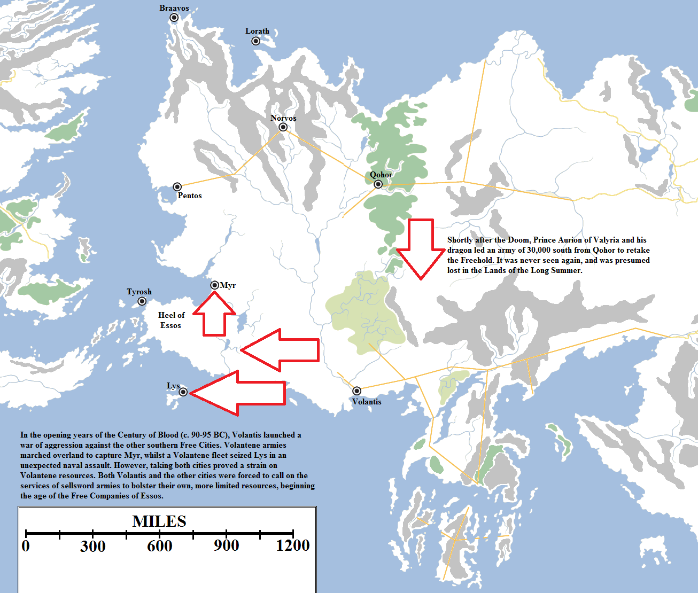
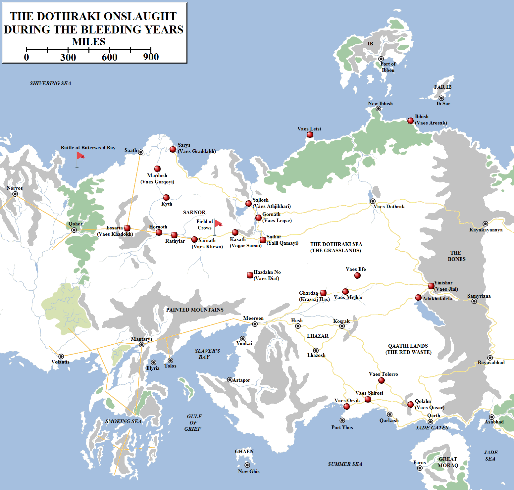
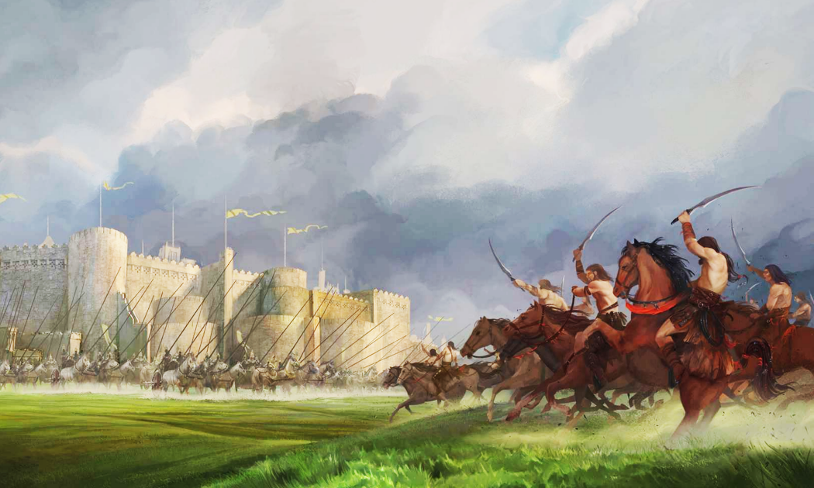
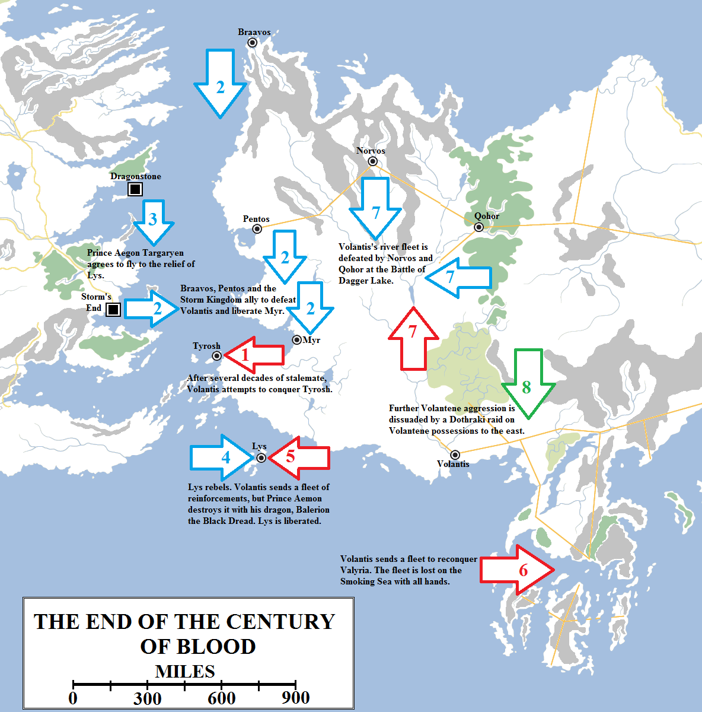
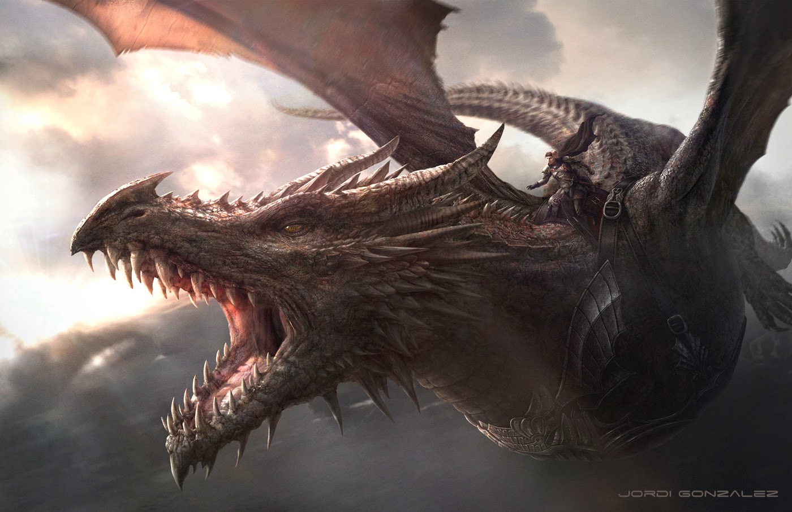

Valyria was destroyed in a single day of fire and blood. But not all of the cities of the Freehold were lost. The cities of Slaver’s Bay survived, as did the eight colony-cities of western Essos and their vassal towns. Essaria, the great trading hub with Sarnor, still endured, as did the colony of Gogossos off the coast of Sothoryos. Even Mantarys, at the northern end of the Valyrian Peninsula, survived. The loss of Valyria and the Lands of the Long Summer was a massive blow, but if the remainder of the empire could be seized, it would make for a grand prize.

The quickest to react was Aurion, a dragonlord of Valyria who had flown to Qohor to attend to some business. Hearing of the Doom, he raised an army of 30,000 troops and marched south to reclaim the homeland. Neither he, his dragon nor his army were heard from again.

Other dragonlords were reported to be in Tyrosh and Lys, but according to confused reports it appears that they may have been slain by rioting crowds or assassinated in political machinations. If their dragons survived, they presumably flew off, never to be seen again.

The Doom of Valyria is said to have wiped out almost all of the dragons in the world. Some maesters find this both unlikely and convenient. Certainly the overwhelming majority of the Valyrian dragons, lairing in the Fourteen Flames or nearby, would have been killed during the catastrophe, but quite a few should have survived. It is possible some flew into the distant east, back to the Shadow Lands from whence their ancestors are rumoured to have come. Others may have taken wing for other distant lands, with other volcanic lairs. Some maesters have even suggested that a few surviving dragons may yet remain lairing on the slopes of the Fourteen Flames. With the Smoking Sea a lethal trap for many sailors, it is hard to say if they would have ever been discovered if they’d simply returned to their ancestral homes.

The only dragons known definitively to have survived the Doom were those of House Targaryen, located safely over two thousand miles away on Dragonstone. But two of the Targaryen dragons had died, leaving behind only a youngling, Balerion, and a clutch of eggs. They were in no fit state to wage war. Although some of the cities petitioned the Targaryens for an alliance, this was more likely to make use of their name than their dragons. The Targaryens stayed out of the growing chaos.

Volantis was the first major city to react. It declared itself the new capital city of the Valyrian Freehold and demanded that the other cities swear fealty to it. But Volantis had no dragons and the other cities saw an opportunity to break free and decide their own destinies. Pentos, Norvos, Qohor, Lorath, Myr, Lys and Tyrosh declared themselves the Free Cities, no longer answerable to any authority other than their own.

The Volantenes responded with war. They assembled a significant army quickly and marched west, past the Orange Coast and into the fertile Heel of Essos, a land of peace and plenty extending westwards into the Summer Sea. This had formerly been the eastern end of the Arm of Dorne before it had shattered and fallen into the sea, forming the Stepstone islands that lay just off the coast.

Now it became a warzone. The Volantene host attacked and seized Myr before turning south. With the help of the Volantene fleet, it attacked and captured Lys in short order. The two cities remained under Volantene control for more than two generations, whilst Volantis attempted to consolidate so it could mount a renewed offensive against the rest of the Free Cities.

Volantis was rich, powerful and populous, but it did not have limitless resources. The city had limited manpower for its armies, so it sent out a call to arms. Men and mercenaries responded, many as individual sellswords, some swearing loyalty directly to Volantis but others forming entire freesword armies – the Free Companies – to make contracts with the Volantene government. Some of the other Free Cities cannily outbid Volantis to win sellswords for themselves, or even paid some to feign allegiance to Volantis in order to betray their secrets to their enemies.

For more than fifty years Volantis was deadlocked against the other Free Cities, maintaining control of Myr and Lys but unable to make headway against the rest.

During those fifty years a new threat arose from the east, one that had no-one had seen coming.

The Century of Blood saw the arising of the Dothraki people, unified by Khal Mengo out of disparate, feuding nomadic tribes in the eastern Grasslands. In the course of a century of battle, the Dothraki would destroy at least twenty-one major cities (all marked in red) and bring about the downfall of Sarnor, one of the most ancient civilisations in the world. In the east the Hyrkoon fortress-cities of Kayakayanaya, Samyriana and Bayasabhad would turn back the Dothraki advance, whilst in the west their onslaught was halted at the Battle of Qohor, where they were defeated by a garrison of Unsullied warrior-eunuchs. Dothraki forays into the south were halted by the spreading, desolate Red Waste.

The precise origins of the Dothraki people are not known, but it is generally assumed that they started as pastoral nomads wandering the eastern Grasslands, between the lake known as the Womb of the World and the Bone Mountains. The Sarnori sometimes claimed to hold all the lands east from the remnants of the Silver Sea to the Bones, but in reality they had little interest in the lands much beyond fifty leagues east of the sea.

This left an area considerably smaller than that which the Dothraki range over today, but still vast in size. The Dothraki slowly grew in power, overwhelming other tribes of the Grasslands and slowly amassing great hosts of horses. The Dothraki soon came to rule all of the eastern Grasslands, but were divided into at least sixty feuding clans – _khalasars_ – ruled by warlords known as _khals_. Although the Dothraki had commenced raiding their neighbours, they were well aware of the power of the Valyrians to the south-west and the Tall Men of Sarnor to the west, and were careful not to overextend themselves.

The Doom of Valyria was felt even on the Grasslands. The south-western sky turned dark and word came to the Dothraki of the death of the dragons and the engulfing of the western world in turmoil and war. Most of the Dothraki paid little heed to the doings of outlanders, but an unusually intelligent leader, Khal Mengo, did listen to the stories. Acting on the canny advice of his mother, the feared and respected “Witch-Queen” Doshi, he began uniting the _khalasars_ into one horde. Mengo became the first _khal-of-khals_.

Sarnor only realised its peril when Mengo’s son, Khal Moro, destroyed the Waterfall City of Sathar. In a brutal surprise attack, he sacked the city and carried the survivors off as slaves to Hazdahn Mo, the great, former Ghiscari slave city (long since conquered by Valyria) in the southern Grasslands. Sathar became known as _Yalli Qamayi_, the Place of Wailing Children.

To the bemusement of the Dothraki, the Sarnori failed to coordinate a defence against them. Instead, each city sought to capitalise on the weakness of the rest. The armies of Kasath and Gornath marched to “liberate” (but in reality conquer) Sathar from the Dothraki, only to fall upon each other three days west of the city and virtually annihilate one another. The Sarnori even sent a fleet across Bitterweed Bay to challenge the Free Cities, only to see it destroyed in a great naval battle with Braavos and sent to the bottom of the sea (leading to the bay’s other nicknames, “Bloody Bay” and “Battle Bay”).

The Dothraki attack Sathar, beginning their war against the Kingdom of Sarnor that would lead, some thirty years later, to the complete collapse of the kingdom. Artwork by Paolo Puggioni from _The World of Ice and Fire_.

Six years later Khal Moro made common cause with the King of Gornath and together they destroyed Kasath. Twelve years later, Khal Horro slew Moro and seized control of all the Dothraki. He abruptly turned on and sacked Gornath. Horro’s victory was short-lived, for he was slain in turn three years later. On his death the Dothraki splintered apart into a dozen _khalasars_, spending as much time fighting one another as the Sarnori.

The Sarnori failed to take advantage of the divided nature of the Dothraki. Sallosh, the great City of Scholars on the Silver Shore, was soon burned into rubble. The great library was destroyed and with it many fine tomes on the history of Essos and Sarnor.

Kyth and Hornoth followed, but Mardosh the Unconquerable, the great fortress-city of Sarnor, proved a harder nut to crack. It endured six years of siege and, at the end, its king ordered the gates opened for one last, glorious charge. The defenders of Mardosh refused to surrender, instead being killed to a man and taking many thousands of Dothraki with them. Even the Dothraki were impressed with the defenders’ indomitability, and named the ruins _Vaes Gorqoyi_, the City of the Blood Charge.

Mazor Alexi, King of Sarnath and the titular High King of Sarnor, finally ended the lesser kings’ bickering and united them. A vast host took shape under the walls of Sarnath and marched towards the ruins of Kasath. Halfway between the two cities the army of Sarnor met the assembled might of no less than four Dothraki _khalasars_ in the Battle of the Field of Crows.

The Dothraki _khals_ Haro, Qano, Loso the Lame and Zhako commanded almost 80,000 horsemen. The Sarnori numbered 10,000 heavy cavalry, 10,000 light cavalry, 100,000 infantry and slingers and 6,000 scythed chariots. This gave the Sarnori a superiority in both numbers and equipment, as well as a more versatile force. However, this also made them overconfident. During the battle the Sarnori chariots broke the ranks of Khal Haro and killed him, causing his _khalasar_ to rout. The Sarnori plunged into the breach only to find the route was feigned. The Dothraki were able to use their greater mobility to encircle the Sarnori and destroy them in detail over the course of many hours of blood-letting.

Two weeks later Sarnath fell to Khal Loso. The great Palace With a Thousand Rooms, one of the wonders of the known world, was put to the torch. Sarnor had effectively fallen with the loss of its _de facto_ capital, but some cities endured. With the back of Sarnori resistance broken on the Field of Crows, the Dothraki picked off the remaining cities at their leisure. Sarys, at the East Mouth of the Sarne, was destroyed by Khal Zeggo close to the end of the Century of Blood. Saath, the port on the West Mouth of the Sarne, would have followed, but for a geographical quirk that brought the Sarne around the city in a massive, wide arc that was almost completely unpassable. To take the city would require that the Dothraki build boats, and they fear the open water with a passion. Saath was allowed to survive and it survives still, with less than twenty thousand Sarnori surviving where once there were millions.

The Dothraki continued their conquests. They destroyed Hazdahn Mo, perhaps feeling they could get better prices by dealing with Slaver’s Bay directly, and torched Essaria, the great Valyrian trading city. Khal Temmo led his _khalasar_ west through the Forest of Qohor, planning to destroy that city and open up the Rhoyne and the entire Free Cities region to the Dothraki, but instead was fought to a standstill. Qohor had purchased an army of Unsullied, the fabled warrior-eunuchs of Astapor. The Unsullied turned back eighteen full Dothraki charges, slaughtering Temmo’s finest warriors. The Dothraki were so impressed that they turned back, and both Qohor and the west were spared.

In the east, the Dothraki advanced through the Bones, seeking a route through to the fertile lands beyond, but they were turned back. A great empire, the Patriarchy of Hyrkoon, had taken shape beyond the Bones centuries earlier but had collapsed as its primary source of water, the Shrinking Sea, evaporated. Only its three great western fortress-cities of Samyriana, Bayasabhad and Kayakayanaya endured. These cities were built high on the mountain passes, blocking the peaks with massive stone walls. The Dothraki were unable to make any headway against them and were forced to retreat.

The Dothraki had greater luck in the south. Thousands of years earlier the Qaathi people had been driven from the eastern Grasslands by Sarnor and settled the lands south and south-east of the Skahazadhan. A number of cities were built in these lands, the greatest of which where the three ports on the Summer Sea: Port Yhos, Qarkash and Qarth. But, some centuries before the Doom, the Qaathi began to notice that the land was dying. Rains came less frequently, the grasses stopped growing and the fields stopped blooming. Some kind of horrendous blight turned the land infertile and then to desert.

The Qaathi were already on the brink of collapse when the Dothraki invaded the wasteland, destroying the cities one by one and herding the captives westwards. But the lands were already becoming difficult to survive in and the Dothraki turned back before they reached the coast. The three ports survived and Qarth, which already commanded a strong position on the Jade Gates, was able to bolster its wealth by assembling a fleet and seizing full control of the straits linking the Summer Sea to the Jade Sea. The Qaathi today survive only in Qarth and its two vassal ports, and in the kingdom of Lhazar to the west, a nation of mixed Ghiscari and Qaathi blood.

The Century of Blood ended when Volantis overreached in trying to seize Tyrosh at the same time that it sent fleets into the Smoking Sea to reclaim Valyria and north along the Rhoyne to conquer more territory. The resulting counter-attack involved most of the remaining Free Cities and even House Targaryen of Dragonstone and the Storm King of Westeros. The Volantenes suffered catastrophic losses and were forced to sue for peace. However, the legacy of the Century of Blood would be felt in the Heel of Essos, which would now be known as the Disputed Lands.

Back in the Free Cities the Volantene stalemate was broken by a renewed offensive. A great Volantene fleet sailed into the Smoking Sea, boldly declaring its intent to retake Valyria. Another fleet assembled off Lys and cut Tyrosh off by sea, whilst a grand army assembled in the Heel of Essos and prepared to cross to the island. Another fleet of ships sailed north along the Rhoyne to place the Volantene flag on the shores of Dagger Lake and in the ruins of Chroyane.

Alarmed by the growing power of Volantis near his shores, King Argilac Durrandon, the Storm King, assembled a strong expeditionary force and sailed across the Narrow Sea to land north of Myr. Braavos and Pentos made alliance and sent both troops and ships southwards. Myr and Lys staged simultaneous rebellions. When the Volantenes attempted to retake Myr, they were caught between Argilac’s forces and the Myrish and destroyed. The Volantene fleet aimed at conquering Tyrosh instead sailed to retake Lys, but was caught in the open water near the city by a dragon. To the shock of the Volantenes, the young Aegon Targaryen of Dragonstone had flown forth on Balerion the Black Dread. The Volantene fleet was destroyed and Volantis was forced to retreat from Lys.

Exactly why Aegon had stirred himself is unknown, as he immediately flew back home. But some maesters speculate that Aegon already had plans in mind for Westeros and did not want a resurgent Volantis claiming to be the heir to Valyria just off the coast of his continent.

The Volantenes tried to rally and their mercenary armies went into action in the Heel of Essos, battling the Tyroshi and the Myrish forces. But Volantis was outnumbered: it could match Myr and Lys together, but not Tyrosh as well. It was forced to retreat. In the north the Volantene fleet at Dagger Lake was attacked by a joint fleet of riverships from Norvos and Qohor that routed their forces and sent them scurrying back south of the Sorrows. In the east, no word at all came from the fleet and army in Valyria. It had simply vanished, and no trace of it was ever found.

Aegon Targaryen, Prince of Dragonstone, and his dragon Balerion, known as the Black Dread. Artwork by Jordi Gonzalez for _The World of Ice and Fire_.

Volantis’s woes increased when Dothraki _khalasars_ appeared out of the east. Volantis was protected from the Dothraki by branches of the Rhoyne and their fearsome Black Walls, but they certainly were not invulnerable. Selhorys on the east bank of the Rhoyne was also vulnerable to attack. With little choice, Volantis pulled its forces back to consolidate and defend against this threat. The Century of Blood, or Bleeding Years were over.

Or at least they almost were. The power vacuum in the Heel of Essos could not be endured as Lys and Myr clashed directly for control of those fertile lands. Tyrosh also frequently joined in these struggles. For more than three hundred years those three cities, sometimes joined by Volantis and independent mercenary companies, have skirmished and fought for control of the region. It is now known by a simple, sorry name: the Disputed Lands. In 96 AC the three cities did manage to establish a peace and form a long-lasting alliance, the Triarchy, also known as the Kingdom of the Three Daughters, and restored some of the peaceful tranquillity of the region, but after several decades the alliance collapsed due to infighting and the machinations of Volantis and they resumed their quarrelsome ways.

The Century of Blood reshaped the known world into something approaching the maps as we known them today. The Free Cities had been established, Sarnor and the Qaathi states had been destroyed, Qarth rising to power and the Grasslands given a new name: the Dothraki Sea.

But there was one large, major difference. Westeros south of the Wall was home to seven great kingdoms rather than one. From the Chamber of the Painted Table in Dragonstone Castle, Aegon Targaryen considered this a folly that he meant to end. Summoning his sisters, his dragons and his bannermen he declared his ambition to conquer the Seven Kingdoms and unify the entire continent of Westeros under the rule of House Targaryen.
