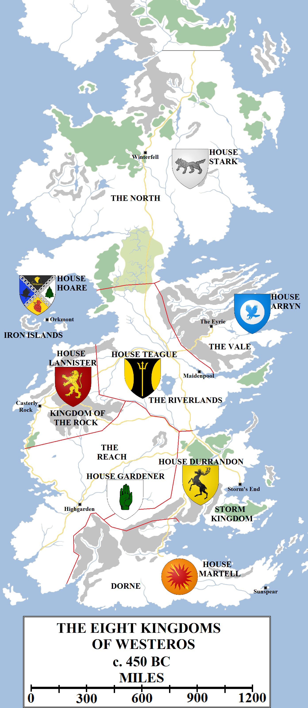
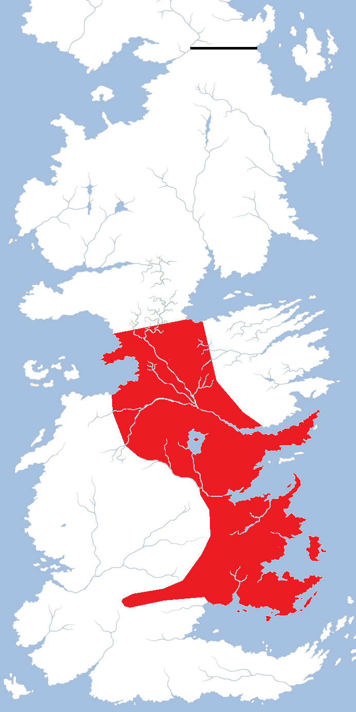

By four thousand years ago (according, as ever, to traditional history), the Andals had overrun and conquered the lands of Westeros. They held sway from the Summer Sea to the Neck, from the Iron Islands to the Vale of Arryn. They had defeated the First Men and intermarried with them below the Neck, whilst destroying the Children of the Forest and sending the survivors fleeing into the North. The Andal concepts of honour and chivalry became widespread. The Faith of the Seven became the dominant religion below the Neck, coexisting with the worship of the old gods of the forest in some places and only failing to find much purchase in the Iron Islands, where the Drowned God remained the supreme deity.

The Eight Kingdoms circa 450 BC, just before the extinction of the last Kingdom of the Rivers and Hills, ruled by House Teague.

The Andals also sponsored the arts and science. Before the Andal invasion, King Peremore Hightower of Oldtown had granted the Isle of Ravens and adjacent lands along the Honeywine to an order of scientists, mathematicians and historians. The order of maesters was founded, with the newly-built Citadel as their base of operations. When the Andals invaded the Reach, the Three Sage Kings of House Gardener made canny alliances with them and accepted Andal vassals. Thus Oldtown and the Citadel welcomed students from both the Andals and First Men, the new faith and the old. Oldtown also became the seat of the Faith of the Seven in Westeros, with the great Starry Sept being built in honour of the Seven.

The Andals had brought with them the notion of chivalry, bringing a code of honour to personal comportment and rules of conduct for the battlefield. At some point – it is unclear if this was back in Andalos or some time after the invasion – this gave rise to the order of knighthood, of skilled soldiers of faith sworn to the justice and ideals of the Seven. Knights were expected to protect the weak and serve the just. Identified by the honorific _ser_, knights were seen as great warriors. Sometimes bloody wars and sieges could be avoided by single combat, or trials of seven warriors versus another seven, with the victors declared holy and just.

After the initial wave of migrations and invasions, which according to some histories lasted one thousand years, according to others almost two thousand, there was peace in Westeros, sometimes lasting years, occasionally decades, vanishingly a generation or two. But never permanently. There were too many warlords and kings and exiled princes and unruly bastards. Westeros became a shifting patchwork of nations, some of them scant miles across, with a king rarely holding more land than he could ride across in a day. But as centuries passed more powerful kings arose and began to conquer more territory. A hundred nations became fifty, and then a dozen.

By 450 BC Westeros had become the domain of eight powerful nations, as follows:

*   **The Kingdom of the North**: ruled from Winterfell by House Stark.
*   **The Kingdom of the Rivers and Hills**: ruled from Maidenpool by House Teague.
*   **The** **Kingdom** **of** **Vale** **and Sky**: ruled from the Eyrie by House Arryn.
*   **The Kingdom of the** **Iron** **Islands**: ruled from Orkmont by House Hoare.
*   **The Kingdom of the Rock**: ruled from Casterly Rock by House Lannister.
*   **The Kingdom of the Reach**: ruled from Highgarden by House Gardener.
*   **The** **Storm** **Kingdom**: ruled from Storm’s End by House Durrandon.
*   **The** **Kingdom** **of** **Dorne**: ruled from Sunspear by House Martell.

This was the last time that the eight traditional regions of Westeros were each controlled by a separate kingdom.

House Teague, which itself had only held the fractious Riverlands for a few generations, suffered a devastating betrayal by House Blackwood over a religious dispute. In the war that followed, the Storm King Arlan III Durrandon took the part of Lord Roderick Blackwood. House Teague was destroyed in the Battle of Six Kings, but House Blackwood itself was also almost extinguished, reduced to a single daughter who was wed to the Storm King’s son. Arlan’s proposal that Lady Shiera Blackwood be crowned Queen of the Rivers and Hills was met with scorn. Not wanting to let the Riverlands descend into civil war, Arlan annexed the Riverlands altogether. He became the first Storm King to plant his banners on the shores of the Sunset Sea and ruled a domain stretching from Ironman’s Bay to the Mountains of the Moon, and from the Neck to the Red Mountains and the Sea of Dorne. Apart from the North (and the unified domain of the Targaryens, of course), this was the largest nation to ever exist on the continent of Westeros.

The approximate borders of the Kingdom of the Storm and Rivers, which existed for approximately three centuries. A highly fractious nation, it was nevertheless the second-largest independent kingdom to ever exist in Westeros, after the North.

It was large but unruly. Some of the river lords were happy to be ruled by a strong and capable ruler, but others didn’t want a foreigner commanding them. Barely a decade passed without some kind of rebellion or uprising led by a “River King” or “King of the Trident”, some of which gained some success before being crushed by the power of Storm’s End.

More than three centuries passed, during which time the Storm Kings maintained their grip on the Riverlands, but the cost of maintaining such large possessions was ruinous. When the Durrandons lost the Riverlands, it wasn’t to the local river lords but to another king sailing and marching out of the west.

Around the time of the Doom of Valyria, when the south-eastern sky turned dark and strong waves broke on the shores of Dorne and the Stepstones, King Harwyn Hoare of the Iron Islands landed on the coast of Ironman’s Bay, forty leagues south of Seagard, and marched inland to the Blue Fork of the Trident. The ironborn brought light and mobile warships with them, longships they could carry overland to the rivers. Through the Blue Fork they gained swift access to all of the rivers of the Trident and its vassal streams, and through them, the Riverlands themselves.

The river lords became divided, the Brackens joining the invaders and the Blackwoods and Tullys resisting them, only to be defeated. The Storm King, Arrec Durrandon, led a large army north to meet the ironborn but they outpaced their supply train (which was destroyed in a foray led by the Lords Goodbrook, Paege and Vypren) and were then defeated at the Battle of Fairmarket. So complete was the route that the Storm Kings lost control of the Riverlands altogether.

On the eve of the Conquest, there were Seven Kingdoms in Westeros: the North, the Vale, the Rock, the Reach, the Storm Kingdom, Dorne and the Kingdom of the Isles and Rivers. Despite many later variations in borders and nomenclature, this is the name that has stuck for the lands of Westeros ever since. It should be noted that the Crownlands, the lands along Blackwater Bay and Crackclaw Point, were only very nominally claimed by Harren the Black and acted more of an unofficial buffer region between the ironborn and stormlanders.

Lord Lothar Bracken may have hoped for the ironborn to return home and for him to seize the crown of the Rivers and Hills, but the ironborn had other ideas. They chose to stay, and Lothar lost his life attempting to unseat them. Harwyn Hardhand ruled brutally and harshly before dying at the age of sixty-four. His son followed and then his grandson on the throne of the Kingdom of the Isles and Rivers.

Harren the Black was a brutal ruler, but he was also a dreamer. He dreamed of a great castle taking shape next the lake known as Gods Eye. From this castle Harren would extend his rule to all the corners of Westeros. He commanded that taxes be raised to pay for the castl and workers be commissioned (forcibly, if necessary). He sent for the finest masons in all of Westeros. The Riverlands were bled and beggared in both lives and money. Harren rejected the plans for a castle the size of Riverrun, or one the size of Storm’s End, or even one the size of vast Winterfell. He wanted a castle so titanic that no army could ever be large enough to starve it out; big enough to grow its own crops inside the walls; tall enough so that no siege tower could reach it; and with walls so thick that no stone could hope to breach it. Harren’s exacting demands were insane, and soon Harren’s Folly was all the talk of the Seven Kingdoms.

But finally, more than forty years after he began working on it as a young man, the castle of Harrenhal was completed. It was everything that Harren had demanded and planned to be: vast, imposing, dwarfing every other fortification on the continent (bar only Casterly Rock and the Wall). It was a monument to hubris and arrogance, yes, but also a tribute to engineering, to ruthlessness and to the benefits of a singular vision.

It was also completely and totally useless. On the very day the last stone was hammered into place and King Harren declared his great castle completed, Aegon Targaryen and his army landed on the shores of the Blackwater Rush. And with him came _dragons_.

**Credit**

Two of the maps above use heraldry designs (under [Creative Commons](https://creativecommons.org/licenses/by-sa/3.0/)) from the excellent [Wiki of Ice and Fire](http://awoiaf.westeros.org/index.php/Main_Page) and [La Garde de Nuit](http://www.lagardedenuit.com/wiki/index.php?title=Accueil), the ultimate English and French-language guides to the **Song of Ice and Fire** novels
