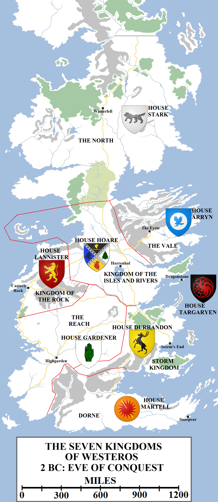
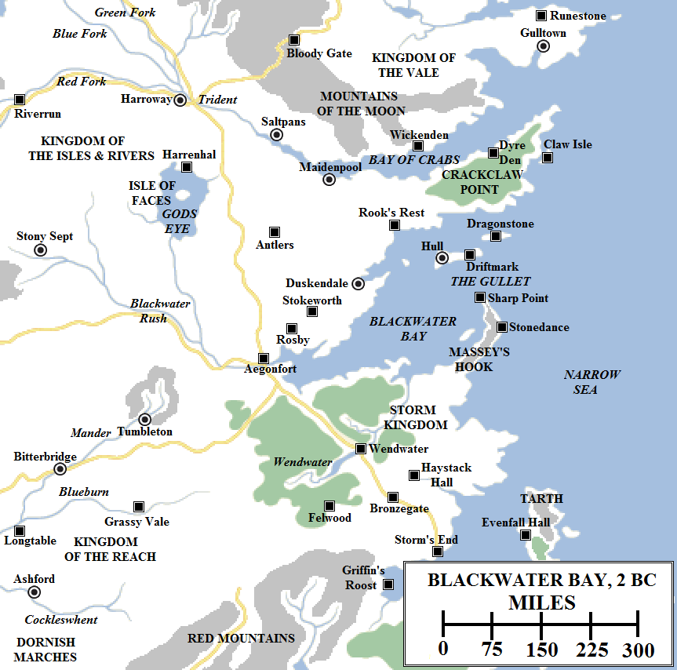
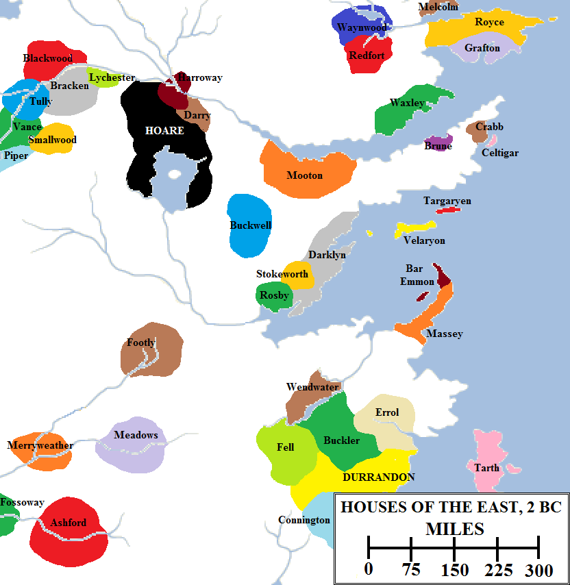
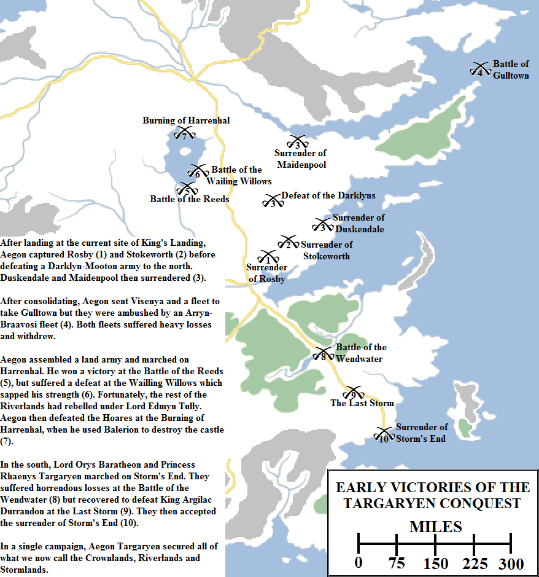
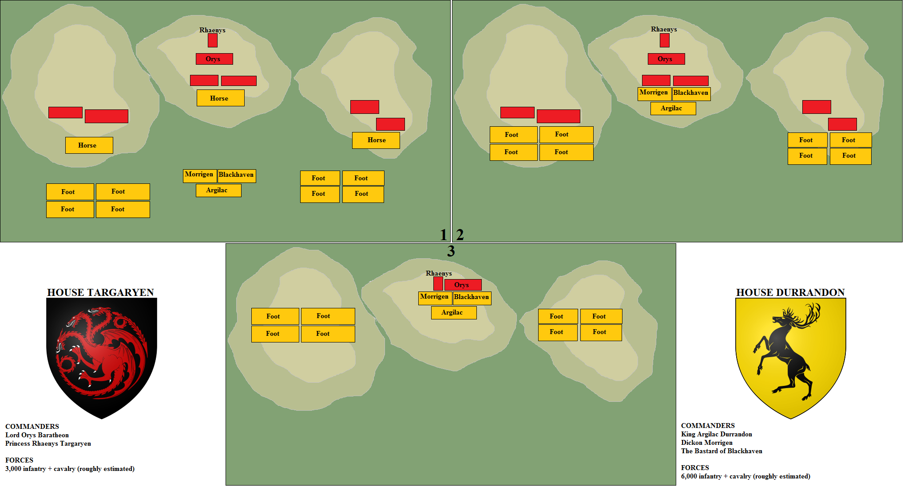

Of old, House Targaryen was one of the forty great noble families of Valyria. In 114 BC Lord Freeholder Aenar Targaryen and his entire family sold their possessions in Valyria and the Lands of the Long Summer and took ship for Dragonstone, the Valyrian island-stronghold in the Narrow Sea, just off the coast of Westeros. Aenar’s maiden daughter, Daena the Dreamer, had visions of the future which manifested in dreams and were never wrong. When she dreamed of the utter ruination of the Valyrian Freehold in a storm of fire, her family took heed and departed.

The Seven Kingdoms of Westeros on the eve of Aegon’s Conquest.

The Doom came in 102 BC, but the Targaryens made no attempt to reclaim the Freehold or return home. They were still consolidating their control of Dragonstone and the surrounding islands, which were held by other Valyrian families (but not dragonlords, so of a lesser social standing) such as the Velaryons of Driftmark and the Celtigars of Claw Isle. The Targaryens had brought five dragons with them to Dragonstone, but four had died, leaving only Balerion – then a still a young beast – and a clutch of eggs.

The Century of Blood followed. Volantis launched its attack on the other Free Cities, the Dothraki rode out of the east and the ironborn tightened their grip around the Riverlands, but the Targaryens took no part. Instead, Aenar the Exile was followed as Lord of Dragonstone by his son (and husband to Daena the Dreamer), Gaemon the Glorious. Gaemon’s son Aegon and daughter Elaena ruled together, the lordship then passing to their son Maegon, his brother Aerys and Aerys’s sons: Aelyx, Baelon and Daemion. Daemion’s son was Aerion, Lord of Dragonstone.

Aerion had two sons and two daughters. The eldest son was Aegon, his son and heir by Lady Valaena of House Velaryon. The younger son was Orys, a bastard born by an unknown mother. Despite the minor scandal, Orys was raised in the Targaryen household and soon grew to be a close friend of his legitimate siblings. Aerion’s daughters were Visenya, a cool-hearted but clever strategist, swordswoman and diplomat, and Rhaenys, a passionate and fiery warrior and lover of the arts. The Targaryens had brought two Valyrian steel blades from the homeland, Blackfyre and Dark Sister; the former Aerion bequeathed to his son Aegon and the latter to his daughter Visenya.

In the Valyrian tradition, Aegon took Visenya to wife. He also married Rhaenys. This was unusual but not unprecedented. Aegon seemed to enjoy being unconventional. His forebears had dealt extensively with their fellow Valyrian lords of the Narrow Sea and kept an eye on what was going on in Essos, but at an early age Aegon took a keen interest in the affairs of Westeros. He visited many of the Seven Kingdoms (apparently mostly incognito, but reportedly both Oldtown and the Arbor openly),  made note of their kings, their customs, their military skills and their religion.

In Dragonstone Castle Aegon commissioned a great table to be built. The Painted Table doubled as a map of Westeros, with every town, sept, bay, river and mountain clearly marked. The only thing it lacked was borders. Aegon believed that Westeros was one land made up of one people, not Seven Kingdoms divided between the blood of the First Men, the Andals and the Rhoynar. Aegon believed that it could all be conquered and held by one ruler, if he only had the vision.

Four dragons had died on Dragonstone, leaving only the great beast known as Balerion. But two of the eggs had hatched, giving rise to the dragons Vhagar and Meraxes, claimed by Visenya and Rhaenys respectively. Aegon planned to use these dragons to make up for the lack of numbers he would have in conventional troops. The islands of the Narrow Sea were small and sparsely-populated. Their army would be small and their fleet modest, although they were lucky for none of the other nations of eastern Westeros were great sea powers either.

Before he could undertake his invasion, Aegon tested his theory that dragons could do what thousands of men and dozens of ships could not. His motives are still not fully clear, but it is possible that he was also simply unwilling to let Volantis conquer the coast of the Narrow Sea and perhaps one day pose a threat to his ambitions. Aegon flew Balerion to Lys, where a great Volantene fleet stood poised to recapture the rebelling city, and destroyed that fleet where it rested. Hundreds of ships burned and hundreds – maybe thousands – of sailors and soldiers were incinerated or drowned. Many more threw themselves into the sea, to be captured or killed by the Lyseni. Aegon had his answer: a man and a dragon together were worth ten thousand armed men and a hundred warships.

As Aegon prepared for war, he received a missive from King Argilac Durrandon, the Storm King. Argilac had also warred in Essos, allying with Braavos and Pentos to repulse a Volantene army at Myr and liberating the city in return for plunder and gold from the defeated Volantenes. Argilac had been a famed warrior in his youth, but was now seeing old age approaching. Argilac had no living sons, only a daughter, and feared that Harren the Black, King of the Rivers and Isles, would soon set his eyes south of the Blackwater now that the monstrous castle he was building on the Gods Eye was nearing completion.

Argilac proposed an alliance, offering the hand of his daughter Argella to Aegon in marriage. He suggested a military campaign to be undertaken against the ironborn, with Aegon allowed to retain all of the lands from Gods Eye to Blackwater Bay and from the Trident to the Blackwater Rush once it had been taken. Aegon politely declined, pointing out that Argilac couldn’t offer him lands he did not control and that he was already married twice over.

Aegon sent a messenger with a counter-proposal. He would accept the lands if Argilac would also cede Massey’s Hook and the lands between the Blackwater and the Wendwater and west to the headwaters of the Mander, and accepted instead his brother Orys’s hand for his daughter.

Argilac was apoplectic with rage. Orys was a bastard and the lands Aegon asked for had been under the rule of the Storm King for thousands of years. He had the hands of Aegon’s envoy cut off and sent back to him in a box, accompanied by a note saying, “These are the only hands you shall have of me.”

This exchange is curious, because it seems unlikely that, if Argilac had accepted the terms, Aegon would have given up on his clear dream to conquer all of Westeros. More likely, Aegon sent Argilac an offer he knew he would reject, and then used it as a way of justifying the subsequent conflict.

Blackwater Bay and the surrounding lands in 2 BC.

Aegon summoned his banners. The Celtigars and Velaryons responded with all of their strength. The Bar Emmons of Sharp Point and the Masseys of Stonedance also came from the great peninsula known as Massey’s Hook. Both houses were sworn to Storm’s End, but counted Dragonstone as a closer and more reliable ally. Aegon consulted with his lords bannermen, with his maester and with his septon (the Targaryens had taken up the Faith of the Seven in their long exile on Dragonstone). He and his sisters prayed in the castle sept and considered their position.

Seven days after summoning his banners, Aegon Targaryen sent messages to every single king and lord in Westeros, from the Night’s Watch to Saltshore in Dorne, from the Citadel in Oldtown to White Harbour and from Pyke to Storm’s End. He told them that, henceforth, Westeros would know only one king and his name was Aegon Targaryen. Those who swore fealty to him would retain their lands, their power and their privileges, losing only their title of _king_. Those who resisted would be destroyed. Then the Targaryen fleet sailed.

Some say that less than three thousand soldiers and knights landed on the coast of Westeros. The fleet had put in at the mouth of the Blackwater Rush, where three hills rose above the bay. It was an excellent defensive location, and indeed small villages, watch-towers and even forts had commanded the hills in ages past. But the river was also the ancient and traditional border between the Storm Kingdom, the Reach and the Riverlands. The hills had exchanged hands hundreds of times and every attempt to built a permanent settlement there had ended with it in flames.

Aegon now established a new outpost on the tallest hill, the one immediately overlooking the mouth of the river. This redoubt was nicknamed the “Aegonfort”. It was made of wood and was rather unimpressive, but it was only meant to serve as a supply base and a stopover. Aegon knew he had to move quickly or be caught between his foes and destroyed. Already Mern IX Gardener, King of the Reach, and Loren Lannister, King of the Rock, were exchanging messages and preparing to meet to consider the Targaryen threat. And on the very day that Aegon had landed on the Blackwater, Harren the Black had completed his great fortress on Gods Eye, Harrenhal.

Aegon’s first move was to secure the region. He sent Rhaenys and Meraxes to force the surrender of Rosby, just to the north-east. Visenya and Vhagar secured Stokeworth, not much further to the north-east on the road to Duskendale, the largest port on Blackwater Bay. The Darklyns of Duskendale had once been great kings in their own right, ruling a wide swath of these lands, but had been forced into submission by a succession of river, storm and now ironborn kings. Still, they were the most powerful house in the region and were raising an impressive force to lead against the Targaryens. They made alliance with House Mooton of Maidenpool, formed an army of three thousand and marched south. Aegon’s half-brother Orys Baratheon engaged them by land whilst Aegon descended on their rear with Balerion, killing both lords. Their heirs surrendered and swore fealty to Aegon.

Lords all along the Blackwater (river and bay) began to swear fealty to Aegon, believing that his victories showed that he was favoured by the gods and that his dragons were undefeatable.

The noble houses of eastern Westeros, 2 BC. Note that the borders and areas of influence of each house are highly conjectural.

Aegon reformed his army at the Aegonfort, now swelled by his new vassals. He formed a “small council” to advise him and delegate commands. Daemon Velaryon, Lord of the Tides, was made master of ships. Triston Massey, Lord of Stonedance, was made master of laws. Crispian Celtigar, Lord of Claw Isle, was named master of coin. Orys Baratheon was named as Aegon’s “stalwart shield”, and some maesters count him as the first Hand of the King, able to speak with his voice and authority. Aegon was then crowned by Visenya, whilst Rhaenys read out his titles: “King of All Westeros and Shield of His People.”

The early responses to Aegon’s letters had been derision and laughter, but the presence of his dragons gave the kings and lords of Westeros pause. When word came that Rosby, Stokeworth, Duskendale and Maidenpool – none of them small or weak strongholds – had fallen in rapid succession, this pause was replaced with concern. Mern IX Gardener, King of the Reach, and King Loren Lannister, King of the Rock, met to discuss a possible alliance against the interloper from the sea. Torrhen Stark, the King in the North, summoned his banners. King Harren Hoare did the same at Harrenhal, but also sent skirmishers across the new border into Aegon’s new holdings. King Argilac Durrandon summoned his banners and likewise sent his vassals – the Lords Fell, Buckler and Errol – north to secure the main road.

Others saw opportunity. Princess Meria Martell, the aged but still-formidable ruler of Dorne, sent Aegon a proposal for an alliance against the Storm Kingdom. Sharra Arryn, the dowager Queen Regent of the Vale, proposed a marriage alliance between herself and Aegon in return for aid from the knights of the Vale in conquering the Riverlands. Aegon sent no answer. He demanded now only submission, not negotiation.

Aegon ignored military doctrine and common sense, which called for him to focus on each major enemy in turn and to defeat them in detail before moving onto the next, and instead divided his army into three forces. The first he led north himself, heading towards Gods Eye and Harrenhal. The second he sent south, led by Orys and Rhaenys, heading into the Stormlands. The third he sent by sea, through the Gullet and around Dragonstone and Crackclaw Point, bound for Gulltown and the Vale of Arryn. Each force numbered only a few thousand men, but each was also accompanied by a dragon.

The Targaryen fleet was ambushed whilst navigating the Narrow Sea by an Arryn fleet out of Gulltown, a surprising move as the Arryns were not a noted sea power. However, they had augmented their forces with a dozen Braavosi warships, paid for in gold. The Valyrian fleet was defeated, with a third destroyed and almost as many ships captured. The flagship commanded by Daemon Velayron was one of those lost in the initial attack. However, the Arryn success was short-lived. Visenya descended out of the clouds on Vhagar and burned the Arryn fleet, destroying almost every ship. The Targaryen fleet, too battered to press on to Gulltown, withdrew to Dragonstone and then the Aegonfort to regroup.

Aegon’s army encountered stiff resistance on its way to Harrenhal. Harren the Black’s sons mounted a campaign of raids and several larger attacks meant to bleed Aegon before he could reach Harrenhal. Aegon proved victorious in the Battle of the Reeds, on the south shore of Gods Eye, but suffered grievous losses in the Battle of the Wailing Weeds. Aegon defeated the attack, launched by boats across he lake, and destroyed the Hoare force with Balerion’s flames (killing two of Harren’s sons), but these were losses he could ill afford.

Aegon’s cause may have seemed doubtful, even with Balerion’s strength, but for Harren’s own hubris. He and his family had ruled the Riverlands for three generations over a century, bleeding them dry in the building of Harrenhal and spending their lives unwisely in wars against their neighbours. Edmyn Tully, Lord of Riverrun, saw an opportunity to remove the ironborn from the Riverlands forever, and raised the dragon banner of House Targaryen over his castle. One-by-one, the other Lords of the Trident followed, summoning their hosts. Edmyn was a superior diplomat and managed to even convince the ever-feuding Blackwoods and Brackens to join forces against Harren the Black. The army they assembled was not huge, eight thousand men only when combined with Aegon’s forces (as they also needed to defend their own lands against ironborn retaliation), but it gave Aegon’s cause more hope. It also forced Harren to abandon his skirmishing and pull all his troops back inside Harrenhal.

Harren refused to surrender. His walls were thick, his battlements strong. He commanded his archers and crossbowmen to bring down the dragon should it show himself. But Aegon simply took Balerion high up above the clouds and descended on each tower in turn, unleashing a torrent of fierce flame. Harren the Black and his surviving sons died, along with many of his remaining liege lords and soldiers.

The next day, Aegon Targaryen accepted Edmyn Tully’s oath of fealty and named him Lord Paramount of the Trident. The river lords turned on the remaining ironborn, putting them to rout and sending them fleeing back across Ironman’s Bay to their islands.

The early battles of Aegon’s Conquest.

Far to the south-east, Orys Baratheon’s army was closing on Storm’s End. It had lost a thousand men in the crossing of the Wendwater, under sustained arrow fire and resistance from the Fells, Errols and Bucklers. Rhaenys and Meraxes were forced to burn the forest to get them to retreat. Once that was done, the army faced lighter but still persistent resistance all the way to Bronzegate, the seat of House Buckler. Orys captured the castle and prepared for the final march on Storm’s End, but Argilac had learned of Harren the Black’s end. Vowing not to face the same fate, he gathered his army and departed the castle to meet the enemy on the battlefield. Rhaenys spied on his march and was able to provide a full accounting of his numbers and strategy to Orys.

Orys took up a strong position on the road south of Bronzegate and prepared to engage the Storm King whilst Rhaenys attacked from the sky. But this was not to be, for a fierce storm fell on the battlefield. Normally armies would wait until the passing of a storm to fight, but Argilac took it as an omen of his victory, and also knew it would limit the Targaryen ability to use Meraxes.

The battle was hard-fought, with the Stormlanders massing twice as many men as the Targaryens and four times as many heavy cavalry. However, the Targaryens had had time to dig in on three hillsides and the muddy conditions favoured the defenders. Still, it was a close thing and the Durrandons may have carried the day had not Meraxes, still lethal on the ground, emerged and incinerated their vanguard with his breath. A panicked rout followed, during which Orys isolated and defeated Argilac in single combat.

The Last Storm was fought a short distance south-east of Bronzegate. Unwilling to wait in Storm’s End to be burned, Argilac the Arrogant chose to give battle. Aerial reconnaisance from Princess Rhaenys Targaryen on her dragon Meraxes allowed Lord Orys Baratheon to pick a strong defensive position athwart three hills. Heavy rain prevented Meraxes from flying and allowed Argilac to take the initiative. An early attempt to achieve breakthroughs with heavy cavalry failed due to the mud and the Targaryen stakes (1), so Argilac committed his heavy infantry to the attack. This was more successful (2). Having collapsed Orys’s flanks, Argilac prepared to deliver a final assault, but Meraxes was deployed on the ground to incinerate Argilac’s forward lines. Orys then broke through and killed Argilac in single combat. Despite sustaining far heavier losses, the Targaryens thus emerged the victors.

Argella Durrandon declared herself the Storm Queen and barricaded the gates of Storm’s End. She refused the call to surrender…but at night she was imprisoned by her own guards and delivered, gagged, chained and naked to the camp of Orys Baratheon. Although grateful not to have to storm the castle, Orys was unimpressed by the treatment of the lady, who was still noble, and treated her gently. He took possession of the castle, named himself its lord and took the Durrandon sigil and words – _“Ours is the Fury”_ – as his own. He also took Argella to wife, to secure the line of kings.

Aegon began to consolidate his forces. Visenya had not been idle after her defeat on the Narrow Sea. She had flown the length of Crackclaw Point, the great peninsula dividing Blackwater Bay from the Bay of Crabs, and accepted the submission of his fractious lords. Although not numerous, the men of Crackclaw were known for their bravery and skill in combat.

But then tidings came from the west. Kings Gardener and Lannister had joined the full strength of the Reach and the Westerlands to one another and were now marching. Almost sixty thousand troops, the largest army ever seen in Westeros, were now advancing on the Blackwater from the south. Aegon was outnumbered five-to-one, with Orys’s army at Storm’s End too far away to relieve him. He took what forces he had and made for the town of Stony Sept
