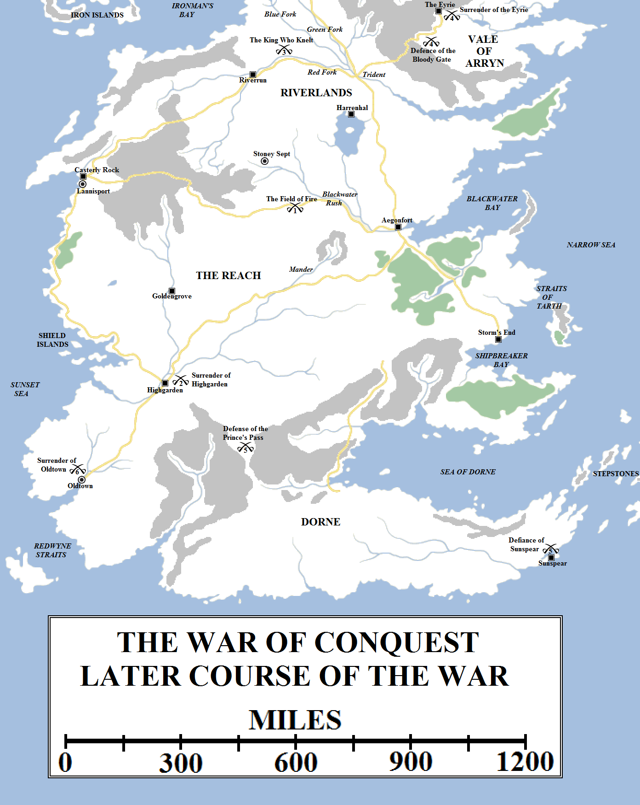
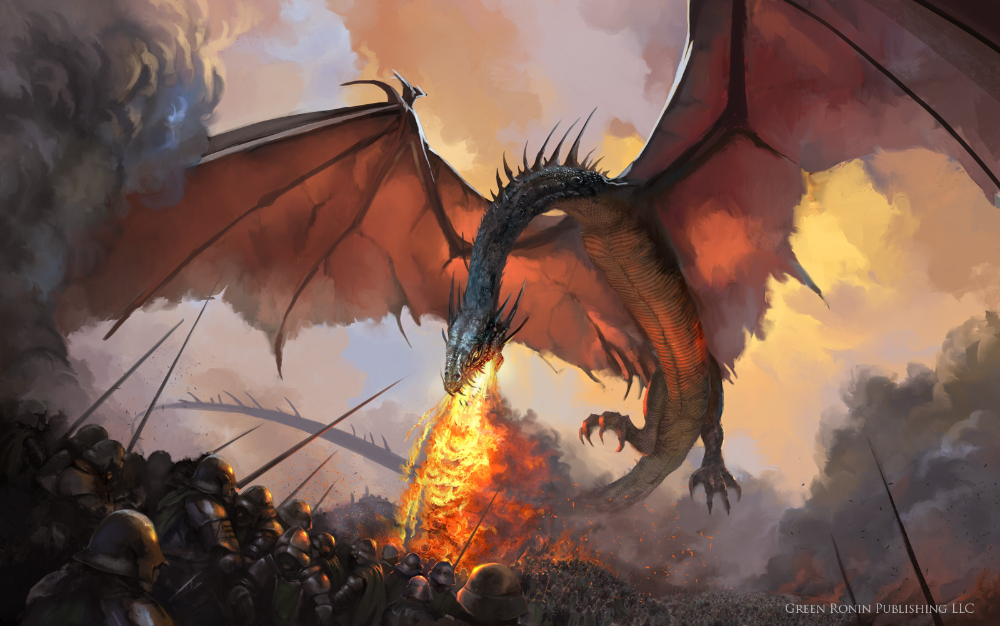
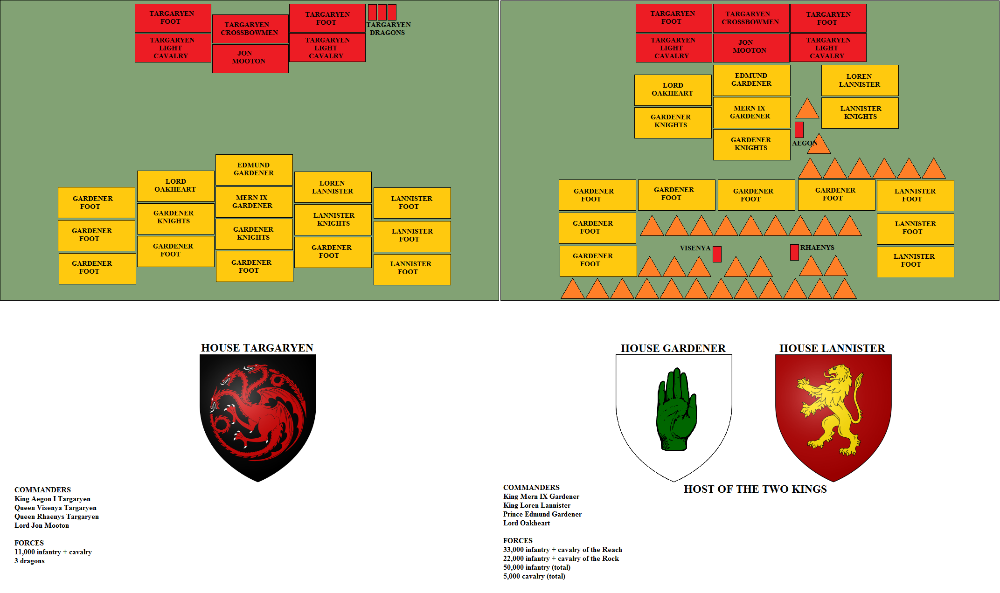
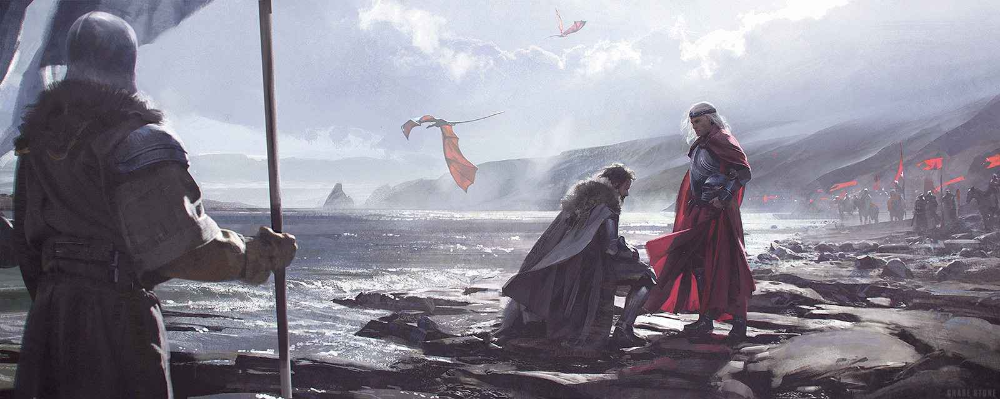
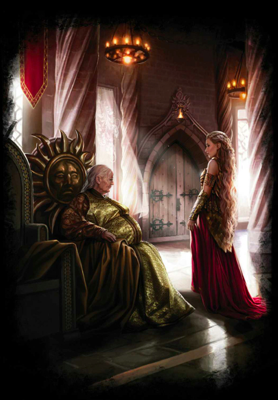
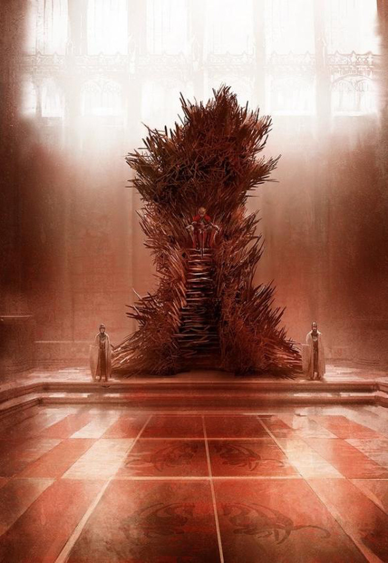

Of the Seven Kingdoms before the dragons, the two greatest were undoubtedly the Kingdom of the Rock, ruled from Casterly Rock by House Lannister, and the Kingdom of the Reach, ruled from Highgarden by House Gardener. These were two ancient houses, both surviving the Andal invasion through canny intermarriages with the invaders and both keeping their kingdoms free of the frequent internal wars of the likes of the Riverlands and Dorne. The Kingdom of the Rock was the richest in Westeros, thanks to the immense gold and silver mines under the Golden Tooth, Silverhill and the Rock itself, and the Kingdom of the Reach was the most populous and fertile, fed by immense fields and gentle plains stretching for hundreds of miles, fed by the mighty River Mander and its many vassals.

After the rapid fall of Harrenhal and Storm’s End, the kingdoms of the Reach and Rock allied and attacked Aegon’s forces. Using the combined might of all three dragons, Aegon defeated them at the Field of Fire (1). He secured the surrender of Highgarden (2) before rushing north to meet a threat from the northmen under Torrhen Stark. Stark, seeing the full power that Aegon commanded, surrendered rather than give battle (3). Visenya then secured the capitulation of the Eyrie (4), but Rhaenys was thwarted in her attempt to invade Dorne and was forced to withdraw (5). Finally, almost two years after first landing on the shores of Westeros, Aegon was welcomed into Oldtown and proclaimed King of Westeros (6).

When word came of the Targaryen conquests in the east, King Mern IX Gardener rode the Ocean Road to Casterly Rock and there took counsel with King Loren Lannister. They agreed that Aegon Targaryen posed a grave threat to their power and resolved to destroy him, no matter the cost.

The army they assembled was unlike any other in the history of Westeros. Fifty thousand footsoldiers (including crossbowmen and archers, whom the two kings hoped would do for the Targaryen dragons) assembled, along with over five thousand mounted knights and some six hundred lords, all the chivalry of the Westerlands and the Reach. It was the largest army ever seen on the continent.

The Host of the Two Kings, as it became known, assembled at Goldengrove, the seat of House Rowan. From there it made east and north, towards the Blackwater Rush. The two kings had debated strategy and seemingly rejected an invasion of the Riverlands from the west, perhaps feeling that Aegon would be able to delay them too easily with his new (and potentially expendable) river lord allies. Instead, a direct thrust across the Blackwater was deemed faster – an essential factor given the speed with which the vast army was consuming supplies – and also allowed the army to move against Harrenhal, the Aegonfort or Storm’s End, depending on where Aegon had deployed his forces.

Aegon moved with decisiveness, again rejecting established military dogma. If he had remained in the Riverlands, he might have assembled a much larger host, but Aegon knew his new river lords were uncertain allies and were busy consolidating their territories, chasing out the last ironborn and crushing quarrelsome vassals unhappy with the new order. Likewise, the storm lords were late to his cause and still smarting from their defeats at Wendwater, Bronzegate and the Last Storm.

Instead, Aegon took what troops he had around Harrenhal and the surrounding regions and made for Stoney Sept, a fortified town located near the headwaters of the Blackwater Rush, close to the border with the Reach. He also sent for his sisters. Rhaenys arrived from Storm’s End on Meraxes, whilst Visenya travelled down from Crackclaw Point on Vhagar. Once assembled with as many local levies as he could muster, Aegon crossed the river. History records that, perhaps, eleven thousand troops accompanied him.

The Targaryen host took up position on the open plains south of the Blackwater and waited for the enemy to arrive. It was four hundred miles from Goldengrove to the site of battle, an epic march for an army so large, but the Host of the Two Kings arrived in good order, with surprisingly few losses to illness or desertion. Loren and Mern were both startled to see that the Targaryen host was so small – one-fifth their own size – and that it had also taken up position on what was effectively a flat field. They had not chosen to use either a river or a hill as a defensive position. Nor had they withdrawn to await favourable weather conditions, or forced the Lannister and Gardener host to march further and risk overextending its supply lines.

The three Targaryen dragons only came together once to unleash their combined might during the War of Conquest: on the Field of Fire. Artwork by Green Ronin Publishing for _A Song of Ice and Fire Roleplaying_.

The Gardener host numbered almost thirty-three thousand men, the Lannisters some twenty-two thousand. Because of his larger contribution, King Mern won the right to command the centre. He placed his son and heir Prince Edmund Gardener in the vanguard. King Loren Lannister and his knights were placed on the right, whilst Lord Oakheart commanded the left. The two kings decided on a simple strategy: to simply envelop the Targaryen lines from both sides, send a flanking force to attack from the rear and hit the centre with heavy cavalry.

Aegon drew his men up in a crescent defensive formation and gave command to Lord Jon Mooton. However, he decided to fight this battle from the skies with his sisters. He and his sisters knew that the two kings massed a vast number of archers and crossbowmen, enough to make deploying their dragons risky. Of old the best chances for the enemies of the Freehold to slay dragons on the battlefield was through massed missile fire, and more than one overconfident dragonlord had seen his mount shot out of the skies over Ghis or the Rhoyne. But Aegon had noted that the grass and wheat that made up the battlefield was incredibly dry.

Visenya and Rhaenys used their dragons to ignite the grasses upwind and behind the enemy lines. King Mern and his massive cavalry charge successfully shattered the Targaryen lines, but no sooner had they made contact then the battlefield went up in flames behind them.

Aegon and Balerion braved the arrows and stones of the enemy to directly attack and burn their ranks, causing them to break and run. As King Mern realised his danger and attempted to withdraw, he was caught in the firestorm. King Mern died, along with his sons, grandsons, cousins and more distant relatives. Only a nephew survived, living for three days before dying of his injuries. When he died, House Gardener went with him. One of the oldest, greatest and most storied families in Westeros had been extinguished utterly.

King Loren Lannister survived, having spotted the danger earlier than Mern. He had wheeled his cavalry and managed to escape the battlefield. However, he could not outrun the dragons. When Aegon caught up with him the next day, Loren surrendered, laying his sword at Aegon’s feet. Aegon raised him up, forgiving him and naming him Lord Loren Lannister, Warden of the West and Lord of Casterly Rock. He likewise accepted the surrender and fealty of the other lords of the west and south present.

The battle known as the Field of Fire was arguably Aegon’s greatest victory. His army of eleven thousand defeated a combined Gardener-Lannister host of fifty-five thousand, allegedly the largest army ever assembled on the continent of Westeros to that time. Aegon’s strategy was to lure the enemy cavalry into committing themselves and then use all three dragons to set the battlefield ablaze around and between the enemy formations. This was successful and saw the enemy defeated with relatively light losses: Aegon lost less than a hundred men, the Host of the Two Kings sustained losses of about five thousand.

Aegon made a rapid march on Highgarden, hoping to capture it – and the heart of the Reach – before some other lord could rally a defence there. Instead he found the castle already secured in his name by the steward, Lord Harlan Tyrell. Pleased with his wise decision, Aegon named him Lord of Highgarden, Warden of the South and overlord of the Reach. Later the Targaryens may have had some cause to doubt this decision: many of the other Reach lords had multiple lines of descent from Garth Greenhand, the great conqueror of the Reach in the Age of Heroes, whilst the Tyrells were of lesser blood. In particular, the Florents of Brightwater Keep would angrily renew their “superior” claim to Highgarden to every Targaryen king that followed, to their great annoyance.

Aegon planned to fly on to secure the submission of Oldtown before considering the fate of Dorne and the Iron Islands, but word then came that King Torrhen Stark was crossing the Neck with an army thirty thousand strong. Aegon took wing back to the Riverlands and summoned his sisters and as many banners as they could raise quickly.

The Stark host had come down from the Neck, crossed the Green and Blue Forks of the Trident and made for the Red Fork, a hundred miles or so east of Riverrun. When they reached the river they discovered that the Targaryens were there ahead of them. Their army was forty-five thousand strong, half again their size, but all three dragons were present. In addition, Aegon had been able to summon troops from the Stormlands, Riverlands, the Reach and Westerlands. The banners from what had formerly been four sovereign kingdoms could be seen by the Starks. King Torrhen realised that he could not prevail. The Neck might hold back an army of hundreds of thousands, but the dragons could simply fly over it.

His brother Brandon Snow suggested a sneak attack by night to kill the dragons, but cooler heads prevailed. Torrhen Stark crossed the Trident and surrendered to Aegon the Conqueror, offering him his fealty. He rose, a king no more but Lord of Winterfell and Warden of the North.

The King Who Knelt. King Torrhen Stark surrenders his crown to Aegon Targaryen on the banks of the Red Fork of the Trident, marking the end of the reign of the Kings in the North. Artwork by Chase Stone for _The World of Ice and Fire_.

The Targaryens now split their forces in three. Aegon rejoined the forces he had left at Highgarden and marched on Oldtown. Rhaenys led an army south and east towards the Red Mountains. Visenya led a large contingent of troops to the Bloody Gate, which the Arryns of the Vale had barred against them. Visenya mounted a siege, but made no direct assault. Instead, she simply mounted Vhagar and flew over the Mountains of the Moon, passing high over the Giant’s Lance to the walls of the Eyrie. There she spied little King Ronnel Arryn playing in the courtyard. She landed Vhagar in front of the startled child and offered him a ride on the dragon’s back, an offer no child could resist. The Queen Regent Sharra burst into the courtyard with a force of guards to find the King of the Vale seated on Visenya’s knee. Sharra surrendered her crown, along with the swords of her garrison, and Ronnell Arryn found himself named Lord of the Eyrie and Warden of the East. He also got his wish, with Visenya flying him three times around the peak of the Lance before returning him to his mother.

Far to the south, Rhaenys’s army had reached the Red Mountains. The Prince’s Pass was the most direct route into Dorne, but it had been fortified by a Dornish host. Like her sister, Rhaenys chose not to give battle but instead flew to Sunspear on dragonback. To her bewilderment, in every town and castle she stopped in to rest (and demand their surrender), she found the men and lords missing. When she reached Sunspear she likewise found the fighting men gone and only a few old women and children left behind. But one of those old women was Meria Martell, Princess of Dorne, eighty years old and one of the canniest and most wily rulers in all of Westeros, a true descendant of Nymeria of the Rhoyne. Her words to Rhaenys are inscribed in history for the dark promise that, years later, was eventually fulfilled: “You may burn us, my lady, but you will not bend us, break us, or make us bow. This is Dorne. You are not wanted here. Return at your peril.” Rhaenys left and rejoined her army. She decided against an attack and withdrew to rejoin her brother. Thus, Dorne remained unconquered.

Meria Martell, Princess of Dorne, rejects Princess Rhaenys Targaryen’s demand to surrender her kingdom. “You will not bend us, break us, or make us bow.” Artwork by Magali Villeneuve for _The World of Ice and Fire_.

Aegon’s host reached Oldtown and he braced himself for a possible fight. He did not relish the prospect, as Oldtown’s walls were tall and thick, the High Tower was the most formidable defensive fortification on the continent (after the Wall and Casterly Rock) and any attempt to use Balerion’s breath risked getting out of control and burning a city with over two hundred thousand inhabitants, not to mention risking the destruction of the Citadel, the greatest store of learning in the known world, and the Starry Sept, the seat of the Faith of the Seven.

Fortunately, none of this proved necessary. The High Septon had taken counsel with the gods, fasting for seven days and seven nights before receiving a vision from the Crone. She advised that resistance would see Oldtown burned, the High Tower set alight and the Starry Sept torn down in fire. The High Septon revealed this vision to Manfred Hightower, Lord of Oldtown, a godly and pious man. Manfred decided to offer no resistance and surrendered to Aegon on his entrance to the city.

Three days later, in the Starry Sept, the Conqueror was proclaimed Aegon I Targaryen, King of the Andals, the Rhoynar and the First Men, Lord of the Seven Kingdoms and Protector of the Realm by the High Septon. Hundreds of lords witnessed the coronation, along with all the Archmaesters of the Citadel. The entire city turned out to celebrate. Aegon fixed this day as the first day of the first year After the Conquest, the beginning of his reign and the beginning of the Targaryen Dynasty.

The Iron Throne of Westeros, forged from several thousand swords captured at the Last Storm, Field of Fire, Harrenhal, and other engagements. It would be the seat of the Targaryen kings for over two hundred and eighty years. Art by Marc Simonetti for _The World of Ice and Fire_.

Aegon had considered making his seat in Oldtown, but he felt the city, located in the far south-western corner of Westeros, nigh on three thousand miles from the northern border at the Wall, was too far from the centre of the continent. He considered returning to Dragonstone, but the island was too small to act as an effective royal capital. Many of the other possibilities – Maidenpool or Lannisport – would have meant impugning on the territories of other, long-established families or lords. The logical alternative was the Aegonfort, which Aegon now declared would serve as the core of a new city, a royal capital to be called King’s Landing. In the small stronghold thrown up atop what was already known as Aegon’s High Hill, Aegon had all of the swords of the defeated soldiers, knights, lords and kings gathered. There were thousands of them. Balerion burned them, his breath buckling the swords and fusing the metal together. Again and again he did this, blacksmiths taking the mass that was left behind and hammering it into a seat unlike any other in the world: the Iron Throne of Westeros.

**Note on Population Levels**

The population of the Seven Kingdoms was clearly significantly less at this point in history than during the events of the books: the North massed an army of thirty thousand during the Conquest, as compared with the potential forty-five thousand they could gather at the time of the War of the Five Kings (although Robb Stark had time to gather only half that amount). The Lannisters and Gardeners also managed to raise a combined army of around fifty-five thousand, whilst three centuries later the Lannisters could raise this by themselves and the Reach could raise almost one hundred thousand by themselves.

We can assume that three hundred years of relative peace allowed the population of Westeros to boom significantly. Several long winters, three major civil wars and at least one major plague, not to mention two wars against Dorne, did take their toll on the population, but clearly not enough to undo the huge population increase.

**Length of the War**

It has been suggested that the length of the war was around two years. However, it is more likely to say that the invasion began at some point in the year 2 BC and concluded with Aegon’s crowning on the first day of what was effectively 0 AC. As a result the war could have lasted from anything between thirteen and twenty-four months.
