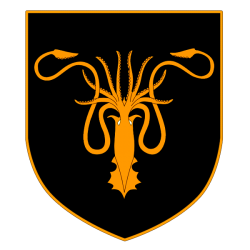
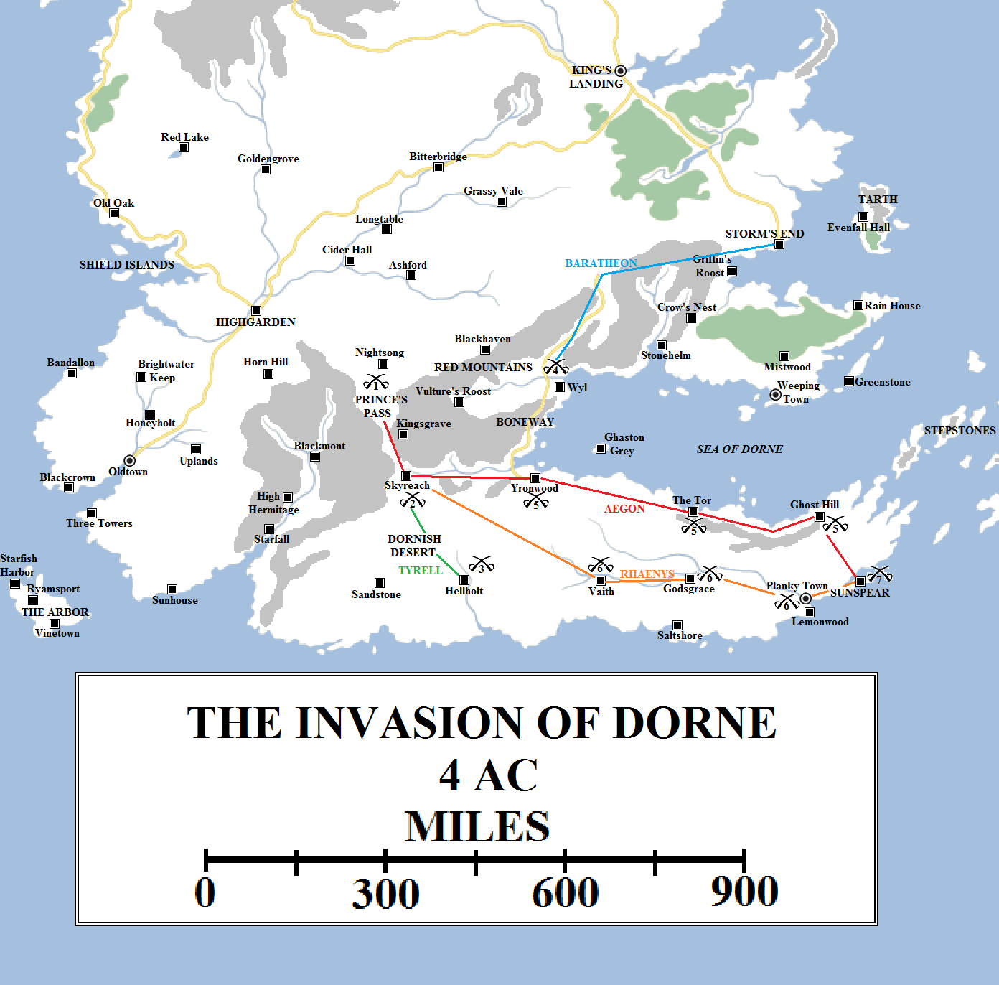
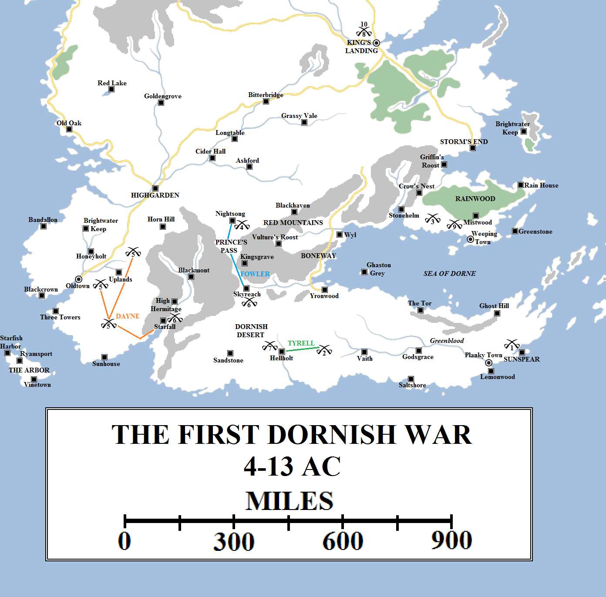
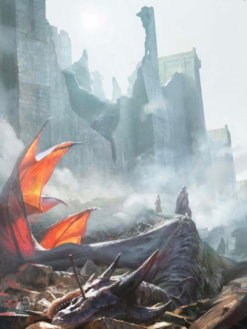
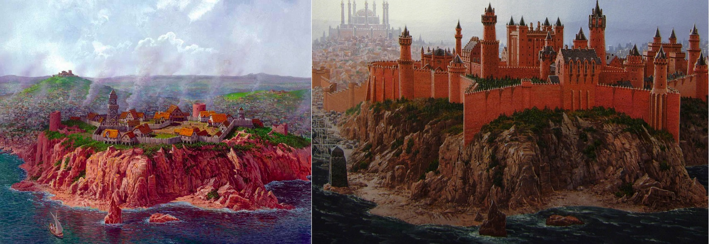

The Targaryen conquest of Westeros is sometimes presented as a sweeping, continuous campaign lasting the better part of two years which delivered the entire continent south of the Wall to Aegon’s banner. This is somewhat misleading, as on the day of Aegon’s coronation on the steps of the Starry Sept in Oldtown both the Iron Islands and Dorne remained free and defiant. Aegon’s assumption was that both regions would see the folly of defying him and come to his banner willingly.

The sigil of House Greyjoy of Pyke (from [Wiki of Ice and Fire](http://awoiaf.westeros.org/index.php/House_Greyjoy)).

Instead, the ironborn turned on themselves. The death of Harren the Black and the extinction of House Hoare left the ironborn feuding for dominance and the right to take the Seastone Chair. Qhorin Volmark of Harlaw was the first to claim the throne, but he was followed by a drowned priest named Lodos, and then many others. The ironborn fell on one another in a struggle lasting over two years.

Finally, angered by the delay, Aegon Targaryen descended on Grey Wyk on Balerion, the fleets of the Reach and the Westerlands at his back. Aegon slew Qhorin Volmark himself and Lodos the priest-king reportedly hurled himself into the waves to seek the Drowned God’s favour and never returned.

Debate raged over what to do next, but Aegon simply commanded all of the ironborn lords to attend him. He told them to pick their own lord using reason and argument rather than bloodshed. After a time when the largest and most populous islands – Harlaw, Great Wyk and Orkmont – found they could not stomach any of the other great lords becoming more powerful, they agreed on a compromise choice: Vickon Greyjoy, Lord Reaper of Pyke. Pyke was a relatively small island, but the Greyjoys were respected for their ferocity in battle, their cunning gambits at sea and their shrewd judgement. More than a few of the ancient Kings of the Iron Islands had been from the house, and the other ironborn found the symbol of the kraken easier to follow than many others. Aegon accepted their choice.

It proved wise, for Vickon was as smart a ruler as his forebears had been. He accepted Aegon’s command to allow septs to be opened on the islands, but he would not command his people to convert. He also allowed his people to continue following the Old Way of reaving and raiding, but only in the Stepstones and the lands beyond the borders of the Seven Kingdoms. Vickon’s son Goren succeeded him in 33 AC, putting down an inept rebellion by House Volmark and a religious revolt against the encroaching Faith of the Seven in 37 AC by the followers of the Drowned God. Goren Greyjoy sent the head of the leader to King Aenys in a picked jar. Aenys was pleased so granted Goren a boon. Goren was allowed to expel the Seven from the Iron Islands altogether, winning the support of the religious ironborn in the process and securing House Greyjoy’s rule for centuries to come.

Dorne proved a tougher nut to crack.

Aegon Targaryen invaded Dorne in 4 AC, forcing the Prince’s Pass (1) before dividing his forces into three after taking Skyreach (2). Lord Harlan Tyrell led his army south through the Dornish desert to take Hellholt (3). Aegon himself marched along the coast of the Sea of Dorne, taking Yronwood, the Tor and Ghost Hill (5). Rhaenys advanced along the Vaith and the Greenblood to the Planky Town (6) both she and her brother united at Sunspear (7). Unfortunately, a secondary assault by Lord Orys Baratheon out of the Stormlands was defeated at the Battle of the Boneway (4). Orys was captured and imprisoned in Wyl.

Princess Meria’s defiance irked Aegon and he resolved to conquer Dorne outright if she would not submit. After diplomatic efforts were rebuffed, Aegon planned to invade Dorne but soon found himself confronting the same geographic and climactic realities that had stymied the Kings of the Reach and the Stormlands for generations.

Dorne was relatively small, but it was well-defended. The Red Mountains formed a defensive wall to its north-west, with an invading army forced through the bottlenecks of the Prince’s Pass and the Boneway, with much smaller defending forces able to hold off far vaster armies. Most of the vast coast of Dorne (well over 2,000 miles in length, north, east and south) was rocky and unsuitable for seaborne landings, with the few good harbours (such as Sunspear’s) heavily defended. Once through those barriers, any invading army would find the interior of Dorne to be parched and dry, with wells few and few between, their locations a closely-guarded secret. The Dornish could retreat into the deserts at will, harrying any invading army as it struggled along the coasts.

Aegon was aware of the dangers, so took a vast host into Dorne, consisting of large numbers of troops from all across his realm but mostly from the Reach, which provided the largest army and also acted as a supply base. He also took his dragons, assuming that the tactics that worked on the Field of Fire, the razing of Harrenhal and even in the Last Storm would work in the sands of Dorne.

They did not. The Dornish had learned from the mistakes of their neighbours and simply refused to give battle. Their army did not assemble _en masse_ but instead divided into raiding parties and attacked in small, surgical strikes on the skirmishers and scouts, on supply lines and on night camps. By the time the dragons had roused themselves and arrived, the attackers were gone. The few times that Aegon and his sisters were in time to destroy the attacking force, the losses to the overall Dornish army were negligible.

Aegon’s strategy saw his army invade Dorne in 4 AC in four hosts. Rhaenys moved fast with a small force led by herself from dragonback, with the goal of rapidly seizing castles through central Dorne and turning east at the Greenblood. Aegon and Lord Harlan Tyrell led the main host through the Prince’s Pass, splitting in two afterwards with Aegon moving east along the coast and Tyrell marching through the desert on Hellholt. Orys Baratheon led an army out of the Stormlands towards the Sea of Dorne, advancing along the Boneway.

This strategy proved only partially effective. Tyrell took Hellholt, but the march through the Dornish desert saw thousands of his men die of thirst, insect bites and disease. Hellholt itself was deserted. Aegon found the same: Yronwood and Skyreach were likewise abandoned, and Ghost Hill deserted save for a few old men and Lord Toland’s fool, who challenged Aegon to single combat and died as a result.

Orys Baratheon’s march up the Boneway ended in disaster. Aware that Baratheon’s force was not accompanied by dragons, Lord Wyl of the Boneway launched a series of raids and spoiling attacks on the army that saw it cut to pieces. Orys and many of his senior lords and knights were taken prisoner and imprisoned in Wyl Castle.

Aegon and Rhaenys reunited their forces in Sunspear, having burned out the Planky Town along the way, but found the victory hollow. Princess Meria Martell had vanished into the desert and the majority of Dorne’s army had simply not given battle and remained unengaged. Aegon proclaimed himself the victor anyway, naming Lord Rosby as Castellan of Sunspear and Warden of the Sands. He also commanded Lord Tyrell’s host to remain at Hellholt to provide support in case of a counter-attack. This suspicion was well-founded: no sooner had Aegon and his sisters returned to King’s Landing then Dorne revolted. The Dornish emerged from their sanctuaries in the deep desert and retook Sunspear. Lord Rosby was thrown to his death from the Spear Tower of Sunspear by Princess Meria and most of the other castles were rapidly retaken.

After the capitulation of Sunspear, Aegon returned to King’s Landing. Sunspear then rebelled and was retaken by House Martell (1). Lord Tyrell’s army left Hellholt and marched on Sunspear, but was destroyed in the deep desert (2). With most of the Reach’s armed might destroyed, Aegon found himself unable to raise another large army to mount a renewed offensive. Instead, he used his dragons to raid and raze Dornish castles. The Dornish invaded the Stormlands and caused immense damage (3), whilst House Fowler captured and destroyed Nightsong (4) and House Dayne launched a massive raid out of Starfall that left parts of the lower Reach ablaze and Oldtown’s hinterland threatened (5). Aegon’s dragons burned Starfall and Skyreach in retaliation (6), but Queen Rhaenys and her dragon Meraxes were killed in the assault on Hellholt (7). Aegon’s wroth saw most of Dorne’s castles and towns destroyed and Dornish assassins sent against him in King’s Landing (8). House Wyl unleashed a new raid in to the Stormlands that caused many atrocities (9). Finally, Aegon and Princess Deria Martell met and negotiated a peace (10).

Lord Tyrell led his army east from Hellholt, planning to retake Sunspear, but it was destroyed in the sands. The Dornish never revealed its fate, so it is unknown if it fell to hunger and disease, or if a Dornish army ambushed it, but the entire host was slain to a man.  With his largest fighting force destroyed, Aegon was unable to raise a new host quickly or easy, to his anger, and was forced to treat for the release of Orys Baratheon. The Dornish played for time and were able to delay the release until 7 AC, by which time Aegon had agreed to pay paid the weight in gold of each captive to ransom them, only to find that the Wyls had also removed the sword hand from every captive, including his half-brother.

Furious, Aegon and his sisters attacked Dorne with their dragons, burning several castles in rapid succession for what he saw as a betrayal of the negotiations. A year later, the Dornish launched a huge raid into Cape Wrath that saw half of the Rainwood set ablaze and dozens of towns and villages destroyed. Aegon again countered with his dragons, but again was able to only destroy strongholds, not hold territory.

In 10 AC the Dornish invaded the Seven Kingdoms, an act of brazen boldness that was breathtaking given how badly they were outnumbered. Lord Fowler led a strong host that besieged and captured the marchlands castle of Nightsong. Lord Caron was forced to surrender and his family was carried off for a rich ransom. Nightsong was burned behind them.

Simultaneously, Lord Joffrey Dayne led another army out of western Dorne, around the Red Mountains and into the southern-most part of the Reach. There his army went on a spree of raiding and burning, their march taking them to the walls of Oldtown. Dayne was too canny to try to besiege the city, instead turning for home and retreating beyond the walls of the Red Mountains before a counter-attack could be launched.

To the Targaryens, this was an insult too far. Aegon ordered that the three greatest castles of western Dorne be completely destroyed: Starfall, the seat of House Dayne; Skyreach, the seat of House Fowler; and Hellholt, the seat of House Uller. Aegon and Visenya took the first two castles and Queen Rhaenys was sent to destroy Hellholt on her dragon Meraxes.

She never returned.

The death of the dragon Meraxes, slain by a lucky scorpion shot in the attack on Hellholt in 10 AC. According to the Dornish, his rider, Queen Rhaenys, was killed outright. Her body was never returned to King’s Landing, and may have never been found. Artwork by Chase Stone for _The World of Ice and Fire_.

The Ullers chose to defend their castle rather than retreat as previously, and a lucky shot from a scorpion found Meraxes’s eye, killing the great dragon outright. The dragon fell from the sky. Some say Queen Rhaenys fell from the saddle and was killed, others that she remained on the dragon’s back and was crushed beneath it. Either way, she was slain and the Dornish refused to send her body back to King’s Landing.

Aegon and Visenya went berserk with rage, visiting destruction on Dorne on a massive scale from the skies. Towns and castles and villages from one end of the realm to the other were set ablaze, but again often to no avail. The Dornish simply refused to wait and be slaughtered, vanishing into the sands or the mountains at the first sign of a dragon’s wing and returning afterwards to rebuild. The Targaryens attempted to sow discord amongst the Dornish, sparing Sunspear and spreading rumours that the Martells had bought their luck through treachery, but such deceptions were easily seen through.

The Dornish countered with assassins. Lord Fell was killed in a brothel and King Aegon and Queen Visenya were attacked on the streets of King’s Landing itself. Visenya saved her brother with her blade, Dark Sister. Angry at the brazen nature of the attack, Visenya decided that Aegon needed his own band of dedicated protectors, seven chosen warriors who would spurn all other duties save protecting the life of the king. So, in 10 AC, the institution of the Kingsguard was created.

The Dornish launched more raids into the Stormlands, with Lord Wyl’s men inflicting horrendous atrocities on Fawnton, the seat of House Cafferen. Counter-attacks followed, and the conflict raged on, to no end. With the army of the Reach destroyed and most of the other lords of Westeros far too distant to send large amounts of aid, Aegon had no prospect of victory. Likewise, the Dornish could raid and harrass the surrounding lands, but had no way of defeating Aegon permanently.

By 13 AC Dorne was a blackened, charred ruin, tens and maybe hundreds of thousands of its people slaughtered. But the Dornish refused to surrender. Tens of thousands of lives had been lost in the Reach and in the Stormlands, and even on the streets and back-alleys of King’s Landing itself. The bloodshed was incredible and Aegon’s reputation as an honourable, even-handed ruler was besmirched.

The death of Princess Meria Martell, the Yellow Toad of Dorne, at the age of ninety-three, offered a new opportunity. Her son, Prince Nymor, inherited the throne and he sent his own daughter, Deria, to King’s Landing with a peace offer. They took the skull of Meraxes with them as an offering…and also a warning. King Aegon listened to the delegation’s words and accepted the offer of peace.

The First Dornish War ended in 13 AC after nine years of bloodshed. The storm and Reach lords were furious, having seen so many of their lives lost for nothing. They had believed the peace offer to be a sign of desperation, that the Dornish were close to ruin and surrender. What finally swayed Aegon is unknown: according to some, Princess Deria handed a letter to Aegon from her father which he burned on the spot. Maesters have speculated endlessly on the contents, ranging from the plausible (Nymor convinced Aegon he could not conquer Dorne, only destroy it completely to no advantage) to the possible (Nymor vowed to hire Faceless Men from Braavos to end Aegon and his line altogether, even if it beggared Dorne for generations to come) to the fanciful (Queen Rhaenys yet lived in unimaginable torment from her injuries and Nymor would end her pain in return for peace). Yet it worked.

Peace came and the realm prospered. For the next twenty-four years the Seven Kingdoms of Westeros were united in peace and plenty. Trade within the realm became lucrative, even moreso with the Free Cities to the east. The Aegonfort was torn down and a much larger wooden castle was thrown up in its stead. King’s Landing grew rapidly, reaching the population of a city in 10 AC.

King’s Landing during the reign of King Aegon the Conqueror (left), when it had a population of perhaps 30-40,000, and King’s Landing during the reign of Robert Baratheon (right) three centuries later, when its population was over ten times as great. Artwork by Ted Nasmith for _The World of Ice and Fire_.

In 19 AC a pirate fleet raided the Summer Isles, carrying thousands off into slavery. Concerned that King’s Landing was vulnerable to a surprise attack from the sea, Aegon sponsored the raising of the city’s walls. Grand Maester Gawen and Ser Osmund Strong, the King’s Hand (Lord Orys having surrendered the Handship after his hand was removed in Dorne), took charge of the project and constructed many miles of defensive walls, extending far beyond the city’s current limits. Aegon had commanded that plenty of space be left for later expansion. The project was completed in 26 AC, leaving King’s Landing a city in truth and in appearance. Around this time the city overtook Gulltown in population to become the third-largest city in the realm.

Aegon the Conqueror died in 37 AC in the Chamber of the Painted Table on Dragonstone, apparently of a stroke. His eldest son, Aenys, succeeded him. This was as expected, and no-one raised an eyebrow at the succession save one group: the Most Devout of the Faith of the Seven, the ruling council of the Faith. Aenys was the son of Aegon the Conqueror by his wife and sister Rhaenys. He was born of incest, a sin in the eyes of the Seven. Because of the vision granted to the then-High Septon in the Starry Sept, Aegon and his sisters were excused and forgiven their Valyrian origin and customs, but this was not meant as an acceptance that the twin offences of incest and bigamy would be tolerated in Aegon’s descendants. But Aenys had married Alyssa of House Velaryon in 22 AC and House Targaryen had joined the Faith and accepted its customs, so it was decided that the Faith’s support for House Targaryen would continue.

But Aenys had a younger brother, Maegor, and he was considerably less devout.
