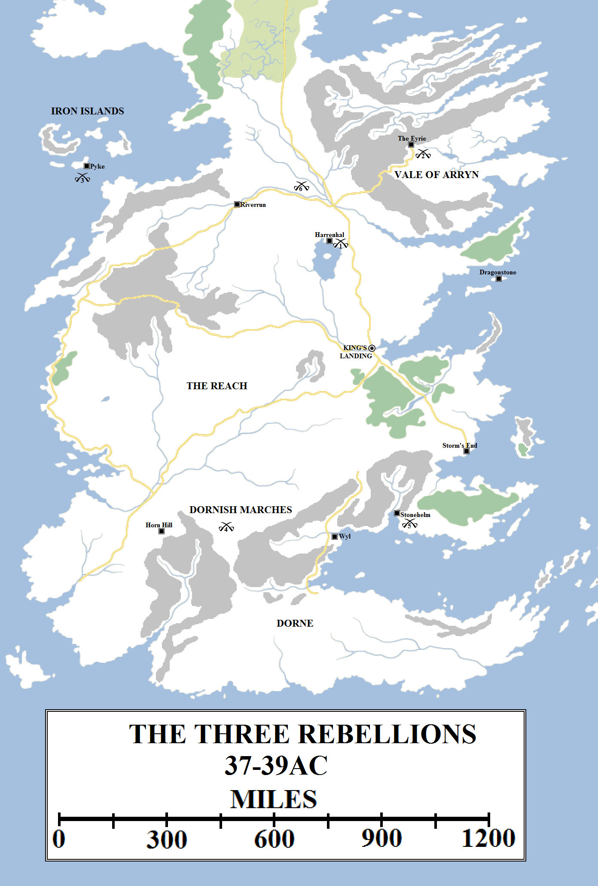
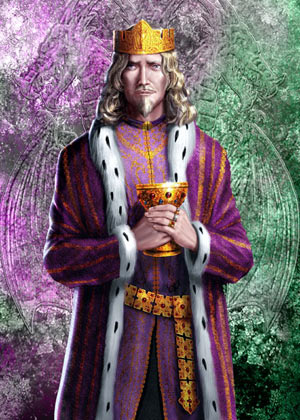
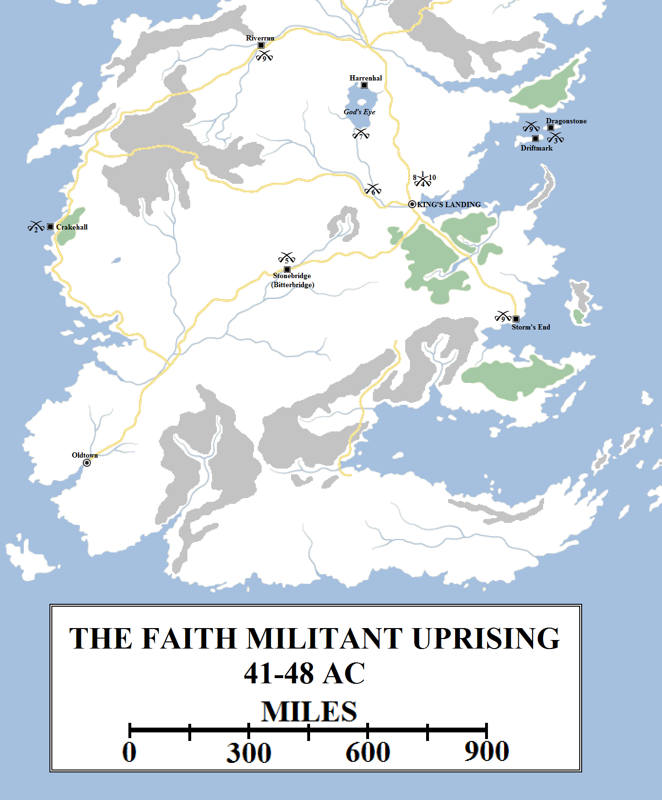
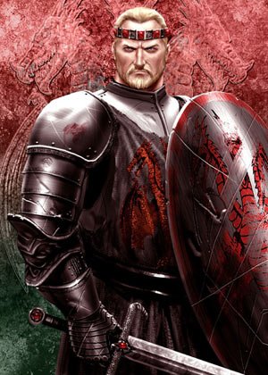
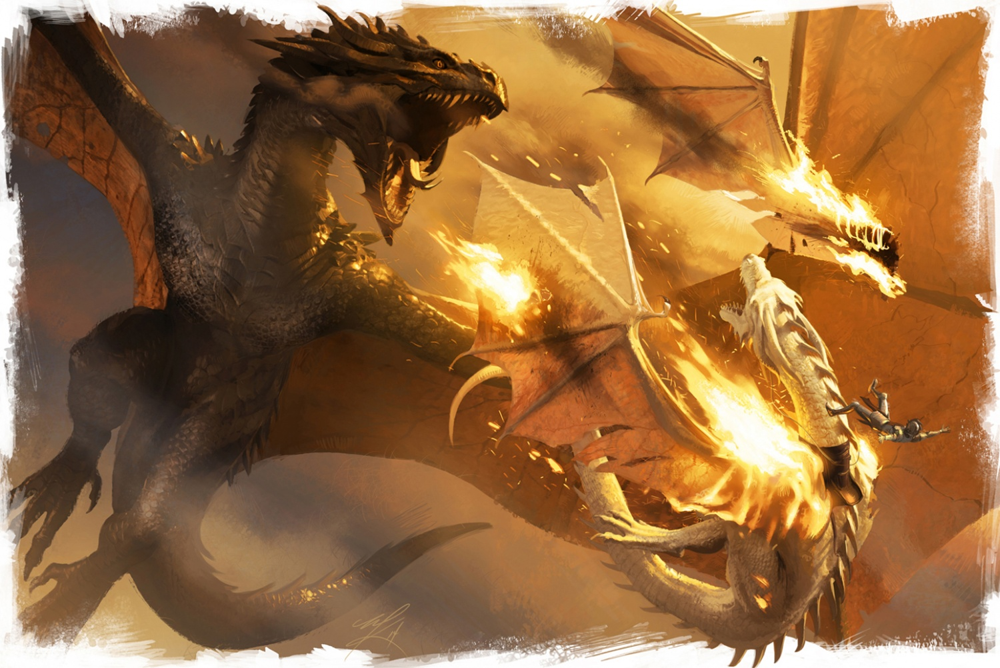
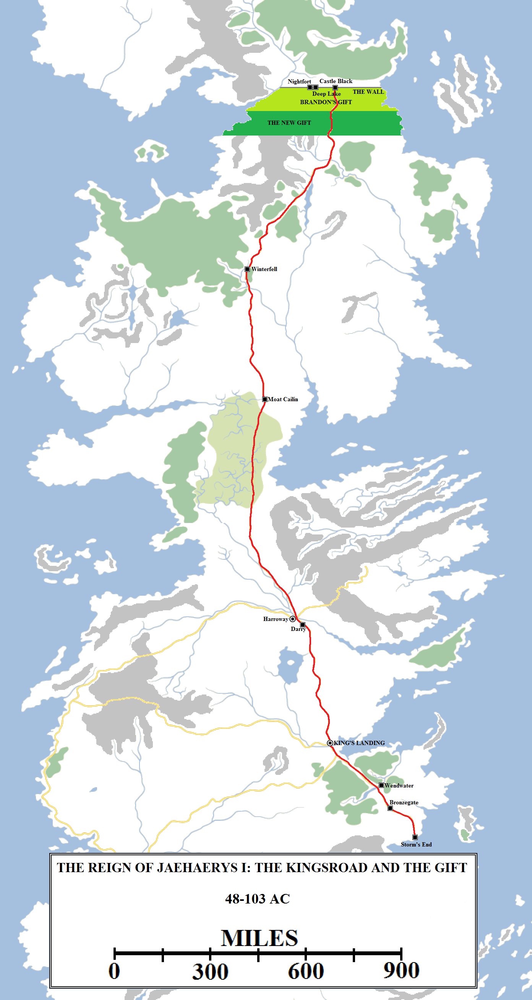
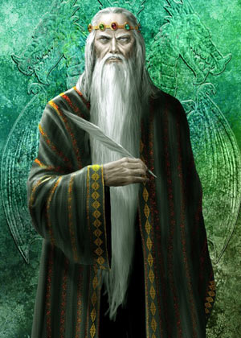

Aegon the Conqueror’s death in 37 AC saw his eldest son by Rhaenys take the Iron Throne. Aenys I Targaryen was crowned with great pomp and ceremony in the Red Keep even as it was under construction, but no sooner had the crown settled on his brow and the new king had set off on a progress then rebellions were launched in three of the Seven Kingdoms.

The Three Rebellions blighted the first year or so of King Aenys I Targaryen’s reign. A man claiming to be Harren the Red, a lost son of Harren the Black, seized Harrenhal (1) and sacked it before beginning a campaign of banditry in the Riverlands. Jonos Arryn usurped his brother Ronnel’s seat as Lord of the Eyrie and proclaimed himself King of the Vale and Sky. He was hung by Maegor Targaryen (2). In the Iron Islands, the claimed Priest-King Lodos led a rebellion against Goren Greyjoy that was quickly crushed (3). A warlord known as the Vulture King arose in the Red Mountains to wage a campaign on the Dornish Marches. He suffered grievous defeats at the hands of Savage Sam Tarly (4). The Vulture King’s army was destroyed at the Battle of Stonehelm, where Lord Orys Baratheon captured Lord Walter Wyl and mutilated him (5). Finally, Lord Alyn Stokeworth took the field against Harren the Red and defeated him, at the cost of his own life (6).

A man claiming the name Harren the Red, an alleged secret son of Harren the Black, seized Harrenhal and put Lord Gargon Qoherys to death, extinguishing the house (and it was not the first family to hold Harrenhal to end badly). Harren the Red proclaimed himself King of the Rivers and demanded homage. Aenys’s progress had reached Riverrun, so he was well-placed to raise an army from the Riverlands and march on Harrenhal. However, Harren had already fled back into the Riverlands and banditry. Harrenhal passed to the control of House Harroway, whilst Harren the Red was eventually killed some months later by the squire of the King’s Hand, Lord Alyn Stokeworth, after Stokeworth himself was slain in battle.

Jonos Arryn, the younger brother of Lord Ronnel, usurped his brother’s place and seized the Eyrie, hoping to proclaim himself King of the Vale and Sky. However, his support was lukewarm. Prince Maegor Targaryen descended on the castle on Balerion, his father’s dragon whom he had claimed, and ended Jonos’s pretensions. This was not in time to save Lord Ronnel, who had been thrown out of the Moon Door.

A madman claiming to be the Priest-King Lodos had attempted to seize control of the Iron Islands, but Lord Goren Greyjoy defeated him in battle and sent his pickled head to the king as a sign of loyalty and fealty. Aenys was impressed, and in his largesse granted the ironborn request to oust the Faith of the Seven from their islands, to the horror of the rest of the realm.

A bandit outlaw arose in the Red Mountains, known the Vulture King. At the height of his success he had thirty thousand supporters, carrying out raids and blood-letting across the Dornish Marches. Princess Deria Martell’s response was lacklustre, at best. The Vulture King was finally defeated by an alliance of the Marcher lords from both the Stormlands and Reach, with “Savage” Sam Tarly being particularly noteworthy for the bloody path he cut through the Vulture King’s followers with his Valyrian sword Heartsbane. Eventually the Vulture King was defeated and killed. During the campaign the aged Lord Orys Baratheon emerged from Storm’s End to lead his army into battle one last time. At Stonehelm Orys captured Walter Wyl, Lord of the Boneway, the son of the man who cut off his hand during the First Dornish War. Orys chopped off all of Walter’s extremities and proudly displayed them on his march back to Storm’s End. Orys succumbed to his injuries at home, but was said to die smiling for the vengeance he had taken on the Wyls.

Aenys I Targaryen (7-42, r. 37-42 AC). Artwork by Amok.

With these rebellions put down, Aenys’s rule looked secure. However, he had proven indecisive during the crisis, dithering rather than acting. Aware he needed a strong Hand to lead for him, he appointed his half-brother Maegor. At first this seemed a wise move, for Maegor was cunning, skilled in battle and very decisive. In fact, he was too decisive, often acting out of anger or with no regard for the consequences.

Aenys had married Alyssa Velaryon in 22 AC and they had had several children (Rhaena, Aegon, Jaehaerys, Alysanne, Viserys and Vaella), securing the Targaryen succession. Maegor had married Lady Ceryse Hightower, but she proved barren. The Dowager Queen Visenya had previously proposed marrying Maegor to Aeny’s first child, Rhaena, but the High Septon had protested and convinced her to abandon the idea.

To the shock of the realm, in 39 AC Maegor announced that he had taken a second wife, Alys Harroway. He had married her in secret. The Faith complained, as they regarded bigamy as a sin, and Aenys exiled his brother from the Seven Kingdoms. He also appointed a septon, Murmison, as his Hand, to try to repair the breach.

In 41 AC Aenys chose to marry his daughter Rhaena to his son Aegon, whom he named Prince of Dragonstone. Exactly why he chose this course is unknown. It might be that, having listened to counsel to reconcile himself with the Faith, he listened to his step-mother and his Valyrian followers to continue the traditions of their family and the Freehold. It might also be that he decided to let his children decide and they chose each other.

The Faith Militant rebelled against the Iron Throne in 41 AC, when Aenys I Targaryen married his son and heir Aegon to his daughter Rhaena. They attempted to kill the royal family and fortified the Sept of Remembrance in King’s Landing (1), whilst they besieged Aegon and Rhaena in Crakehall (2). Aenys retretaed to Dragonstone where he died of an illness. Prince Maegor returned from Pentos and usurped the throne, being crowned on Dragonstone (3). He then retook King’s Landing, burning the Sept of Remembrance (4). He inflicted further defeats on the Faith at the Battle of Stonebridge (5) and the Great Fork (6). Aegon escaped from Crakehall to challenge his uncle, but was defeated and killed at the Battle Beneath God’s Eye (7). Maegor completed the Red Keep and butchered everyone who worked on it, turning the commons against him (8). The Tullys, Baratheons and Velaryons then declared for Aegon’s brother, Jaehaerys (9). When Maegor was unable to win the support of the other Great Houses, he apparently killed himself on the Iron Throne (10).

Whatever the case, the Faith of the Seven rebelled against the Iron Throne with sudden, shocking speed. Septon Murmison was killed by Poor Fellows, armed followers of the Faith from the smallfolk. The Warrior’s Sons, knights sworn to the service of the Seven, fortified the Sept of Remembrance atop Rhaenys’s Hill in King’s Landing. An attempt was made on the life of the royal family, which the Kingsguard defeated, and Prince Aegon and Princess Rhaena found themselves besieged in Crakehall whilst on their progress. Aenys was forced to retreat to Dragonstone. There he was wracked by coughs, fevers and fits until he died.

Visenya took wing on Vhagar for Pentos, where Maegor was living in exile. He returned to Westeros on Balerion, pausing on Dragonstone long enough to be crowned. Grand Maester Gawen objected, noting that the throne had by rights passed to Prince Aegon. Maegor executed him on the spot, quelling further objections.

Maegor I Targaryen (12-48, r. 42-48 AC). Artwork by Amok.

Maegor flew to King’s Landing and planted his standard on Visenya’s Hill. Thousands rallied to him and he challenged the Warrior’s Sons to battle. Ser Damon Morrigen, known as the Damon the Devout, proposed a Trial of Seven to settle the matter. Maegor agreed and at the end of the contest, was the last man standing. However, he had sustained a grievous injury and was thirty days in recovering. Some say he only recovered thanks to the ministrations of Tyanna of the Tower, a Pentoshi woman said to be King Maegor’s lover (and possibly his wife Alys’s as well). Upon his recovery, Maegor flew Balerion to the Sept of Remembrance and burned it to the ground, killing hundreds of the Warrior’s Sons and Poor Fellows who had gathered there.

The High Septon condemned Maegor and great armies was sent against him. The first was defeated in the Battle at Stonebridge, when the Faith’s army was defeated with such violence that the Mander ran red with blood and the town was renamed Bitterbridge. An even larger battle was fought at the Great Fork of the Blackwater, where thirteen thousand Poor Fellows, and hundreds more Warrior’s Sons and soldiers belonging to allied lords, were burned by Balerion’s flames.

In 43 AC, Prince Aegon and his sister managed to break out of the siege at Crakehall. They raised a new host and advanced on King’s Landing, Aegon vowing to overthrow his uncle and make peace with the Faith. Instead, Maegor defeated him in the Battle Beneath the Gods Eye. Aegon was slain along with his dragon, Quicksilver.

Maegor the Crule and Balerion the Black Dread slay Prince Aegon and his dragon Quicksilver during the Battle Beneath the God’s Eye, the first – but not the last – occasion that a Targaryen dragonlord killed another in aerial combat. Artwork by Michael Kormack for _The World of Ice and Fire_.

In 44 AC the High Septon died and a new one was raised who was eager to make peace, but his commands for the Poor Fellows and Warrior’s Sons to put down their swords were ignored. The following year the Red Keep was completed in King’s Landing. Maegor threw a great feast for the masons, architects and builders and promptly butchered them all, so they may not tell anyone about the secret passages he had ordered built into the walls. Maegor also cleared the rubble from the Sept of Remembrance and ordered that it be converted into a great “stable for dragons”, in later years known as the Dragonpit.

The death of Dowager Queen Visenya in 44 AC removed from Maegor a source of advice and counsel. In the aftermath of her death, King Aenys’s widow Alyssa slipped out of the city, taking with her her younger children and the Valyrian blade Dark Sister. Maegor, convinced that she plotted treachery, tortured his young nephew Viserys who was serving as his squire and then killed him.

In 48 AC Prince Jaehaerys declared himself King of the Seven Kingdoms and Protector of the Realm. Riverrun and Storm’s End declared for him. Lord Daemon Velaryon, the King’s Admiral, sided with them as well. Two Kingsguard abandoned Maegor’s cause and Queen Rhaena, whom Maegor had married after killing her brother, escaped from King’s Landing with his Valyrian steel blade, Blackfyre. Two of the principle Poor Fellows, Septon Moon and Ser Joffrey Doggett, raised a substantial new army and, surprisingly, made common cause with Jaehaerys.

Maegor ordered a new host to be raised to defend King’s Landing, but only a few minor lords heralded his call. Many of the other great lords either took no part or chose to wait and see who would emerge the victor. Maegor took counsel with his lords on a strategy that would gain him victory (for the rebels had mustered several young dragons as well to check Balerion) and pondered the matter late into the night. The next morning he was found dead on the Iron Throne. According to popular myth, the Throne had killed him rather than suffer any further hurt to the realm. More likely, Maegor chose suicide rather than the embarrassment of a major defeat.

Jaehaerys I Targaryen (who reigned 48-103 AC) is accounted as the greatest of the Targaryen kings. Amongst his most impressive achivements was the construction of the Kingsroad, a single highway extending from Storm’s End to King’s Landing and then north all the way to Castle Black on the Wall. The length of the Kingsroad is estimated at 2,600 miles, making it easily the largest road-building project since the Doom of Valyria. Jaehaerys also doubled the size of the Gift, the land worked by the Night’s Watch, extending it to approximately 150 miles south of the Wall. Queen Alysanne also sponsored the building of a new castle, Deep Lake, to replace the decrepit and expensive Nightfort.

Jaehaerys I Targaryen was crowned King of the Seven Kingdoms at the age of fourteen. Until his majority, he was guided in rule by the Dowager Queen Alyssa and Lord Robar Baratheon, Protector of the Realm and Hand of the King. Jaehaerys was a dragonrider of skill. His mount, Vermithor, was the largest dragon in the realm after Balerion and Vhagar. He was decisive in deed, but diplomatic in his dealings and cunning in his planning.

Jaehaerys had married his sister Alysanne, further angering the Faith of the Seven, but had then reconciled with the High Septon in Oldtown. Jaehaerys halted the persecution of septons and septas, but was clear that the Warrior’s Sons and Poor Fellows must lay down their arms and disband. Convincing them to do so was difficult until Jaehaerys named Septon Barth as the Hand of the King. Barth was as canny and intelligent as his king, and the two made for an excellent team. Barth worked with the High Septon on a plan of reconciliation that allowed the Faith Militant to disband with honour in return for House Targaryen vowing to protect the Faith forever more.

Jaehaerys I Targaryen (34-103, r. 48-103 AC). Artwork by Amok

Thus ended the Uprising of the Faith Militant, a war that had spanned the reigns of three kings. Jaehaerys the Conciliator took the Iron Throne of Westeros and reigned for fifty-five years. During his reign he ordered the construction of the Kingsroad, sponsored the expansion of King’s Landing, granted the New Gift (and the new castle of Deep Lake) to the Night’s Watch and created the first codified set of laws to govern the entire realm. Jaehaerys also improved relations with Dorne, burying the anger of the past and forging new ties of trade and friendship with Sunspear. Jaehaerys was said to be the wisest king to ever set the Iron Throne and in his fading years he proved it with what might have been his wisest act.

Jaehaerys had lived for so long that he and his wife had had several children, who had then had grandchildren. With the death of Jaehaerys’s third son, Baelon the Brave, the succession was unclear. So Jaehaerys called a Great Council to be held at Harrenhal, with lords and maesters to consider the matter. The final two candidates were Laenor Velaryon, the son of Princess Rhaenys (Jaehaerys’s granddaughter through his second son Aemon), and Viserys, the son of Baelon the Brave. Despite some arguments for Laenor, Viserys was ultimately chosen. This set the precedent of the Iron Throne passing through the male line of House Targaryen only. Within a generation, this would prove to be a fateful decision…although only after Laenor’s father, Corlys Velaryon, had made his name famous in the world.
