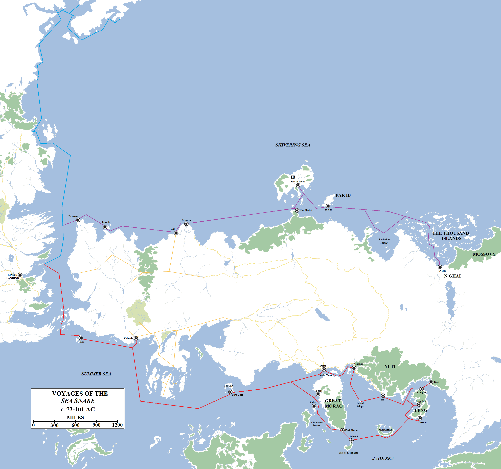
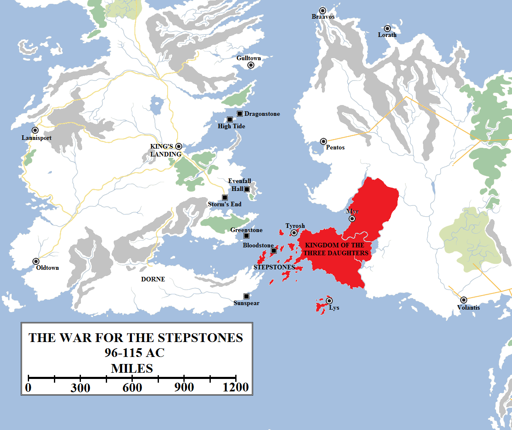

The greatest explorer in the history of Westeros is said to have been Corlys Velaryon, Lord of the Tides. Born in 53 AC on the island of Driftmark, he was, like so many of his kin, a natural sailor. However, whilst other Velaryons had been content with visiting the Free Cities or sailing around Westeros to visit Lannisport and the Iron Islands, Corlys had an insatiable appetite to explore new lands and acquire new knowledge. He consulted with maesters to learn more about distant lands and peoples, and on their theories on the shape of the world.

The three most famous of the ten great voyages of Corlys Velaryon, the Sea Snake. In blue is his attempt to find the fabled “Northern Passage” around the northern edge of Westeros. He failed to do so, leading some to conclude the continent of Westeros continues all the way up over the north pole of the world. In purple is Corlys’s great voyage along the Shivering Sea, which ended after his visit to the Thousand Islands and Nefer. In red is his journey to the rich kingdoms and cities of the Jade Sea, which made him for a time the wealthiest man in Westeros.

It has been known that the world is round, and that if you sail far enough across the Sunset Sea you should come to the far eastern coasts of Essos and, then following them, make your way back to Westeros. The distance is vast and daunting, however, and the dangers of being killed on the vasest, open ocean immense. Corlys was not so bold as to challenge the open ocean, and instead resolved to follow the coasts of known lands and thus hope to find new ones.

Some maesters theorised the existence of a “northern passage” around the top of Westeros. They suggested that Westeros was not joined by continuous land to the northern polar ice cap – the White Waste – and instead during the peak of the longest summers a new sea route might open through the Lands of Always Winter. If this could be proven, it would allow trade ships and travellers to sail from the Narrow Sea to the west coast of Westeros without having to risk the pirate-infested waters of the Stepstones.

At a young age, Corlys sailed his ship _Ice Wolf_ from Driftmark to Eastwatch-by-the-Sea, the port castle located at the eastern end of the Wall. He then struck north, keeping to the east of the Haunted Forest. Aside from a few wildling fisherfolk, he found no signs of habitation and even they disappeared a few hundred miles north of the Wall. Eventually Corlys sailed into a world never before seen by Westerosi sailors, of vast and frigid ice floes, huge icebergs floating in the sea like detached mountains and howling blizzards that would descend with little warning. In the height of summer, the sun never set.

Corlys could find no trace of a sea route through the Lands of Always Winter. Either this far north it was simply far to cold for the ice to melt, or there was no sea route and, as some maesters have since concluded, the continent of Westeros continues under the snow and ice right up to the north pole and maybe into the opposing hemisphere. Corlys was forced to return to known lands for food and resupply.

On his return home, Corlys set about designing a new ship: the _Sea Snake_. It was a great vessel, capable of carrying impressive amounts of cargo but also cleverly designed for speed. Its sinuous lines gave the ship its name. Corlys made nine great voyages on the _Sea Snake_, visiting most of the known world. However, his fame rests on two particularly grand voyages.

The first was his immense journey across the top of the world. He sailed north through the Narrow Sea and at Braavos turned east, heading along the north coast of Essos. His exploration of the coast took him from the familiar waters around the Free Cities of Braavos and Lorath all the way past Ib into Leviathan Sound and then the Thousand Islands, where he made landfall on the mainland at the city of Nefer. This immense trip also saw him visit the mysterious forests of the Ifeqevron north of the Dothraki Sea. Upon reaching Nefer, a forbidding and strange city, Corlys decided to turn back to Westeros. His crew was unhappy at being so far from home and none of Corlys’s charts showed any further known landfall to the east. The people of Nefer were unhelpful, providing conflicting stories about the enigmatic lands to the east, such as Mossovy and beyond. Corlys turned for home after travelling for over 6,500 miles. The return trip included, this voyage likely exceeded 13,000 miles.

Corlys also made several voyages along the south coast of Essos, visiting Slaver’s Bay and many of the Free Cities. On his last great voyage, he sailed from Driftmark, through the Stepstones and thence to Volantis for resupply. From there he sailed around Valyria and made east for Qarth and the Jade Gates, also called the Straits of Qarth.

At Qarth Corlys bought twenty more ships, loaded them with trade goods and sailed into the Jade Sea. He stopped at the vast port cities of Yi Ti, the slaver ports on the Isle of Whips and cities on the great island of Leng. From there he turned back west to pass Marahai and the Isle of Elephants before traversing the Cinnamon Straits back into the Summer Sea and then for home. By the time he reached Driftmark, he’d sailed more than 15,500 miles and made a fortune in gold, silver and exotic trade goods that, for several years, made him richer then the Lannisters.

Corlys, curiously, did not extend his trip east to visit Asshai, a relatively modest 600 miles or so south and east from Leng when he had travelled ten times that distance already. The traditional Traders’ Circle around the Jade Sea usually included a journey to that forbidding, but rich, city and then a return journey via the Cinnamon Straits. Most likely, Corlys’s twenty-one ships were rammed full at this point and there was no point risking a further journey for no good reward.

This was the last of Corlys’s great journeys: the death of his grandfather left Corlys as the Lord of the Tides and his responsibilities kept him at home, at court in King’s Landing or sailing across Blackwater Bay or the Narrow Sea. He built a new seat, High Tide, on Driftmark with his immense wealth and sponsored the expansion of the towns of Hull and Spicetown on the island.

However, it was not the end of his adventures. In 96 AC the warring city-states of Tyrosh, Myr and Lys unexpectedly made alliance with one another and drove the Volantenes out of the Disputed Lands. They secured control of the Disputed Lands and then invaded the Stepstones in force, conquering the islands in a matter of months. Craghas Drahar, an admiral from Lys, led the military campaign which drove the pirates out of the southern Narrow Sea once and for all.

In 96 AC the feuding cities of Myr, Tyrosh and Lys allied together as the Kingdom of the Three Daughters, or the Triarchy. They defeated attempts by Volantis to intervene and then conquered the Stepstones, liberating them from pirates. However, within a decade the Triarchy’s tolls and privateers were causing more expense and damage than the pirates. Lord Corlys Velaryon and Prince Daemon Targaryen made alliance and conquered the Stepstones in a ferocious campaign. By 110 AC Daemon had named himself “King of the Stepstones and the Narrow Sea”, but the Triarchy, now allied to Dorne, sent fresh forces against him. By 115 AC Daemon and Corlys had both been forced to return to King’s Landing and the islands slipped back into lawlessness. The Triarchy later collapsed in 130 AC, after an ill-advised intervention in the Westerosi civil war known as the Dance of Dragons.

The swift victory was welcomed in Westeros, for it made travel through the Stepstones much safer and resulted in vastly increased trade between the east coast of Westeros and the west. The new alliance, now known as the Triarchy or the Kingdom of the Three Daughters, placed tolls on journeys through the Stepstones and enforced it with their powerful fleets. At first the tolls were reasonable, but soon they grew out of control and threatened the merchants of Westeros with ruin. By 106 AC the situation had become intolerable.

King Viserys I Targaryen, only a few years into his reign, was not minded to intervene, so it fell to Corlys to deal with the crisis himself. He made alliance with Prince Daemon Targaryen, the king’s estranged younger brother (who was angry with his brother naming his daughter Rhaenyra his heir rather than Daemon), and they assembled a strong army from houses bordering the Narrow Sea, along with mercenaries and sellsails from the other Free Cities (particularly Pentos but also Braavos and Lorath) affected by the Triarchy’s tolls.

The War for the Stepstones was bloody and long, but eventually the Triarchy faced defeat at sea. Admiral Craghas Drahar was a good sailor, but Corlys Velaryon was simply his better and eventually defeated him. The presence of Daemon’s dragon, Caraxes, was also a great benefit to the Westerosi cause. The Lyseni fleets were smashed and forced to withdraw from the Narrow Sea, allowing Daemon’s armies to conquer the islands piecemeal. Once victory had been secured – with naval supremacy attained and all but two of the islands conquered – Corlys named his friend as “King of the Stepstones and the Narrow Sea”. Daemon made his seat on the island of Bloodstone.

However, in 110 AC the Triarchy counter-attacked with a fleet led by the Tyroshi captain Racallio Ryndoon. This attack was supported by Dorne, which had unexpectedly allied with the Triarchy and provided some ships and men, along with the use of its ports as resupply posts. Both Corlys and Daemon defended the Stepstones well and it might well be that the Triarchy’s attacks could have been defeated and the islands added to the realm permanently, but King Viserys was not particularly interested in doing so. In 115 AC Daemon’s wife died and he returned to Westeros to try to secure her inheritance. He was then distracted by court politics, as was Corlys, and they chose to withdraw from the Stepstones altogether.

The Triarchy attempted to reconquer the Islands, but with mixed results. The islands gradually descended back into lawlessness and piracy. The Triarchy itself endured until 130 AC, when the politics Daemon and Corlys had been distracted by suddenly exploded into the bloodiest civil war in the history of Westeros: the Dance of Dragons.
