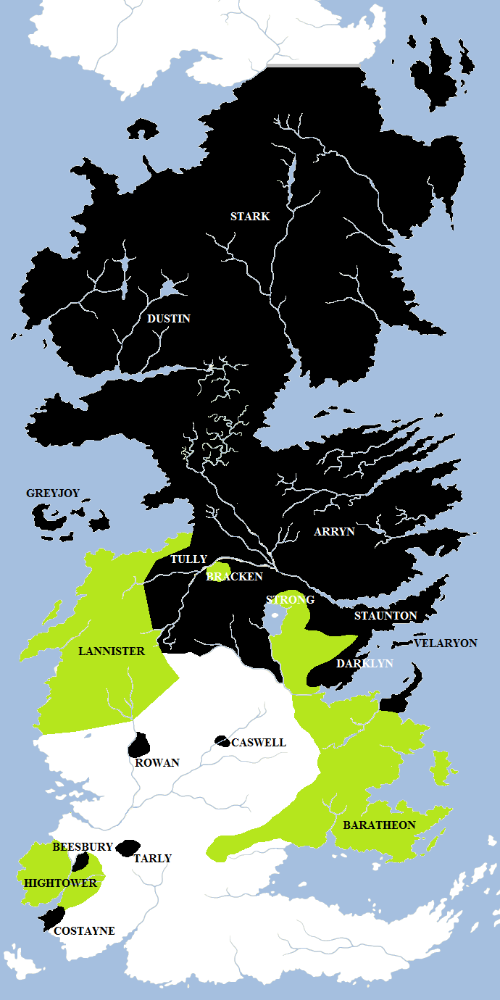
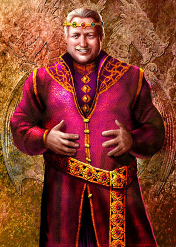
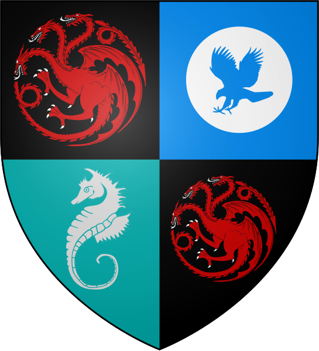
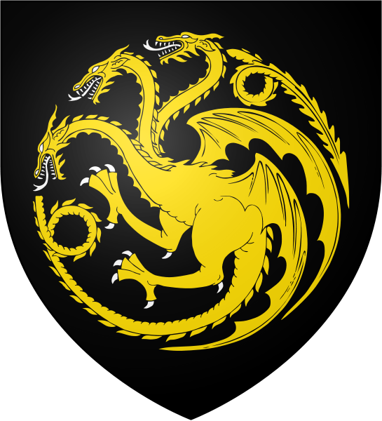

The Dance of Dragons lasted for over two and a half years, from 129 to 131 AC, and nearly ruined House Targaryen. During this conflict, most of the Targaryen dragons were killed, several lesser branches of the family tree were extinguished and several huge battles fought, resulting in hundreds of thousands of deaths. Its violence dwarfed later conflicts such as the Blackfyre Rebellions and Robert’s Rebellion, and may not have been exceeded until the War of the Five Kings.

The initial dispositions during the Dance of Dragons. Houses loyal to Queen Rhaenyra Targaryen are shown in black and those loyal to Aegon II Targaryen are shown in green. Houses Stark, Tully, Arryn and Velaryon provided Rhaenyra with her initial manpower. They were later joined by House Greyjoy, seeking opportunities for plunder. Houses Lannister and Hightower declared for Aegon II and were later joined by House Baratheon. House Bracken defied Riverrun to declare for Aegon II, whilst five houses of the Reach declared for Rhaenyra and against the Hightowers of Oldtown. House Tyrell and the independent kingdom of Dorne took no part in the war.

The background to the war lay in a simple dynastic dispute between the children of King Viserys I Targaryen. Viserys had married Lady Aemma Arryn and, in 97 AC, she bore him a daughter, Rhaenyra. In 105 Queen Aemma died in childbirth leaving Rhaenyra as his only child. The grief-stricken Viserys named Rhaenyra as Princess of Dragonstone and his heir. The realm acknowledged her as such. Viserys also named the dashing young knight Ser Criston Cole to the Kingsuard, to serve as the princess’s protector.

However, a year or so later King Viserys remarried, to Lady Alicent Hightower, the daughter of the King’s Hand, Ser Otto of Oldtown (the younger brother of Lord Hightower). Alicent quickly bore him three children: Aegon, Helaena and Aemond. In 109 Ser Otto and Queen Alicent formally requested that King Viserys recognised Aegon as his true heir. Viserys, furious, banished Otto and confirmed that Rhaenyra would follow him on the Iron Throne. In 111, at a great tourney, Rhaenyra appeared dressed in black with red highlights, the colours of House Targaryen, whilst Alicent appeared in a green gown. From that point forward, the faction favouring Rhaenyra became known as “the blacks” and the faction favouring Alicent and Aegon became known as “the greens.”

In 114 Rhaenyra married Laenor Velaryon. Despite the rumours that Laenor preferred the company of other young men, they had three sons: Jacaerys, Lucerys and Joffrey. In 120 Laenor was killed, apparently in a jealous fight with one of his friends, Ser Qarl Correy, leaving Rhaenyra as a widow.

During all of this, Viserys also had to endure a tempestuous relationship with his younger brother, Daemon, who was resentful of the fact that Rhaenyra had been named as heir rather than himself and also that his brother refused to let him divorce his estranged wife, Lady Rhea Royce. Daemon fell out with his brother several times, leading to his conquest of the Stepstones with the help of Corlys Velaryon. Allegedly in 111, at the same tourney that gave rise to the greens and the blacks, Rhaenyra and her uncle had been found in bed together, to Viserys’s anger and disgust. Ser Criston Cole also turned on Rhaenyra and soon found favour in the service of Queen Alicent instead.

Viserys I Targaryen (77-129, r. 103-129 AC). Artwork by Amok.

Ser Laenor’s sister Laena was instead married to Prince Daemon following Lady Rhea’s accidental death in 115. Laena gave birth to two daughters, Baela and Rhaena, before dying in childbirth in 120. Also that year there was a jealous spat between the sons of Alicent and the sons of Rhaenyra, resulting in Prince Lucerys stabbing Prince Aemond in the eye. Viserys ended the squabble by sending Rhaenyra and her children to Dragonstone whilst Alicent and her children remained in King’s Landing.

120 AC ended with King Viserys recalling Ser Otto Hightower to serve as Hand of the King, whilst Rhaenyra and Daemon finally married. They had two children: Aegon, sometimes called Aegon the Younger to distinguish him from Alicent’s son, and Prince Viserys.

King Viserys, the first of his name, died in 129 AC. He had cut himself on the Iron Throne, at first an apparently minor injury which soon became infected. Despite the best efforts of Maester Orwyle, Viserys soon became very ill and passed away.

In King’s Landing, Ser Criston Cole picked up the royal crown and set it on the brow of Prince Aegon, naming him Aegon II Targaryen, King of the Seven Kingdoms, Lord of Westeros and Protector of the Realm. Hence, Ser Criston became known to history as “the Kingmaker”. When Lord Beesbury, the aged master of coin, insisted that the crown pass to Rhaenyra, he was executed for treason.

On Dragonstone Rhaenyra was absolutely furious. In a separate ceremony, she was crowned Queen of the Seven Kingdoms and sent out a call to arms, commanding her father’s bannermen to follow their oath of allegiance to her father. The lords of Westeros were loathe to get involved in the brewing conflict between the two forces, both reinforced by dragons. Stories of the razing of Harrenhal and the Field of Fire still troubled the lords of the realm, and they had no wish to see their armies and holdfasts burned. But they had also sworn oaths of obedience and, reluctantly they summoned their banners.

## **Initial Dispositions in the Dance of Dragons**

Rhaenyra’s person sigil, the red-and-black dragon of House Targaryen quartered with the the falcon of House Arryn (her mother’s house) and the seahorse of Velaryon (her first husband’s house). [Heraldry from the Wiki of Ice and Fire.](http://awoiaf.westeros.org/index.php/Rhaenyra_Targaryen)

**Disposition of the forces of Queen Rhaenyra Targaryen, the “blacks”**

**Leaders:** Queen Rhaenyra Targaryen, Prince Daemon Targaryen, Lord Corlys Velaryon, Lord Roderick “the Ruin” Dustin, Lord Cregan Stark.

**Great Houses:** Arryn, Greyjoy, Stark, Tully.

**Other Houses of Note:** Bar Emmon, Blackwood, Beesbury, Caswell, Celtigar, Costayne, Darklyn, Dustin, Rosby, Rowan, Staunton, Stokeworth, Tarly, Velaryon.

**Dragons:** Syrax, Caraxes, Vermax, Tyraxes, Arrax, Stormcloud, Meleys, Moondancer, Morning (too young to fight), Silverwing (unclaimed), Seasmoke (unclaimed), Vermithor (unclaimed), Sheepstealer (wild), Grey Ghost (wild), the Cannibal (wild).

Queen Rhaenyra commanded great respect in the Seven Kingdoms. As a child she had been known as the “Realm’s Delight” for her intelligence, charm and wit, and her beauty as a young woman had been famed. She had been trained to rule since a young child and King Viserys had commanded all of the lords of the Seven Kingdoms to acknowledge her as his heir.

Queen Rhaenyra’s chief support came from the great houses Arryn (the house of her late mother, Queen Aemma), Stark and Tully, as well as the Velaryons, the family of her first husband. House Greyjoy soon joined her cause in return for plunder and booty. Her second husband was her uncle, Prince Daemon Targaryen, the former “King of the Narrow Sea”, a famed and skilled battle commander on land and at sea. Her former father-in-law, Lord Corlyns Velaryon, the “Sea Snake”, was the greatest admiral and sailor in the known world, whose skill at sea was undaunted by his then-advanced age.

Rhaenyra’s charm and skill was enough to win the support of the Darklyns, Rosbys, Stauntons and Stokeworths of the Crownlands, who supported her rule rather than Aegon’s. She also won the allegiance of Houses Beesbury, Caswell, Costayne, Rowan and Tarly of the Reach. With House Tyrell declaring itself neutral, the other Reach lords were able to choose sides as they wished. However, Rhaenyra was unable to charm the Baratheons into supporting her cause. Insulted at her offer, Lord Borros Baratheon declared for Aegon instead.

Rhaenyra’s forces appeared overwhelming, with massive superiority of numbers, of ships and of dragons. However, this was somewhat illusory: winter was closing on the North and Lord Cregan Stark was initially only able to send a small force of two thousand warriors. The rest of his strength he kept back for one last harvest before he could take the field in force. The Tullys were divided by internal conflict, with Houses Bracken and Strong declaring for Aegon. The Arryns were able to commit forces, but lacked a strong leadership figure.

Aegon II’s personal sigil, the traditional three-headed dragon of House Targaryen coloured gold to reflect his own personal dragon, Sunfyre. [Heraldry from the Wiki of Ice and Fire.](http://awoiaf.westeros.org/index.php/Aegon_II_Targaryen)

**Disposition of the forces of King A****egon II Targaryen, the “greens”**

**Leaders:** King Aegon II Targaryen, Queen Regent Alicent Hightower, Ser Otto Hightower, Ser Criston Cole, Prince Aemond Targaryen, Lord Borros Baratheon, Lord Jason Lannister.

**Great Houses:** Baratheon, Lannister.

**Other Houses of Note:** Bracken, Hightower.

**Dragons:** Sunfyre, Vhagar, Dreamfyre, Tessarion, Morghul (too young to fight), Shrykos (too young to fight).

King Aegon II Targaryen was ten years younger than his half-sister Rhaenyra and lacked leadership experience. He was initially reliant on the counsel of his mother, her father, his brother Aemond and Ser Criston Cole of the Kingsguard. Aegon II’s reputation was also soured by his well-known years as a youth carousing in King’s Landing when other men were devoting their lives to fighting or learning.

However, Aegon proved a quick study during the war and several times made bold gambits that paid off. His personal bravery in combat was not questioned, and he twice overcame crippling wounds to resume the offensive. His successful wooing of House Baratheon early in the conflict was also a significant and noted diplomatic victory.

Still, Aegon found it hard to win loyal support. The bedrock of his support remained his mother’s family, the Hightowers of Oldtown, and the Lannisters, whose belief in his cause came from an unshakeable opposition to women to rule from the Iron Throne. Many of Aegon’s other supporters came from lords eager to maintain the status quo and prevent daughters, sisters and neices disputing their inheritances should Rhaenyra come to power and make it formally law that the oldest child could inherit propery and title, as in Dorne.

Aegon was badly outnumbered on land and completely outclassed at sea. He also had far fewer dragons than his half-sister. What he did have was control of the capital at King’s Landing and the realm’s strongest fortresses at Harrenhal, Storm’s End and Casterly Rock. He also had the diplomatic nous to win an alliance with the Triarchy, the Kingdom of the Three Daughters which was keen to exact vengeance on Prince Daeron and Lord Corlys for their defeats in the Stepstones two decades earlier. Initially, however, it looked like Aegon II’s prospects for victory were slim.

The board was set, the pieces were in play and now it was time for the dragons to dance.
