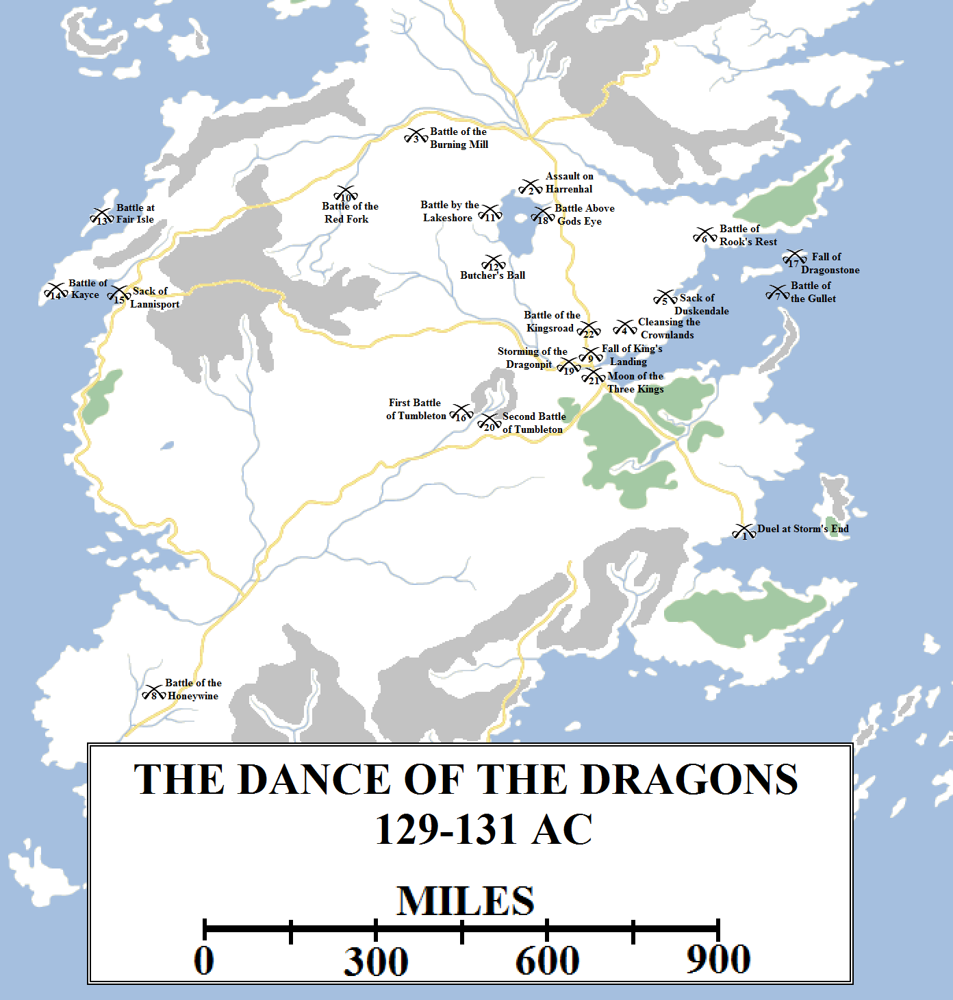
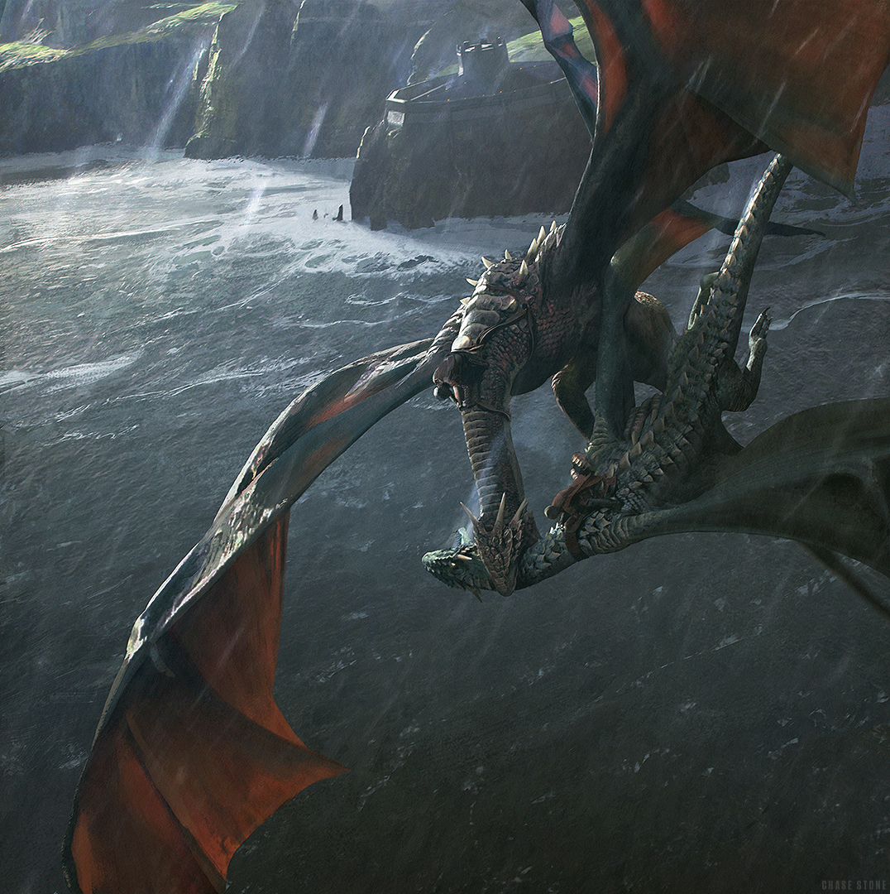
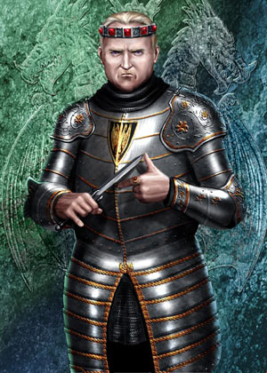
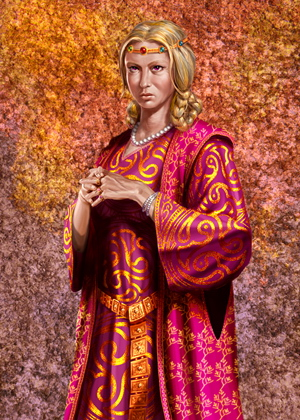
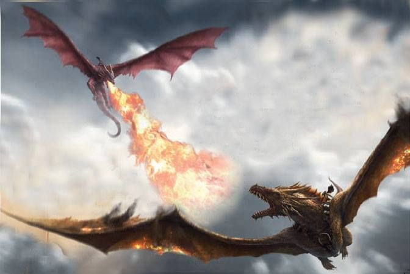
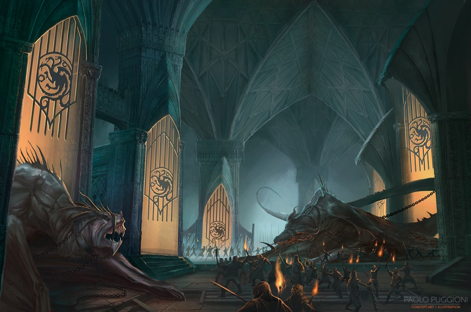
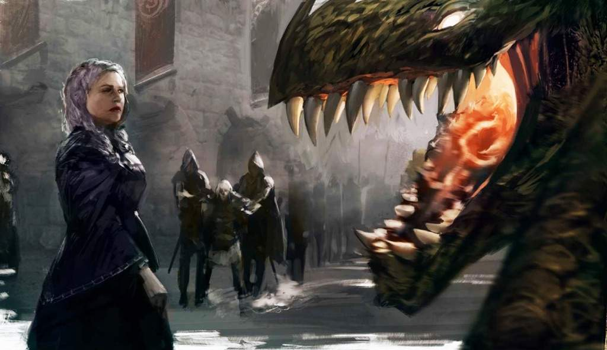

The first battles fought in the Dance of Dragons were skirmishes, with relatively little loss of life but they nevertheless proved that both sides were willing to fight to back up their claims.

The battles of the Dance of the Dragons in chronological order.

Rhaenyra Targaryen took the initiative. She dispatched her son Lucerys on his dragon Arrax to Storm’s End. Her hope was to win the allegiance of Lord Borros Baratheon and his fierce stormlanders quickly before moving on King’s Landing. Jacaerys flew north on Vermax to the Eyrie. Her mother’s family, House Arryn, swore readily to her cause and Jacaerys was quickly able to secure the loyalty of the Sisters and then Lord Manderly of White Harbor.

Lucerys had considerably worse luck. He found Lord Borros intractable and unsympathetic: Rhaenyra’s missives had spoken more like commands then requests and Borros felt that Rhaenyra had taken his allegiance for granted. By chance, Prince Aemond arrived on his dragon Vhagar from King’s Landing with a considerably more generous offer of alliance and reward from King Aegon. Borros was minded to side with the greens, but told the two cousins to take their feud outside.

The first clash of the Dance of the Dragons, appropriately, came with tooth and claw and wing and flame. Arrax and Vhagar met in battle in the skies over Storm’s End as an epic storm erupted. Lucerys was an eager warrior and Arrax a hardy beast, but both were no match for the last-surviving of Aegon the Conqueror’s great dragons. Vhagar sent Arrax plummeting from the skies, killing Prince Lucerys outright.

Prince Aemond Targaryen and Vhagar slay Prince Lucerys and his dragon Arrax in the skies over Storm’s End. Art by Chase Stone for _The World of Ice and Fire_.

Meanwhile, Rhaenyra’s uncle and husband Prince Daemon Targaryen took wing on Caraxes for the Riverlands. He landed Caraxes on Kingspyre Tower in Harrenhal, where Harren the Black had once burned alive under the breath of Balerion the Black Dread. Taking the hint, the castellan Ser Simon Strong yielded the castle without giving battle. Daemon quickly secured the allegiance of House Tully over the objections of the infirm and bed-ridden Lord Grover who wished to side with Aegon II. His grandson and heir Elmo and great-grandson Kermit overrode his decision and declared for Rhaenyra. Most of the other riverlords quickly fell in line, all aside from Lord Bracken who sided with Aegon. Daemon and Lord Blackwood took Stone Hedge after the Battle of the Burning Mill, unifying most of the Riverlands under Rhaenyra’s banner.

Jacaerys reached Winterfell and took counsel with Lord Cregan Stark. After some brief negotiations, Cregan and Jacaerys signed the Pace of Ice and Fire: Stark would commit troops in support of Queen Rhaenyra in return for a princess of Targaryen blood marrying into House Stark. However, winter was bearing down on the North and Cregan urgently needed men to collect the last harvest. He promised to bring significant strength of arms south to Rhaenyra’s aid. In the meantime, he dispatched Lord Roderick Dustin and two thousand troops – the “Winter Wolves” to provide support, with additional troops sent by Lord Manderly.

Word of Lucerys’s death reached Daemon at Harrenhal. Having once commanded the City Watch of King’s Landing (and given them their famous gold cloaks), Daemon had many agents still in the city. He ordered two of these into the Red Keep with orders to kill one of King Aegon’s children. They executed Prince Jaehaerys, the eldest son of King Aegon II and his sister-wife Helaena, right in front of the queen and his younger brother, Maelor. In retaliation, Ser Criston Cole dispatched Ser Arryk Cargyll of the Kingsguard to Dragonstone in the guise of his twin brother, Ser Erryk of Rhaenyra’s Queensguard, to assassinate the queen. However, the two brothers met by chance in the halls of the citadel and slew one another in single combat, allegedly dying in one another’s arms.

Aegon II Targaryen (107-131, r. 129-131 AC). Artwork by Amok

With his southern flank secured and Lord Borros providing support from the Stormlands, Ser Criston Cole now led a counter-offensive against the Queen’s forces in the Crownlands. He captured Rosby and Stokeworth in a lightning campaign, forcing both lords to bend to the knee. He brutally sacked Duskendale when the Darklyns failed to do the same before marching up the coast to Crackclaw Point and besieging Rook’s Rest. Lord Staunton secured his gates and sent to Dragonstone for aid. Princess Rhaenys Targaryen, the wife of Lord Corlys Velaryon, arrived on her dragon Meleys, the Red Queen. She attacked Cole’s forces, but fell into an ambush. Prince Aemon Targaryen, riding Vhagar, and King Aegon II himself on Sunfyre appeared and attacked. Meleys was outmatched but she was a canny and powerful beast. In the fierce combat that followed Meleys was killed and Rhaenys with her, but Sunfyre was injured so badly he never flew properly again. Aegon II was carried away from the battlefield with a broken and burned body, and he was more than a year in recovering.

Learning of his wife’s death, a grief-stricken Lord Corlys threatened to leave Rhaenyra’s cause. Instead, she named him Hand of the Queen and asked for his help in reinforcing their numbers. They hit on the idea of offering a noble title to any man or woman who could tame the wild dragons of Dragonstone. Several tried and were killed, but several – the “dragonseeds” – succeeded: Vermithor was claimed by Hugh Hammer, Silverwing by Ulf the White, Seasmoke by Addam of Hull and Sheepstealer by a wild girl named Nettles. Addam and his brother Alyn claimed to be bastards of Ser Laenor Velaryon and thus grandsons of Lord Corlys. This seemed unlikely, but Corlys adopted them anyway and named Addam as his heir.

Rhaenys and Meleys had been providing cover for Lord Velaryon’s fleet that was blockading Blackwater Bay. With the dragon gone, the blacks were now able to launch a counter-offensive. Lacking strength at sea, they had secured an alliance with the Triarchy. A fleet of warships from Lys, Myr and Tyrosh, supported by a small number of ships from the Stormlands and mercenary forces, assembled under the command of Admiral Sharako Lohar. In total, more than ninety warships from the Free Cities took part in the attack.

Rhaenyra Targaryen (97-130, r. 129-131 AC, disputed). Artwork by Amok.

By chance, the cog _Gay Abandon_, carrying Prince Aegon the Younger and Prince Viserys, had departed from Dragonstone shortly before the Triarchy fleet arrived. The cog was captured and Prince Viserys taken prisoner, but Aegon escaped on his young dragon Stormcloud. Stormcloud was heavily wounded in a hail of arrows, but managed to deliver the prince home. Aware of the threat bearing down from the Narrow Sea, Prince Jacaerys and Lord Corlys, still grieving the loss of his wife, were able to engage the enemy fleet in open battle just south of Dragonstone.

The result was one of the largest naval battles in recorded history, the Battle of the Gullet. The Velaryon fleet was outnumbered but Prince Jacaerys and his dragon Vermax proved a fine force-equaliser. Significant parts of the Triarchy fleet were burned and destroyed, but Vermax was then brought down in a hail of scorpion bolts and arrows. Jacaerys jumped clear, but was killed almost immediately. Heartened, the Triarchy fleet may have won the day and pressed on to Dragonstone, but the dragonseeds had been roused by the clamour of battle. Silverwing, Sheepstealer, Seasmoke and Vermithor took wing and soon bore down on the Triarchy fleet. By this point it had broken into several smaller squadrons to engage the Velaryon fleet scattered across Blackwater Bay. Several of these were completely destroyed, but more were too distant. Several of these smaller formations descended on Driftmark, completely destroying Spicetown and burning High Tide before being forced to withdraw.

The Battle of the Gullet ended inconclusively. The Velaryon fleet had lost more than a third of its number, but the Sea Snake survived and was able to continue the blockade of King’s Landing. Driftmark was badly damaged but survived, and Dragonstone was not threatened. The Triarchy fleet had lost sixty-two ships in the battle, leaving just twenty-eight to limp home. The decision to join the war was bitterly criticised in the Triarchy, with recriminations and feuding following. Within a year the Triarchy had collapsed, the Kingdom of the Three Daughters was no more, the cities of Lys, Tyrosh and Myr were at each other’s throats and, after a thirty-year respite, the Disputed Lands fell into dispute once again. The loss of Jacaerys and Vermax, so soon after Rhaenys and Meleys and Lucerys and Arrax, was keenly felt.

The Battle at Rook’s Rest, where Princess Rhaenys Targaryen and her dragon Meleys the Red Queen severely wounded King Aegon II and his dragon Sunfyre. Art by Gonzales Escamilla for _The World of Ice and Fire_.

Also keenly felt was the loss of Prince Viserys. Prince Aegon the Younger berated himself for leaving his younger brother behind, and soon the blacks came to believe that Viserys was dead. The rest of that curious tale is for another time, however.

At the outset of hostilities, Lord Ormund Hightower had assembled a strong force of arms at Oldtown. However, the Reach was riven by disagreement. The Lady Regent of Highgarden had declared House Tyrell neutral in the conflict and most of her vassals had followed suit. The Hightowers, furious, had been forced to raise support by themselves but this resulted in both a much smaller army than they had hoped to take to King Aegon’s aid and also resulted in a lot of wasted time. Eventually they raised a host and marched to the relief of King’s Landing, but this involved a march of over a thousand miles.

Not long after the host set out, it was beset on the banks of the River Honeywine by Rhaenyra supporters. Lord Thaddeus Rowan and Tom Flowers, the Bastard of Bitterbridge, advanced from the north whilst Ser Alan Beesbury, Lord Alan Tarly and Lord Owen Costayne cut off the Hightowers from the south. The result was a likely rout, but the younger Prince Daeron, the youngest brother of King Aegon II, had joined Lord Ormund’s host with his dragon Tessarion. Daeron took the attackers by surprise and unleashed his dragon’s fire in such force that they were forced to retreat. For the boldness of his counter-attack, Daeron was knighted and dubbed “Daeron the Daring”.

The year 130 AC opened with both the Lannister army under Lord Jason marching east from Casterly Rock and the Hightower host under Lord Ormund marching north-east from Oldtown, both seeking to relieve King’s Landing which was still vulnerable to an attack. It would have been better for Lord Jason to have taken the southern route along the Blackwater and thus been able to join his host to Ormund’s, but Jason had judged that it was more important to invade the Riverlands and prevent the riverlords from assembling a host and marching on King’s Landing from the north. This proved strategically unwise, for the riverlords were reinforced by both the Arryns and the newly-arrived Winter Wolves from the North, granting them local superiority.

To divert attentions away from the advancing Lannister host and to try to engage and kill Prince Daemon Targaryen, Prince Aemond led a strong army north from King’s Landing. They arrived at Harrenhal after a forced nineteen-day march, finding the castle abandoned. Unfortunately, Aemond had been betrayed by whisperers in King’s Landing, who had sent word to Daemon that the bulk of the defenders had left the city.

Daemon, riding Caraxes, and Rhaenyra, riding Syrax, appeared in the skies over King’s Landing. The goldcloaks betrayed King Aegon and went over to the blacks, throwing open the city gates. Lord Corlys’s surviving ships landed troops under the walls and soon the city was taken. The gold dragon banner of Aegon II was thrown down and the Dowager Queen Alicent was taken prisoner. Ser Otto Hightower, the Hand of the King, was executed for high treason. However, Rhaenyra’s final victory was thwarted by the disappearance of King Aegon II and his son Maelor. Despite his severely wounded state, he had been smuggled out of the city. With Aemond Targaryen, Jason Lannister and Ormund Hightower’s armies still all in the field, Rhaenyra’s position remained vulnerable.

Prince Maelor had been sent to safety in Oldtown, accompanied by Ser Rickard Thorne of the Kingsguard. However, at Bitterbridge they were met by a braying mob and both killed. Lord Hightower’s host reached Bitterbridge not long after and, learning of what had transpired, he burned the town to the ground. Lady Caswell hung herself from the walls of the castle in despair.

Around the same time, the Lannister host crossed the Red Fork of the Trident south of Riverrun. They were met by fierce opposition and Pate of Longleaf, a young squire, slew Lord Jason Lannister. The riverlords inflicted significant damage before withdrawing. Ser Adrian Tarbeck and Lord Lefford assumed command of the host and marched east towards Gods Eye. However, on the banks of the lake they were caught between the Winter Wolves, who had allied their force with that of Lord Forrest Frey and Red Robb Rivers and advanced from the north, whilst the host of Lords Bigglestone, Chambers and Perryn advanced from the south. An army commanded by Lord Garibald Grey, Jon Charlton and Benjicot Blackwood arrived the next day to complete the encirclement of the Lannister army and trap it against the river. In a ferocious battle with no quarter given, the Lannister army was almost completely destroyed and forced into the marshy lakeshore. The Gods Eye turned red from the blood pouring into it and the fish gorged themselves, resulting the colloquial name for the battle: the Fishfeed.

House Lannister’s fortunes soon turned even more grim. Having learned of the fate of Lord Jason and his army, Lord Dalton Greyjoy, the Red Kraken, fulfilled his pledge to Queen Rhaenyra and led his ships into battle. Fair Isle was overwhelmed and captured. The town of Kayce followed in a matter of weeks. The small Lannister fleet was engaged and destroyed, allowing the ironborn to sack Lannisport itself. The ironborn then scattered up and down the coast of the Westerlands, raiding and sacking at will. This prevented the Lannisters from assembling another host and effectively neutralised them in the war.

At Harrenhal, Prince Aemond and Ser Criston Cole quarrelled on strategy. Aemond and Vhagar remained in the Riverlands to inflict tremendous damage on the riverlords whilst Cole marched sound with Aemond’s host. South of Gods Eye they were surprised by the Winter Wolves and a coalition of riverlords, commanding a considerably larger and stronger host. Criston Cole challenged Ser Roderick Dustin to single combat. Dustin declined and Cole was shot down with arrows. His men were massacred in what became known as the Butcher’s Ball.

The war had now turned decisively in Queen Rhaenyra’s favour. House Lannister had been neutralised, King’s Landing had been recaptured and two of the three largest king’s armies had been destroyed. She had regained naval superiority, retained air superiority and had substantial strength of arms from the Riverlands and the Vale, with the North’s army now beginning to assemble in the wake of the last harvest and preparing for the long march south.

However, the Hightower army remained in the field and was rapidly marching on King’s Landing. Rhaenyra assembled a new host of riverlords and Valemen, along with the Winter Wolves, and dispatched them southwards to meet the enemy near the town of Tumbleton. With the army she sent two of the dragonseeds, Ulf the White and Hugh Hammer. Unfortunately this proved unwise. Ulf and Hugh listened to the terms offered by the greens and went over to the foe. Despite losing their dragons to the enemy, Lord Roderick Dustin chose to attack anyway, in a fit valour or madness. The resulting battle was bloody, but the presence of three dragons on the Hightower side meant that the end was not in doubt. Rhaenyra’s army was defeated, Lord Roderick was killed and the survivors sent fleeing back along the road to King’s Landing. However, Lord Ormund Hightower was slain, along with his brother Ser Brynden. Prince Daeron the Daring attempted to reassert control, but fell to quarrelling with the traitor dragonriders Ulf and Hugh, who were unhappy with the rewards they had been given. This moment of chaos saw many of the Hightower army desert.

At this moment, King Aegon II emerged from hiding. Lord Larys Strong had smuggled him into hiding amongst the remote villages on the far side of Dragonstone to the citadel, hiding him right under Rhaenyra’s nose. Aegon had spent a great deal of time healing, and had been found by his dragon Sunfyre. Although injured, Sunfyre was still capable of fighting. When the time was right, Aegon and Sunfyre attacked the citadel. They killed the only dragon present, Moondancer, and captured her rider, Princess Baela Targaryen, the daughter of Prince Daemon. The citadel surrendered, handing Aegon a significant prize.

By this time word of the treachery at the Battle of Tumbleton had reached Queen Rhaenyra. She ordered the other dragonseeds to be arrested. Addam of Hull escaped, thanks to a warning from his grandfather Lord Corlys. This led to Corlys’s arrest for treason. When Rhaenyra refused to release him, the Velaryon fleet departed for Driftmark with the greater part of her naval strength. She also sent an order for the arrest of Nettles, who was now based at Maidenpool, ranging out with Rhaenyra’s husband, Prince Daemon (who was now Nettles’s lover) in search of Aemond. Lord Manfryd Mooton read the order, pretended he never had received it, and warned Nettles and Daemon. The next day Nettles and Sheepstealer departed Westeros, never to be seen again, and Daemon flew to Harrenhal. He took the castle easily and sent out word that he would face Prince Aemond in battle there.

Aemond arrived, exchanged cordial greetings with Daemon, and then mounted their dragons, Vhagar and Caraxes. The resulting Battle Above the Gods Eye was epic, for Vhagar was the oldest dragon in Westeros but Caraxes was his equal in size and vigour. The two dragons were too well-matched, and in the end killed one another, locked in furious battle. According to legend, Daemon leapt from the saddle and stabbed Prince Aemond through his blind eye with the Valyrian steel blade Dark Sister, killing him outright. Then the two dragons struck the water. Many years later, Aemond’s corpse was pulled from the water and Dark Sister returned to King’s Landing, but Daemon’s body was never found. Singers like to say that he actually lived and escaped with Nettles to find a lasting happiness, but this seems unlikely in the extreme.

The Storming of the Dragonpit. Artwork by Paolo Puggioni for _The World of Ice and Fire_.

King’s Landing had descended into paranoia and fear. The remnants of the Highgarden host remained a threat to the south-west and the Velaryons had left for Driftmark. The Baratheons were gathering a new host to the south and Rhaenyra realised that she had very few friends left. She quickly sent to Riverrun, Winterfell and the Eyrie for aid, but the riverlords had expended a great deal of their strength fighting the Lannisters and Hightowers and did not have much left to give. Lord Cregan Stark’s new host was forming, but still weeks away from marching and months from reaching King’s Landing.

The breaking point came when Queen Helaena Targaryen, King Aegon II’s sister-wife, committed suicide by throwing herself from Maegor’s Holdfast. Rhaenyra confirmed that she had killed herself in despair after the death of her son Maelor, but the smallfolk refused to believe that. There was a riot in King’s Landing, with a mob of ten thousand taking to the streets, burning and looting. The Shepherd, a religious fanatic, declared that the dragons were abominations and needed to be slaughtered. He led a storming of the Dragonpit. Shrykos and Morghul, the young dragons, were killed easily but the others proved more resilient. Tyraxes burned many attackers before being felled. Dreamfyre killed so many of the mob that they may have been driven from the Dragonpit altogether, but in the furore the supports of the great dome above the pit had been damaged and the ceiling caved in, killing the dragon. Rhaenyra’s own dragon, Syrax, descended from on high and killed many of the survivors of the mob, but a lucky crossbow bolt blinded the beast and the mob were able to slay the dragon. Prince Joffrey Targaryen was likewise killed in the furore.

With chaos spreading through the city, Rhaenyra agreed to abandon it. She fled to Duskendale with her son, Aegon the Younger, and took ship for Dragonstone.

When word came to Tumbleton of the chaos in King’s Landing, Daeron the Daring and the Hightower army prepared to march. However, Ulf the White and Hugh Hammer proved reluctant to assist and Daeron was forced to confront the possibility of having them assassinated. Before any decision could be made, the camp came under a surprise attack. Addam of Hull had arrived from King’s Landing and had managed to reform some of Roderick’s host. Proving his loyalty to Queen Rhaenyra, he led the assault. In the following battle Ulf, Hugh, Daeron and Addam were all killed, along with their dragons: Tessarion, Seasmoke and Vermithor. Silverwing survived but was now riderless.

The Second Battle of Tumbleton ended with the Hightower host being bled badly and losing all of its leaders and its dragonriders. Lord Peake assumed command and led a retreat back into the Reach. The surviving riverlords and Winter Wolves were unable to take Tumbleton or relieve King’s Landing, lacking siege equipment, so chose to retreat into the Riverlands instead.

Rhaenyra Targaryen is fed to her brother’s dragon, Sunfyre, whilst her son Prince Aegon the Younger is forced to watch. Art by Arthur Bozonnet for _The World of Ice and Fire_.

Upon reaching Dragonstone, Rhaenyra was shocked when her men were all put to death. She was taken into the courtyard of the citadel, where her hated half-brother waited with his dragon Sunfyre. Whilst Prince Aegon the Younger watched, on his uncle fed his mother to his dragon. The young prince was imprisoned as a hostage.

Lord Borros Baratheon led the stormlanders to King’s Landing, which fallen into total anarchy. They retook the city, butchered the leaders of the rioters and declared the city taken. King Aegon II arrived and raised his banner. He freed Corlys Velaryon from the black cells, naming him to his new small council. And that should have ended the war.

It did not. Too much blood had been spilt for this to end so easily. The now-Lord Kermit Tully, Lord Benjicot Blackwood and his aunt “Black” Alysanne Blackwood had assembled a new host, helped by Lords Darry and Mallister, and were now marching on the city. The Vale had assembled a new army and was marching to the Bloody Gate, and Lord Cregan Stark’s host, consisting tens of thousands of fresh troops, was now marching down the causeway through the Neck. Borros decided the only strategy was to engage the enemy piecemeal, defeat each army in detail before they could combine.

This was a sound strategy, but it was undone almost immediately. Borros discounted the riverlords, assuming that they had lost too many men in earlier battles and what was left was an army of green boys. Instead, Borros’s host was defeated and destroyed by the riverlords, scarcely a few days’ march north of the city. The Battle of the Kingsroad ended Aegon’s hopes of a military victory: with the Lannisters pinned down by the ironborn and the Tyrells refusing to choose sides, he had absolutely no men left to throw into the fray.

Lord Corlys advised King Aegon that he surrender and take the black to find honour in the service of the Night’s Watch. Aegon refused. He sent word to the advancing army that if he was to die, his nephew and namesake Aegon would die as well, ending Rhaenyra’s bloodline (or so he supposed). The next day, Aegon II Targaryen was found dead in his bed, poisoned. The identity of the murderer was never discovered.

Aegon the Younger was crowned as King Aegon III Targaryen. Corlys Velaryon became his closest counsellor, but they found the task of reconciling the former, bitter enemies difficult. Aegon III was also too young to rule in his own right. The remaining Great Lords were reluctant to swear loyalty to him, the ironborn flat out ignored his command to stop raiding the Westerlands and the realm teetered on the precipice of flat-out disintegration.

The Seven Kingdoms were saved – arguably – by Lord Cregan Stark. His large northern host arrived at King’s Landing to find the civil war ended. Stark’s army was filled with lords and warriors hungry for plunder, and unhappy at being disappointed. Cregan took charge of the city, arrested most of the nobles present and interrogated them harshly to find out who had murdered Aegon II. He even arrested Corlys Velaryon, releasing him only at the urgings of the twin daughters of Prince Daemon, Baela and Rhaena Targaryen. Cregan appointed himself Hand of the King for a day, had everyone he suspected of plotting against either Aegon II or Aegon III executed on the spot, and took himself back north before the roads closed for the winter. He left a large contingent of his northmen behind to serve, effectively, as Aegon III’s mercenaries.

A council of seven regents was assembled to rule until Aegon III’s majority, and did a reasonable job of healing the divisions in the realm. The Red Kraken remained a problem, but he was then killed in a bloody rebellion on Fair Isle. In 134 AC Lady Johanna Lannister allied with Lord Leo Costayne, High Lord Admiral of the Reach, and invaded the Iron Islands themselves in vengeance for their attacks on the Westerlands, destroying many of their ships and sacking many of their villages and towns. The ironborn were subdued for the next several generations

The Dance of the Dragons caused much misery in Westeros. The death toll is incalculable, both for the war and the deaths that followed in the savage six-year winter that scoured the continent. The Riverlands, ravaged by dragonfire, almost starved in that winter. But its longest-lasting effect was that it all but wiped out the Targaryen dragons. Only four survived the war. Sheepstealer and the Cannibal were never seen again. Silverwing turned wild and made her home on an island in Red Lake. She died in the next decade or so. Only Lady Rhaena’s hatchling, Morning, remained in the care of House Targaryen.
