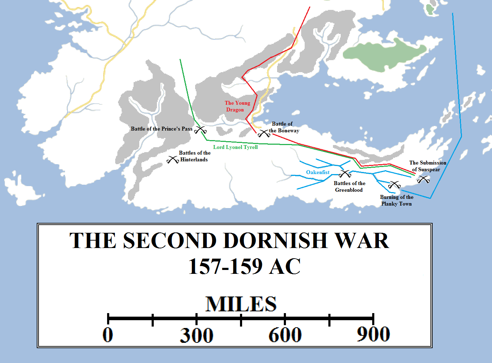
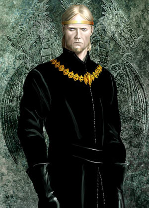
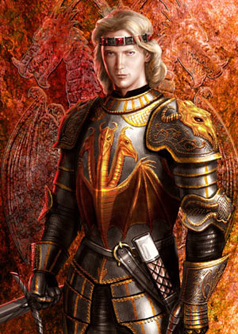
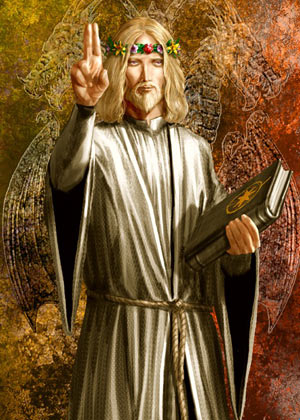
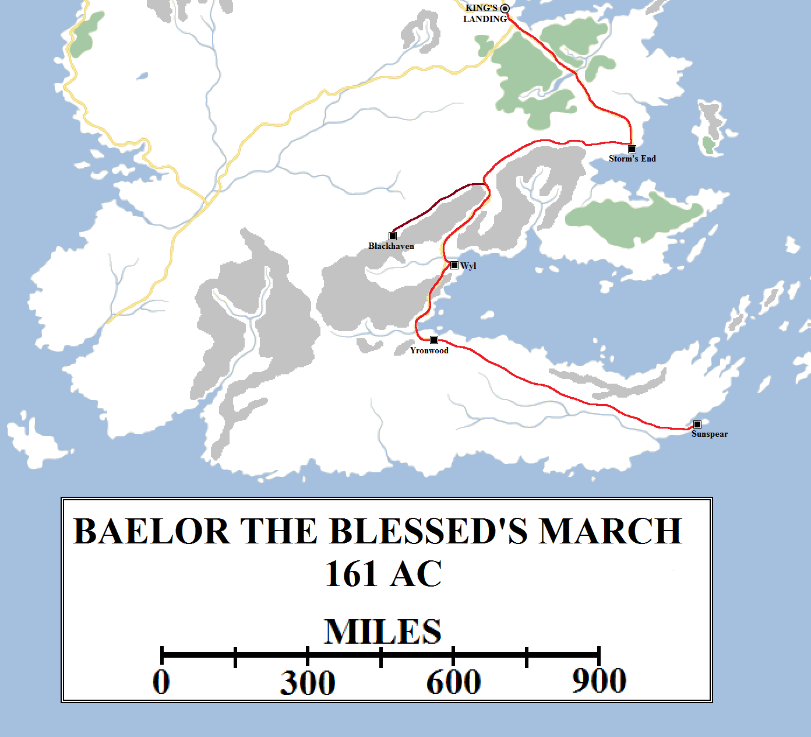
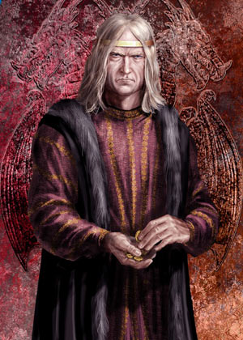

After Aegon III took the throne in 131 AC, the realm endured a period of rebuilding. Marriage pacts were made to bind formerly warring houses against one another, but it was a difficult time. Regents ruled on Aegon III’s behalf for six years, and his advisors and counsellors schemed with and against one another incessantly.

The Second Dornish War, also called the Conquest of Dorne, was fought with stunning rapidity. Only a few months into his reign and aged just fourteen, the Young Dragon invaded Dorne in a three-pronged assault by land and sea. By early 158 Sunspear had surrendered and the last rebels in the hinterlands crushed by early 159. However, Daeron misjudged matters by leaving a Lord of Highgarden to rule over the Dornish. Within months the nation had rebelled against him. By mid-161, Daeron was dead and Dorne was free once more.

The death of Corlys Velaryon, the Sea Snake, in 132 at the age of seventy-nine left a void in the Seven Kingdoms, but one that was ably filled in by his legitimised grandson (and some say actual son), Alyn, the brother of Addam of Hull. Alyn Velaryon first destroyed the pirate lord Racallio Ryndoon and then sailed against the Red Kraken in the Iron Islands. His skill at naval combat soon saw him named “Oakenfist”, and although his six great voyages did not match the nine titanic trips of his grandfather, they were nevertheless remarkable and ambitious.

Aegon III was a moody and sullen king, traumatised by his experiences as a child during the Dance of Dragons. He hated dragons, of which only four had survived the Dance. Sheepstealer and the Cannibal were never seen again in Westeros, whilst Silverwing’s fate, on her island in Red Lake, is even murkier. Some say she also just took wing and disappeared, whilst others saw she was slain by a brave knight, but he failed to bring any proof of the deed to others.

Aegon III refused to let Morning or her hatchlings out of the ruined Dragonpit, to the distress of the rest of his family. Cloistered in the ruins, they could not grow to their full size and the last Targaryen dragon, stunted and sickly, died in 153. She left behind a clutch of eggs, but none of them hatched.

One piece of good news emerged during this period. Prince Viserys, the younger brother of King Aegon, had survived the Battle of the Gullet as a prisoner on the Lyseni fleet. He had been raised in Lys as a ward of the Rogare family and was ransomed back to King’s Landing by Oakenfist for a huge sum. Aegon, who had blamed himself for his younger brother’s demise, was delighted and Viserys became his closest friend and confidante, the only person he ever fully trusted.

Aegon III Targaryen (120-157, r. 131-157 AC). Artwork by Amok.

Aegon III married Daenaera Velaryon, a cousin of Oakenfist, and they had two sons, Daeron and Baelor, and three daughters: Daena, Rhaena and Elaena. All of these would become storied and infamous in the history of the Seven Kingdoms, especially Daena’s own son, Daemon. Meanwhile, Viserys had married Larra Rogare in Lys and they had three children who would also become infamous: Aegon, Naerys and Aemon.

Aegon III Targaryen died from consumption early in 157, after twenty-six years of rule. It was a difficult reign, marked more for the achievements of the men around the king (especially Oakenfist and Viserys) rather than the king himself. The death of the last dragon in his reign led some to dub him the Dragonbane, and others the Broken King.

His son and heir was a different matter.

The generation that grew up with memories of the Dance of Dragons were not very keen on fighting or warfare. The memories of the two-and-a-half years of constant, bloody warfare were horrific and traumatising. Whenever the threat of military action arose, a veteran of the Dance would say “War is not a game,” and those words would carry weight.

By the time Daeron I Targaryen came to the Iron Throne, the Dance was a quarter-century in the past and a fading memory. A new generation of young men and knights arose, for whom war and combat promised honour and valour, not butchery and blood.

Daeron was only fourteen when he took the throne. His uncle, Viserys, was Hand of the King and chose not to appoint a regent. The Hand and the king’s counsellors were surprised when Daeron informed them that he wanted to “complete the Conquest” and finally take Dorne into the Seven Kingdoms. At first they rejected the idea out of hand, pointing out that they had no dragons, but Daeron presented a military proposal so sound that they agreed to consider it.

Daeron I Targaryen (143-161, r. 157-161 AC)

The Dornish were taken aback by the invasion. Dorne had not intervened in the Dance of Dragons and, aside from a brief alliance with the Triarchy during their war with the Sea Snake, had enjoyed cordial relations with King’s Landing for over a century. Whilst the Dornish had years to make preparations to resist Aegon’s invasion, Daeron moved so fast they had no time to react.

Daeron Targaryen invaded Dorne late in 157 AC. Lord Lyonel Tyrell led the main host south through the Prince’s Pass. This army consisted mostly of forces from the Reach. Daeron assumed command of a second army, believed to consist of troops from the Stormlands and Crownlands, and moved up the Boneway. But rather than advance along the main pass, which Orys Baratheon had done to his ruin, he located goat tracks and side-trails off the beaten path, known to local hunters and scouts from the Dornish Marches.

The Dornish were taken by complete surprise when Daeron’s host appeared in their rear, near Yronwood at the southern end of the Boneway, and was able to outflank their main army in the Prince’s Pass. They were forced to retreat, allowing Tyrell’s army to link up with Daeron and press home the attack.

It was at this point that Daeron unleashed his masterstroke. During the First Dornish War, the Targaryens had lacked any significant strength at sea. Their main fleet had been destroyed by the Arryns and no other house in Westeros had the naval power to assist them. The ironborn had many ships, but none suitable for a massive naval invasion (it would be a long, long time before they would finally build the more formidable Iron Fleet), and it would appear that the Arbor was not the naval powerhouse it would be three centuries later. The few ships Aegon had to hand would be at risk from the pirates of the Stepstones should they attempt a landing.

During the Second Dornish War, matters were very different. House Velaryon had rebuilt its formidable fleet damaged during the Dance of Dragons and the Targaryens also had their Royal Fleet. Oakenfist assumed command of both and, having already smashed the pirates of the Stepstones a few years earlier, was able to blockade the coast of Dorne.

Dorne was not a major sea power: its entire south coast was almost four hundred leagues of rock and mud and cliffs, without a single good anchorage or landing point all the way from Starfall in the west to Sunspear in the east. Sunspear commanded the only half-decent anchorage on the whole south or east coast, and even that was a poor thing compared to the harbours of King’s Landing or Oldtown. But there was one key weakness: the Greenblood, the primary river of Dorne which emptied into the Summer Sea south-west of Sunspear. It certainly wasn’t the Mander or the Blackwater, let alone the Rhoyne or Sarne, but it provided easy access to the Dornish interior.

As Daeron and Lyonel advanced from the west, a portion of Oakenfist’s fleet broke off and sacked the Planky Town near the mouth of the Greenblood, putting the town to the torch. Oakenfist’s galleons and smaller craft then sailed up the Greenblood and its two tributaries, the Scourge and the Vaith. This allowed additional troops to land and menace Godsgrace and Lemonwood, surprising both castles who believed the enemy was still hundreds of miles away. It also allowed troops to advance on the Tor from the south, Saltshore from the north and of course Sunspear from the south-west.

The Dornish preference for fading into the desert or mountains to continue the fight did not avail them. The three armies, all highly mobile, had divided up Dorne quite efficiently, neutralised most of the Dornish armies without a massive, pitched battle (which led Daeron to seriously overestimate their numbers in his war memoir) and allowed Daeron to advance quickly on Sunspear. A number of major battles were fought, but Daeron won each one with a mixture of skill, stealth and superior numbers.

A somewhat dazed Dorne surrendered to the Young Dragon in 158. The Prince of Dorne and forty of the most powerful lords of the nation bowed to the king in Sunspear itself. The Submission of Sunspear was a major, feted event. Daeron was praised for achieving something even the Conqueror couldn’t. When Dornish rebels arose in the mountains and the hinterlands, Daeron sortied against them and crushed them with surprising rapidity. In early 159 Daeron was able to return home in triumph, bringing with him fourteen highborn hostages and leaving Lord Lyonel Tyrell in command of Dorne.

Baelor I Targaryen (144-171, r. 161-171 AC). Artwork by Amok.

This was an uncharacteristic strategic error by Daeron. Having accepted the Prince of Dorne’s oath of fealty, he perhaps would have been better served by leaving him to order his realm and trusting his leadership, as Aegon the Conqueror had with his conquered vassals. It would have also left the task of extinguishing any remaining embers of rebellion to the Dornish themselves.

Instead, Daeron left Dorne under an effective military occupation commanded by Reachmen, whom the Dornish had fought bitterly against for thousands of years. The hostages discouraged rebellion by the nobles, but their smallfolk had no compunction against murdering royal soldiers patrolling the streets, ambushing supplies and interfering with communications. When Lord Lyonel Tyrell was murdered in an elaborate trap at Sandstone (involving an extremely large number of scorpions and his bed), Dorne rose in warfare and rebellion.

Daeron had returned home to write – or complete, as he may have begun it whilst still on campaign –_The Conquest of Dorne_, his own much-feted account of the invasion. That done, he barely had time to relax before news of the rebellion reached him. He raised a fresh army and invaded Dorne again in 160. This time the Dornish were ready, and his secret way past the Boneway was known to them. The coastal castles also knew to avoid the counter-attack by Oakenfist.

The decision to repeat the earlier tactic was a mistake, as it allowed the numerically inferior Dornish to position themselves in the best places to avoid being defeated again. This led to numerous raids, pitched battles and attacks against supply wagons. Eventually, however, the Prince of Dorne sued for peace and offered to meet the Young Dragon in the Prince’s Pass to discuss terms of surrender.

The meeting was a trap. Assassins attacked the Young Dragon and his entourage. Three of the Kingsguard were killed defending their king. Daeron’s cousin, already known as Aemon the Dragonknight, was struck down and taken prisoner by Lord Wyl. Daeron himself proved himself in personal combat, striking down several assailants, but he was felled by blows from at least a dozen enemies and stabbed to death, the Valyrian steel blade Blackfyre in his hands. The Young Dragon was dead after just four years of rule, most of it spent in the saddle.

The Iron Throne passed to Daeron’s brother, Baelor. Baelor was a very different man to Daeron. Baelor was pious and pacifistic, eschewing violence as a solution to the problems of the world. He would rather while away an afternoon discussing matters of faith with a septon rather than studying the art of warfare. He showed no interest in women at all, and seemed frightened of them. Baelor’s desire was to become a septon, but his uncle Viserys and brother had compelled him to marry his sister Daena against his wishes.

Baelor the Blessed marched all the way – barefoot – from King’s Landing to Sunspear and then back again as far as Wyl, a distance of approximately 2,450 miles (in red). At Wyl he rescued his cousin Aemon the Dragonknight but sustained numerous snakebites in the process. Aemon carried him dozens of miles up the Boneway to safety in the Dornish Marches, from where Baelor was carried to Blackhaven to begin his recovery.

The royal court screamed for blood, demanding that a new, massive army be raised from all seven kingdoms and that Dorne be crushed to dust for their treachery. Prince Aegon, the eldest son of Viserys, seemed particularly keen on this idea. But Baelor refused to countenance it. He pardoned the Dornish hostages and decided to take them home to make amends and make peace. To the astonishment of both the court and the Dornish, Baelor walked the Boneway barefoot, clad only in sackcloth, leading the hostages behind him on horses. At Wyl Castle he pleaded for the release of his cousin Aemon, hanging in a cage in the sun, but the Wyls refused, forcing Baelor to press on.

Baelor, astonishingly, survived not only the Boneway but the northern desert between the Scourge and the Sea of Dorne. He finally met the Prince of Dorne and forged a new peace, promising the hand of his cousin Aegon’s son Daeron, still an infant, to the Princess Mariah Martell, the Prince of Dorne’s eldest daughter. The Prince of Dorne agreed, apparently humbled by Baelor’s feat. The Dornish were fierce, independent and sometimes cruel, but they were also of the faith, and Baelor’s miraculous journey uncharacteristically astonished them.

Then Baelor did it again.

This time the road was not quite so onerous: the Prince of Dorne commanded that Baelor be granted every hospitality by the castles and waystops along the way. The Prince also sent word to Lord Wyl commanding him to release the Dragonknight to Baelor’s custody. But when Baelor reached Wyl, the cruel lord simply gave him the key to Aemon’s cage and asked him to unlock it himself. During Baelor’s journey to Sunspear, Lord Wyl had, in a moment of inspiration, ordered a pit dug under Aemon’s cage and filled with vipers.

Baelor crossed the pit of vipers, despite being bit dozens of times, and opened the cage before passing out from the venom. Despite having been sealed up in the cage for months on end, Aemon was able to rescue his cousin and jump clear from the pit, to the apparent incredulity of the Wyls (who had been laying bets on the outcome). Aemon carried his cousin a fair way down the Boneway before a village septon, overawed by Baelor’s piety, gave him a donkey to carry Baelor back on. Aemon finally reached Blackhaven in the Dornish Marches, where the maester of House Dondarrion took over Baelor’s care.

Baelor recovered, but some said that his wits had been left behind in the viper pit. Baelor dissolved his marriage to his sister Daena, but then locked her and their other sisters, Rhaena and Elaena, up in the Red Keep, in the structure later known as the Maidenvault. Baelor claimed this was so the sight of them would not tempt him to carnality. He also outlawed prostitution in King’s Landing, despite the uproar this caused, and busied himself in spiritual matters. He regularly emptied the treasury to pay for good works, winning the love of the commons but the despair of the lords and his master of coin. He also ordered the construction of an absolutely massive new sept on the top of Visenya’s Hill. The ambitious building was still only partially complete when he died, so it was named the Great Sept of Baelor in his honour.

Baelor’s rule ended in 171 with his death from an overzealous fast. His sister Daena have given birth to a son, despite her confinement, and she resolutely refused to name the father. She instead named the child Daemon Waters. Baelor was so distressed by this sin that he fasted for forty days, drinking only water and eating a small portion of bread each day. On the forty-first day, he was found dead before an altar of the Mother.

Viserys II Targaryen (122-172, Hand of the King 157-171, r. 171-172 AC). Artwork by Amok.

Baelor’s death has occasionally been blamed on his uncle Viserys, who had been waiting a long time to inherit the Iron Throne. However, this seems unlikely. There was no real motive, since, as Hand to a king completely uninterested in temporal matters, Viserys had arguably more power than the king himself. Some have suggested that Baelor was planning to convert all unbelievers in Westeros to the Faith of the Seven, but this would have meant war with both the North and the Iron Islands. Given that Baelor was a rabid pacifist, refusing to reinstate the Faith Militant even at the urging of many septons, this seems highly implausible.

With both Daeron and Baelor dead without issue, Viserys II Targaryen inherited the Iron Throne. He ruled for only a year before dying of a swift illness. Viserys had actually ruled for fourteen years as Hand of the King. His shrewdness and intelligence was undoubted and his interest in public works, increasing trade with the Free Cities and revamping Jaehaerys’s code of laws hint that he may have been a great king indeed. But he died long before that could come to pass.

In 172 AC Viserys’s son Aegon succeeded to the Iron Throne as Aegon IV, known to history and infamy as Aegon the Unworthy, the worst king to sit the Iron Throne. Some point to the depredations of Maegor the Cruel or Aerys the Mad, but they at least had the excuse of illness and insanity. Aegon was not mad, he was very consciously corrupt, venal, grasping, narcissistic and selfish, with no care for the consequences of his actions and no interest in preserving the peace or good of the realm above his own concerns.

Astonishingly, Aegon IV somehow did not plunge the Seven Kingdoms into war or an irrecoverable crisis. That was left to his bastard son. It soon became clear that the bastard son of Daena the Defiant was Aegon’s, a man who would match his sire’s more doubtful place in history: Daemon Blackfyre.
