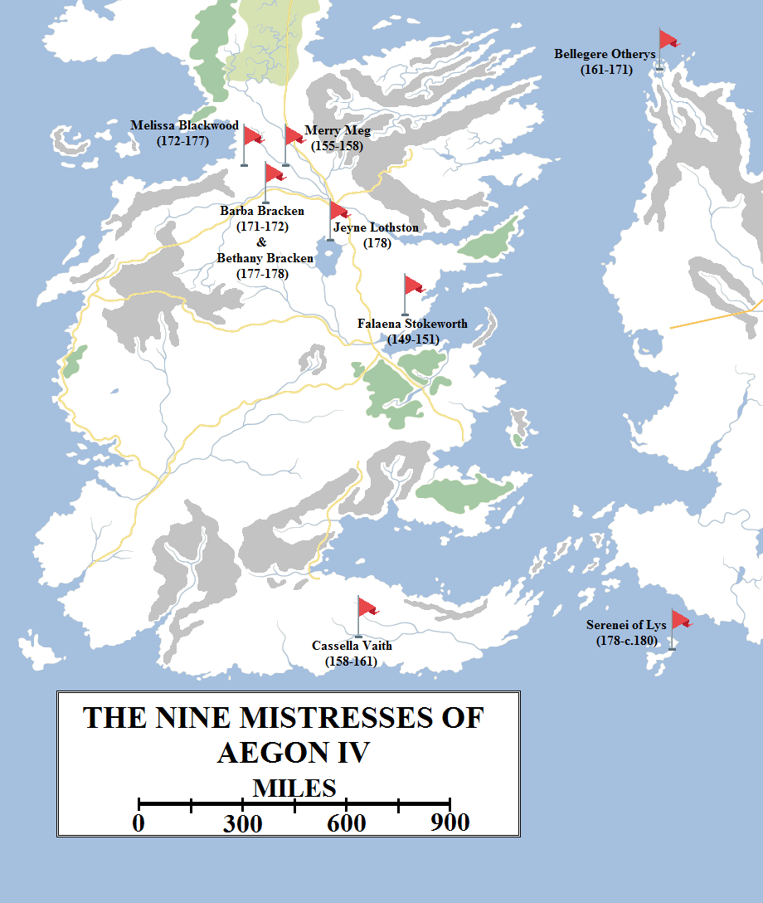
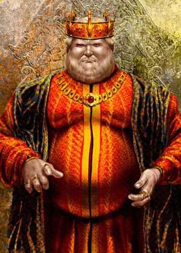
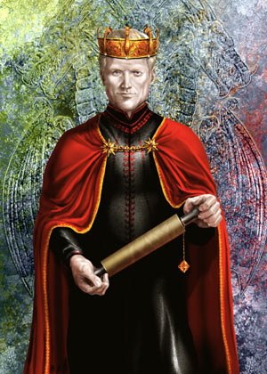
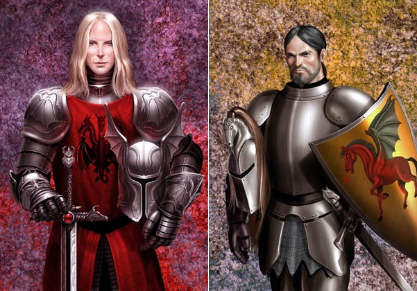
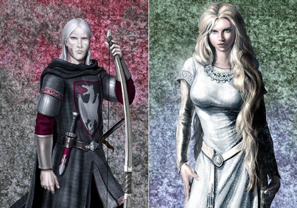

Aegon IV ruled the Seven Kingdoms from 172 to 184 AC, a period of just twelve years. His was a relatively short reign, but he still managed to unsettle and destabilise the realm, setting in motion chains of events that would continue to resonate a hundred and twenty years later.

The Nine Mistresses of Aegon IV came from all over Westeros and the Free Cities.

Aegon IV, it is generally agreed, was the worst king in the history of the Targaryen dynasty, excepting only the violently insane Maegor and Aerys II. Even those who unleashed war on a huge scale, such as Aegon II and Daeron I, did so without fully comprehending the consequences of their actions. Aegon the Unworthy, on the other hand, knew full-well what he was doing was wrong and would have dire ramifications, but he did it anyway.

As a young man, Aegon had coveted the throne. As a dashing prince, he seemed well-suited to it. He was handsome, skilled at battle and had the healthy appetites of a young man. But he was also headstrong, quick to anger and slow to forgive, and deeply self-centred. He married his sister Naerys in 153 AC, at the age of eighteen, but the marriage was unhappy. Aegon was lusty and boisterous and Naerys was quiet, delicate, timid and pious. Naerys had a far closer relationship with her other brother, Ser Aemon Targaryen. Shortly after Aegon and Naerys’s marriage, Aemon was named to the Kingsguard. He was already known as one of the finest warriors in the realm and had been dubbed the Dragonknight for his elaborate helm and ferocity in battle.

Aegon and Naerys had two children: Daeron, born on the last day of 153, and Daenerys, born in 172. Both pregnancies were difficult and nearly killed the delicate queen. She lost several other children during her life, and it is said that only Aemon’s protection prevented the king from treating her more harshly.

Some, indeed, went so far as to suggest that Aemon and Naerys shared more than sibling affection and were actually lovers, and that Aemon was the father of Prince Daeron. This foul rumour seems to have started circa 174, after the young prince had begun quarrelling with his father openly. One man, Ser Morgil Hastwyck, went as far as to repeat the slander in public, to the Queen’s person. Furious, Ser Aemon challenged him to recant the words. Hastwyck proclaimed that he was speaking only what all men knew to be true…possibly because Aegon IV himself had spread the rumour. The Dragonknight challenged Hastwyck to trial by combat, which rapidly ended the rumour (and Haswyck’s life), although in closed rooms and remote castles it continued to be whispered.

Aegon IV Targaryen (135-184, r. 172-184 AC). Artwork by Amok.

Prince Daeron Targaryen had been born in 153. In 161, as part of the peace agreement between the Seven Kingdoms and Dorne, King Baelor had suggested that Daeron be betrothed to Princess Mariah Martell, the Prince of Dorne’s daughter. The Prince agreed. The two were still children, so married after coming of age, probably circa 169.

Daeron and Mariah’s marriage was happy and fruitful. Daeron was much taken with his beautiful Dornish wife, and soon became an admirer of Dornish culture and history. Mariah seems to have loved her husband. Daeron was not cowardly, but he was bookish and more interested in the serious study of governance and state than in butchery and gaining glory through battle. He was notably less flamboyant than his father…or his half-brother.

Aegon may have been married to Naerys, but he infamously had lovers and consorts almost beyond count. History records his nine “great” mistresses: Falena Stokeworth (149-151 AC), Megette of Fairmarket (155-158), Cassella Vaith (159-161), Bellegere Otherys of Braavos (161-171), Barba Bracken (171-172), Melissa Blackwood (172-177), Bethany Bracken (177-178), Jeyne Lothston (178) and Serenei of Lys (178-c. 180). However, this is not counting the many lovers he took for a night, or a few days’ amusement. It also doesn’t count the brief dalliance he had with his cousin Daena in 170 AC, which ended with her giving birth to a son, Daemon Waters. It was this event that scandalised and shocked Baelor, causing the fasting that led to his death.

Aegon IV had only two trueborn children, but bastards beyond count. Four of these were known as the “Great Bastards”, born of noble blood and acknowledged by Aegon: Daemon Waters (born 170, acknowledged in 182); Aegor Rivers (born 172, by Barba Bracken); Brynden Rivers (born 175, by Melissa Blackwood); and Shiera Seastar (born c. 180, by Serenei). At least nine more bastards went unacknowledged, although it was common knowledge that Aegon was their father.

Aegon was never fully satisfied with his son and heir Daeron. Daeron was intelligent and learned, quick-witted, diplomatic, even-mannered and cunning. He wasn’t a coward, but he had no appetite for war or unnecessary bloodshed. Aegon’s eldest bastard, Daemon, was a different kind of boy. He was charismatic, funny, savvy in tactics and tremendously skilled at arms, defeating grown men whilst still a squire. To the shock of the realm, Aegon knighted Daemon Waters in 182 AC, when Daemon was only twelve years old, acknowledged him, and gave him Blackfyre, the ancestral Valyrian steel blade of House Targaryen.

This act was a massive insult to Prince Daeron, who bore it stoically. Daemon was allowed to take a new surname for himself and chose that of his sword, thus creating House Blackfyre.

In 174 Aegon decided to complete the work of his cousin Daeron and launched an invasion of Dorne, sending a massive seaborne force with the intent of taking Sunspear completely by surprise whilst an army marched south through the Stormlands, equipped with fire-breathing wooden “dragons”, siege devices created by the Guild of Alchemists. However, both forces met with disaster: a fierce storm raged up through the Stepstones and the Narrow Sea, scattering and smashing the fleet to pieces, whilst one of the “dragons” exploded, starting a conflagration that consumed a quarter of the Kingswood and destroyed the rest of the siege machines. Aegon gave up on the idea, but Daeron was furious with his father for almost betraying the alliance bought by his marriage and undoing the diplomatic work of three generations, and which he hoped to continue.

Daeron II Targaryen (153-209, r. 184-209 AC). Artwork by Amok.

Prince Aemon the Dragonknight had died at the end of 170s. Aegon IV had caught his mistress Bethany abed with Ser Terrence Toyne of the Kingsguard and put them both to death. Two of Terrence’s brothers ambushed the king and tried to assassinate him in revenge. Aemon killed both attackers and saved his brother, but took a mortal wound in the process. Queen Naerys did not long survive him, dying within a year in childbirth (the child also did not survive).

With Aemon and Naerys both dead, nothing could restrain Aegon’s more dubious appetites. Fortunately, he was consumed by his passion for food and drink rather than attempting anything more bloody and died, so horribly obese he couldn’t stand, in 184 AC.

The realm breathed a sigh of relief. King Daeron II Targaryen ascended the Iron Throne and rapidly began setting right his father’s wrongs. He dismissed his father’s corrupt and indolent counsellors, replacing them with men of ability. These included Ronnel Penrose, his master of coin, although it was quite well known that it was Ronnel’s wife – and Daeron’s cousin – Elaena (the youngest of the princesses in the Maidenvault) who was the true power behind the treasury. With her good sense and cunning investments, the Seven Kingdoms rapidly began to recover from the financial mismanagement of King Aegon IV. Daeron also had to rebuild the City Watch of King’s Landing, which had fallen into disrepute and corruption.

Daeron’s most important act, however, came early in his reign. Immediately after taking the throne, Daeron began negotiations with Prince Maron Martell of Dorne. After two years, in 187 AC, Maron was wed to Daeron’s younger sister Daenerys. After the wedding ceremony, Maron knelt before Daeron and swore fealty to the Iron Throne of Westeros, adding Dorne peacefully to the Seven Kingdoms. The continent of Westeros south of the Wall was now united under House Targaryen. Great celebrations followed, for Daeron II had accomplished with words and compromise what Aegon and Daeron I could not with blood and fire.

In 188 Daeron built a great summer palace in the Dornish Marches, where the borders of Dorne, the Reach and the Stormlands came close together. He named it Summerhall, and after the Red Keep and Dragonstone it became the most important stronghold of House Targaryen.

Daemon Blackfyre (170-196 AC) and Aegor “Bittersteel” Rivers (172-241 AC), the eldest of Aegon IV’s “Great Bastards”.

King Daeron the Good, as he was named by the commons, was beloved by the smallfolk for ensuring peace in the realm. He was loved by the merchants for improving their trade rights in the Free Cities: after Lord Penrose’s unfortunate death, Princess Elaena Targaryen had married Michael Manwoody. Daeron dispatched both of them to Braavos as diplomats, and they won remarkable trading concessions for the Seven Kingdoms, to the further enrichment of the realm. Daeron sponsored many great works, improved laws and the relations between his individual kingdoms (to the delight of the maesters), remained respectful of the Faith, remained faithful to his wife and caused no great scandal. He and Mariah had four sons. The eldest, Baelor, and youngest, Maekar, showed promise as great warriors, formidable in battle. Such was Baelor’s valour that he even defeated Daemon Blackfyre at a tourney, earning the sobriquet “Breakspear” (and Daemon’s mild enmity) in the process. By the early 190s, Daeron’s circle of counsellors was bolstered by the addition of his bastard half-brother Brynden Rivers, dubbed “Bloodraven” for a distinctive birthmark, who had a nose and talent for sniffing out scandals and plots against the crown despite his young age.

Daeron’s good name, impeachable reputation and tremendous wisdom could not cancel out the nagging rumour that he was not the legitimate king, however. The suggestion that Aemon the Dragonknight had been his true father continued to be whispered, and most virulently by Aegor Rivers, another of the Great Bastards. Aegor harboured a grudge for the displacement of his mother in Aegon IV’s affections by Bloodraven’s mother. This enmity reignited the long-quiescent feud between House Bracken and House Blackwood (causing their mutual liege, Lord Tully, no end of trouble) and earned Aegor the nickname “Bittersteel”. Bittersteel loathed Bloodraven, disliked King Daeron II and he yearned to see both brought low.

Bittersteel befriended Daemon Blackfyre, earning his respect through his own skill at arms (which was not far off Blackfyre’s) and his gift for military strategy (which far surpassed Blackfyre’s). Blackfyre had become a popular figure at court, respected by all for his skill at arms and loved by many for his sense of humour and his easy charisma. He and Daeron seemed to get on well, for all that some counted Aegon giving him Blackfyre as a deliberate slight against Daeron. But Daemon was not part of Daeron’s inner circle. Indeed, aside from his sons and his cousin Elaena, Daeron’s inner circle started to take on a more Dornish flavour, the influence of his wife and her family.

Lords in the Dornish Marches were concerned to see Dornish merchants and travellers moving freely through their lands. Some of the Marcher lords now wondered if they had any purpose. Other lords of Westeros, who initially welcomed the peace, now frowned upon seeing Dornish lords and knights being given places of honour at court over those families that had supported the Targaryens for two centuries, or in some cases more. In most cases this amounted to no more than furrowed brows and muttered irritations, but for some it became a more pressing matter.

Brynden “Bloodraven” Rivers (175-252? AC) and Shiera Seastar (c. 180- c. 140? AC)

What finally caused the breach between House Targaryen and House Blackfyre is unclear. Some say that Daemon had loved Daenerys and resented her marriage to Prince Maron Martell, but if that was the case he waited a long time to do anything about it. It’s also possible that Daemon was anticipating a role of honour and respect, perhaps even the Handship, and when that failed to materialise he rebelled. More likely, the slow accumulation of perceived insults, the poisoned words of Bittersteel and the growing amount of military support from other lords finally pushed him to a point where he felt it was the right thing to do.

In 196 AC, Daemon Blackfyre prepared to claim the Iron Throne. But before he could do so, word got to the king’s spymaster. Bloodraven told the king, and the Kingsguard was sent to arrest Blackfyre. Aided by his friend and mentor Ser Quentyn Ball, the famed master-of-arms at the Red Keep (dubbed “Fireball” by many), Blackfyre escaped. He took up arms against the king and began gathering support.

The First Blackfyre Rebellion had begun and, with it, sixty-five years of turmoil.
