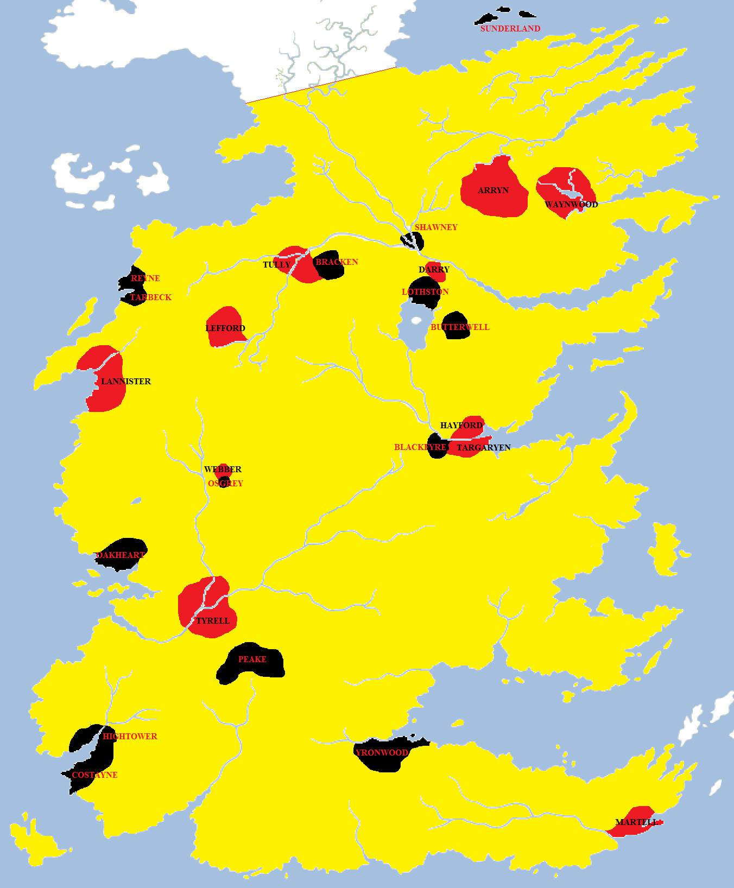
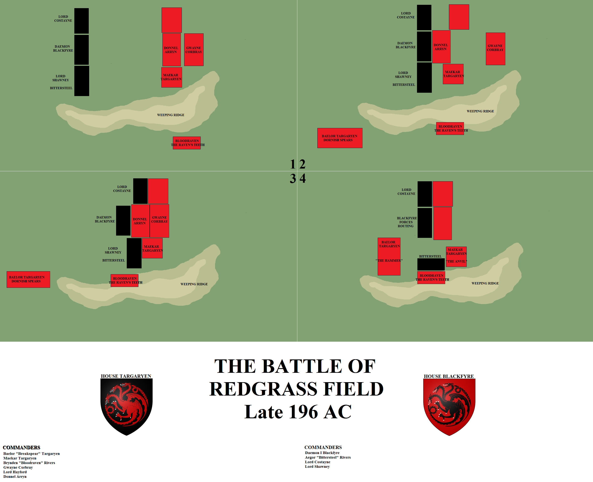
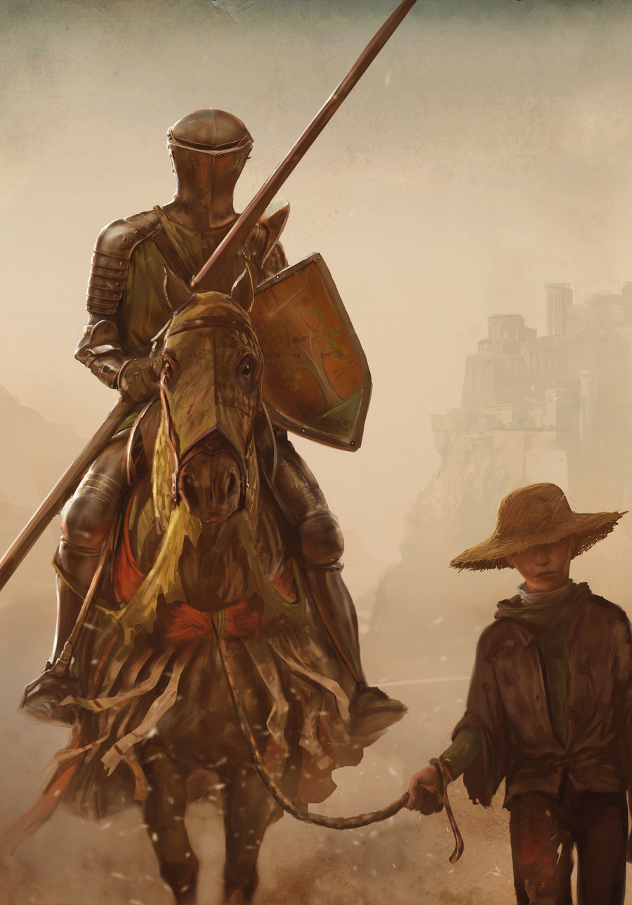
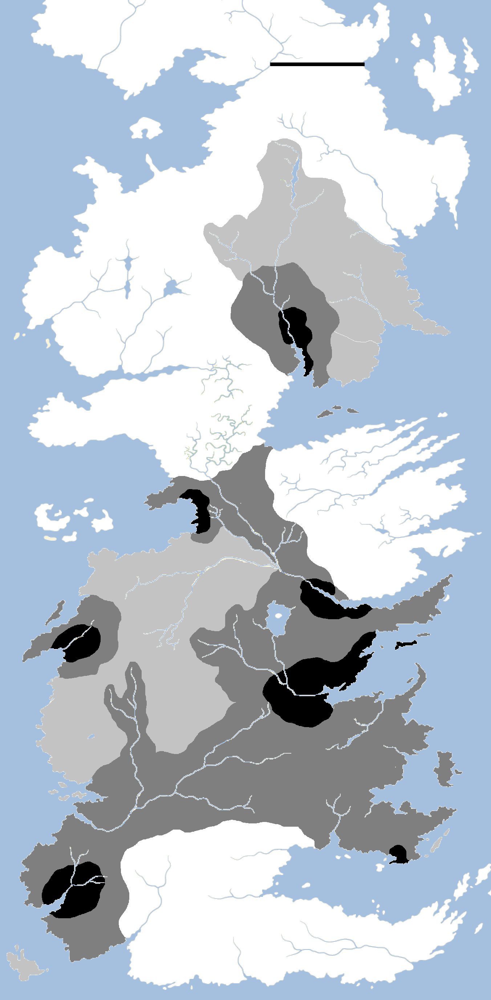

Daemon Blackfyre, bastard son of King Aegon IV Targaryen, claimed the Iron Throne of Westeros in 196 AC. His claim was based on the report that his half-brother Daeron was actually the bastard son of Queen Naerys and her brother, Ser Aemon the Dragonknight, and thus not the true heir to the Iron Throne. Daemon, who had been legitimised by Aegon IV on his deathbed, was thus the rightful King of Westeros.

The houses engaged in the First Blackfyre Rebellion (196 AC). Houses in red fought for King Daeron II Targaryen and those in black fought for King Daemon I Blackfyre. The area in yellow technically fought for Daeron, but in actuality many houses sat out the war or waited to choose sides. The Greyjoys and Starks appear to have played no role, due to their remoteness or lack of interest.

Daemon’s claim was supported by many individual knights and lords of note: Ser Quentyn “Fireball” Ball, Ser Aegor “Bittersteel” Rivers, Lord Gormon Peake, Ser Robb Reyne, Lord Strickland, Lord Sunderland, Manfred Lothston, Ser Eustace Osgrey and more. Knights and heroes, known for their skill at arms, including many young men eager for adventure. Whether they believed Daemon’s claim or simply hungered for a chance at glory is unknown. They answered Daemon’s claim in the their thousands.

The Brackens declared for the black dragon, as did the Costaynes and the Oakhearts, the Tarbecks and the Butterwells. Even the Hightowers did for a time, before they changed their minds and submitted to the red dragon. Worthy and strong houses, but not great ones. The Arryns, Lannisters, Tullys, Baratheons and Tyrells all supported Good King Daeron. Some houses proved hesitant, the Starks citing their remoteness, whilst the Greyjoys of Pyke took no side. But none of the Great Houses declared for Daemon, and no matter how many men he raised from lesser families and the smallfolk, that ultimately doomed Daemon to failure.

The Blackfyre Rebellion – later called the First Blackfyre Rebellion – lasted over a year. According to some, the realm was riven in two, with half declaring for Daemon and half for Daeron. This may be technically accurate given the accounting of the houses directly involved in the war, given that the vassals of many of the Great Houses were divided, but it seems a little poetic. Daemon was almost certainly outnumbered (at least moderately), but by remaining mobile, launching surprise attacks and trying to draw the Good King into a pitched battle where he could bring superior forces to bear, he attempted to win a victory.

In this he was disappointed. King Daeron did not take the field, as his allies and generals were formidable in their own right. His son and heir Prince Baelor was a great field commander as well as a strong knight. Prince Maekar was not far behind him in skill. Brynden “Bloodraven” Rivers commanded the finest intelligence network in the realm and also led his own unit of elite archers, the Raven’s Teeth.

Battles in the Blackfyre Rebellion were fought in the Vale, the Westerlands, the Riverlands and the Reach. Ser Quentyn Ball raided the Westerlands, killing Lord Lefford Lannister at the gates of Lannisport and the defeating Lord Damon Lannister. At a pitched battle at a crossing over the Mander, Ball also defeated Lady Penrose’s sons, slaying all but the youngest. Lord Leo Tyrell sortied from Highgarden, raised a substantial force and drove the black dragon’s supporters from the Reach.

Daemon soon faced a severe depletion of men and morale. Manfred Lothston betrayed the Blackfyres and went over to Daeron. Lord Bracken hired an army of elite Myrish crossbowmen, but were delayed by storms. The noted thief Quicksilver attempted to steal some of the dragon eggs left behind by the last dragon in the reign of Aegon III, but failed.

One notable success for Daemon Blackfyre had been diplomatic. He had convinced Lord Yronwood to rise in rebellion against the Martells of Sunspear. Yronwood’s rebellion had been substantial and Prince Maron Martell spent months in crushing it. This prevented him from riding to Daeron’s aid, but as soon as Yronwood had submitted he dispatched several thousand Dornish spearmen to King’s Landing.

The Battle of Redgrass Field ended the First Blackfyre Rebellion. At the start of the battle, House Targaryen met House Blackfyre near a ridgeline. The Targaryens planned to pin the Blackfyres and allow an outflanking manoeuvre by the Raven’s Teeth, hoping that Baelor Breakspear’s Dornish troops would relieve them. In the event, the Blackfyre charge was so ferocious (1) that the reserves under Gwayne Corbray had to be committed much earlier than expected (2). If it hadn’t been for Daemon and Gwayne’s epic battle-within-a-battle, the Blackfyres may have won the day. The Raven’s Teeth then attacked, killing Daemon Blackfyre and throwing the black dragon’s forces into confusion (3). Bittersteel led a rally to engage Bloodraven, but by this point Baelor had arrived and the battle was won for the Targaryens (4).

The final battle of the Blackfyre Rebellion was fought on the Redgrass Field in late 196 AC. Reports of the battle are scattered and confused, but it appears that Daemon had finally managed to combine his disparate supporters and form an army large enough to threaten the capital. The newly-appointed King’s Hand, Lord Hayford, and Prince Maekar had managed to assemble an army of roughly equal size to Blackfyre’s. Bloodraven joined them with the Raven’s Teeth, and Ser Gwayne Corbray of the Kingsguard, a knight of formidable reputation. Prince Baelor had ridden south to link up with the Dornish, and there was a question on how soon they could arrive. However, the Blackfyres had stolen a march on the Tyrells, who were unable to reach the battlefield in time.

For the Blackfyre host, Lord Daemon commanded the centre with Lord Costayne on the left and Lord Shawney on the right with Bittersteel. For the Targaryens, Lord Donnel Arryn commanded the vanguard, with Prince Maekar on the left. Bloodraven absented himself and his men from the battlefield just as the engagement began.

Daemon Blackfyre led an all-out attack, commanding a massive charge that shattered the vanguard. Lord Donnel survived, but his force was overwhelmed. Wyl Waynwood and the Knight of Ninestars were slain in personal combat by Daemon himself. Prince Maekar ordered in reinforcements under Ser Gwayne Corbray, who came face-to-face with Blackfyre. The knight of the Kingsguard was the wielder of Lady Forlorn, a Valyrian steel blade of storied history. The swords Lady Forlorn and Blackfyre crashed together, their wielders each other’s equal in battle. According to the legend, the two men fought for a full hour as the battle swirled around them before Blackfyre got the upper hand, striking Corbray senseless.

Moved by the valour of his foe, Blackfyre ordered Corbray taken from the field. However, Bloodraven had taken advantage of the distraction. His Raven’s Teeth had gained the Weeping Ridge overlooking the battlefield and now sent wave after wave of arrows into the melee. How many friendly troops they killed is unknown, but it is known that Prince Aegon Blackfyre, the eldest of Daemon’s twin sons was killed in the first volley. As Daemon struggled to help his son, he was struck by seven shafts and died on the field. His younger son Aemon tried to help him and also died.

The rebels began to rout, but Bittersteel led a charge that restored their morale. He reached the Weeping Ridge and Bloodraven was forced to resort to sword-to-sword combat. Prince Daeron had given his bastard half-brother the Valyrian steel blade Dark Sister, but even so Bloodraven was nearly outmatched, losing an eye to his half-brother before he rallied and defeated him, driving him bloodied from the field.

By now Prince Baelor had reached the field with the Dornish spearmen and a host of stormlanders, which he deployed like a hammer. Maekar rallied the rest of the Targaryen host into the “anvil” and the two hosts crushed the Blackfyres between them. The slaughter was tremendous. Although some rebels surrendered, many chose not to give any quarter and were killed.

Ten thousand men died on the Redgrass Field, making the bloodiest battle since at least Daeron I’s invasion of Dorne (and possibly the Dance of Dragons). The blood seeped into the ground and turned the grass red, giving the battlefield its name.

The Blackfyre Rebellion ended with King Daeron II confirmed in his rule of the Seven Kingdoms, but the threat was not ended. Bittersteel had escaped from the battlefield. He fled to the Free Cities with numerous supporters, including Lord Strickland, and Daemon’s five other sons, all claimants to the Blackfyre name (and thus the Iron Throne). Daemon’s widow and the mother of his children was Rohanne of Tyrosh, and she was able to secure a new home in that city.

The remainder of Daeron II’s reign was peaceful. He treated those who had followed Daemon and surrendered with respect, but not forgiveness. Many of the families who declared for the Blackfyres found that they had lost land, titles and castles. House Peake, a proud and powerful Marcher house of the Reach with three castles to its name, found itself reduced to one. Lord Osgrey, whose forefathers had lost their castle at Coldmoat to House Webber after challenging Maegor the Cruel’s treatment of the Faith Militant, was reduced to a single towerhouse named Standfast. Other lords also suffered badly. For the rest of Daeron’s reign and into his son’s, the question “Were you for the red or the black?” was a dangerous one, depending on who was asking.

Still, the realm survived, endured and prospered. Daeron’s reign remained peaceful, aside from a rebellion on the island of Skagos. Lord Barthogan Stark crushed the rebellion quickly, but lost his life in the process.

Daeron’s eldest son and heir Baelor, already a great warrior and a hero of the Redgrass Field, became noted as his father’s son, famed for his diplomatic skills and wisdom as well as his martial strength. He was named Hand by his father and made a huge success of the role. His combination of battlefield prowess and wisdom in rule was said to have been unmatched by any since Aegon the Conqueror, and some began to say that Baelor Breakspear could be the greatest king of the age.

Alas, it was not to be.

Ser Duncan the Tall met “Egg”, the future Aegon V Targaryen, in 209 AC. Their adventures together became a thing of legend and their lives remained inextricably entwined for the next fifty years. Art by Marc Simonetti.

In 209 AC, thirteen years after the Redgrass Field, the divisions in the realm were finally healing. Lord Ashford, a rich lord of the Reach, called a great tourney on Ashford Meadow, near his castle and town. He challenged the great lords of Westeros to compete for the honour of naming his daughter the Queen of Love and Beauty.

The tourney attracted the great and the good from across the realm. Ser Samwyle Tarly, the heir to Horn Hill, came, as did Ser Gunthor Estermont and Manfred Dondarrion. Lord Pearce Caron and Lord Gawen Swann came to represent the Marches and Ser Franklyn Frey and Bennifer Blackwood for the Riverlands. Great lords also came: Damon Lannister of Casterly Rock, Leo Tyrell of Highgarden, Medgar Tully of Riverrun and most notably Lyonel Baratheon of Storm’s End, called the Laughing Storm, a warrior of great honour, accomplishment and chivalry.

Impressively, the royal family turned out in force. Prince Baelor and Prince Maekar, both now in their thirties with large families of their own, attended. Baelor hoped his son Valarr would distinguish himself in the tourney, whilst Maekar hoped his own sons would make names for themselves. He brought his eldest two sons, Daeron and Aerion, and his fourth, Aegon. However, Daeron and Aegon slipped away from their escort so Daeron could get raging drunk at an inn. Aegon, who had shaved his head to hide his distinctive Targaryen hair, was impressed by an arrival at the inn, a huge hedge knight named Ser Duncan, who hoped to make a name for himself. Aegon, taking the name “Egg”, attached himself to Duncan as a squire.

What followed is told far better elsewhere. Suffice to say that Ser Duncan struck Prince Aerion of the blood royal to save the honour of a young lady, Prince Aerion took offence and, upon realising he had no hope of defeating the far larger knight in single combat, proposed a trial of seven champions against seven. Prince Baelor, moved by Ser Duncan’s honour and chivalry, volunteered to join his side. Prince Maekar joined Aerion’s. Two cousins of House Fossoway took opposing sides, Ser Raymun for Ser Duncan and Ser Steffon for Prince Aerion. This resulted in the famous splitting of the house and the founding of the green-apple Fossoways by Ser Raymun.

From that battle Ser Duncan emerged the victory. He forced Prince Aerion to yield and it was declared that the gods had decided in Ser Duncan’s favour. But after the battle it was discovered that Prince Baelor had been fatally wounded by a mace blow to the head from his own brother. Prince Baelor died, taking with him the hopes of his family.

Prince Maekar Targaryen was horrified at what he had done, even accidentally. He also felt shamed by his sons: Daeron the Drunk and Aerion the woman-beater. He sent Aerion to Lys for a few years, hoping it would make a man of him. The only one of his sons to show any real spirit was Aegon. Reflecting on where privilege and power had gotten his elder sons, he gave Aegon into the care of Ser Duncan the Tall, telling him to raise him incognito as his squire on the road.

Much of the adventures of “Dunk and Egg” are written elsewhere. But tragedy and darkness was soon to follow.

The Great Spring Sickness arrived in Westeros in the second half of 209 AC, several months after the Ashford Tourney. It arrived by ship, ravaging the major port cities of Westeros and some of the smaller port towns. It was carried by road and river to much of the rest of the continent. The above map shows possible contagion areas: black for most lethal and light grey for the least. Lannisport and Oldtown were ravaged, but King’s Landing was devastated: 40% of the population died and a quarter of the city was burned to the ground. The total death toll for Westeros is unknown, but given that c. 150,000 (possibly more) died in the capital alone, it was likely in the millions. Dorne and the Vale were able to seal their borders in time to prevent major infection, and, lacking a major port, the Iron Islands were likewise largely not affected.

A great plague spread from the east. To what degree the Great Spring Sickness afflicted Essos is unknown, but it entered Westeros through the ports. Lannisport was badly affected (Lord Damon Lannister died there in 210 AC), but Oldtown far moreso and King’s Landing worse of all. Four-in-ten of the capital’s populace was killed.

The royal heir, Prince Valarr Targaryen died, and his brother Matarys.  King Daeron then died, and the High Septon, a third of the Most Devout, nearly all of the silent sisters (who attended to funeral rites), and more besides.

Aerys I Targaryen, the second son of Daeron II, was crowned king in a city stinking of death and decay. Unable to face the horror and the scale of the situation, he appointed Ser Brynden Rivers, Bloodraven, to the post of Hand of the King. Bloodraven proved decisive and able. He ordered the bodies of the dead burned. The fires burned brightly, too brightly, and took nearly a quarter of the city with them. But the blazed stopped the spread of the disease and spared the rest of the city.

Much of the realm was affected, apart from the Vale and Dorne which were able to close their ports and borders. Ser Duncan and Prince Aegon were visiting Dorne when the plague hit, so were spared its ravages. But the after-effects were felt for years afterwards, with many speaking of those who “died in the Spring.”

The Great Spring Sickness turned the history of the Seven Kingdoms onto a different path. It wiped out many of the lesser branches of House Targaryen and it brought King Aerys I to the Iron Throne. It also killed many of the hostages taken during the Blackfyre Rebellion, allowing their families to begin plotting and scheming again. It made some think that the Seven Kingdoms were vulnerable, and in its wake Dagon Greyjoy rebelled and began raiding the west coast very heavily. But more than all of this, it brought Bloodraven, Brynden Rivers, to the role of Hand of the King. Some call Bloodraven villain and some hero, but none could doubt his impact on the years to follow.
