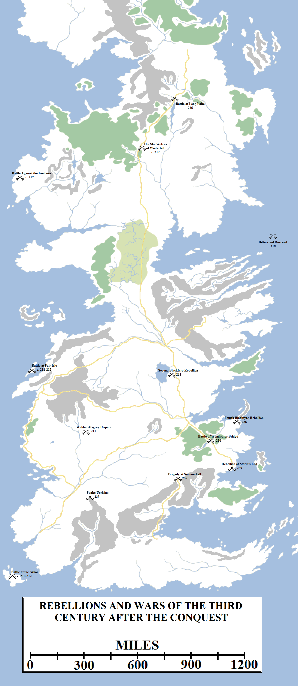
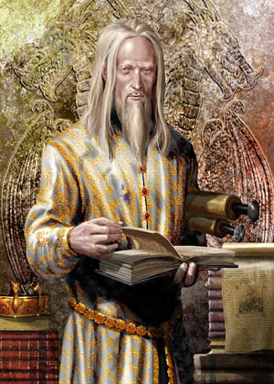
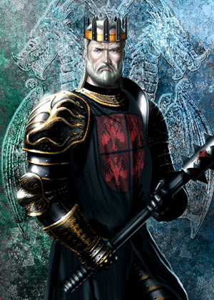
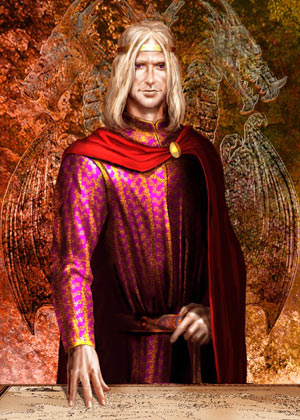
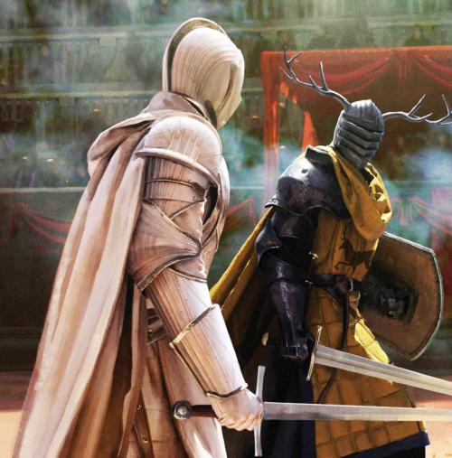
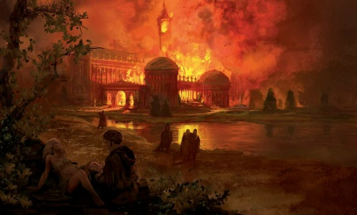

Aerys I Targaryen, the second son of Daeron II, took the Iron Throne in 209 AC. He was not particularly suited to the task, preferring books and intellectual pursuits to ruling. He appointed Brynden Rivers, popularly called Bloodraven, as his Hand and retired to his library.

The third century after the conquest saw numerous rebellions and minor wars: Dagon Greyjoy’s raids along the coast (210-212), the Second Blackfyre Rebellion at Whitewalls (211), the struggle at Winterfell between the “She-Wolves” (212), the Third Blackfyre Rebellion and Bittersteel’s rescue at sea (219), King-beyond-the-Wall Raymun Redbeard’s invasion and defeat at Long Lake (226), the Peake Uprising (233), the Fourth Blackfyre Rebellion and defeat at Wendwater Bridge (236), the rebellion of Storm’s End after the betrayal of Prince Duncan (239), and the great Tragedy at Summerhall (259).

Bloodraven proved a capable administrator and he certainly did all he could for the realm, but he was also mistrusted. A former master of whisperers, his spies were rumoured to exist throughout the Seven Kingdoms, feeding reports and intelligence to their master. The common folk spoke of his “thousand eyes and one”, and his astonishing ability to ferret out secrets anywhere.

Aerys I was an ineffective ruler but not a tyrannical or bloody one. His reign may have been a quiet one, had not he risen to the throne during the Great Spring Sickness. The realm was left devastated, with certainly hundreds of thousands and maybe millions dead. In the wake of the Spring came a horrendous drought. Lasting more than two years, it saw harvests across the south fail. The smallfolk blamed their lacklustre new king and his sinister Hand.

The combination of the plague and drought made the ironborn bold. In 210 Lord Dagon Greyjoy launched a ferocious series of raids along the west coast of the continent, hitting the coasts of the North, the Reach and the Westerlands particularly hard. By 211 Houses Stark and Lannister had made common cause to coordinate a defence against the ironbon. Lord Beron Stark and Lord Tybolt Lannister raised ships and armies, and by 212 had defeated the ironborn, forcing them back to their islands.

House Greyjoy resubmitted to the King’s Peace, but Dagon’s enemies did not long enjoy their victory: Lord Tybolt was dead by the end of 212, his daughter and heir Cerelle surviving him only by a year before her own untimely death and the succession of her uncle Gerold. In the North Lord Beron had been mortally wounded and soon died, plunging House Stark into a brief crisis as the “She-Wolves of Winterfell” contested the inheritance.

Donnor Stark won the inheritance but did not rule for long: he died without issue a few years later and was succeeded by his brother Willam. In 226 Willam received word that a wildling chieftain, Raymun Redbeard, had declared himself the King-beyond-the-Wall and raised an army. Willam expected the Night’s Watch to delay their advance and send warning of their movements, but Lord Commander Jack Musgood’s arrangements were lax and Raymun’s army was able to scale the Wall and quickly march south. Willam joined with Lord Harmond Umber and they met the wildlings in battle on the shores of Long Lake. The engagement was won but Willam was slain, beheaded in the middle of the fighting. His brother Artos, known as the Implacable for his ferocity in battle, killed Raymun and sent the wildlings fleeing. The late-arriving Night’s Watch was ordered to dig burial pits for the bodies and the Lord Commander was given the withering nickname “Sleepy Jack” for his laxity.

Aerys I Targaryen (c. 174-221, r. 209-221 AC). Artwork by Amok.

Meanwhile, more than sixteen years had passed since the Redgrass Field when the black dragon rolled the dice again. In 211 the third-eldest son (but eldest surviving) of Daemon Blackfyre, Prince Daemon the Younger, styling himself Daemon II Blackfyre, crossed the Narrow Sea from Tyrosh in disguise. He made his way to Whitewalls, the seat of House Butterwell in the Riverlands, where a clandestine gathering of Blackfyre loyalists was taking place.

Lord Gormon Peake, who had lost two of his house’s three castles in the Blackfyre Rebellion, was the mastermind of this gathering. His plan was to launch a rebellion from the heart of the Riverlands and take the king and his Hand completely by surprise. However, their plans were betrayed to Bloodraven, who soon arrived with a strong army. Peake was executed, Butterwell lost most of his and his castle, which was demolished, and Daemon II was imprisoned in the Red Keep. He died in captivity a few years later.

Bittersteel had not supported Daemon’s plan, deciding it was reckless and foolhardy. In the wake of Daemon’s capture, he made new arrangements. With support for the Blackfyres in Westeros itself uncertain, in 212 he founded his own private army out of Westerosi sellswords, fellow exiles and knights who had crossed the Narrow Sea in search of adventure. He named his army the Golden Company, selling its swords to one or other of the Free Cities to keep it financed.

In 215 Rhaegal, Aerys I’s younger brother (the third son of Daeron II), choked to death at a feast. His son Aelor became the heir apparent to the Iron Throne, but two years later he was slain by his twin sister and wife Aelora in a mishap. These events left Aerys’s only surviving brother, Maekar, as the heir to the Iron Throne.

In 219 the Golden Company invaded Westeros in force with Bittersteel at its head, supporting the claim of Daemon II’s younger brother, Haegon. They rallied some local support but in the end were defeated by Bloodraven. Prince Maekar Targaryen and his sons Aerion Brightflame and Prince “Egg” played key roles in the fighting. Haegon was defeated, surrendered his sword and was then killed, which may have been wise but unchivalrous. Bittersteel was captured, however, and stood trial. He was found guilty of high treason and should have been executed, but King Aerys spared his life and allowed him to take the black.

Although honourable, this proved unwise. Warships hired by the Golden Company intercepted the galley bearing Bittersteel to the Wall and rescued him, bearing him back to Tyrosh. Haegon’s eldest son was crowned as Daemon III Blackfyre before the year was done, once again imperilling the realm.

Maekar I Targaryen (c. 176-233, r. 221-233 AC). Artwork by Amok.

Aerys I Targaryen died of natural causes in 221, not yet fifty years of age. He was succeeded by his younger brother Maekar. Maekar was a fierce warrior who had won renown in the First and Third Blackfyre Rebellions, but was troubled by quarrelsome and controversial sons. His eldest son Daeron was a drunk and wastrel, whilst his second son Aerion was an accomplished warrior but also prone to bouts of cruelty and insanity. Maekar’s third son Aemon had joined the Citadel and become a maester. This left only his youngest son Aegon (or “Egg”), who had become a squire to the hedge knight Ser Duncan the Tall.

Daeron the Drunkard, as he was unkindly named, died from a pox caught from a prostitute. In 232 Aerion, in one of the more infamous examples of Targaryen madness, became convinced he would be reborn as a dragon if he drank wildfire. Instead, it transformed him into a corpse. Both left behind issue, but Daeron’s daughter Vaella was simple-minded and Aerion’s son Maegor was young and, it was feared, may have inherited his father’s madness.

In 233 House Peake of Starpike rose in rebellion against the Iron Throne. Long-standing supporters of the Blackfyres, the Peakes finally grew tired of waiting for their return and tried to take matters into their own hands. This appeared a folly, with the rest of the realm likely to turn on them, but in the end it was a partially successful one: King Maekar I Targaryen was slain during the final assault on Starpike, his head crushed by a rock, along with Lord Robert Reyne and Ser Tywald Lannister. Roger Reyne, Robert’s son, executed seven Peake captives in furious vengeance before being restrained on the order of Prince Aegon Targaryen.

Maekar’s death left the succession in doubt: Aerion’s son Maegor was an infant just a year of age, Daeron’s daughter Vaella was a simpleton and Aemon made it clear he wished to remain as a maester. Bloodraven, still serving as King’s Hand, called a Great Council in King’s Landing to debate the matter.

The obvious contender was Prince Aegon, but his years spent wandering the Seven Kingdoms as a squire to Ser Duncan the Tall had left him “half a peasant”, according to some, and they despised his desire to help the smallfolk with planned reforms. Surprisingly, another claim was put forwards: Aenys Blackfyre, the fifth of Daemon’s seven sons, wrote from Tyrosh asking to present his case with words and diplomacy. Bloodraven, surprisingly, agreed and allowed him safe passage. But no sooner had Aenys entered King’s Landing then he was arrested and executed.

Aegon V Targaryen (200-259, r. 233-259 AC). Artwork by Amok.

The Great Council declared Aegon V Targaryen as the King on the Iron Throne. As the fourth son of a fourth son, he was dubbed Aegon the Unlikely. Taking the throne, his first act was to order the arrest of Bloodraven for betraying his oath and bringing dishonour to House Targaryen. Bloodraven accepted the judgement, saying he had sacrificed his honour to help the Iron Throne. Bloodraven was sentenced to death, but offered the chance to take the black to atone for his dishonour. Bloodraven agreed and set sail for the Wall. With him into exile went two hundred of his personal guard, the Raven’s Teeth. Maester Aemon also decided to absent himself from the toxic poison of court politics and take up the role of maester at Castle Black. Bloodraven would rise high in the ranks of the Night’s Watch, becoming Lord Commander in 239 and serving with distinction until he was lost in a ranging beyond the Wall in 252 at the age of seventy-seven. Although his precise fate is not known, his age, of course, means that he is long since dead.

Aegon V took the throne in the middle of a brutal six-year winter, the worst in a century. The North suffered terribly, and some of the southern realms also suffered from the long nightmare. The winter finally lifted, to the relief of the realm, in 236, but almost immediately a fresh crisis arose. King Daemon III Blackfyre, accompanied by the aged-but-still-hale Bittersteel and his Golden Company, landed on Massey’s Hook and struck inland, hoping to reach King’s Landing and seize the city before resistance could be organised.

King Aegon V rode out to meet them, his three young sons – Prince Duncan, Prince Jaehaerys and Prince Daeron – at his side. With them also went Ser Duncan the Tall, now of the Kingsguard, and many warriors of the Crownlands and Stormlands. They met the Blackfyres in battle at Wendwater Bridge. In a brutal engagement the Blackfyres were defeated. Daemon III was slain by Ser Duncan the Tall, but Bittersteel managed to withdraw the Golden Company in good order. Five years later Bittersteel finally died, at the age of sixty-nine, fighting in the Disputed Lands.

Aegon V’s reign became one of patience-testing defiance. Aegon sought to introduce peaceful reforms to improve the lot of the commons, but his lords defied him, horrified at any suggestion they would lose some of their own power and privileges (however slight). Aegon’s own sons then caused problems: Prince Duncan fell in love with a peasant girl, Jenny of Oldstones, whom some people said was a witch. He broke his betrothal with the daughter of Lord Lyonel Baratheon, the Laughing Storm who had taken Ser Duncan the Tall’s side during the Ashford Tourney, to wed Jenny in 239.

Ser Duncan the Tall of the Kingsguard faces Lord Lyonel Baratheon in single combat in 239 AC, after the insult done to the lord’s daughter by Prince Duncan Targaryen. Artwork by Chase Stone for _The World of Ice and Fire_.

Lord Lyonel was incensed by the insult of his daughter being passed over for a peasant and rebelled against the Iron Throne, declaring himself the Storm King. Ser Duncan the Tall challenged his old comrade to single combat to settle the matter without bloodshed. Noted for his chivalry, Lord Lyonel agreed. After a furious battle, Ser Duncan emerged victorious but chose not to kill the self-styled Storm King. Prince Duncan apologised by abdicating his position as heir to the Iron Throne, and King Aegon offered his daughter Rhaelle in marriage to Lyonel’s son Ormund. Lyonel pronounced that honour was satisfied and returned to the King’s Peace.

In 240 Prince Jaehaerys, now heir to the Iron Throne, married his sister Shaera in secret. Aegon had developed a belief that it was incestuous unions of the Targaryens which contributed to the occasional bout of madness seen in the line, but Jaehaerys and Shaera did not share this belief. Shaera had been betrothed to Luthor Tyrell of Highgarden and Jaehaerys to Celia Tully of Riverrun, and both houses were again sorely insulted. In 244 Jaehaerys and Shaera had their first son, Aerys, and then a daughter, Rhaella, two years later. Jaehaerys determined to have them marry one another when they came of age, to Aegon’s frustration.

Aegon hoped his youngest son Daeron would keep to his betrothal to Lady Olenna Redwyne of the Arbor, but even in this he was thwarted. Daeron repudiated the match in 246, apparently preferring the company of dashing young knights, and died in 251 crushing a minor rebellion.

King Aegon’s reign continued to be blighted by arguments, defiance and dissent. Aegon was oft-said to complain bitterly that he had no dragons, for with dragons he could forge new laws and force the reluctant lords to obey them, as Aegon I and Jaehaerys I had done. The last dragons had left behind several eggs when they died a century earlier and Aegon now demanded that the maesters and other learned men find how to hatch them. According to legend, some brave men even took ship for Asshai to find books of knowledge there.

The Great Fire of Summerhall, sometimes called the Tragedy. A great fire destroyed the Targaryen summer palace in 259, killing King Aegon V, his eldest son Prince Duncan and the legendary Lord Commander of the Kingsguard, Ser Duncan the Tall. During the fire Prince Rhaegar Targaryen was born to Princess Rhaella and Prince Aerys. Artwork by Marc Simonetti for _The World of Ice and Fire_.

Eventually Aegon concluded that the eggs could only hatch if they were placed in a great fire. He gathered the blood of the dragon together at Summerhall in 259, along with seven dragon eggs, and the fire was lit. But it got out of control. The great Targaryen palace caught fire and was destroyed. Duncan the Tall, now Lord Commander of the Kingsguard and still hale in his sixties, helped several people escape, but he was unable to save his king and best friend, nor his son and namesake. King Aegon V, Prince Duncan and Lord Commander Duncan were all killed, along with several other courtiers and lords of note.

If the ashes of the great fire had heralded the passing of one generation, it also announced the birth of the next. Princess Rhaella, the teenage daughter of the newly-inherited King Jaehaerys II Targaryen, had given birth to her son during the chaos of the night. She and Aerys decided to name him Rhaegar.

The death of King Aegon V and so many other notables in such a tragedy shocked the entire realm. But soon it had to recover. A year earlier word had come that nine notable lords of Essos had joined forces to assist one another in claiming thrones they could not take themselves. Prince Duncan japed that thrones were being sold “nine a penny”, and the name stuck. Just weeks after the Tragedy at Summerhall, word came that the so-called Band of Nine, the Ninepenny Kings, had conquered Tyrosh and invaded the Stepstones. With them was Maelys Blackfyre, the last surviving descendant of Daemon Blackfyre in the male line, and he intended to seize the Iron Throne.
