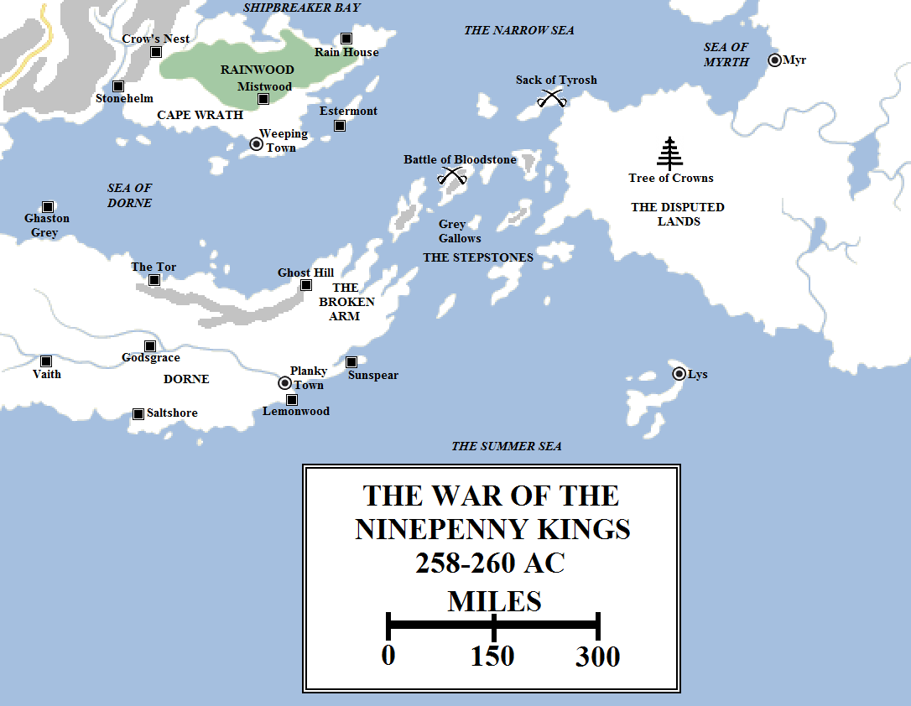
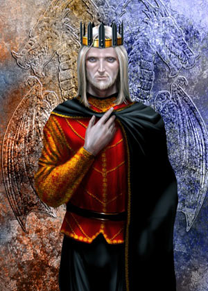
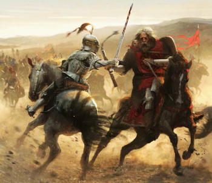
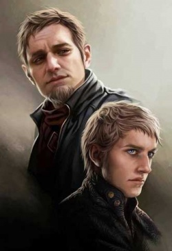
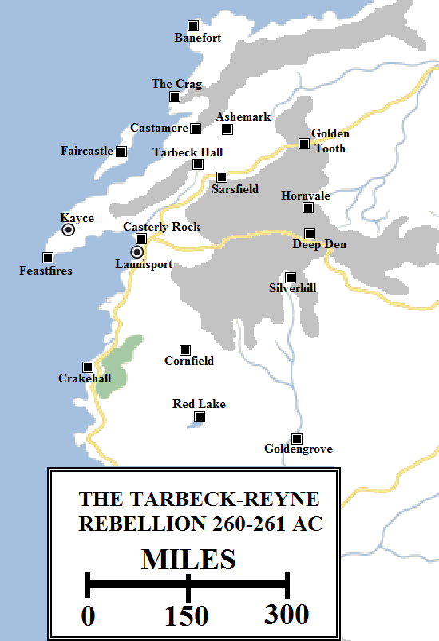
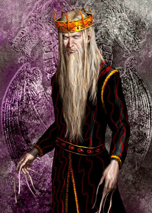

In 258 AC nine great warlords, exiles, sellsword captains and pirates met in the Disputed Lands, under the Tree of Crowns, and made alliance. They swore an oath that they would support one another in their claims to lands, kingdoms and territories, so they might achieve together what none could alone. They became known as the Band of Nine.

The War of the Ninepenny Kings began in 258 AC when nine warlords of Essos made a formal pact under the Tree of Crowns. These were: Alequo Adarys of Tyrosh; Maelys Blackfyre of the Golden Company; Ser Derrick Fossoway, a sellsword captain; Liomond Lashare, Lord of Battles; Nine Eyes, a pirate captain; the Old Mother, a pirate queen; Xhobar Qhoqua, the Ebon Prince of the Summer Isles; Samarro Saan of Lys; and Spotted Tom the Butcher. They invaded and sacked Tyrosh before seizing several of the Stepstones, including Bloodstone. King Jaehaerys II sent his armies against the Band of Nine in 260, with Ser Barristan Selmy defeating and killing Maelys the Monstrous in single combat. The rest of the Band were destroyed over the next six months, with only Adarys surviving in Tyrosh. He was killed by his own wife in 266, ending the pretensions of the Ninepenny Kings.

Foremost in military reputation amongst their armies was the Golden Company, made up of exiled knights and warriors from Westeros. Their great commander, Bittersteel, had died seventeen years earlier but the company remained intact and its reputation formidable. Their commander was Maelys Blackfyre, the last surviving descendant of House Blackfyre in the male line. Maelys, a huge and ugly man said to have swallowed his twin in the womb (he had a vestigial second head growing out of his shoulder) had seized command of the company by tearing the head of his cousin Daemon from his shoulders and had a reputation for savagery and bloodlust that had tainted the honour of the company. Still, the opportunity to return home and seize the Seven Kingdoms could not be ignored.

Word came to the Red Keep of the pact. Prince Duncan Targaryen joked that crowns were being “sold nine a penny.” The name stuck and spread, with the Band of Nine becoming known as the Ninepenny Kings.

Prince Duncan, his father King Aegon V and their great friend and protector Ser Duncan the Small, Lord Commander of the Kingsguard, all perished in the great fire at Summerhall the following year. Aegon’s second son and heir apparent, Prince Jaehaerys, assumed the Iron Throne as the Second of His Name, whilst Ser Gerold Hightower, the White Bull, became Lord Commander. Shocked by the deaths of his father and brother, Jaehaerys was ill-prepared to deal with the news that arrived not long after.

Jaehaerys II Targaryen (225-262, r. 259-262 AC). Artwork by Amok.

The Band of Nine had marched and then sailed. Several of their number, including Nine Eyes, the Old Mother and Samarro Saan, were great sea captains and had landed their forces on the island of Tyrosh. In short order the Ninepenny Kings had seized one of the greatest of the Free Cities, sacked it and turned it over to the rule of Alequo Adarys, the Silvertongued. They then seized several more of the islands. The news was momentous, for it was assumed that the Free Cities would have dealt with the problem before it became so great. Now an army numbering in the many thousands was sitting less than a hundred leagues off the coast of Westeros.

Early in 260 King Jaehaerys II made a great call to arms. He would not sit idly by and let these upstarts invade his kingdom. His plan was to launch a pre-emptive assault on the Stepstones and destroy the Ninepenny Kings before they could regroup for an invasion of Westeros.

He planned to lead the assault himself, but he was the least militarily-minded of Aegon’s children. His Hand and brother-in-law, Lord Ormund Baratheon, dissuaded him of the idea. Instead, Ormund assumed command of the mission and began raising a great host.

Ormund summoned troops from across Westeros, from the Westerlands, the Riverlands and the Vale of Arryn, as well as his own host from the Stormlands and many more besides. The size of the host was in the tens of thousands: eleven thousand men marched from the Westerlands alone, under the command of Ser Jason Lannister (Lord Gerold’s youngest son), and thousands more came from the other regions. Lord Quellon Greyjoy was commanded to provide a fleet of one hundred longships from the Iron Islands to support the attack and large transport ships were sourced from the Royal Fleet and elsewhere.

The Greyjoy longships and other vessels swept through the Stepstones, engaging and destroying most of the Band’s ships. Then the Westerosi forces landed on three of the islands, including Prince Daemon Targaryen’s old stronghold of Bloodstone, and engaged the enemy.

The son of the Laughing Storm, who had always believed in leading from the front, Ormund Baratheon was one of the first off the ships and onto the beaches, leading the storming of the fortified defences where Maelys the Monstrous held the command. This proved to be unwise, as he was killed almost immediately. Ormund perished in the arms of his young son, Ser Steffon of Storm’s End. Lord Commander Gerold Hightower quickly assumed command and restored the momentum of the attack.

In the bitter fighting that followed a new generation of Westerosi knights and captains won renown and honour: Ser Tywin Lannister, the young son of Lord Tytos, and his brothers Kevan and Tygett; Ser Brynden Tully, who became known as the Blackfish; his elder brother Ser Hoster Tully, heir to Riverrun; Lord Baelish of a modest smallholding on the Fingers, who fought alongside Ser Hoster and earned his respect; and Prince Aerys Targaryen, not a noted warrior but he distinguished himself ably on the battlefield.

Ser Barristan Selmy battles Maelys the Monstrous, the last of the Blackfyre Pretenders, during the War of the Ninepenny Kings. After Barristan killed Maelys, he was named to the Kingsguard by Jaehaerys II and served with honour in its ranks for the next thirty-eight years. Artwork by Jose Daniel Cabrera Pena in _The World of Ice and Fire_.

However, the most famous hero of the war was one who was already fast becoming a legend. Having fought his first tourney at the age of ten and won his spurs at sixteen, the twenty-three-year-old Ser Barristan Selmy cut a bloody path through several of the greatest warriors of the Golden Company and engaged Maelys the Monstrous in combat. The huge and overpowering Maelys was slain there and then, the mad dreams of Bittersteel and the hopes of House Blackfyre dying with him.

The War of the Ninepenny Kings raged on for another half a year. The Westerosi forces cleared the rest of the three islands they had landed on and made sure that the other Ninepenny Kings had been routed before returning home. The other Free Cities finished off the pretensions of the remaining claimants, but it wasn’t until 266 that Alequo Adarys was finally poisoned to death by his wife and the Archon of Tyrosh restored.

Ser Barristan Selmy, Barristan the Bold, was inducted into the ranks of the Kingsguard shortly after the war. Lord Commander Gerold Hightower hung the white cloak from his shoulders and King Jaehaerys II named him to his position from the Iron Throne. It was all the young warrior had ever wanted, and he gave up his claim to Harvest Hall and his planned betrothal for it.

Jaehaerys II’s reign began with great promise but it soon turned sour. There was an attempted rebellion in the Westerlands against the lawful rule of House Lannister of Casterly Rock within months of the War of the Ninepenny Kings ending.

Lord Tytos Lannister, the Laughing Lion, and his eldest son and heir Tywin as a young man. Art by Magali Villeneuve for _The World of Ice and Fire_.

The roots of this rebellion went deep. In 233, during the Peak Uprising, Tywald Lannister, the eldest son and heir of Lord Gerold, the Golden Lion, died in battle at Starpike. Tywald’s wife was the formidable and ambitious Lady Ellyn Reyne, of the Red Lions of Castamere, who had dreamed of becoming Lady of the Rock. She convinced Tywald’s younger brother, the new heir Tion, to marry her instead. Tywald and Tion’s youngest brother, Tytos, married Lady Jeyne Marbrand in a double wedding.

With Lord Gerold elderly and failing, Lady Ellyn convinced her husband to heap honours on her family, House Reyne of Castamere Castle. However, three years into their marriage Tion was killed in the Battle of Wendwater Bridge during the Fourth Blackfyre Rebellion. Tytos was now heir to Casterly Rock and Lord Gerold rallied in his final years to instil the virtues of rule and leadership in his weak-willed son. Lady Jeyne now became the dominant female power in Casterly Rock. At her urging, Lady Ellyn was found a new marriage match – Lord Walderen Tarbeck of Tarbeck Hall – and forced to leave the Rock.

In 244 AC Lord Gerold Lannister died and Tytos became Lord of Casterly Rock, Shield of Lannisport and Warden of the West. Lady Jeyne had given him his first son, Tywin in 242, and soon many more children followed: Kevan (b. 244), Genna (b. 245), Tygett (b. 250) and Gerion (b. 255). However, Tytos was not a strong ruler. He was amiable and amenable, easy to flatter and please, and too trusting by far. He forgave debts rather enforce them, let insults slide as harmless banter and was slow to claim taxes or enforce laws. He became known as the Laughing Lion, but also as the Toothless Lion.

In 252 Genna Lannister was married to Emmon Frey, a son of Walder Frey, Lord of the Crossing. Only ten years of age, Tywin considered this match to be far below his house and mocked his father to his face at the wedding ceremony, stunning the room. Shortly afterwards the embarrassed Laughing Lion sent his eldest son to King’s Landing, to serve as cupbearer at the court. There the young Tywin met and befriended Prince Aerys Targaryen.

In 255 Lady Jeyne died from complications birthing her last son, Gerion. Tytos was heartbroken and miserable. Lonely and his already-questionable judgement lapsing further, he allowed himself to be seduced by various mistresses, more interested in his money and his influence than himself. His interest in his realm waned, to the point of civil disorder breaking out. Three times knights were sent by the Iron Throne to restore the King’s Peace, but Lord Tytos seemed unable to focus on the problems at hand. Finally, in mid-260 Tywin, Kevan and Tygett returned from the War of the Ninepenny Kings, all now knighted and respected warriors. More than five hundred bloodied knights from the Westerlands had fought on the Stepstones and formed the core of a new Lannister army that Ser Kevan took command of to drive out the outlaws and robbers from the hills.

Ser Tywin assumed command of Casterly Rock, letting his father retire with his current mistress. He ordered the vassals of House Lannister to repay the loans they had taken out. Those who could not comply were ordered to hand over hostages. Lord Harys Swyft of Cornfield was one of those who could not afford to repay the debts and instead surrendered his young daughter Dorna to Ser Kevan’s custody. As she was a child and nobly born, Ser Kevan treated her honourably. Many years later they fell in love and later married, having four children: Lancel (b. 282), the twins Martyn and Willem (b. c. 286) and Janei (b. 297).

Others were less cooperative. Lord Reyne of Castamere refused to obey outright and Lord Walderan of Tarbeck Hall rode directly to Casterly Rock to beg for Lord Tytos to forgive his debts. Tywin had him arrested and thrown into Casterly Rock’s much-feared underground cells. Lady Ellyn Tarbeck took vengeance by kidnapping three Lannisters, including Tywin’s cousin Stafford, and threatening them with harm.

During the troubled rule of Tytos Lannister, Lord of Casterly Rock (244-267 AC), many of his vassals took liberties and built up massive debts. In 260 his sons Tywin, Kevan and Tygett returned from war to set things right. House Reyne of Castamere and House Tarbeck of Tarbeck Hall proved resistant and rebelled against the Golden Lion banner. The following year, Tywin destroyed both houses, root and branch, both dismaying and impressing the realm. Upon his ascension to the Iron Throne in 262, King Aerys II Targaryen named Tywin as Hand of the King.

Lord Tytos roused himself to meet the Tarbeck demands. Lord Walderan was freed and his debts forgiven, to Tywin’s utter fury. Words of forgiveness were uttered and all seemed well, but Tywin merely bided his time. He waited until his father was once again distracted and then sent word to Castamere and Tarbeck Hall, ordering that their lords present themselves at Casterly Rock for justice. Judging that Tywin would again be restrained by his father, they instead chose defiance and rebellion.

Tywin Lannister had prepared for this. An army of five hundred knights and three thousand men-at-arms marched from Casterly Rock. They descended on Tarbeck Hall in a sudden fury. Lord Walderan ill-advisedly rode forth to meet the Lannister host, but he was too badly outnumbered and Tywin was too canny a battlefield commander. The Tarbeck host was butchered, Lord Walderan was beheaded and the castle invested. Lady Ellyn chose to seal the gates and wait for relief from Castamere, but Tywin lacked the patience for a siege. The castle’s walls were strong and thick, rebuilt with the money the Tarbecks had borrowed from Casterly Rock, but the actual keep had not been rebuilt to the same standards. A boulder hurled from a siege engine brought the entire keep crumbling to the ground, Lady Ellyn crushed to death in the process.

Lord Roger Reyne arrived at Tarbeck Hall with only two thousand men, leaving him seriously outnumbered. He trusted to surprise and launched a furious charge into Tywin’s camp. However, Tywin’s men, veterans of the Stepstones, were too well-drilled and experienced. They counter-attacked with remarkable speed and Reyne was forced to flee, leaving half his men dead and a crossbow bolt sticking from his shoulders. His brother Ser Reynard assumed command and fortified Castamere. Like Casterly Rock, most of the “castle” was actually an old mine located below ground, making it a nightmare to assault.

Ser Tywin did not even try a direct attack. He razed the castle entrance, sealed up the tunnels leading into the mines and diverted a nearby river into them. More than three hundred people drowned to death in the cold and the dark under Castamere.

The Seven Kingdoms reeled, with lords and smallfolk alike divided between horror at Tywin’s utter ruthlessness and admiration at how he had taken command of the situation and resolved it decisively. Bards even created a song to commemorate the occasion, the “Rains of Castamere”.

In 262 AC King Jaehaerys II, never the most robust of men, sickened and died. He was only thirty-seven years old and had been king for barely three years. His son took the Iron Throne as Aerys II Targaryen, Lord of the Seven Kingdoms and Protector of the Realm.

Aerys II Targaryen (244-283, r. 262-283 AC). Art by Amok.

Aerys II was only eighteen years old but he was young and vital compared to his sickly father. He had already distinguished himself ably (if not spectacularly) in the War of the Ninepenny Kings and had already sired his first son, Rhaegar. His coronation and that years that followed coincided with the birth of a new generation of nobility for the Seven Kingdoms.

Aerys’s cousin Steffon Baratheon was now Lord of Storm’s End, and within months of the coronation Steffon’s wife Cassana Estermont had given birth to a healthy and robust son, Robert. Just over a year later, in early 264, a second son, Stannis, followed (and in 277 a third, Renly).

In the North, Lord Rickard Stark and Lady Lyarra celebrated the birth of their eldest son, Brandon. A second son, Eddard, followed in 263, followed by a daughter, Lyanna, in 266, and a third son Benjen, in 267.

In Riverrun Lord Hoster Tully had married Lady Minisa Whent and they had three living children: Catelyn (b. c. 265), Lysa (c. 268) and Edmure (c. 270).

Lord Quellon Greyjoy had nine sons, but only four survived to adulthood: Balon (b. c. 260), Euron, Victarion and Aeron.

In Highgarden, Lord Luthor Tyrell and the famously acerbic Lady Olenna Redwyne had several children, the most notable of which was Mace (b. c. 256). Mace married Lady Alerie Hightower and they in turn had four children: Willas (b. c. 270), Garlan (b. 277), Loras (b. 282) and Margaery (b. 283). Mace came to the rule of Highgarden young, as his father rode off a cliff whilst hawking and not paying attention to what he was doing.

In Dorne the ruling Princess of Dorne had given birth to three children who survived to adulthood: Doran Martell (b. c. 248), Elia (c. 257) and Oberyn (c. 258).

In the Vale, things were less secure. Lord Jon Arryn had married twice, but survived both wives and neither provided him with living children. He eventually appointed his hale and hearty young nephew, Ser Elbert Arryn, as his heir.

But the family King Aerys took the most interest in were the Lannister. A friend of Tywin’s, Aerys had been knighted by him in the war on the Stepstones. Deeply impressed by his handling of the Tarbecks and Reynes, Aerys named Tywin as Hand of the King at just the age of twenty. Tywin accepted the honour. A year later Tywin married his cousin Joanna, whom he loved deeply. It was said that Lady Joanna was the only person who could make Tywin smile. In 266 she made him smile greatly by giving birth to beautiful twins, a girl and a boy, Cersei and Jaime. But in 273 the smiles of Tywin Lannister died altogether along with his wife in childbirth. The child, a son, survived, but he was a misshapen dwarf. If he had been born a peasant Tywin would have left him to die in the woods. He despised the child for the death of his wife, but he also knew the value of a second son for marriage purposes. He named the child Tyrion and did his best to ignore the infant.

These were the names that would resonate strongly in the years ahead. For, although none could guess it on that promising day in 262 AC when the young, handsome and charismatic Aerys Targaryen sat on the Iron Throne, the Targaryen Dynasty had entered its twilight. Ahead lay the days of wrath and fury, when madness and insanity would lay low the kingdom that Aegon the Conqueror had fought to unite.

**Geographic Note: The Stepstones**

Only two of the Stepstones have been named: Bloodstone, a large northern island, and Grey Gallows, a considerably smaller island just to the south. Both islands are likely significant since they’ve been named. Bloodstone was Daemon Targaryen’s stronghold during his reign as King of the Narrow Sea, so it’s possible that Maelys the Monstrous chose it as his stronghold during the War of the Ninepenny Kings. We know Jason Lannister died fighting on Bloodstone during the war, so this is a credible but not watertight conclusion. However, I have not definitively said the battle where Maelys died was fought on Bloodstone, only that _a_ battle was fought there. It is a reasonable supposition that Grey Gallows was one of the other islands attacked during the war, but again this is unconfirmed. Tyrosh was _not_ one of the three islands attacked, as Tyrosh was not liberated until six years after the war ended. The Tree of Crowns is likely a neutral meeting spot deep in the Disputed Lands, possibly near its centre, the furthest away from any of the cities feuding over the territory.

**Geographic Note: Location of Castamere and Tarbeck Hall**

Castamere and Tarbeck Hall are both said (in _A Storm of Swords_) to be located relatively close to the Crag. Marching (presumably north) from Casterly Rock, Tywin’s host reaches Tarbeck Hall first. Castamere is a three-day march from Tarbeck Hall for an army of several thousand men laden with siege engines and equipment, so it’s likely considerably less than 100 miles. I have according placed the two locations as shown on the map above. This also puts Castamere on the site of an unnamed mine noted in the map of the Westerlands in _The World of Ice and Fire_, which also matches up nicely.
