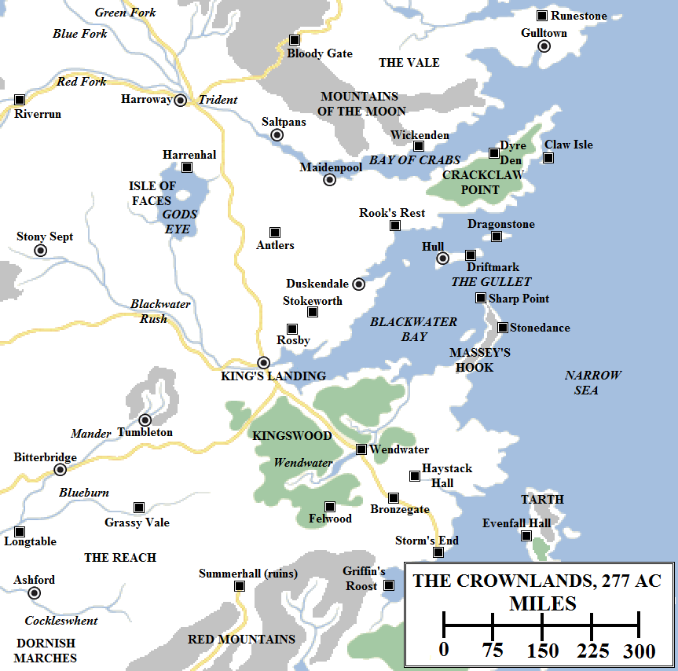
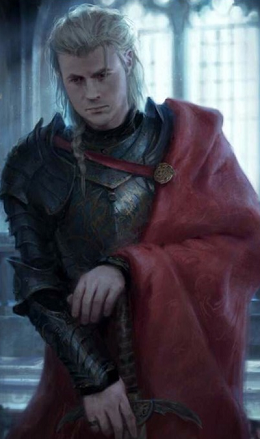
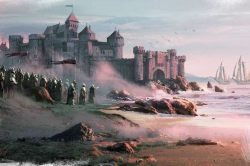
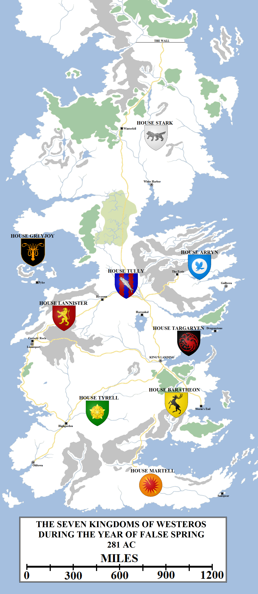

King Aerys II Targaryen started his reign in 262 AC with great promise. He dismissed his father’s aged counsellors and advisors and replaced them with younger, more dynamic men. Most notable of these was his appointment of Tywin Lannister as Hand of the King, but he also replaced the small council and many lesser offices of note. Even his Grand Maester was younger than the norm: after the deaths of several ancient Grand Maesters in succession (one before he even took up the post), the Citadel appointed the relatively young Pycelle to the role during the latter part of Aegon V’s reign.

The Crownlands – the area around King’s Landing directly administred by the crown – circa 277 AC. Flashpoints in Aerys II Targaryen’s reign came at the Defiance of Duskendale in 277 and the rebellion of the Kingswood Brotherhood in 280-281, whilst the death of the king’s cousin and boyhood friend Lord Steffon Baratheon in a shipwreck near Storm’s End in 278 made him fearful and paranoid.

Even the Kingsguard took on a younger, more dashing and heroic feel: the steady Gerold Hightower remained Lord Commander but it was now emboldened by the addition of Ser Barristan Selmy, the hero of the Stepstones. A few years later it was enhanced by the addition of Ser Arthur Dayne, the Sword of the Morning, wielder of the legendary blade Dawn and arguably the greatest swordsman in the history of the Seven Kingdoms.

Aerys II was full of grand schemes, and it was Tywin’s job to temper the more outlandish (such as building a new wall three hundred miles north of the existing one and claiming the lands inbetween) and the ruinously unaffordable (such as building a new capital city out of marble on the south bank of the Blackwater). Aerys even threatened war against Braavos when the Iron Bank tried to claim on money it had lent the Seven Kingdoms, but Tywin managed to smooth over the dispute and took on the debt himself.

Tywin was an impressive Hand, possessing  a mastery of fine detail and a keen intelligence. He was capable of being diplomatic and even generous, but also did not hesitate to swift and decisive action when needed. His reputation had been forged in the drowning of Castamere and few lords were willing to challenge him now he had the entire realm at his command. Under Tywin’s guidance, the crown restored the powers and privileges to the lords which had been removed by Aegon V, improved trade with the Free Cities to enrich the merchants and the ports and repaired numerous roads and highways to facilitate faster travel around the vast kingdom. Tywin was assisted closely by Grand Maester Pycelle, who admired the young man’s tenacity and worth ethic, and his brother Kevan, who was of similar mind but somewhat more chivalrous character and could act as a more diplomatic messenger.

Tywin was much-admired and arguably no more respected man ever wore the Hand’s sigil, but he was not loved. He was humourless, strict, lacked patience with fools and flatterers, and occasionally was even cruel. Only his wife Joanna could make him smile (and then rarely in public). His demeanour changed slightly when his twin children Cersei and Jaime were born in 266 and he became Lord of Casterly Rock upon his father’s death a year later, and he became more proud.

The relationship between King Aerys and his Hand was very strong for the first five years of his rule, but began to turn sour after that point. In 267-268 King Aerys decided to visit Tywin at home in Casterly Rock for an extended stay. It was well-known that Aerys had developed a fancy for Lady Joanna when she was a courtier to his wife, and this irked Tywin somewhat. Upon his return to King’s Landing, Aerys began to interfere more with Tywin’s areas of responsibility. He sided with Volantis in a dispute with Myr and Lys rather than taking a neutral position as Tywin advised, and increased port fees. When merchants complained, Aerys reduced them again and blamed the decision on Tywin.

By this time it was clear that King Aerys II had no real wisdom or talent for ruling, and the Seven Kingdoms prospered only due to Lord Tywin’s diligence. It was said, from Oldtown to the Wall, that “King Aerys reigns but Lord Tywin rules”. Aerys realised this and his slights and undermining of the Hand took on the tinge of jealousy. Maesters debate why Aerys didn’t simply dismiss Tywin outright, but it is possible that Aerys realised that there was simply no-one else fit for the post. Tywin himself found the situation unpalatable and attempted to resign the Handship in 272, after Aerys insulted his wife in public. Aerys refused to accept the resignation.

In 273 Lady Joanna died in childbirth, giving birth of a dwarfen and misshapen son, Tyrion. Aerys made mock of the incident, saying it was the gods’ punishment for Tywin’s arrogance. Tywin heard this news and became furious, ending whatever respect he had left for the king.

Prince Rhaegar Targaryen. Artwork by Karla Ortiz for _The World of Ice and Fire_.

The future of House Targaryen seemed secure, but not as secure as might be hoped. The Targaryen line had been reduced to just King Aerys, his sister-wife Rhaella and their son Rhaegar. Aerys and Rhaella’s other children had been stillborn or miscarried, to the point where Aerys suspected infidelity and confined Queen Rhaella to the Red Keep from 270 onwards. Their next-nearest relatives were the Baratheons, for Aerys’s aunt Rhaelle was the mother of Lord Steffon Baratheon, and the Martells, for the current Princess of Dorne was descended from Prince Maron Martell and Princess Daenerys Targaryen.

For his part, Prince Rhaegar had grown up quiet and bookish, more enamoured by music and reading than battle. However, he abruptly changed his mind and sought training in warfare, apparently because of something he read in a book. He was knighted in 275, at the age of sixteen, and by all accounts was a strong and gifted warrior. However, he was not the equal of Ser Arthur Dayne or Ser Barristan Selmy and by all accounts saw fighting and war as a burden to be shouldered, not something to be gloried or exalted in. Handsome and melancholy, he created many beautiful songs and was seen as a romantic figure. He had the love of the commons, the respect of warriors and was seen as a more sensible, level-headed man than his increasingly erratic father.

In 276 Queen Rhaella gave birth to a living son, Viserys. Aerys was pleased but also paranoid, believing that enemies were now plotting against him and his family and ordering that Viserys be kept close and under guard at all times. At a great tourney held to celebrate Viserys’s birth in Lannisport, Lord Tywin proposed that his daughter Cersei marry Prince Rhaegar. Aerys dismissed the idea contemptuously, to Tywin’s anger.

What happened next was unexpected. Lord Denys Darklyn was the ruler of Duskendale, a port town on Blackwater Bay barely sixty leagues from King’s Landing. In ancient times Duskendale had been the greatest city on the east coast of the continent, its lords ruling over a vast stretch of the Crownlands as the Dusk Kings. King’s Landing’s rise had utterly eclipsed Duskendale, reducing it to a backwater. Darklyn planned to change that by convincing King Aerys to give him a royal charter for the town. This would allow him to offer more competitive tariffs and docking fees and allow the town to compete with King’s Landing again.

Tywin saw no reason to grant the request, as the Darklyns were not great or important enough to risk offending, and turned it down flat. Aware that there was tension between King and Hand, Lord Denys halted all payments of taxes from the town to the crown and then sent an invitation for Aerys to visit the town personally to hear his petition. Lord Tywin advised Aerys not to attend in strong terms, which raised Aerys’s ire. He rejected Tywin’s advice and, in 277, set out with a bodyguard led by Ser Gwayne Gaunt of the Kingsguard. Before he left, King Aerys told Grand Maester Pycelle that he meant to resolve the situation himself, since Tywin had been unable to do so.

Arriving at Duskendale, King Aerys’s bodyguard was set upon. Ser Gwayne was killed by Ser Symon Hollard, Lord Denys’s master-of-arms, and the king was imprisoned in the Dun Fort of Duskendale. Lord Tywin gathered together a substantial army and invested the town, ordering the king to be released. He also put in place a naval blockade.

Lord Denys realised that he had overreached, but could not find a way of extricating himself from the mess without condemning himself to death for treason. Instead, he dithered whilst the townsfolk starved.

Lord Tywin said that he was unwilling to risk the king’s royal person in a frontal assault, so he allowed the siege to play out. But, after six months, it became clear that Denys was unwilling to surrender without guarantees for his life. Tywin was unwilling to countenance that (perhaps being fully aware that the king would never stand for it) and made a fateful decision. He could not let the matter – now widely called the Defiance of Duskendale – stand. He ordered Denys to surrender on pain of a full-scale assault. Several of the small council objected that Denys would kill the king and Tywin, in a rare public loss of patience, snapped and said it did not matter if he did, for they had a better king right there, in the form of Prince Rhaegar. This shocked all present.

Duskendale. Artwork by Michael Komarck for _The World of Ice and Fire_.

Seeking a solution that guaranteed the safety of the king, Ser Barristan Selmy volunteered to enter the Dun Fort by stealth and rescue the king single-handed. Tywin thought the idea was insane, but Ser Barristan was respected and his prowess was not doubted. Tywin eventually agreed.

Ser Barristan’s daring rescue of King Aerys became the subject of several songs. He infiltrated the town and then the keep, released the king, killed Ser Symon Hollard and rode pell-mell for the walls with the disoriented king in tow. The feat accomplished, Lord Denys had no choice but to surrender. He and his kin were beheaded, including the entire Darklyn family and also many of the Hollards, related to the Darklyns by marriage. Only the youngest Hollard son, Dontos, was spared after Barristan intervened and begged a boon from the king. Serala of Myr, Lord Darklyn’s wife who was blamed for “bewitching” her husband with her foreign wiles and convincing him to rebel, was burned alive.

King Aerys II Targaryen returned to the Red Keep and did not leave it for four years. His order was that no-one was to lay hands on him ever again and that the only blades allowed in his presence where those of the Iron Throne and the Kingsguard. He became paranoid, seeing treason everywhere. Some courtiers did not help the matter by repeating Lord Tywin’s words outside Duskendale to the king. Aerys became convinced that Tywin had conspired with Rhaegar to have him killed to Rhaegar could inherit the throne and marry Tywin’s daughter. He may even have come to believe that Tywin arranged the entire situation himself.

There were few people left that Aerys trusted. One of them was Lord Steffon Baratheon, a boyhood friend and fighting comrade of the War of the Ninepenny Kings. In 278 the king ordered Steffon to travel to the Free Cities to seek a worthy bride for Rhaegar, one Lord Tywin had no hand in selecting. Steffon was not sure where to start with this task, so enlisted the help of his wife Lady Cassana. They took ship for the Free Cities and considered the nobility of several cities, such as Volantis and especially Lys where those of Valyrian blood and descent could still be found. In Volantis Lord Steffon found a delightful, quick-witted fool named Patchface whom he decided to bring home, but no suitable bride could be found.

Steffon and Cassana’s ship, the _Windproud_, foundered in a storm on Shipbreaker Bay. The ship broke apart, killing both the lord and lady, along with the crew. The sole survivor was Patchface, who washed up on the rocks below Storm’s End and was nursed back to health by Maester Cressen. He mind and wits were gone.

Steffon’s son, Robert, became Lord of Storm’s End. King Aerys was horrified, believing that Tywin had somehow conspired to kill Steffon. Aerys believed that if he dismissed Tywin from the Handship, he would be killed as well. In desperation he decided to counter Tywin’s influence with someone who could sniff out plots and conspiracies. Aerys had heard that the Free City of Pentos had been put in order by a merchant lord, Magister Illyrio Mopatis, working alongside a spymaster of formidable reputation, a eunuch named Lord Varys. Aerys convinced Illyrio to send Varys to King’s Landing. Despite being a foreigner to Westeros, Varys was a fast learner and soon had agents – his “little birds” – installed across the Seven Kingdoms.

King Aerys also installed Wisdom Rossart, the head of the Guild of Alchemists, on the small council. Aerys had developed a peculiar fascination with fire, reasoning that if he had dragons then no-one would dare oppose him. After Lady Serala Darklyn’s death, the king had switched to burning his enemies alive rather than execution with the noose or sword. Rossart used wildfire to incinerate the king’s enemies, to the king’s delight. After seeing someone burn to death, the king would become animated and excited, energy he would often take out on his wife Rhaella. Their marriage had never been a happy one, but in those final years it became a nightmare.

Aerys’s reign had gone from erratic to almost tyrannical, with his Hand no longer able to keep him in check. From Castle Black to Saltshore, from the Lonely Light to Tarth, Aerys II Targaryen now had a new nickname: the Mad King.

The Seven Kingdoms in 281 AC, during the reign of Aerys II Targaryen, the Mad King, and on the eve of rebellion.

In 279 Prince Rhaegar was betrothed to Princess Elia Martell of Dorne. They married in 280 in a ceremony at the Great Sept of Baelor. Now all but estranged from his father, Prince Rhaegar chose to establish his household on Dragonstone rather than in the Red Keep. Later that year his daughter Rhaenys was born, but Aerys was unimpressed, saying the girl “smelled Dornish”.

By 281 a group of bandits had taken up residence in the Kingswood just to the south of King’s Landing. Naming themselves the Kingswood Brotherhood and led by Simon Toyne, they kidnapped several nobles and carried out acts of rebellion against the King’s Peace. Aerys sent the Kingsguard with a detachment of troops to put down the rebellion. During the campaign, fifteen-year-old Ser Jaime Lannister, the eldest son and heir of Lord Tywin, distinguished himself in battle. He saved the life of Lord Sumner Crakehall, to whom he was serving as a squire, and crossed swords with the Smiling Knight and lived to tell the tale. Impressed, Ser Arthur Dayne knighted him.

Ser Harlan Grandison of the Kingsguard passed away from advanced age and King Aerys had to choose a replacement. Shrewdly, and some say under advice, he chose Ser Jaime. Jaime could not refuse the honour, but it meant him giving up his claim to Casterly Rock and his place as Lord Tywin’s heir, making the dwarf Tyrion heir to Casterly Rock instead. Aerys appreciated the anger this would cause Tywin and was correct: Tywin resigned the Handship and returned home. Ser Jaime joined the Kingsguard believing he had been chosen for his skill with a sword and quickly realising it had been done solely to slight his father, bruising his pride.

Winter had fallen on the Seven Kingdoms in 279 and the realm had endured for two years. Early in 281 it appeared that the season had broken and spring had arrived. Lord Walter Whent of Harrenhal celebrated the occasion by organising a great tourney on the banks of Gods Eye. It raised the status of the occasion when Prince Rhaegar announced he would attend, and sent messages urging all of the good and the great of the realm to come as well to celebrate the gods’ bounty by ending the cruel winter. Prince Oberyn Martell, the famed Red Viper of Dorne and younger brother of both Prince Doran (who had recently inherited the seat at Sunspear), confirmed he would attend. So did the children of Lord Rickard Stark of Winterfell: Brandon, Eddard, Lyanna and Benjen. Lord Robert Baratheon of Storm’s End confirmed his attendance, and Lord Jon Arryn of the Eyrie. The Tyrells of Highgarden announced they would also attend. The only glaring absence was from Casterly Rock, for Lord Tywin refused to bestir himself, still nursing the grudges and insults done to him by the Mad King.

Momentous events were set in motion at Harrenhal, for this was the Year of False Spring and the Doom of the Targaryens was at hand.

**Credit**

The map above use heraldry designs (under [Creative Commons](https://creativecommons.org/licenses/by-sa/3.0/)) from the excellent [Wiki of Ice and Fire](http://awoiaf.westeros.org/index.php/Main_Page) and [La Garde de Nuit](http://www.lagardedenuit.com/wiki/index.php?title=Accueil), the ultimate English and French-language guides to the **Song of Ice and Fire** novels.
