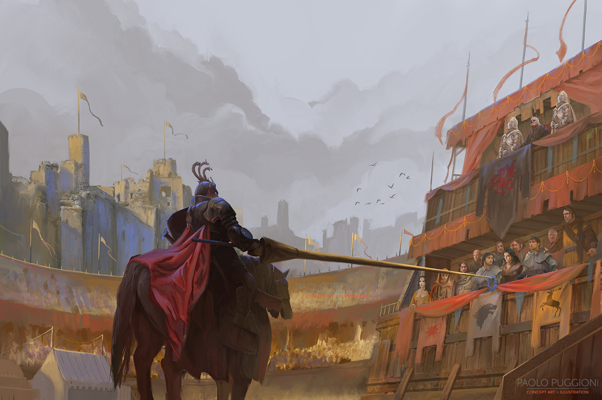
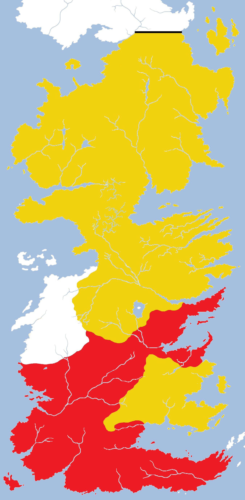
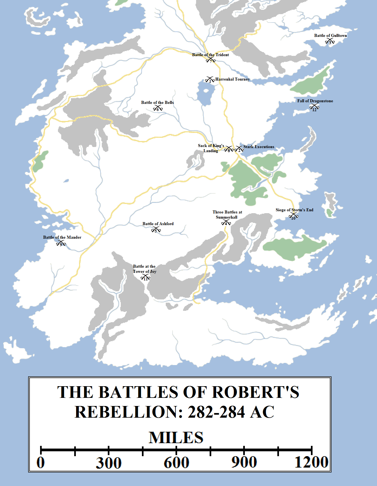
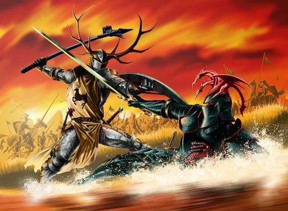
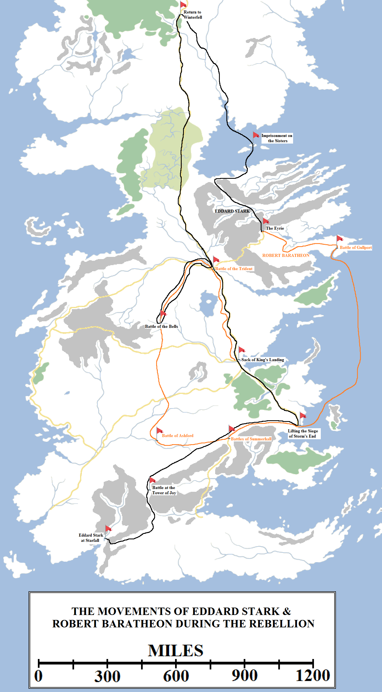

Much has been written of the war that ended the reign of the Mad King and the Targaryen dynasty. All of the accounts agree that events were set in motion at the great Harrenhal tourney, which took place very late in the Year of False Spring, 281 AC. The great and the good of the realm announced they would attend – Lord Tywin Lannister excepted – and it was to be a gathering of such magnificence that the Seven Kingdoms had not seen in years.

The Great Houses and their areas of control just prior to Robert’s Rebellion.

Some believe that Lord Walter Whent had arranged the tourney because he was desperate for alliances. He and his wife Shella, a cousin from another branch of the family, had four sons and a daughter and was keen to find marriage matches for them. However, the Whents, like most houses that had held Harrenhal (leading to the myth of the “Harrenhal Curse”), had not prospered and seemed scarce able to afford to host such a large gathering. The fact that Lord Walter’s brother, Ser Oswell Whent, a knight of the Kingsguard and close friend of Prince Rhaegar, had visited him shortly before the tourney was announced has led to much theorising and gossip.

Some believe that Prince Rhaegar, distressed by the madness that was clearly now starting to eat away at his father, arranged the tourney in secret so it could act as an informal Grand Council, where he could test the mood for removing his father on the grounds of insanity and take over as regent. If so, it was a bold move. Although few in the realm could deny Aerys’s state of mind, there were many who had played on his paranoia and fears to win themselves high office: Wisdom Rossart,  Lucerys Velaryon (master of ships), Symond Staunton (master of laws) and Lord Qarlton Chelsted (master of coin) were foremost amongst this faction. Varys, master of whisperers, also held the king’s favour. Prince Rhaegar’s support came from a new, younger coterie of lords and knights: Lord Jon Connington of Griffon’s Roost, Ser Myles Mooton of Maidenpool and Ser Richard Lonmouth were foremost among this group.

The Kingsguard were supposed to be neutral in such matters, as they were sworn to protect the king, but all seven knights seemed to think well of Prince Rhaegar, who considered Ser Arthur Dayne to be his greatest friend. Ser Oswell Whent and Prince Lewyn Martell, Princess Elia’s uncle, were also in Rhaegar’s confidence.

Grand Maester Pycelle’s personal loyalty had been to Lord Tywin, but with him gone he set himself the task of mediating between the factions, believing that the risk of war, or at least civil unrest, was becoming greater. He was aided in this task by Lord Owen Merryweather, the Hand of the King, a man of a relatively steady hand and diplomatic mind, but not the most dynamic of men. When the Harrenhal tourney was announced and its scale became clear, Chelsted and Staunton urged that the king prohibit it from taking place, suspicious of the reasons for it occurring. Merryweather argued against this, saying that the commons loved tournaments and banning it would add to the king’s unpopularity. To the bemusement of all, King Aerys suddenly announced that he would attend the event in his royal person. Given that he hadn’t left the Red Keep since the Defiance of Duskdendale four years earlier, this was a startling move.

The tourney proved to be a great occasion for meetings and reunions. Eddard Stark, the second son of Lord Rickard Stark of Winterfell, had been sent to foster at the Eyrie at the age of eight, in 271. The eldest son of Lord Steffon Baratheon, Robert, had also been sent to the Eyrie to foster. The two boys were as different as could be imagined, Eddard being serious and thoughtful, Robert boisterous and loud. But they found in one another a true friend. For seven years they were inseparable companions, the halls of the Eyrie and the Gates of the Moon ringing to their laughter, japes and adventures.

Under Lord Jon Arryn’s tutelage, both grew into fine men, both skilled at battle but Robert far more energetic and gifted at it. Jon also taught them both the art of governance, although Eddard was a better study at that, ironically for as a second son as it was not expected he would inherit lands or title.

In 278 Lord Steffon Baratheon was sent on a mission to the Free Cities. Robert decided to return to Storm’s End to greet his father on his return. Instead, he watched with horror from the castle as his father’s ship was smashed to pieces on the aptly-named rocks of Shipbreaker Bay. Robert Baratheon become Lord of Storm’s End at the age of sixteen.

The following year Eddard returned to Winterfell but, having come to love Lord Arryn as a second father, returned several times in the next two years to visit.

Robert was now one of the most powerful figures in the Seven Kingdoms and was as yet unwed. Lord Rickard Stark proposed that Robert marry his daughter Lyanna, Eddard’s younger sister, and unite their houses. Robert was delighted with the idea and a betrothal was set. Lyanna and Robert had met several times and Robert had fallen in love with her, admiring her headstrong spirit. Lyanna seemed to like Robert, but warned her brother that she knew he was not the sort of man to stay faithful. Still, she consented to the betrothal.

Several years earlier, in 276 AC, Lord Rickard had arranged for his eldest son and heir Brandon to be betrothed to the eldest daughter of Lord Hoster Tully of Riverrun, Catelyn. The betrothal upset Lord Hoster’s ward, Petyr Baelish. Hoster and Petyr’s father had fought together during the War of the Ninepenny Kings and Hoster had befriended the man. When he offered to take Petyr as a ward it was a tremendous honour, for House Baelish held a tiny spit of land on the Fingers and were the poorest of the nobility, barely a foot above merchants or simple landholders. Petyr grew up with Catelyn and came to love her, whilst in turn her sister Lysa had fallen in love with Petyr. However, these childish infatuations could not interfere in matters of state and politics. When Brandon came to visit Catelyn, Petyr challenged him to single combat. He lost, badly, but Brandon spared his life. Humiliated, Petyr returned to the Vale.

The Starks, Baratheons, Arryns and Tullys all travelled to the great tourney and there was much rejoicing and feasting. Robert and Eddard were reunited after some time apart and Eddard was smitten by Lady Ashara Dayne, one of Princess Elia’s handmaidens. There was excitement when a short mystery knight bearing the sigil of a smiling heart tree entered the lists and defeated three seasoned knights, demanding that they each teach discipline to their squires (who had committed some offence). The mystery “Knight of the Laughing Tree” then vanished. Irked and wondering if it was some plot against him, the Mad King ordered Prince Rhaegar to track down and identify him, but Rhaegar either failed or, if he did catch the knight, let him go.

Ser Jaime Lannister was given his gold cloak in front of the crowds, roaring with approval, and then abruptly dismissed by the king and ordered back to King’s Landing to protect the royal family. Jaime realised for the first time that maybe his honour was not such a great honour after all.

There was feasting and celebrations and much talk at the tourney, but the Mad King’s presence made it difficult for Prince Rhaegar to talk to anyone about a possible regency, if that had been his intent. Instead, he did his talking in the lists. Although certainly capable, Rhaegar was not regarded as the most outstanding warrior in the Seven Kingdoms, so it was a surprise when he defeated all comers, including Ser Barristan Selmy (who was beginning to advance in years but still utterly formidable). Rhaegar took the crown of love and beauty, a garland of blue roses, but rather than award them either to his wife or the presiding lord’s daughter (as custom dictated) he instead gave the crown to Lyanna Stark, a curious choice for he had – apparently – never met her before this day, although some had noted that Lyanna had found Rhaegar’s singing and musicianship beautiful in the preceding days.

Prince Rhaegar Targaryen names Lyanna Stark the Queen of Love and Beauty at the great Harrenhal tourney in the Year of False Spring. This seemingly innocuous courtesy set in motion a series of events that would lead to the downfall of the Targaryen dynasty. Artwork by Paolo Puggioni for _The World of Ice and Fire_.

Brandon and Eddard bristled at the insult to their sister, for Rhaegar was a married man and Lyanna was betrothed to Robert Baratheon, but the incident, curious as it was, was soon dismissed.

The false spring was already breaking and temperatures were plummeting. The lords and knights and their retinues broke camp and returned home. Some lingered longer than others. Brandon Stark was due to shortly wed Catelyn Tully at Riverrun, so some of the family remained at Harrenhal a while longer. Lord Rickard Stark was marching south with a retinue for the wedding, so Eddard took advantage of the delay to visit the Eyrie with Robert Baratheon. The year turned and winter hardened, with King Aerys reaching King’s Landing and commanding that huge wildfires be lit to stave off the worst of the cold.

Prince Rhaegar was not with him. He had returned by stealth to Harrenhal and chanced upon Lyanna Stark not thirty miles from the castle. According to some, he abducted her by force. According to others, she went willingly. But this was the falling pebble that started the avalanche.

Word of the abduction reached Harrenhal and ravens were sent bearing the news to Riverrun. Lord Hoster Tully counselled caution, but Brandon Stark flew into a rage at the news. He gathered a retinue of those close friends and allies present at the castle, including his squire Ethan Glover, Kyle Royce, Jeffory Mallister and Ser Elbert Arryn, and they rode for King’s Landing like the fires of the Seven Hells were at their heels. Lord Rickard received the word on the road and likewise rode south for King’s Landing, but some days behind his son.

Reaching the Red Keep, Brandon demanded that Rhaegar come forth to answer for his crime. But Rhaegar was not there. Instead, on King Aerys’s order, Brandon and his cohorts were arrested and thrown into the Red Keep’s infamous dungeons, the black cells. Lord Rickard, arriving shortly afterwards, demanded an explanation. King Aerys told him that his son stood accused of treason for threatening the prince’s safety. He refused to produce Lyanna or order his son to turn her over. Rickard offered trial by battle and Aerys agreed, but when Rickard came forth in his armour he found only a blaze waiting for him: the champion of House Targaryen, the Mad King said, was _fire_. Brandon Stark was brought into the chamber with a Tyroshi strangling contraption placed around his neck and forced to watch as his father was roasted to death. Brandon chocked himself trying to rescue his father. Brandon’s other compatriots were executed apart from Ethan Glover, who was spared because of his young age.

Word came to the Eyrie of these events, followed by a royal command from King Aerys demanding that Eddard and Robert be turned over to him. Lord Jon Arryn ignored and the letter and summoned his banners; Eddard and Robert sent ravens to Winterfell and Storm’s End ordering the same. Suddenly three of the Great Houses were in open rebellion against the Iron Throne.

They were shortly joined by a fourth. Eddard Stark offered to marry Catelyn Tully in his brother’s stead. House Mallister urged Lord Hoster to accept for the murder of their own son and others followed. Lord Hoster agreed and Riverrun summoned its banners as well.

The factions at the onset of Robert’s Rebellion in 282 AC: yellow represents those houses that swore fealty to Robert Baratheon, red those that remained loyal to Aerys II Targaryen. White areas were neutral or undeclared at the start of hostilities. The Iron Throne commanded a potential pool of around 160,000 troops whilst the rebels slightly more at around 170,000\*. However, the relative rapidity of the fighting and the dismal weather conditions (the war began in a renewed and savage winter) meant that neither side came close to raising its full military potential (particularly the North). The closest was at the Trident when the royal faction managed to raise around 40,000 troops and the rebels slighty less.

More than half of the realm was now in open rebellion and it fell to the Hand of the King to deal with the crisis. Lord Merryweather ordered the other houses to summon their banners and prepare to move against the rebels. House Tyrell complied quickly, beginning to gather a large army, but House Martell, insulted by Rhaegar’s actions, was slower to act. It was only when King Aerys sent a not-too-subtle message that Princess Elia, her daughter Rhaenys and her newborn son Aegon were under his protection that Sunspear began to move with greater speed.

The ironborn, as usual, took no part. But from Casterly Rock there was only an imposing silence. Lord Tywin Lannister was not minded to help his ungrateful and conniving king and hoarded both his counsel and his military might.

The weight of numbers was (slightly) against King Aerys, but he held an advantage that his foes were scattered. The armies of the North would be slow to gather in the renewed winter and House Baratheon’s forces were cut off in the Stormlands from their allies. The king also held an advantage in authority: he sent word to every castle in the Seven Kingdoms ordering them to maintain their allegiance to the Iron Throne, even in rebellion against their lords. Marq Grafton, the Lord of Gulltown, heeded the king’s command and fortified the city, refusing Lord Arryn’s command to surrender. Eddard Stark had to cross the Mountains of the Moon to the north coast of the Vale and sail across the Bite with a fisherman to get home to take command of his army, whilst Jon Arryn and Robert Baratheon had to batter down the gates of Gulltown and retake the city. That done, Jon moved his forces to the Bloody Gate whilst Robert sailed for Storm’s End.

In the Stormlands Lords Grandison, Cafferen and Fell rebelled against Robert and declared for the king. They decided to combine their forces at Summerhall before marching on Storm’s End, hoping to end the war before it could even really begin. However, Robert moved too fast and defeated them in three battles fought on the same day. Lord Fell was slain and his famous warrior son, Silveraxe was taken captive. Here Robert won a famous diplomatic victory, for he won back the allegiance of all three houses with his wit and charm.

Lord Eddard Stark had reached White Harbor. He marched to Winterfell to find that, despite the weather, his brother and master of arms had already assembled a large host. Taking command, he marched swiftly down the Kingsroad and was able to join with Jon Arryn’s armies near the Trident.

By now Lord Mace Tyrell had assembled the martial strength of the Reach and was marching east against Robert. Although he was massively outnumbered, Robert chose to give battle. Leaving his brother Stannis in command at Storm’s End, Robert marched west and intercepted the Tyrell army at Ashford. However, Robert suffered a significant defeat. Lord Randyll Tarly, whose reputation as the most formidable battlefield general in the Seven Kingdoms was already taking shape, drove Robert from the field with his vanguard before Mace’s main force even arrived. Robert retreated north, perhaps hoping to lure the Tyrell army away from Storm’s End and towards the Riverlands where Robert could reinforce.

However, the Tyrell tactical victory turned into a strategic mistake when Mace was ordered to press on to Storm’s End to lay siege. The Tyrell fleet, commanded by Paxter Redwyne of the Arbor, had by now sailed around Dorne and through the Stepstones. It blockaded Storm’s End by sea as the huge Tyrell host invested the castle. Stannis ordered the garrison to switch to emergency rations, since he knew the chances of relief were slim. His task now was to keep the Tyrell host pinned down and unable to send aid to King’s Landing.

Lyanna Stark’s kidnap outside Harrenhal (1) very early in 282 AC set the scene for the rebellion, although it didn’t formally begin until a few weeks later, when Rickard and Brandon Stark were executed by the Mad King (2). Jon Arryn called his banners but Lord Grafton refused, forcing Jon and Robert Baratheon to storm Gulltown (3). Robert sailed home, raised an army and defeated three royalist armies on the same day at Summerhall (4). He then marched west to confront the Tyrells but was defeated at the Battle of Ashford by Randyll Tarly (5). Whilst the Tyrells invested Storm’s End, Robert fled north and took refuge in Stoney Sept. Jon Connington’s army stormed the town in an attempt to kill him, but was defeated at the Battle of the Bells by a Tully-Arryn-Stark host led by Eddard Stark (6). The rebels regrouped north of the Trident and then defeated Prince Rhaegar Targaryen at the ruby ford (7). Tywin Lannister led a westerlands army to the gates of King’s Landing, professed loyalty to the Mad King, but then sacked the city (8). The ironborn joined the conflict late, attacking the Reach, but were then defeated at the Battle of the Mander by warships from the Shield Islands (9). Eddard Stark lifted the Siege of Storm’s End (10) before killing the last of the royalist Kingsguard at the Tower of Joy (11). Although the Rebellion was mainly fought between early 282 and early 283 AC, some maesters hold it not to have formally ended until Dragonstone surrendered to Paxter Redwyne and Stannis Baratheon in early 284, after the flight of Viserys and Daenerys Targaryen to Essos (12).

By now Lord Merryweather’s slowness to act had come to Aerys’s attention. Realising that he now faced the greatest threat to Targaryen rule since the Blackfyre Rebellions, Aerys realised he needed a younger and more dynamic man to command. Merryweather was stripped of his title and exiled. He was replaced by Lord Jon Connington of Griffin’s Roost.

Connington took a host from King’s Landing, planning to intercept and destroy Robert’s army before it could link up with the Starks, Arryns and Tullys. Robert’s forces had become strung out on the rapid march north and he was cut off near the upper Blackwater. He took refuge in the town of Stoney Sept. Connington’s army surrounded the town and threatened to sack it if Robert was not handed over, but the townsfolk – sworn to Riverrun – were not inclined to aid him. The matter became desperate when Lords Tully, Stark and Arryn brought their assembled might to bear against Connington. Badly outnumbered, he threw his men into the town in a desperate attempt to kill Robert. Connington failed, was severely injured and forced to flee. His army was destroyed in the Battle of the Bells, named for the bells the septons rang to warn the townsfolk to take cover. Shortly after the battle Eddard Stark and Catelyn Tully were married in a double ceremony, with Catelyn’s younger sister Lysa marrying the aged Lord Jon Arryn.

In the aftermath of the battle Connington was stripped of his title and sent into exile in the Free Cities. Lord Qarlton Chelsted was appointed Hand in his stead. Prince Rhaegar returned from the south and asked his father to beg Lord Tywin for aid, even as he gathered as many men as he could for one decisive battle. Aerys sent Queen Rhaella, who was pregnant, to Dragonstone but decided to keep Elia and her children close to ensure Rhaegar’s loyalty, and that of the Dornish. Ser Lewyn Martell arrived from Dorne at the head of ten thousand Dornish spears.

Events came to a head at the Battle of the Trident. The combined Arryn-Baratheon-Stark-Tully host had marched north of the river (possibly to meet reinforcements from the North and the Vale) and turned south, planning to follow the Kingsroad south to the capital. By this time the rebels had decided that Aerys and Rhaegar must be deposed and executed. After briefly considering installing a regency behind the young Prince Viserys, they instead decided that Robert should claim the Iron Throne himself as a great-grandson of King Aegon V.

Prince Rhaegar’s host met them at the main ford over the river, not far from Lord Harroway’s Town and the Inn at the Crossroads.

The result was the Battle of the Trident. The royal host numbered just over forty thousand, the rebels slightly less. Rhaegar’s troops were mostly fresh and unengaged, but Robert’s troops were bloodied and experienced. Prince Rhaegar’s men fought valiantly but were overmatched. Prince Lewyn suffered a mortal wound before he faced Ser Lyn Corbray, wielding his Valyrian steel blade Lady Forlorn. Corbray killed Lewyn and took the glory for it, although his foe was already severely wounded and the match was deemed unchivalrous. Of the other Kingsguard Ser Jonothor Darry was killed, not far from his birthplace, and Ser Barristan Selmy was badly wounded. Seeing him fall on the battlefield, Lord Robert commanded that Selmy be spared and taken to the maesters to be treated.

Finally, in the swirling waters of the ford itself, Robert came face to face with Rhaegar Targaryen. If they exchanged words, none heard of it in the clamour and din. What is known is that Rhaegar inflicted several wounds on Robert before Robert’s massive warhammer crushed his chest, spilling the rubies from his armour into the river. The crossing was later named the “ruby ford” in memory of the duel.

Robert Baratheon defeats Rhaegar Targaryen at the Battle of the Trident in 283 AC. Artwork by Mike S. Miller.

Seeing Rhaegar fall, the royal army broke and ran. The rebels quickly reformed and prepared to march after them, but Robert had been injured in the fighting. He gave command to Lord Eddard Stark whilst he followed more slowly. King’s Landing was vulnerable and defenceless, but still almost four hundred miles away. Reinforced by the army of House Frey, which had reached the battlefield only after the day was done (leading Lord Hoster to dub Old Walder as “the Late Lord Frey”, to his fury), the rebels force-marched on the capital.

In King’s Landing word of Rhaegar’s death and the defeat of his army triggered panic on the streets. King Aerys commanded that Wisdom Rossart place caches of wildfire at strategic points across the city. Lord Chelsted discovered Aerys’s plot to burn the city to deny it to the rebels and, aghast, resigned the Handship. He was burned alive as a traitor and Rossart named Hand.

In Pyke Lord Quellon Greyjoy was confronted by his sons: Balon, Euron and Victarion. Balon demanded that they be allowed to join the fray, now it was clear that the rebels would win. With House Lannister still undeclared, Quellon agreed to lead a large raid on the Reach, which still held for Aerys. However, in a furious naval engagement at the mouth of the Mander the ironborn longships were overcome by the warships of the Shield Isles. Lord Quellon was killed and the ironborn forced to withdraw. Balon Greyjoy was now Lord of the Iron Islands, but the manner in which he came into the title was lacking in glory.

The rebel army beared down on King’s Landing but was beaten to the prize. An army of twelve thousand westermen had reached King’s Landing, the Lannister and Targaryen banners fluttering at their head. Lord Tywin professed loyalty to the Iron Throne and demanded that his forces be allowed to reinforce the city’s defence. Lord Varys objected, suspecting a trap, but Grand Maester Pycelle convinced the king into opening the gates and allowing the Lannister forces to enter the city.

Once inside the gates, Lord Tywin commanded his troops to kill the defenders and sack the city savagely. Thousands died as the Lannisters bled the streets and elite forces led by the savage, huge Ser Gregor Clegane and Ser Amory Lorch assaulted the Red Keep.

Horror-struck, the Mad King gave his last command: “Burn them all”. Wisdom Rossart hurried to obey, but was instead cut down by Ser Jaime Lannister, who had no intention of seeing the city destroyed. Then, realising that Aerys could simply give the command to someone else, he cut down King Aerys at the foot of the Iron Throne. Moments later, Lannister loyalists burst into the throne room, preventing Jaime from disavowing knowledge of who did the deed.

At around the same time, Amory Lorch and Gregor Clegane broke into Maegor’s Holdfast with a band of loyal men. There, they brutally – too brutally – killed Princess Elia Martell and her children, Rhaenys and Aegon.

The rebel army found the city of King’s Landing screaming when they arrived. Lord Eddard commanded that order be restored. He accepted Lord Tywin’s oath of loyalty to Robert Baratheon, but he found the manner in which he had dealt with the Targaryen children and the Mad King to be distasteful. When Robert arrived a few days later, Eddard urged Robert to punish Tywin and Jaime as oathbreakers and traitors, but Robert rejected the idea since they had delivered the crown and the capital to him. Furious, Eddard left the city with a strong host and marched south to fight the last battles of the war.

Storm’s End had withstood siege for nigh on a year. The garrison had been reduced to eating rats and boiling shoe leather. The castle may have fallen, had not a smuggler named Davos broken the blockade with a single ship packed with onions, which allowed the castle to hold out just a few more weeks. Eddard Stark’s host arrived and he treated with Lord Mace Tyrell. Convinced that his cause was hopeless, Mace dipped his banners and swore fealty to King Robert Baratheon, the First of His Name. Storm’s End was relieved. In aftermath Stannis rewarded the smuggler Davos with title and lands, but also took several of his fingers as a punishment for smuggling.

That was not quite the end of the matter. Queen Rhaella had fled to Dragonstone with Prince Viserys and a bodyguard commanded by the formidable Ser Willem Darry. The Royal Fleet remained loyal to the dragon banner, so Stannis and Paxter Redwyne were commanded to raise a fleet large enough to take the island once and for all. Also, to the growing alarm of the rebels, the famed Kingsguard knights Ser Gerold Hightower, Ser Arthur Dayne and Ser Oswell Whent remained missing.

The movements of Eddard Stark (in black) and Robert Baratheon (in orange) during Robert’s Rebellion. Both started at the Eyrie, where they were staying with Lord Jon Arryn when the Mad King called for their heads after executing Eddard’s brother and father. Eddard had considerably greater ground to cover, but had the benefit of mostly moving unhindered through friendly territory. It’s also likely he set out for the North weeks before Jon and Robert attacked Gulltown, as Jon had to spend time assembling his army.

For his part, Lord Eddard rode on…but not in force. Instead he picked six loyal companions – Howland Reed, Lord Willam Dustin, Ethan Glover (freed from the black cells), Martyn Cassel, Theo Wull and Ser Mark Ryswell – and rode south and west, through the Dornish Marches. By close questioning of certain survivors at the Trident and in King’s Landing, Eddard had discovered the place where Rhaegar had secreted his sister, a nondescript tower located south of Nightsong in the Prince’s Pass, with the Red Mountains of Dorne in the background.

There Eddard found his sister under the guard of the three missing Kingsguard knights. They met in battle, seven against three, and the Kingsguard proved their valour and legendary prowess. Only Eddard Stark and Howland Reed survived the fight. Eddard found his sister dying in the tower, having been struck down with an illness. He was in time to hear her last words, but not do anything more to save her.

After the battle, Eddard tore down the tower so he could use the stones to create burial cairns. He also took his sister’s bones, so she might be laid to rest in the crypts of Winterfell with her forefathers. But before doing that, he visited Starfall so he might return Ser Arthur Dayne’s great sword, Dawn, to his sister Ashara. Ashara and Eddard had met at the Harrenhal tourney and, according to some, had had a tryst there. Not long after the end of the war, Ashara committed suicide for reasons that remain debatable.

When Eddard Stark finally returned from war to greet his new wife Catelyn he brought a surprise: a baby, Eddard’s bastard son, Jon Snow. Eddard refused to disclose where the baby had come from, but some spoke of Eddard’s relationship with Ashara Dayne, or her serving lady Wylla, or the daughter of the fisherman who carried him home from the Vale to the North. Catelyn was furious and upset, as her and Eddard’s own son Robb had not long been born, but accepted her husband’s order that Jon be raised with them at Winterfell.

In early 284, eight months after the Sack of King’s Landing, the greatest storm in the history of Westeros came rushing up the Narrow Sea. The royal fleet was smashed to kindling in the waters around Dragonstone. As the storm reached its peak, Queen Rhaella gave birth to a daughter, Daenerys Targaryen, and died in the process. With no choice, Ser Willem Darry and the last loyal retainers took Viserys and the stormborn princess and fled across the Narrow Sea into exile. Although the bulk of the fighting had taken place in a period of around a year, some maesters hold that the war did not end until 284, when Dragonstone surrendered to Stannis and Redwyne’s fleet, and Robert Baratheon was crowned on the Iron Throne.

The coronation was accompanied by a wedding, for Lord Tywin Lannister had finally gotten his wish: his daughter Cersei sat at Robert’s side and was named Queen of the Seven Kingdoms. The smallfolk cheered for the cessation of hostilities and the rise of a new dynasty, but in this victory so the seeds for a future war were sown.

\* For more on estimated military strength, [see here](https://atlasoficeandfireblog.wordpress.com/2016/03/06/the-population-of-the-seven-kingdoms/).

**Timeline of Robert’s Rebellion**

Few facets of **A Song of Ice and Fire** have been more vigorously debated over the years than the timeline of Robert’s Rebellion. This is because George R.R. Martin developed the broad strokes of the rebellion at first and then added more details later on (for example, it does not appear that the Battle of the Bells was developed before the writing of _A Storm of Swords_, or Eddard Stark’s brief stay on the Sisters until _A Dance with Dragons_). Some of these details do not dovetail perfectly with previously-established information.

Established facts about the Rebellion include:

*   The Harrenhal Tourney took place in the Year of False Spring, 281 AC.
*   The Rebellion itself began in 282 AC.
*   The Rebellion ended “about a year later”.
*   Aerys II Targaryen died in 283 AC.
*   Robb Stark and Jon Snow are born at or near the end of the Rebellion and are already 14 when the main storyline of _A Game of Thrones_ commences in 298 AC. Robb is 15 when _A Clash of Kings_ begins.
*   Daenerys Targaryen is born about eight months after Aerys’s death. Her newly-pregnant mother was evacuated to Dragonstone a week to two weeks before the Sack of King’s Landing. Daenerys is 13 when _A Game of Thrones_ starts and turns 14 during its length. However, Daenerys’s storyline in _A Game of Thrones_ is completely disconnected from everything else and it is possible-to-likely that it begins somewhat earlier, in late 297. There is precedent for this: based on the dates given elsewhere, the _Game of Thrones_ prologue definitely takes place in mid-to-late 297. Daenerys turning 14 in early 298 – or even late 297! – is therefore possible.
*   _Lands of Ice and Fire_ confirms the distances that Daenerys has to cover in the first three books are significantly larger than had previously been assumed, with the Red Waste being particularly huge. Given that it would take a good couple of months (maybe more) to cross the Waste, following by a long and dreary, multi-month stay in Qarth and then a long sea voyage to Slaver’s Bay, starting Daenerys’s story as early as possible becomes desirable to make these journeys and long stays plausible.
*   The appearance of the Red Comet in _A Game of Thrones_‘ closing chapters and the the opening ones of _Kings_ appears to closely tie events in the Red Waste and Winterfell together. However, the Red Waste is 2,000+ miles south of Winterfell, so it is possible for the comet to appear to Daenerys considerably earlier than to the rest of the characters, depending on the comet’s trajectory and orbit respective to the planet.
*   Previously it was assumed that many months or even more than a year passed between the Harrenhal Tourney and Lyanna’s abduction. However, _The World of Ice and Fire_ reduced this timespan significantly, stating that the tourney concludes in the closing weeks or even days of 281. It also indicates that Lyanna is abducted near Harrenhal having stayed there for some time after the tourney. The reason for this is unclear but potentially related to her brother Rickard’s impending marriage to Catelyn Tully. There is no real reason for her to remain at Harrenhal, however, compared to Riverrun or perhaps visiting the Eyrie with Eddard and Robert. The only possibility I can think of is that Harrenhal is much closer to the crossing over the Trident and Lyanna may be waiting for her father’s retinue to arrive from Winterfell (although the faster route from Winterfell to Riverrun is via the Twins, Rickard may have preferred to take a longer route precisely to meet up with Eddard and Lyanna along the way, or he rejected Walder Frey’s crossing fees as exorbitant).
*   Due to this information, Robert’s Rebellion appears to begin in the spring of 282, end in the spring of 283 and Daenerys is born very early in 284. Further information from Martin in future volumes may clarify things further.
