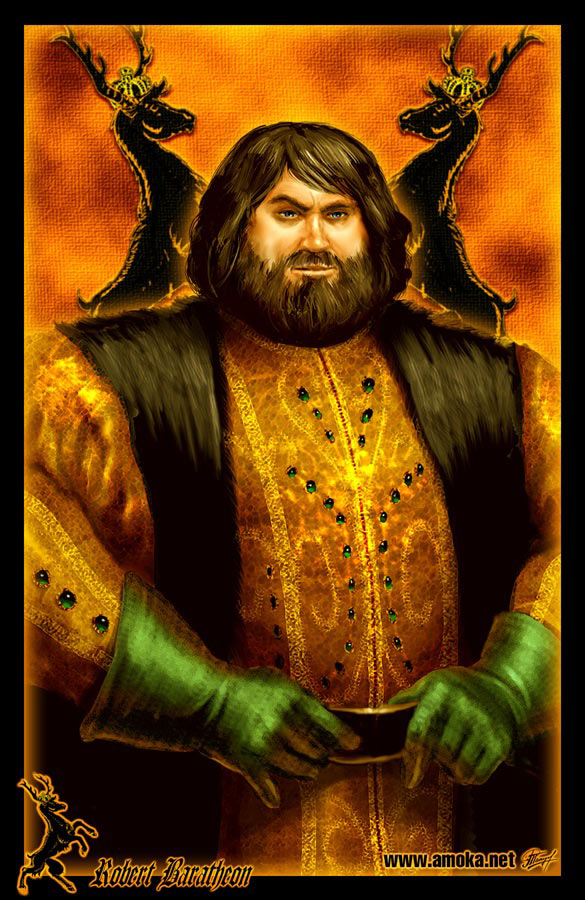
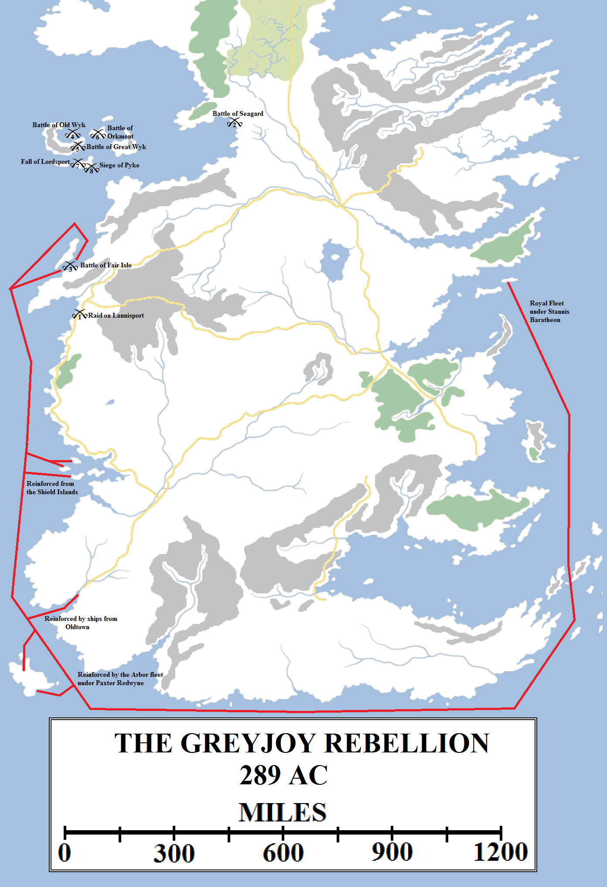
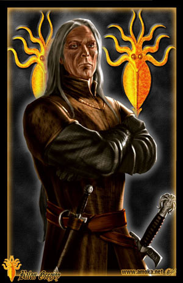
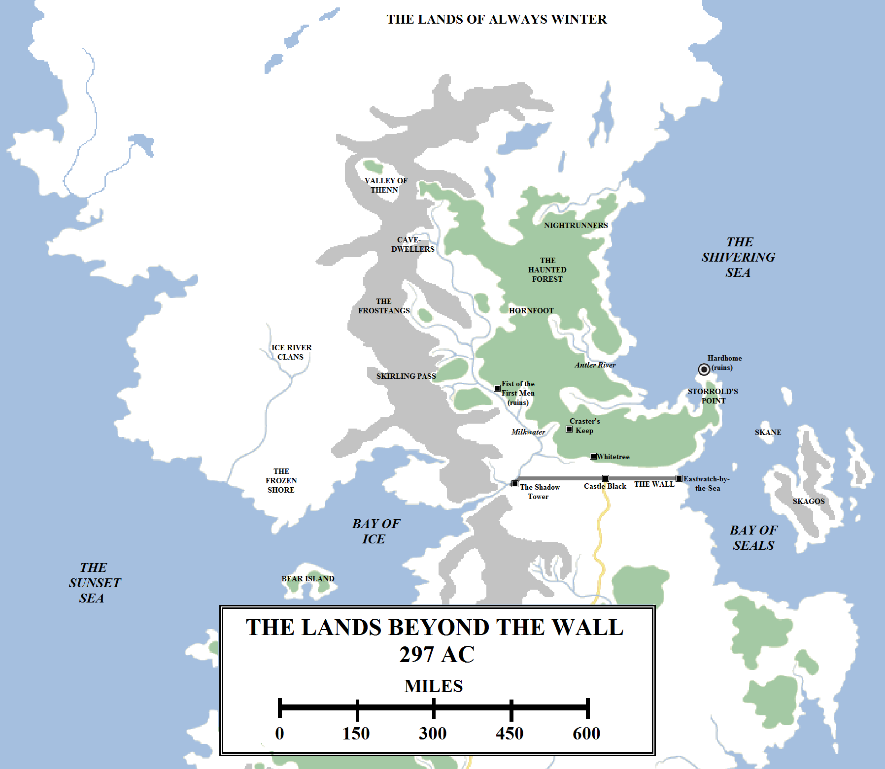

King Robert I Baratheon was crowned early in the year 284 AC. He married the Lady Cersei of House Lannister and the Seven Kingdoms rejoiced, hoping for a new age of peace and plenty following the depredations of the Mad King’s reign.

Robert I Baratheon (262-298, r. 283-298). Artwork by Amok.

Robert appointed his mentor and friend Jon Arryn as Hand of the King. Jon was a steady and reliable Hand, noted for his wisdom, diplomacy and judgement. When Prince Oberyn Martell, the feared Red Viper of Dorne, urged that his brother, the ruling Prince Doran, declare for Viserys and continue the fight, Jon Arryn visited Sunspear and made peace instead. Arryn also proved wise in his choice of counsellors and advisors. Noting the success of young Lord Petyr Baelish in collecting customs duties in Gulltown, Arryn brought him to King’s Landing and made him master of coin. Crown incomes under Baelish’s care soon tripled, which was useful because Robert Baratheon developed a fondness for great tourneys and feasts on an elaborate and expensive scale.

The war officially ended (according to some maesters) in 284 AC when Stannis Baratheon and Paxter Redwyne captured Dragonstone. It was a hollow victory, for Ser Willem Darry had already fled to the Free City of Braavos with the young Prince Viserys and the infant Princess Daenerys. The Sealord of Braavos gave them shelter and succour, but was careful not to offend the Seven Kingdoms, for important trading links lay between the Free Cities and Westeros. Also, although this was not revealed until some time later, Ser Willem signed a secret pact with Prince Doran Martell, who, despite his warm words to Jon Arryn, still hungered for revenge for the murder of his sister Elia. Doran pledged his daughter Arianne in marriage to Viserys, to take place at the right time. If Viserys could raise an army and land on the shores of Westeros, Dorne would declare for him. However, Viserys himself was never told of the agreement.

By the time Ser Willem died, in 289 AC, it was clear that the Seven Kingdoms was not going to rise for Viserys and his sister and they were put out of the house they had lived in. Viserys, now thirteen years old and claiming the title and name King Viserys III Targaryen, took his sister from Free City to Free City, asking for help and support. Although he was treated politely, none of the Free Cities listened to him. Viserys even petitioned the Golden Company, founded by mortal enemies of the Targaryens, for assistance but they would not accept his cause. Viserys’s increasingly desperate pleas for help soon earned him the mocking nickname, “The Beggar King”.

Back in Westeros, the realm prospered but there was already some disquiet. By becoming the King on the Iron Throne, Robert decided he should abdicate his position as Lord of Storm’s End and pass the title on to his brother. However, he decided that Stannis was needed to hold Dragonstone, so appointed him lord of that island and castle. Robert’s youngest brother Renly was made Lord of Storm’s End instead. For Stannis, who hated Dragonstone, this was a slight and one he could not forgive his brother for, even when Robert named him master of ships and commander of the Royal Fleet. Even worse was when, a couple of years after the Rebellion, Stannis was married to Lady Selyse of House Florent. During the wedding celebrations Robert deflowered Selyse’s cousin Delena in Stannis’s wedding bed (evidently Stannis and his wife were not present at the time) and got her with child. Stannis was outraged by the insult to his wife’s house. Robert recognised the child as his, Edric Storm, and sent him to Storm’s End to be raised. Stannis and his wife’s only child, Shireen, was born in 289.

The Greyjoy Rebellion saw Lord Balon Greyjoy of Pyke declare himself king and rebel against the Iron Throne. An early victory at Lannisport was undone with a defeat at Seagard, a major naval engagement lost off Fair Isle and the invasion of the Iron Islands by King Robert’s armies. Balon Greyjoy was forced to resubmit to the Iron Throne. The Iron Islands could muster only a maximum of 100 heavy warships in the Iron Fleet (although an estimated 500+ longships of limited utility against galleys), whilst the Royal Fleet alone consisted of over 210 warships of note. The Redwyne Fleet added 200 warships and the coast lords, Shield Islands and lords of the Mander could add several dozen to this number. Stannis and Paxter Redwyne are unlikely to have used every ship in both their fleets and a squadron was likely left at Dragonstone to defend the capital, but certainly the ironborn were significantly outnumbered.

Sitting in Pyke, in the Iron Islands, Lord Balon Greyjoy assessed the situation. King Robert had come to this throne through rebellion and war. He had overthrown the rightful king, and many in the realm still called him a traitor and upstart, if only in private. “Robert’s Rebellion” was also called “The War of the Usurper” in some quarters. Greyjoy also began to wonder how many of the houses would really rally to support Robert. In addition, the Targaryens had won the Seven Kingdoms with their dragons and maintained them after the loss of the dragons with political alliances and maintaining historical inertia. With that gone, there was no guarantee things would continue. Balon was also aware that he had come to power through the death of his father in a failed attack on the Reach during the Rebellion. He came to believe that he need to strengthen his rule through strength and bold action and military success.

Accordingly, in the year 289 AC Balon Greyjoy rebelled against the Iron Throne. He declared himself Balon IX Greyjoy, King of the Iron Islands. In the five years since the Rebellion he had secretly ordered the construction of a new fleet of warships. Unlike the longships of the ironborn, which were excellent fast raiders but unsuited for combat with galleys and war dromonds (as they had learned at the Battle of the Mander), these new ships included galleons and multi-mastered warships which could match the Royal Fleet or the fleet of the Arbor. The Iron Fleet was formidable in battle and a tremendous force-equaliser.

The declaration was not taken well in King’s Landing and King Robert roused himself for war. He ordered his bannermen to march and his warships to sail, but Balon Greyjoy took the initiative. He sent the Iron Fleet under his brother Victarion’s command to attack Lannisport. Victarion destroyed the Lannister fleet at anchor and burned part of the harbour.

Balon also sent his eldest son, Rodrik, with a raiding force to attack Seagard, the primary port of the Riverlands on the west coast. Although Rodrik’s raiders inflicted some damage, the town was warned in time and Lord Jason Mallister was able to rally a defence. Mallister slew Rodrik in battle and threw the ironborn back into the sea. Despite this setback the Greyjoys continued their raids, attacking all along the coast of the Westerlands and Reach.

By now the Royal Fleet had sailed south, through the Stepstones and around the coast of Dorne to the Arbor. There Lord Stannis joined his strength to that of Lord Paxter Redwyne and sailed north along the coast of the Reach. More ships joined the armada, sailing out of Oldtown and the Shield Islands. This gave Stannis tremendous numerical superiority. He ordered part of the fleet to sail west, striking around the coast of Fair Isle, whilst he approached the straits between the island and the mainland.

As he had hoped, Victarion had spotted the incoming Royal Fleet and decided to attack directly. Stannis avoided giving battle for as long as possible, so the Iron Fleet was firmly within the Straits, before joining the engagement. Stannis’s flagship, the _Fury_, smashed the _Golden Storm_ under the command of Aeron Greyjoy (Balon’s youngest brother). Aeron was fished out of the sea and later imprisoned under Casterly Rock until the end of the war. The ironborn fought ferociously, but the rest of Stannis’s fleet had circumnavigated Fair Isle and now took the Greyjoy fleet from the north, crushing it between the two forces. Some of the Greyjoy ships managed to escape, but the much-feared Iron Fleet was effectively destroyed in the engagement.

By now Robert had taken the field with significant strength of arms. Eddard Stark had ridden south with a sizable army and the Westerlands and Riverlands contributed substantial numbers of men. Stannis’s fleet ferried them across to the Iron Islands.

Balon IX Greyjoy (c. 258-299, r. 282 & 299 AC). Artwork by Amok.

Ser Barristan Selmy, now Lord Commander of the Kingsguard, led the attack on Old Wyk, whilst Stannis mounted a naval assault on Great Wyk. Orkmont was also attacked, and Harlaw as well. Finally, once the other ironborn forces and fleets had been neutralised, Robert’s army landed on Pyke. The castle of House Botley was destroyed along with the town of Lordsport early in the action, before Pyke was invested. Siege engines collapsed the main watchtower and part of the wall, killing Maron Greyjoy (Balon’s second son) who was rallying the defence.  The mad warrior-priest Thoros of Myr flung himself through the breach first with his flaming sword (coated in wildfire) and Jorah Mormont of Bear Island right behind him. Others, such as Jacelyn Bywater, also distinguished themselves in the fighting. The ironborn, badly outnumbered, were defeated with many great warriors and lords (such as Lord Blacktyde) killed.

Balon Greyjoy was overpowered and brought before King Robert in chains. Some urged him to execute the rebel or send him to the Wall, but Robert felt magnanimous (possibly because the rebellion had spiced up what was becoming a dull reign for him) and allowed Balon to knee and re-swear fealty in return for forgiveness. Robert took hostages from several of the ironborn families, with the young Lord Baelor Blacktyde sent to Oldtown. Most notably, Balon’s only surviving son Theon was given to Lord Eddard Stark to raise as a ward and hostage for his father’s good behaviour.

Rewards were given to those who distinguished themselves in the fighting: Jacelyn Bywater was knighted and, despite the loss of a hand, was given a place of command in the King’s Landing City Watch. Jorah Mormont was also knighted. In the great tourney at Lannisport to celebrate the victory, he met and successfully wooed Lynesse Hightower. Lord Leyton, surprisingly, consented to the match and Jorah and Lynesse were soon married. However, the marriage turned sour when Lynesse came to hate the poor, remote and wild Bear Island. Jorah’s attempts to keep her in the standards she was used to in Oldtown saw him driven into debt and he ended up dabbling in the slave trade. Word of this reached Eddard Stark, who stripped Jorah of his title. Jorah and Lynesse had already fled to the Free Cities, where Lynesse left him to become a noble’s consort in Lys. Jorah became a sellsword, wandering the Free Cities and other parts of Essos.

In the aftermath of the rebellion Balon ordered Lordsport, Pyke and the Iron Fleet to be rebuilt. He also began treating his daughter Asha as his effective heir, perhaps having already written off Theon so he could not be used against him in a future rebellion. When Balon’s brothers Euron and Victarion quarrelled, he exiled Euron. Soon Euron’s black-sailed ship, the _Silence_, became the terror of the seas from the Arbor to Asshai as he raided mercilessly and without conscience.

The lands north of the Seven Kingdoms. By 297 AC many of the wildling tribes and clans had been united by Mance Rayder, the King-beyond-the-Wall (the location of some of the tribes is speculative).

A much more minor event happened after this time, although it had long-lasting consequences. Mance Rayder, a sworn brother of the Night’s Watch based at the Shadow Tower, was angered by the unyielding attitude of his order and its hostility towards the wildlings, whom Mance had come to regard as honourable and freedom-loving. Mance turned his cloak and went over to the wildlings. Gifted in music and oratory as well as a formidable warrior, Mance soon won the respect of several wildling tribes and was proclaimed their chief. Word soon came of a spreading terror from the north, a tide of cold and ice. The nature of this threat grew more serious and Mance determined to unite the wildlings against it. Over a decade or more he united dozens of tribes, from the northern valleys of Thenn to the Wall and from the Frozen Shore to the Bay of Seals. Late in the 290s he was proclaimed King-beyond-the-Wall and made no secret of his intention to take his people into the Seven Kingdoms. The Night’s Watch, under the command of Lord Commander Jeor Mormont, grew concerned and sent word to Eddard Stark, who began to wonder if he would need to summon a host and lead it north of the Wall to deal with the threat.

In King’s Landing the king and his beautiful queen had had three children: Joffrey (b. 286), Myrcella (b. 290) and Tommen (b. 291). However, their marriage was not a happy one. Robert was boisterous and fun-loving, but found his wife was cold and harsh towards him, and intolerant of his dalliances and his pining for the slain Lyanna Stark. Robert lived for excitement, fighting and celebrations and found the minutiae of day-to-day rule tedious in the extreme, which he took out in slighting and baiting his wife and her twin brother Jaime, a member of his own Kingsguard. He spent money unwisely, trusting to Jon Arryn and Petyr “Littlefinger” Baelish to find more. Robert raised his youngest brother Renly to the position of master of laws and more than a few noted that Renly, although charismatic and brave like his brother, was also wiser and more level-headed. Renly also took care to cultivate friendships with other factions and houses, most notably the Tyrells of Highgarden and his own storm lord vassals. Stannis was regarded by all as dour, lacking in charisma and dangerously inflexible in his judgements.

Still, as the year 297 progressed war and disquiet seemed far away. Westeros basked in the heat of a long summer, the Hand of the King ruled wisely and well even if the king could be rash and intemperate, and the Seven Kingdoms prospered. The first tidings of the dark times to come were minor and innocuous: a Night’s Watch raiding party led by Ser Waymar Royce disappearing beyond the Wall; Lord Jon Arryn visting Stannis Baratheon with a book and certain questions over the lineages of the houses Lannister and Baratheon.

But, most forebodingly of all, in the Free City of Pentos, beyond the Narrow Sea, Daenerys Targaryen was married to Khal Drogo of the Dothraki, a warlord with an army of forty thousand skilled riders. Illyrio Mopatis, a Magister of the Free City, had arranged the match between Drogo and Viserys, with Drogo agreeing to mount an invasion of the Seven Kingdoms and give Viserys his crown in return for his sister’s hand in marriage. The Beggar King now had an army, more battle-hardened and experienced than any in Westeros.

To meet this threat, the Seven Kingdoms would need wise and strong leadership. But it was not to have it, for Lord Jon Arryn took ill suddenly and died unexpectedly. After a period of grieving, King Robert took to the Kingsroad for Winterfell, and the beginning of the end.
