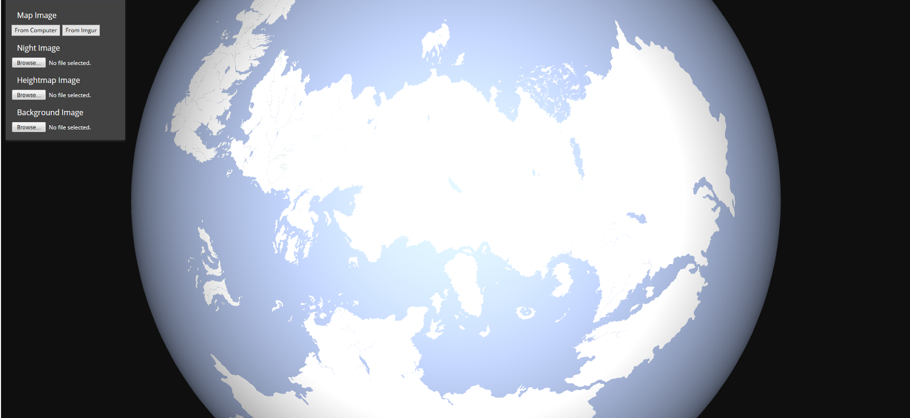
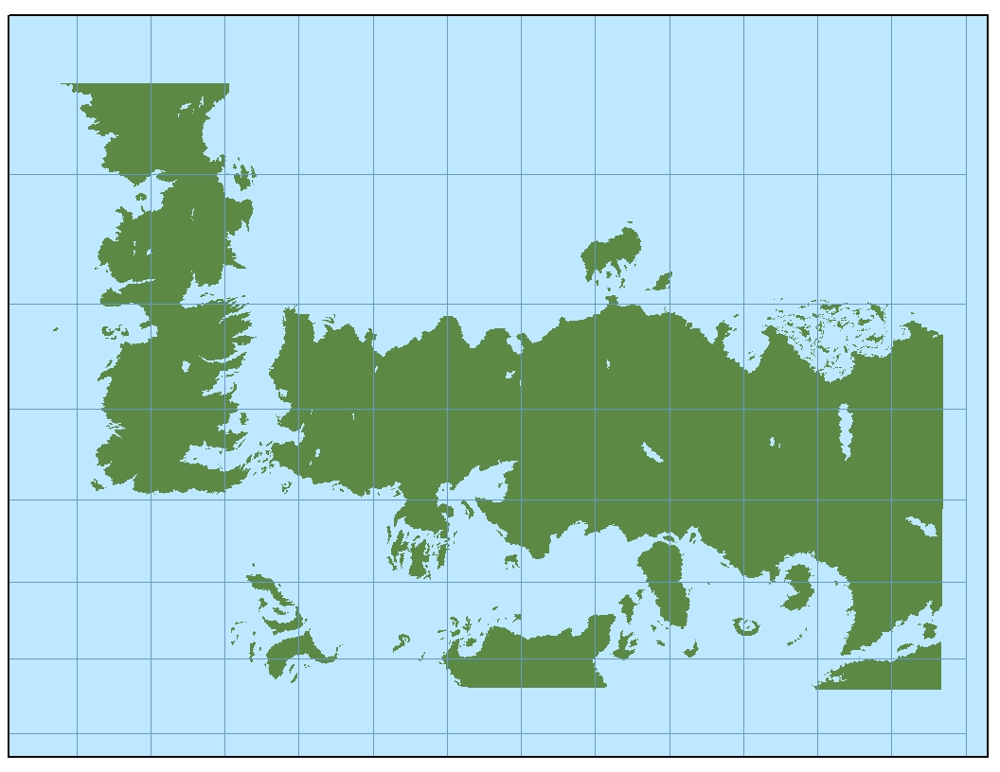
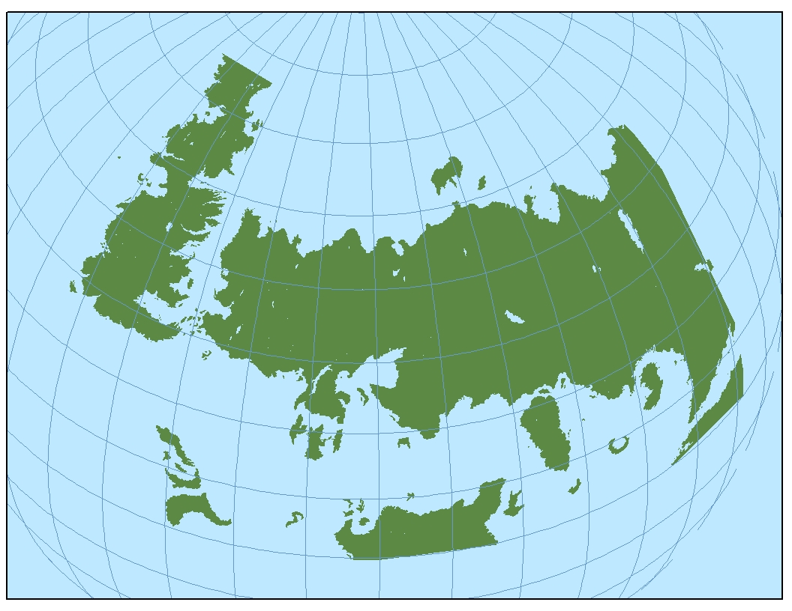
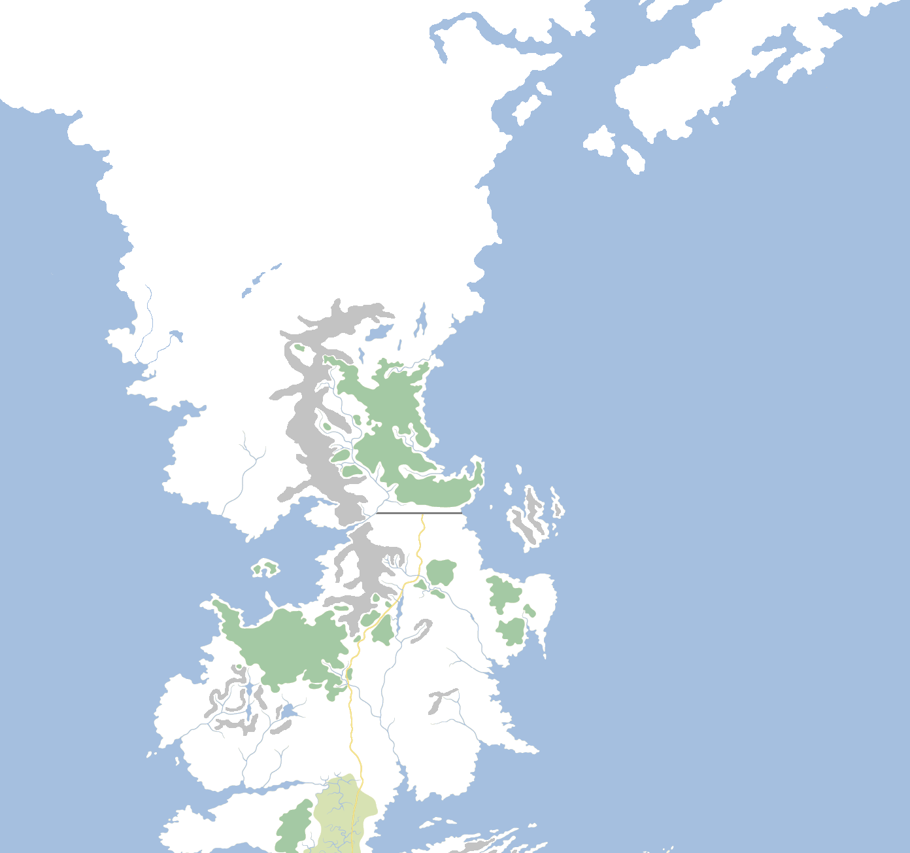
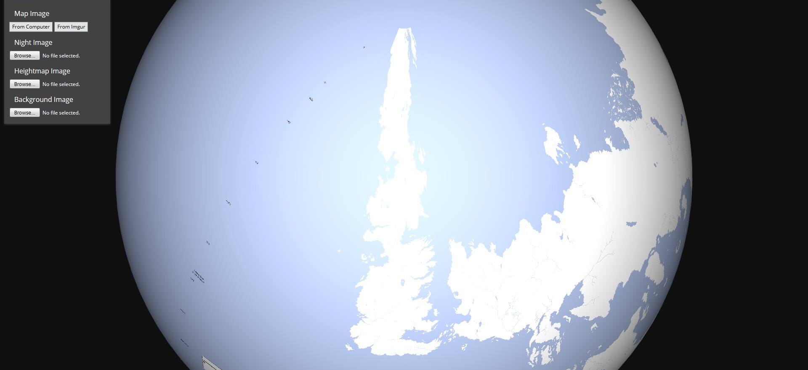

One of the biggest difficulties in drawing maps on a flat, 2D piece of paper (or screen) is that they do not accurately reflect what the landmass would look like on an actual spherical planet. For town or even country maps, the differences are often negligible, but for continent or world maps, accuracy tends to diminish. Either scale or area or shape ends up being distorted.

Westeros, Essos, Sothoryos and Ulthos [when placed on a globe](http://maptoglobe.bitbucket.org/?map=4IEZOGi) and viewed from a point roughly above the northern tropic (the equator passes just south of Naath and through the southern Summer Islands and northern Sothoryos, on this model). From this view, it actually works quite well. Note that the depictions of the far east of Sothoryos and Ulthos and the south coast of the Jade Sea are all speculative and non-canonical.

This is the old problem of projection, with world maps of the Earth tending to show the continents all squashed up the further north they go (which distorts shape and area) or the upper parts of the map are at a much bigger scale than the rest, such as those maps which show Greenland being almost the size of Africa rather than (as in reality) 1/14th the size.

This is also true for fantasy maps. As discussed before, in creating the maps of Westeros and Essos for **A Song of Ice and Fire**, George R.R. Martin has not really taken projection into account at all. On his maps of Westeros, the Wall is 300 miles long but the distance between Deepwood Motte and Winterfell (hundreds of miles to the south) is also said to be 300 miles long and the south coast of Westeros – 3,000 miles south of the Wall! – is said to be 1,200 miles long. These are all in perfect scale to one another, which is not really possible when you look at the maps as a representation of what the planet actually looks like.

The answer to that problem is that the maps of Westeros are essentially stitched together from lots of local maps extending across the entire continent. So the maps are all accurate for scale and shape on a local level, but not from an overall continental or world view. To illustrate this, consider the following view from the [Ibbenese Cartographer](http://ibbenesecartographer.blogspot.co.uk/2013/05/the-true-size-of-north.html) site:

The top map is the Known World map from _The Lands of Ice and Fire_ with lines of longitude and latitude placed of it. Using this grid, the map is then bent into a sphere. It’s a nice idea but it doesn’t work because it actually shrinks the size of the North quite drastically, reducing it to not much more than the size of the Reach.

From some points of view this may be desirable, because the North is almost unfathomably huge. However, remember that the people of Westeros don’t have GPS, satellites or aerial mapping, so they’d be going by the local, absolute maps and the size of the landmass. Robert Baratheon’s quote that the North is “as big as the other six kingdoms put together” is already somewhat inaccurate (the North is actually a bit more than one-third the total size of the Seven Kingdoms), so shrinking the North even further seems implausible. Also, the use of the Wall as  scale bar confirms that distances remain constant on the maps of Westeros regardless of if you’re in the North, the Riverlands or Dorne.

The North of Westeros and the lands Beyond the Wall, taken from the most detailed world maps so far (from _Lands of Ice and Fire_ and the Westeros/Essos map from _World of Ice and Fire_).

Using the [Map to Globe website](http://maptoglobe.bitbucket.org/?map=4IEZOGi), the same thing happens when I place the Known World map (with worked-out lines of latitude but no longitude) on it. Because this incorporates the much more detailed information from _The World of Ice and Fire_, which [as previously discussed](https://atlasoficeandfireblog.wordpress.com/2016/02/28/the-size-and-extent-of-westeros/) probably takes the far north of Westeros to within 200 miles of the North Pole, the distortion becomes extreme.

The North of Westeros and the lands beyond the Wall become tremendously distorted when the flat map is applied to a sphere. This depiction is erroneous, but no map corrected for the distortion has yet been created.

The actual world probably looks like the flat 2D map, but on the 3D globe. The only way to make that work is that the North actually covers more lines of longitude than the South does, so on a traditional 2D projection the North will actually extend further east and west than it has ever been depicted before, with Skagos located north of Braavos. At some point I’ll try to adjust the maps to make that work but that’s going to be a complicated job.

In the meantime, you can check out more “globified” fantasy maps for series like **Wheel of Time**, **Dragonlance**, **Malazan Book of the Fallen**, **The Belgariad**, **Conan the Barbarian** and **Avatar: The Last Airbender** over on my other blog, [The Wertzone](http://thewertzone.blogspot.co.uk/2016/12/visit-westeros-malazan-world-and.html).
