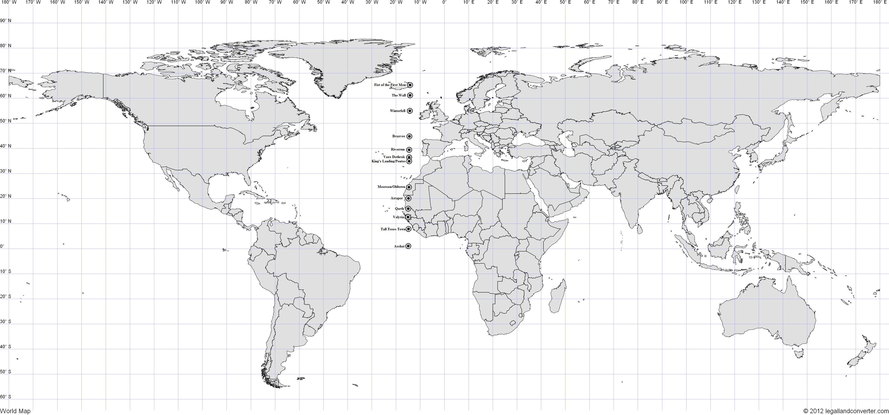
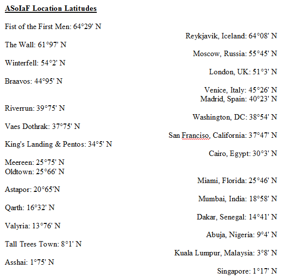

Due to work [done earlier on the blog](https://atlasoficeandfireblog.wordpress.com/2016/02/28/so-how-big-is-the-world-anyway/), we now have a working model for the size of the **Song of Ice and Fire** planet and the approximate positions of the major locations on that world. This means we can work out lines of latitude for many of the major locations that appear in the story and on the accompanying maps, and compare them to real-world locations.

Click for a larger version.

The Fist of the First Men lies at approximately 64°29′ N. For comparison, the world’s northernmost capital city, Reykjavik in Iceland, lies at 64°08′ N. The Wall lies along latitude 61°97′ N, which would place it in northern Canada or southern Norway.

Winterfell lies at 54°2′ N, which puts it south of Moscow (at 55°45′ N) and north of London (51°3′ N). Happily, given the much-discussed parallels between House Stark and the House of York during the Wars of the Roses, Winterfell is very close to York’s latitude (at 53°57′ N).

Similarly, Braavos (44°95′ N) is very close to the latitude of its most obvious inspiration, Venice (at 45°26′ N). More surprising, perhaps, is that Riverrun (39°75′ N) lies south of Madrid (at 40°23′ N) but north of Washington, DC (38°54′ N). King’s Landing and Pentos both lie on 34°5′ N, which is south of the latitude of San Francisco (37°47′ N) but north of Cairo, Egypt (on 30°3′ N).

Latitude coordinates of major locations in **A Song of Ice and Fire**, compared to real-world locations.

Moving into Slaver’s Bay, Meereen lies at 25°75′ N and Astapor at 20°65′ N. For reference, Miami, Florida is at 25°46’N and Mumbai, India at 18°58’N. Oldtown and much of Dorne lies at latitude 25°66’N, comparable to the Sahara Desert or northern Mexico.

At the southern-most edge of the world lies Asshai, at 1°75′ N, just above the equator. The most comparable major city in our world would be Singapore, which lies even closer at 1°17’N. Since the map of the known world ends pretty much at the equator, there are no major locations on the **ASoIaF** world to put in the southern hemisphere. The only known locations in the **ASoIaF** world in the southern hemisphere are the city of Ebonhead at the southern tip of the Summer Islands and the hostile area of jungle in Sothoryos known as the Green Hell.

All of these locations are speculative and approximate, of course, but may help when visualising the respective locations of places. The actual climate of the locations varies widely depending on local conditions, much as it does in the real world.
