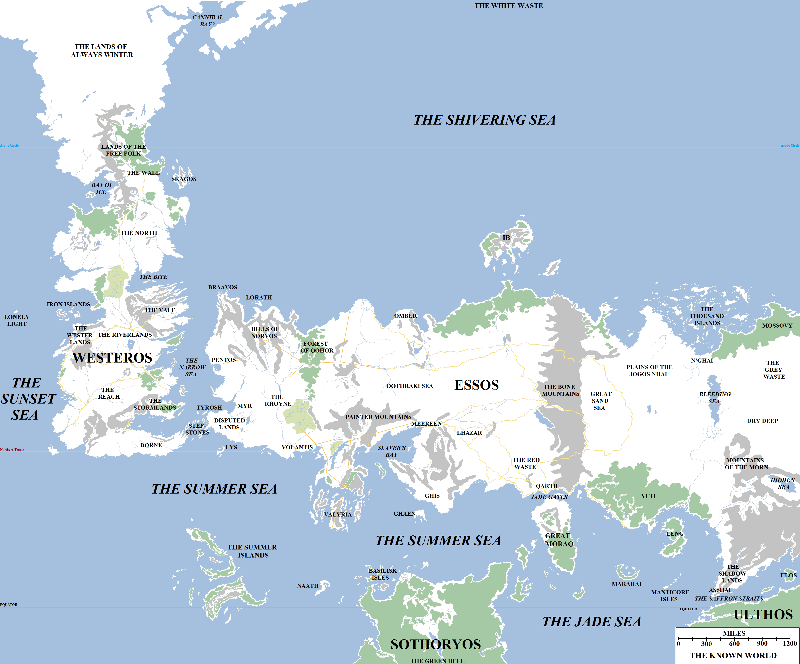
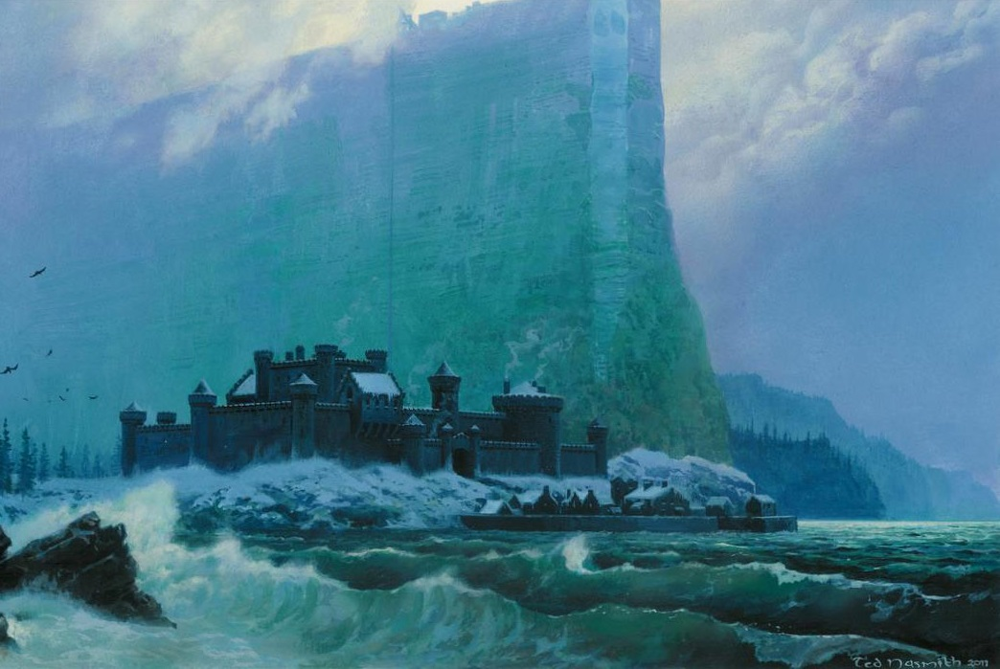

The known world is vast, extending for just over 8,500 miles from the Sunset Sea west of the Lonely Light to the island of Ulos in the Saffron Straits beyond Asshai, and for almost 7,000 miles from the White Waste beyond the Shivering Sea to the Green Hell of Sothoryos. However, this colossal region makes up only a small part of the world. [According to those of learning](https://atlasoficeandfireblog.wordpress.com/2016/02/28/so-how-big-is-the-world-anyway/), the world is a sphere just under 27,000 miles in circumference, meaning that all the lands we know account for just over a quarter of the world’s total surface. Far more lands, maybe even continents larger than Westeros, may lie across the Sunset Sea or beyond Asshai.

The known world, consisting of the continents of Westeros, Essos, Sothoryos and Ulthos.

Four continents are known to us: **Westeros**, at the western end of the known world, the home of the Seven Kingdoms and the lands beyond the Wall; **Essos**, the vast continent of the east, the largest of the landmasses known to us, home to the Free Cities, the ruins of Valyria, the Dothraki Sea and the distant lands of Yi Ti and Asshai; **Sothoryos** beyond the Summer Sea, a land of thick jungles, burning deserts and virulent plagues; and **Ulthos**, a mysterious island-continent located south of Asshai and the Shadow Lands, on the far side of the Jade Sea. Some maesters also argue for the existence of a polar continent located at the very top of the world, but they are also divided on whether this continent is a continuation of Westeros or a different landmass only linked by permanently frozen ice.

Several great seas and oceans have been identified. The largest is the **Sunset** **Sea**, a vast ocean lying to the west of both Westeros and the Summer Islands. No-one has ever successfully crossed the Sunset Sea, or at least has returned afterwards. The ironborn Farwynds of the Lonely Light report that islands can be found far out in the Sunset Sea, but so far as to make colonisation or conquest impractical. More recent reports that the Farwynds have discovered a more substantial island or continent remain unconfirmed.

The **Summer** **Sea** runs from the south coast of Westeros all the way along the south coast of Essos to the island of Great Moraq, dividing Essos from the continent of Sothoryos. The Summer Sea also separates the Summer Islands from Westeros, Essos and Sothoryos. To the east, beyond the Jade Gates (also called the Straits of Qarth) and Great Moraq, lies the Jade Sea. The **Jade** **Sea** is roughly circular and borders Essos to the south, Ulthos to the north-west and Sothoryos to the east and north-east. Several great nations and cities lie on its shores, such as Yi Ti and Asshai, and it is home to many islands of note, such as the Manticore Isles and Leng. The Saffron Straits link the Jade Sea to seas as yet unknown to the east, but no Westerosi traveller has ever sailed beyond the island of Ulos and returned. The Jade Sea is a hub of trade, and a Westerosi merchant who completes the trader’s circle around the Jade Sea and returns home (a fearsome journey of almost two years, depending on the currents) can be rich for life.

**The Narrow Sea** divides Westeros from Essos. It is indeed a narrow body of water, only 300 miles wide in some places, but it is crisscrossed daily by merchants and traders sailing between the Seven Kingdoms and the Free Cities that lie on its eastern shores. The Narrow Sea is separated from the Summer Sea by the island chain known as the Stepstones, the remnants of an ancient land bridge that once linked Westeros and Essos.

**The Shivering Sea** is, to our knowledge, the second-largest of the world’s major oceans. It lies to the north of Essos and north-east of Westeros. It is cold and foreboding at the best of times, and in winter can become impassable as great storms batter the coasts and enormous mountains of ice migrate south, posing a hazard to shipping. The Free Cities of Braavos and Lorath lie on its southern shores, along with more remote cities like Morosh, the Port of Ibben and Nefer. The Dothraki Sea lies along the Shivering Sea, along with foreboding forests and the distant, vast archipelago known as the Thousand Islands. Beyond Nefer and the Thousand Islands lie the thickly forested lands of Mossovy, and no more known ports. No known explorer has returned from the lands beyond Mossovy. Thus, the eastern-most parts of Essos remain unexplored and unmapped.

Following the destruction of Hardhome, Eastwatch-by-the-Sea is the northern-most known port on the Shivering Sea. Art by Ted Naismith_._

The world as a whole is one of eight planets that circle the Sun; the Seven Wanderers are known to those who navigate by the stars. The Red Wanderer, which is easily visible at many times of the year, may be the closest to us. There are also countless stars in the heavens, forming at least ten constellations, such as the Ice Dragon, the Crone’s Lantern, the Stallion and the Sword of the Morning. Different stars and constellations are visible in Dorne compared to the Haunted Forest, and sailors travelling to the Summer Islands report that yet more unusual stars can be found the further south you travel.

The world is circled by a single moon, by whose shifting faces the passing of the month can be determined. According to legend, there was once a second moon in the sky which cracked and broke apart, spilling millions of dragons into the world. However, maesters consider such stories to be fanciful, noting that such an event would have likely destroyed the world altogether.

As is well-known, the seasons shift unpredictably from spring to summer to autumn to winter and back again. A summer of nine months may be followed by an autumn of two years and a winter of three. Maesters, who are spread all across the continent of Westeros, carefully monitor the length of the days and consult with the Citadel in Oldtown to determine when the days start shortening towards winter and when they start lengthening towards summer. However, so far the maesters have not been able to find any reliable mechanism to determine why the seasons act as they do, as they defy all rationality. They have produced some theories which could explain the seasons, but these all conclude that the seasons _should_ be predictable and regular. The erratic wild swings that have been measured through all of recorded history (to at least the Long Night of eight millennia ago) cannot be explained.

The world is governed by natural forces of sunlight and air and fire, which the maesters have come some way to understanding. However, other forces are at work in the world which cannot be so readily explained. A towering wall of ice, 300 miles long, 700 feet height and dozens of feet thick, lies across the northern part of the continent of Westeros, defying all reason and the apparent laws of nature. In eastern lands pyromancers and red priests and warlocks practice arts that lead to results that should be impossible. Commoners call such things “magic”, but the maesters reject such a supernatural term, believing that everything can be explained through science and logic.

According to some maesters, the world is half a million years old. Some speculate more, some somewhat less, but it is agreed that the world is ancient beyond reasoning. Our traditional, recorded history begins only 12,000 years ago when the First Men invaded Westeros and fought the Children of the Forest, the original inhabitants of the continent, to a standstill. Four millennia of peace followed, broken by the Long Night and the invasion of the “Others”, demons of ice and cold out of the uttermost north, the Lands of Always Winter. They were defeated and the Wall raised to bar their return. Two thousand years later, the Andals invaded Westeros from the east, formed dozens of new kingdoms and drove the Children beyond the Wall. Five thousand years after that the Rhoynar, a great people of Essos, were defeated by the spreading might of Valyria and the survivors were driven to Westeros, where they settled in Dorne. Six centuries later Valyria was destroyed by a cataclysm and, a century after that, the last surviving Valyrian family with dragons invaded and conquered Westeros, beginning the modern age of history.

Some claim that these dates are not to be trusted and many of these events happened much more recently, but regardless of such scholarly disputes it is clear that many peoples have walked the world and established countless empires and cities, only for them to fall and new civilisations to arise.

A map of the known world showing known political borders and entities. Note that in many cases the degree to which these borders are formalised is highly speculative.

The Seven Kingdoms of Westeros – despite being dismissed by many of Essos as provincial and barbarous – actually form the largest nation known to man, followed by the Golden Empire of Yi Ti, which dominates central-eastern Essos. Other areas of control and influence are more loosely-defined, such as the territories of the Dothraki or the Jogos Nhai. Other kingdoms tend to be much smaller: such as pastoral Omber along the Shivering Sea and the sheep-herders of Lhazar east of Slaver’s Bay. City-states dominate Essos, such as the Free Cities, the cities of Slaver’s Bay, golden Qarth guarding the Jade Gates and, of course, shadow-shrouded Asshai.

Around and between these cities and nations lie great rivers, towering mountains and deep forests, and we will look at all of these in turn.
